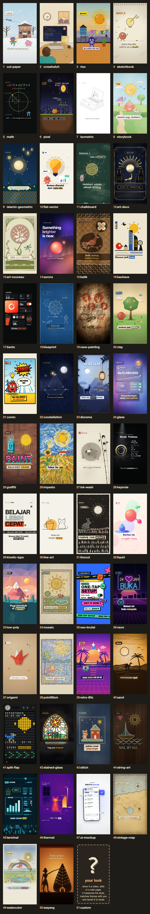

# animate-visual-motion

**Video animasi prosedural yang dibuat sepenuhnya dengan kode, dalam 50 gaya. Skill untuk Claude Code.**

Minta Claude membuat video penjelasan, sejarah, cerita pendek, atau reel peluncuran produk. Claude akan bertanya beberapa hal dan meminta persetujuanmu tiga kali (cerita → tampilan → storyboard). Setelah itu ia menggambar setiap frame di satu `<canvas>`, menyusun musik sintesis, lalu merender MP4 dengan browser headless dan ffmpeg. Hasilnya deterministik: piece yang sama selalu menghasilkan video yang sama.

🇬🇧 [Read in English](README.md)



---

## Mulai cepat

```bash
# 1. toolchain render (sekali per komputer)
npm i -g playwright && npx playwright install chromium
brew install ffmpeg          # macOS, lihat Prasyarat untuk Windows / Linux
```

```
# 2. di dalam Claude Code
/plugin marketplace add frapay/animate-visual-motion
/plugin install animate-visual-motion@animate-visual-motion
```

```
# 3. buka sesi baru, lalu minta
/animate-visual-motion:animate-visual-motion video 30 detik sejarah sepeda, gaya cut paper
```

Kamu juga bisa langsung menulis permintaan biasa, misalnya "buatkan video animasi penjelasan cara kerja DNS dengan gaya chalkboard". Claude akan memakai skill ini dengan sendirinya.

---

## Prasyarat

| apa | untuk | cara pasang |
|---|---|---|
| [Claude Code](https://code.claude.com) | menjalankan skill | lihat dokumentasi Claude Code |
| **Node 18+** | tools build, render, review | [nodejs.org](https://nodejs.org) · `brew install node` |
| **Playwright + Chromium** | merender frame di browser headless | `npm i -g playwright && npx playwright install chromium` |
| **ffmpeg** di `PATH` | menyusun MP4 | macOS `brew install ffmpeg` · Ubuntu/Debian `sudo apt install ffmpeg` · Windows `winget install ffmpeg` |
| Python + `faster-whisper` *(opsional)* | mencatat waktu tiap kata voice-over | `pip install faster-whisper` |
| Connector ElevenLabs *(opsional)* | membuat voice-over di Claude | Claude → Settings → Connectors |

Cek semuanya sekaligus dari hasil clone repo ini:

```bash
bash scripts/doctor.sh
```

---

## Instalasi

Pilih **salah satu**.

### A. Plugin Claude Code (disarankan)

Di Claude Code:

```
/plugin marketplace add frapay/animate-visual-motion
/plugin install animate-visual-motion@animate-visual-motion
```

Atau dari terminal:

```bash
claude plugin marketplace add frapay/animate-visual-motion
claude plugin install animate-visual-motion@animate-visual-motion
```

Buka sesi baru. Skill dipanggil dengan `/animate-visual-motion:animate-visual-motion`. Pembaruan cukup lewat `/plugin update`.

### B. Script instalasi

Script ini menyalin skill ke `~/.claude/skills/animate-visual-motion`, sehingga skill dipanggil dengan `/animate-visual-motion`. Bisa dipakai di macOS, Linux, WSL, dan Git Bash.

```bash
curl -fsSL https://raw.githubusercontent.com/frapay/animate-visual-motion/main/install.sh | bash
```

Atau dari hasil clone:

```bash
git clone https://github.com/frapay/animate-visual-motion.git
cd animate-visual-motion
bash install.sh            # tambah --deps untuk sekalian memasang Playwright + Chromium
```

| flag | fungsi |
|---|---|
| `--project` | memasang ke `./.claude/skills/` di folder saat ini (ikut terbagi ke semua yang bekerja di proyek itu) |
| `--deps` | sekalian menjalankan `npm i -g playwright && npx playwright install chromium` |
| `--uninstall` | menghapus skill yang terpasang |

### C. Salin manual

Salin folder `plugins/animate-visual-motion/skills/animate-visual-motion/` ke folder skills:

```bash
# macOS / Linux
git clone https://github.com/frapay/animate-visual-motion.git
cp -R animate-visual-motion/plugins/animate-visual-motion/skills/animate-visual-motion ~/.claude/skills/
```

```powershell
# Windows (PowerShell)
git clone https://github.com/frapay/animate-visual-motion.git
Copy-Item -Recurse animate-visual-motion\plugins\animate-visual-motion\skills\animate-visual-motion "$env:USERPROFILE\.claude\skills\"
```

### D. Upload ke claude.ai (eksperimental)

```bash
bash scripts/package-claude-ai.sh              # → dist/animate-visual-motion.zip
bash scripts/package-claude-ai.sh --no-samples # zip lebih kecil, tanpa gambar contoh gaya
```

Upload zip-nya di claude.ai → Settings → Capabilities → Skills. Proses render butuh Node, Playwright, Chromium, dan ffmpeg di sandbox eksekusi kode Claude, dan sandbox itu perlu akses internet untuk memasangnya. Setup yang sudah teruji adalah Claude Code di komputer sendiri.

---

## Cara pakai

```
/animate-visual-motion video 45 detik sejarah sepeda, gaya cut paper
/animate-visual-motion cara kerja hash map, gaya math
/animate-visual-motion cerita rakyat Timun Mas, gaya wayang, narasi bahasa Indonesia
/animate-visual-motion reel peluncuran 20 detik untuk https://produkku.com, gaya keynote, vertikal dan kotak
/animate-visual-motion motif batik untuk opening acara, 15 detik, 16:9
```

(Kalau dipasang sebagai plugin, gunakan `/animate-visual-motion:animate-visual-motion`.)

Piece dibuat di proyek **kamu** di `pieces/<nama>/`. Video jadinya ada di `pieces/<nama>/renders/share.mp4`.

Coba demo salah satu gaya dulu:

```bash
SKILL=~/.claude/skills/animate-visual-motion
cp -R $SKILL/styles/wayang/demo pieces/coba-wayang
node $SKILL/tools/export.mjs pieces/coba-wayang --share
```

Daftar lengkap 50 gaya ada di [README bahasa Inggris](README.md#styles) dan di [styles/README.md](plugins/animate-visual-motion/skills/animate-visual-motion/styles/README.md).

---

## Update dan uninstall

| dipasang lewat | update | uninstall |
|---|---|---|
| plugin | `/plugin update animate-visual-motion@animate-visual-motion` | `/plugin uninstall animate-visual-motion@animate-visual-motion` |
| script | jalankan one-liner lagi | `bash install.sh --uninstall` |
| salin manual | salin ulang foldernya | hapus `~/.claude/skills/animate-visual-motion` |

Piece-mu tersimpan di proyekmu sendiri, jadi memperbarui atau menghapus skill tidak akan menyentuhnya.

---

## Kalau ada masalah

| masalah | solusi |
|---|---|
| Skill tidak muncul | Buka sesi Claude Code **baru** setelah instalasi. Pastikan `~/.claude/skills/animate-visual-motion/SKILL.md` ada (script/manual), atau jalankan `claude plugin list` (plugin). |
| `Cannot find module 'playwright'` | `npm i -g playwright` |
| `Executable doesn't exist … chromium` | `npx playwright install chromium` |
| `ffmpeg: command not found` | Pasang ffmpeg, lalu buka terminal baru supaya `PATH` diperbarui. |
| Waktu kata voice-over cuma perkiraan | `pip install faster-whisper`. Untuk naskah bahasa Indonesia, skill memakai `--model small`. |
| Lainnya | Jalankan `bash scripts/doctor.sh`, lalu [buka issue](https://github.com/frapay/animate-visual-motion/issues). |

---

## Kredit dan lisensi

Repo ini adalah fork dari [**cth9191/animate**](https://github.com/cth9191/animate), skill animasi Claude Code aslinya (grammar cerita, kit, tools, dan gaya-gaya awal). Fork ini mengganti nama skill menjadi `animate-visual-motion` dan menambah katalog menjadi 50 gaya, termasuk gaya Indonesia (wayang, batik), sejarah poster, kerajinan, dan peluncuran produk.

MIT. Lihat [LICENSE](LICENSE).
