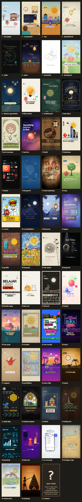

# animate-visual-motion

**Procedural animated videos, made entirely in code, in 50 styles — a skill for Claude Code.**

Ask Claude for an explainer, a history, a little story or a product launch reel. It walks you through a few questions and three quick check-ins (story → look → storyboard), then draws every frame on one `<canvas>`, composes a synthesized score, and renders an MP4 with a headless browser and ffmpeg. Every piece is deterministic, so the same piece always renders the same video.

🇮🇩 [Baca dalam Bahasa Indonesia](README.id.md)



---

## Contents

- [Quick start](#quick-start)
- [Requirements](#requirements)
- [Install](#install): [plugin](#option-a--claude-code-plugin-recommended) · [script](#option-b--install-script) · [manual](#option-c--manual-copy) · [claude.ai](#option-d--claudeai-upload-experimental)
- [Use](#use)
- [Styles](#styles)
- [How it works](#how-it-works)
- [Update and uninstall](#update-and-uninstall)
- [Troubleshooting](#troubleshooting)
- [Credits and license](#credits-and-license)

---

## Quick start

```bash
# 1. the render toolchain (once per machine)
npm i -g playwright && npx playwright install chromium
brew install ffmpeg          # macOS — see Requirements for Windows / Linux
```

```
# 2. inside Claude Code
/plugin marketplace add frapay/animate-visual-motion
/plugin install animate-visual-motion@animate-visual-motion
```

```
# 3. start a new session and ask
/animate-visual-motion:animate-visual-motion a 30-second history of the bicycle, cut paper
```

You can also just describe what you want ("make me an animated explainer of how DNS works in the chalkboard style") — Claude picks the skill up on its own.

---

## Requirements

| what | why | install |
|---|---|---|
| [Claude Code](https://code.claude.com) | runs the skill | see the Claude Code docs |
| **Node 18+** | build, render and review tools | [nodejs.org](https://nodejs.org) · `brew install node` |
| **Playwright + Chromium** | renders frames in a headless browser | `npm i -g playwright && npx playwright install chromium` |
| **ffmpeg** on your `PATH` | encodes the MP4 | macOS `brew install ffmpeg` · Ubuntu/Debian `sudo apt install ffmpeg` · Windows `winget install ffmpeg` |
| Python + `faster-whisper` *(optional)* | times every word of a voice-over | `pip install faster-whisper` |
| ElevenLabs connector *(optional)* | generates the voice-over in Claude | Claude → Settings → Connectors |

Check everything at once from a clone of this repo:

```bash
bash scripts/doctor.sh
```

---

## Install

Pick **one** option.

### Option A — Claude Code plugin (recommended)

In Claude Code:

```
/plugin marketplace add frapay/animate-visual-motion
/plugin install animate-visual-motion@animate-visual-motion
```

Or from your terminal:

```bash
claude plugin marketplace add frapay/animate-visual-motion
claude plugin install animate-visual-motion@animate-visual-motion
```

Start a new session. The skill is called `/animate-visual-motion:animate-visual-motion`. Updates come with `/plugin update`.

### Option B — install script

Copies the skill to `~/.claude/skills/animate-visual-motion`, so it is called `/animate-visual-motion`. Works on macOS, Linux, WSL and Git Bash.

```bash
curl -fsSL https://raw.githubusercontent.com/frapay/animate-visual-motion/main/install.sh | bash
```

Or from a clone:

```bash
git clone https://github.com/frapay/animate-visual-motion.git
cd animate-visual-motion
bash install.sh            # add --deps to also install Playwright + Chromium
```

| flag | does |
|---|---|
| `--project` | installs into `./.claude/skills/` of the current folder (shared with everyone who works in that project) instead of your home folder |
| `--deps` | also runs `npm i -g playwright && npx playwright install chromium` |
| `--uninstall` | removes the installed skill |

### Option C — manual copy

Copy the skill folder `plugins/animate-visual-motion/skills/animate-visual-motion/` into your skills folder:

```bash
# macOS / Linux
git clone https://github.com/frapay/animate-visual-motion.git
cp -R animate-visual-motion/plugins/animate-visual-motion/skills/animate-visual-motion ~/.claude/skills/
```

```powershell
# Windows (PowerShell)
git clone https://github.com/frapay/animate-visual-motion.git
Copy-Item -Recurse animate-visual-motion\plugins\animate-visual-motion\skills\animate-visual-motion "$env:USERPROFILE\.claude\skills\"
```

### Option D — claude.ai upload (experimental)

```bash
bash scripts/package-claude-ai.sh              # → dist/animate-visual-motion.zip
bash scripts/package-claude-ai.sh --no-samples # smaller zip, without the style preview images
```

Upload the zip in claude.ai → Settings → Capabilities → Skills. Rendering needs Node, Playwright, Chromium and ffmpeg inside Claude's code-execution sandbox, and the sandbox needs network access to install them. Claude Code on your own machine is the tested setup.

---

## Use

```
/animate-visual-motion a 45-second history of the bicycle, cut paper
/animate-visual-motion how a hash map works, in the math style
/animate-visual-motion a short about our API in the style of these screenshots: ./refs/
/animate-visual-motion a 20s launch reel for https://my-product.com, cut to ./audio/song.mp3, vertical and square
/animate-visual-motion a narrated 45s explainer of how DNS works, chalkboard, 16:9, voice from ElevenLabs
```

(With the plugin install, use `/animate-visual-motion:animate-visual-motion`.)

Pieces are created in **your** project under `pieces/<name>/`; the finished video is `pieces/<name>/renders/share.mp4`.

You can drive the tools yourself too:

```bash
SKILL=~/.claude/skills/animate-visual-motion      # or the plugin's install path
node $SKILL/tools/gallery.mjs styles.png          # contact sheet of every style
node $SKILL/tools/build.mjs pieces/my-piece       # → pieces/my-piece/index.html (open it to preview)
node $SKILL/tools/still.mjs pieces/my-piece 2.5,9,14 frames.png --scale 0.5
node $SKILL/tools/storyboard.mjs pieces/my-piece
node $SKILL/tools/export.mjs pieces/my-piece --share --formats 9:16,1:1,16:9
node $SKILL/tools/review.mjs pieces/my-piece
```

Try a style's demo first: `cp -R $SKILL/styles/wayang/demo pieces/wayang-test && node $SKILL/tools/export.mjs pieces/wayang-test --share`.

---

## Styles

50 built-in styles. Each one has its rules and frame checklist (`STYLE.md`), a drawing kit (`kit.js`), a preview (`sample.png`) and a small demo piece. The full table is in [styles/README.md](plugins/animate-visual-motion/skills/animate-visual-motion/styles/README.md).

| group | styles |
|---|---|
| **Paper & print** | cut-paper · riso · linocut · origami · diorama · split-flap · vintage-map |
| **Drawn & painted** | crosshatch · sketchbook · storybook · watercolor · ink-wash · impasto · pointillism · chalkboard · line-art · comic · sand · cave-painting |
| **Craft & material** | clay · stitch · string-art · mosaic · stained-glass |
| **Indonesian & Islamic** | wayang · batik · islamic-geometric |
| **Poster & design history** | bauhaus · art-deco · art-nouveau · retro-80s · neo-brutal · graffiti |
| **Graphic & motion design** | flat-vector · kinetic-type · liquid · low-poly · isometric · blueprint · math · constellation · thermal |
| **Screen & tech** | pixel · terminal · neon · glass · aurora |
| **Product launch** | keynote · bento · ui-mockup |

**Your own look:** give the skill references (a video, stills, a web page). It measures palette, line weight, texture, motion and cut rhythm, draws matched frames next to your references, and saves the result as a new style in your project. Reference media stays on your machine.

---

## How it works

| step | what you see | you decide |
|---|---|---|
| 0. Intake | a few questions (subject, formats, voice, look, music, product) and the style gallery | answers, a style, or your references |
| 1. Story check | the story format and a numbered beat table, with facts web-checked | approve / change beats |
| 2. Look check | 2–4 full-size style frames | thumbs up per frame |
| 3. Storyboard | every beat as a key frame, with its sound and transition | thumbs up/down per panel |
| 4. Build | Claude animates, renders and reviews | — |
| 5. Delivery | the video plus measured checks (cuts on the beat grid, loudness, text cut off, narration pace) | notes for a revision |

What's inside the skill:

- `SKILL.md`: the workflow Claude follows
- `grammar/`: 8 short-form story formats and the rules for a strong key frame
- `kit/`: seeded randomness, hand-drawn lines, cameras, shape-morph transitions, springs, a synthesizer and loudness stage
- `tools/`: build, still, tile, storyboard, export, review, gallery, beat-mapping for your own music, site capture, voice-over timing
- `templates/`, `examples/`: starter pieces and a full 60-second worked example

Optional extras: a **voice-over** (ElevenLabs connector or your own recording, timed word by word), **your own music** (cuts land on the song's beats), **your real product** (screenshots of your site animated inside the style), and **every format from one piece** (9:16, 1:1, 4:5, 16:9).

---

## Update and uninstall

| installed with | update | uninstall |
|---|---|---|
| plugin | `/plugin update animate-visual-motion@animate-visual-motion` | `/plugin uninstall animate-visual-motion@animate-visual-motion` |
| install script | run the one-liner again | `bash install.sh --uninstall` |
| manual copy | copy the folder again | delete `~/.claude/skills/animate-visual-motion` |

Your pieces live in your projects, so updating or removing the skill never touches them.

---

## Troubleshooting

| problem | fix |
|---|---|
| The skill doesn't show up | Start a **new** Claude Code session after installing. Check that `~/.claude/skills/animate-visual-motion/SKILL.md` exists (script/manual), or run `claude plugin list` (plugin). |
| `Cannot find module 'playwright'` | `npm i -g playwright`. The tools look in the project's `node_modules` first, then the global one. |
| `Executable doesn't exist … chromium` | `npx playwright install chromium` |
| `ffmpeg: command not found` | Install ffmpeg and open a new terminal so `PATH` is refreshed. |
| Voice-over word times look estimated | `pip install faster-whisper`. For non-English scripts (e.g. Indonesian), the skill passes `--model small`. |
| Render is slow | Normal for long pieces: every frame is drawn in a real browser. Use `export.mjs --only-audio` while you iterate on the mix. |
| Anything else | `bash scripts/doctor.sh`, then [open an issue](https://github.com/frapay/animate-visual-motion/issues). |

---

## Credits and license

This is a fork of [**cth9191/animate**](https://github.com/cth9191/animate), the original Claude Code animation skill: the story grammar, kit, tools and the first styles. This fork renames the skill to `animate-visual-motion` and grows the catalogue to 50 styles, including Indonesian (wayang, batik), poster-history, craft and product-launch looks.

MIT. See [LICENSE](LICENSE).
