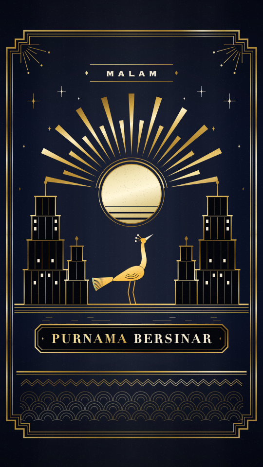

# Art Deco

A 1920s–30s poster or theatre card. A deep lacquered ground (black-navy, emerald or oxblood, with a soft vertical sheen and fine grain) carries metallic gold linework: sets of parallel hairlines beside one heavier line, sunburst fans, stepped towers, scallop repeats, chevrons, nested octagons and diamonds, slender arches, fountains, palm and lotus leaves, a moon disc, a round lantern. The whole sheet is mirrored about its vertical centre line and sits inside an ornate double-line frame with stepped corners and corner fans. Gold is never flat: every gold stroke and fill is painted with a banded metal pattern, and a narrow glint sweeps across it. Solid shapes are few and flat: dark silhouettes edged in gold. Type is tall caps, tracked wide. Motion on 1s, eased in and out, no bounce.

Pick it for elegant openers, awards and announcements, Ramadan / Eid greetings (crescent, lanterns, arches, stars), quotes and title cards. Not for busy explainers, UI, charts, or anything cute and squashy.

**The one rule: everything is mirrored about the centre line, and everything arrives by being drawn.** Lines run from the middle outward on both sides at once, fans open like a hand fan, towers rise tier by tier, rays go out one after another, the frame closes in from its corners. The hero is the only thing that is not symmetric, which is why the eye finds it.

## Palette and meaning (`DEC` in kit.js)

| role | hex | use |
|---|---|---|
| morph paper | `paper #07080e` | the black lacquer a morph happens on |
| grounds | `night #0a1024`, `emerald #0a3a30`, `oxblood #3b0e18` | one per era: black-navy ("before", night), emerald ("after", light, gardens), oxblood (gala, awards) |
| silhouettes | `ink #04050a`, `plaque #05060b` | towers, basins, leaves, plinths; the caption plaque (opaque) |
| **gold** | `gold #d4a94a` (bands from `goldD #8a6426` to `goldL #fff1c4`) | all linework, ornaments, frame, caption text. Passed as `'gold'` it is the metal pattern, not a flat colour |
| **hero** | `amber #f6b63c` (metal `'amber'`) | Bangau, the crane. Reserved for the hero |
| moon | `moon #ead9a0` (metal `'pale'`) | moon and sun discs, crescents |
| ivory | `cream #f4ead2` | tags, the highlighted word, lit windows, water, the beak, gem highlights |
| jewel | `teal #3fbcae`, `emer #2fa07a` | one jewel tone per piece: leaf veins, tail eyes, the highlighted word (teal on navy / emerald, emerald on oxblood) |

A frame is one ground + gold + ivory + at most one jewel tone, with the amber spent only on the hero. Morph between pale and warm golds (moon -> lantern): the blend stays a believable metal.

## Line, metal, texture and type

- **Three weights** (`DEC_W`): hairline 2.2 px, mid 3.6 px, heavy 6 px at 1080 wide. All strokes divide by the camera zoom, so the engraving never thickens. Corners are sharp (mitre joins, butt caps); curves are arcs of circles.
- **The motif** (`decRules`): one heavy line with 1–3 hairlines beside it, 9–10 px apart. Used for the horizon, the frame, arches, dividers.
- **Metal** (`decMetal`): an 8 x 520 px gradient tile (bronze -> gold -> champagne -> gold -> deeper gold -> gold -> pale -> bronze), repeated and tilted -16°, used as the stroke / fill style in world space. So a long line changes tone along its length and a wide fill shows bands. Three metals: `'gold'`, `'amber'`, `'pale'`.
- **Glint** (`DEC_GLINT`): a tilted light band 160 px wide that crosses the frame in 1.3 s every 3 s (from 1.2 s). It is stroked / filled a second time over each gold path, so it only ever shows on gold.
- **Silhouettes** (`decShape`): a flat dark fill, a gold edge, optionally hairlines inset inside. No gradients on solids except the lantern's glow.
- **Ground** (`decGround`, `STYLE.backdrop`): flat colour + a cached sheen (a broad soft light column on the centre line, four faint side bands, darker top and bottom). `STYLE.post` lays a cached static grain (light and dark specks) and a vignette over everything.
- **Type:** `DEC_SERIF` = `"Didot", "Bodoni 72", "Playfair Display", "Bodoni MT", "Didot LT STD", Georgia, "Times New Roman", serif` (captions, titles) and `DEC_SANS` = `"Copperplate", "Optima", "Gill Sans", "Century Gothic", "Gill Sans MT", "Trebuchet MS", "DejaVu Sans", sans-serif` (tags). Weight 700, all caps, tracking 0.14 em (captions) and 0.36 em (tags), set letter by letter. Captions 54 px (shrinks to fit 660 px), tags 40 px.

## Motion habits

- On 1s (`ones: true`). Everything eases in and out (`EZ.io`); nothing overshoots, pops or shakes.
- **Draw-on by path progress:** `p` on every line helper; `from: 'mid'` runs it outward both ways. Hairlines of a rule set trail the heavy line by ~12% each.
- **Fans open like a hand fan** (`open`: the rays spread from the middle ray), then **rays extend in sequence** from the middle outward (`ext`).
- **Towers rise tier by tier** (`rise`), one tier per 8th note; windows come on afterwards (`lit`).
- **The frame closes in from its four corners** (`decFrame` `p`), corner fans opening with it.
- **Idle life:** gems twinkle (a slow pulse and a cross-flare at the peak), water shimmer is re-dealt four times a second, fountain water runs along its arcs in a loop, lantern light breathes, the glint sweeps, the crane's neck and crest sway a hair.
- **Captions:** the plaque opens from its middle, then the letters appear from the middle outward. Plaque and tag close as a bridge starts and reopen after it.
- **Camera:** a very slow push only (3–4% over an era). No pans, no bumps.
- **Morph:** on black lacquer the medallion keeps its double gold rim while its outline and colour change, and a sunburst of 32 rays flares around it at the midpoint; the window is the same double rim with short rays.

## Frame checklist (on top of grammar/FRAME.md)

1. **Mirror test:** fold the frame on the centre line; everything but the hero matches. Props come in pairs through `decMirror`.
2. **A frame holds the sheet:** the double-line border with stepped corners is present, and nothing important touches it.
3. **Gold reads as metal at phone size:** tone bands are visible along the long lines, and at least one heavy line sits beside hairlines.
4. **One ground, deep and calm:** at least 40% of the safe area is bare lacquer. No second ground colour, no photographic gradients.
5. **Solids are dark silhouettes edged in gold** (or the gold disc / lantern / hero). No coloured flat shapes.
6. **Amber is the hero's.** The crane stands clear of other gold (bare ground or a dark opening behind it).
7. **Text is tall tracked caps:** a tag between two hairlines at the top, one caption on its opaque plaque (inside x 140–940, y 250–1500) with exactly one word in cream or teal. Nothing crosses the tag or the plaque.
8. **Something is being drawn, opened or lit** in every beat, plus two or three idle details (twinkle, water, glint).
9. **Bridge objects are round medallions of similar size,** clear of everything else at the bridge time.

## Kit API (`kit.js`, on top of `kit/core.js`)

Needs `CX` from the piece head (the centre line; `W / 2` if absent). Colour arguments take `'gold'`, `'amber'`, `'pale'` (metals), a `DEC` key (`'cream'`, `'teal'`…) or any CSS colour.

- Palette and constants: `DEC`, `DEC_W { hair, mid, heavy }`, `DEC_GLINT { every, at, dur, w, al, tilt }` (`every: 0` = off), `DEC_SERIF`, `DEC_SANS`, `DEC_METALS`.
- Basics: `decAX()`, `decZoom()`, `decMemo(key, make)`, `decMirror(fn, ax)` (calls `fn(1)` then `fn(-1)` mirrored), `decRGB(c)`, `decMix(a, b, u)`, `decTone(c, k)`, `decA(c, alpha)`, `decCentroid(P)` (hex or `rgb()` in).
- Metal: `decMetal(kind)`, `decInk(c)`, `decIsMetal(c)`, `decGlint()`, `decStrokeNow(c, w, { al, cap, join, glint })`, `decFillNow(c, { al, glint })` (both act on the current path).
- Geometry: `decPoly(P, closed)`, `decSub(P, a, b)`, `decOffset(P, d, closed)`, `decInset(P, d)`, `decArea(P)`, `decCirclePts(x, y, r, n)` (starts at the bottom), `decNgon(x, y, rx, n, rot, ry)`, `decChamfer(x, y, w, h, c)`, `decLeafPts(x, y, len, wid, ang, n)`, `decStepPts(x, base, w, h, n, top)`, `decArchPts(x, base, w, h, kind, n)`, `decCrescentPts(x, y, r, { to, bite, inner })`.
- Primitives: `decLine(P, { c, w, p, from: 'start' | 'mid' | 'end', closed, al, cap, join })`, `decRules(P, { n, gap, heavy, hair, side, p, from, c })`, `decShape(P, { fill, edge, w, inset: [px…], p, from, al })`.
- Ground: `decGround(c)`, `decSheen()`, `decLens()` (cached overlays).
- Ornaments: `decFan(x, y, r, { r0, n, mid, span, open, ext, wedge, alt, fat, rim, tips, c, w, al })`, `decZig(x, base, w, h, { tiers, rise, fill, lit, spire, pitch, key, c })`, `decSteps(x, base, w, h, { steps, top, fill, c, rise })`, `decScallops(x0, y0, w, h, { s, rings, c, al, p })` (cached), `decChevrons(x, y, w, { s, h, n, gap, up, p, c, w, al })`, `decOct(x, y, r, { n, gap, sides, rot, sq, fill, p, c, al })`, `decDiamond(x, y, r, { ry, … })`, `decGem(x, y, s, { c, key, rate, tw, flare })`, `decArch(x, base, w, h, { kind: 'pointed' | 'round' | 'step', n, gap, p, fill, caps, c })`, `decFountain(x, base, s, { rise, jet, t, fill, c })`, `decLeaves(x, y, len, { n, mid, span, wid, p, fill, c, vein })`, `decPalm(x, base, h, { r, p, … })`, `decLotus(x, y, s, { n, p, fill, c })`, `decDisc(x, y, r, { p, fill, c, ring, bands, ground })`, `decCrescent(x, y, r, { to, bite, inner, c, edge, p })`, `decLantern(x, y, r, { lit, hang, ribs, tassel, glow, ring, key })`, `decShimmer(x, y, { w, rows, gap, c, al, key })`, `decFrame({ x0, y0, x1, y1, notch, p, fans: 'all' | 'top' | 'bottom' | false, fan })`.
- Hero: `decBird(x, y, r, { key, mood: 'calm' | 'wow' | 'bow', neck (-1..1), fan (0..1), feathers, step, tw, c, flip })` — Bangau; (x, y) the body centre, r half its standing height (it stands on y + r); sets `SPARK_AT`. `decBirdPts(x, y, r, n)`.
- Type: `decFont(size, { font: 'serif' | 'sans', weight })`, `decTextW(str, size, o)`, `decText(str, x, y, size, c, { font, weight, track, align, reveal, caps })`, `decRunW(segs, size, o)`, `decRun([{ s, c }…], x, y, size, o)` (one line in several colours).
- Captions (through `DEFER`): `decCaption('words *highlight* words', { y, x, size, maxW, at, c, hi, plaque })`, `decTag('Label', { x, y, size, at, c, half })`; `decBridgeK()` is how open they are through a bridge.
- `STYLE`: `paper` black lacquer, `backdrop` (lacquer + sheen in any colour), `window` (clip + a double gold rim with short rays), `blob` (the medallion with a flaring sunburst), `hero`, `heroColor`, `heroPts`, `post` (grain + vignette), `ones: true`.

## Do / don't

- **Do** build each side once and mirror it with `decMirror`; put single objects on the centre line.
- **Do** animate with `p`, `open`, `ext`, `rise`, `lit`: draw, open, extend, rise, light.
- **Do** keep a stable `key` on towers and gems: windows and twinkle phases are seeded by it.
- **Do** leave the ground bare around the tag and under the plaque; let the dado (chevrons, scallops) fill the strip below the safe area.
- **Don't** use flat `#d4a94a` for gold; pass `'gold'` so it gets the bands and the glint.
- **Don't** bounce, pop, shake or rotate things; no springs, no squash.
- **Don't** break symmetry with anything but the hero, and don't tilt text.
- **Don't** scale an ornament with `ctx.scale` to resize it (line weights stay constant by design); pass a size.
- **Don't** put a second glow or a coloured shape in the frame; the lantern is the only light.
- **Don't** set long captions: about 20 characters at 54 px; below 40 px the serif's hairlines fade on a phone.

## Not matched / known weaknesses

- Built from the genre's conventions, not measured against a specific poster.
- The metal bands are fixed in world space: a moving gold object slides through them (reads as light on metal, but it is not a true reflection).
- The glint is one straight band; it does not follow a shape's form.
- Typefaces come from the system: Didot and Copperplate on macOS; Georgia / Trebuchet elsewhere are plainer and less "Deco".
- The crane is 2D and only faces sideways; it has three neck poses and a tail fan, no walk cycle or flight.
- `decScallops` is cached without the glint; `decInset` is a mitre offset and can fold on very sharp concave corners.
- Captions are single-line. The demo does not loop seamlessly.

## Proven on

Its demo only. `demo/` (6s, 9:16, 120 BPM, 24fps): on black-navy the frame closes in from its corners, the horizon rules run out from the middle, two pairs of stepped towers rise a tier per 8th, the full moon's rim draws on and fills, a sunburst fan opens behind it, stars twinkle, windows come on, and Bangau the crane, asleep with its head down, wakes and looks up — tag "MALAM", caption "PURNAMA *BERSINAR*". At 3.0s the moon becomes a round lantern hanging in a pointed arch on emerald: its rays go out one after another, two side lanterns light, the fountains start and loop, and the crane opens its tail like a fan and bows — tag "CAHAYA", caption "LENTERA PUN *MENYALA*". Tile deterministic; ~20–40 ms/frame (the first frame ~100 ms while the caches fill); review: morph on grid, flat frames none, text PASS, story arc PASS, dead beats PASS, -14.7 LUFS, true peak -3.7 dBFS.
