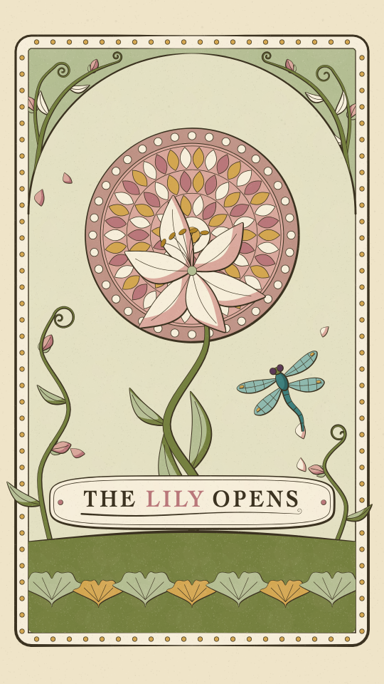

# Art Nouveau

An Art Nouveau lithographic poster from around 1900, printed on cream paper. **Line is the star:** a confident dark olive-brown contour of varying weight — thick on the outside of a form, hair-thin inside it — around flat, muted, slightly chalky colour with at most one soft tonal step, as on a litho stone. Everything is organic: long whiplash S-curves, stems that swell and taper, tendrils ending in tight spirals, lily, iris, poppy and ginkgo forms, a dragonfly, peacock feathers. The composition is architectural: a tall arched panel inside an ornamental border of beads, a large halo disc with a repeating pattern behind the subject, curling foliage in the corner spandrels, a plinth with a frieze, and a lettering cartouche at the bottom. Motion is on 1s, slow and flowing, and the signature move is **growth**.

Pick it for plants, seasons, gardens and nature cycles, perfume / tea / craft subjects, biographies and "portrait in a frame" pieces, anything that should feel graceful, ornamental and unhurried. Not for machines, data, UI, fast comedy or anything that needs straight lines and hard edges.

Different from its neighbours: **art-deco** is metallic gold hairlines on dark lacquer, strictly geometric and mirror-symmetric (fans, steps, chevrons); this is muted colour on cream paper, organic, with no straight-line ornament and no shine. **batik** is cream wax lines on dark cloth with all-over textile repeats; this is a framed poster with dark contours of varying weight and flat colour. **storybook** is watercolour and pencil with a cute character; here colour is flat litho ink and the hero is an ornament-insect, not a character with a face. **stained-glass** has heavy lead lines and glowing panes; this line tapers and nothing is backlit.

**The one rule: every form is a tapered dark contour around flat chalky colour, and every line that is not the panel's own edge is a curve.**

## Palette and meaning (`NOU` in kit.js)

Muted and warm; nothing saturated, nothing metallic, no black, no white.

| role | hex | use |
|---|---|---|
| paper | `paper #efe4c8` | the cream sheet; the ground of the morph |
| **the line** | `line #3b3220` | every contour, vein, tendril, the lettering. Dark olive-brown, never black. |
| light | `cream #f6eeda` | lily petals, the cartouche plate, the border band, beads, spandrel leaves |
| quiet green | `sage #b3bd92` | spandrel flats, leaves, calyxes, panel tints |
| deep green | `olive #75803f` | stems, the plinth, the sage's tonal step |
| the first subject | `rose #d9a79b` / `roseD #b9777a` | the lily's halo, petals, buds / its tonal step, the caption accent |
| warmth | `ochre #d3a650` / `gold #b08428` | the iris's halo, beads, anthers, ginkgo / its tonal step. Old gold is a flat ink, never a shine. |
| **hero** | `teal #3f807d` / `tealL #8fb9ae` | the dragonfly's body / wings; feather eyes, the second panel's foliage |
| depth | `aub #5b3a55` / `mauve #8a6485` / `lilac #b9a0b6` | iris falls and standards, eyes, the feather's core: the darkest flats |

A panel takes **two colour families** (sage + rose, or teal + gold) plus cream and the line; a third family appears only as an accent (the hero, a bud). Panel tints are pale mixes of the family (`#e3e0c2` sage panel, `#d3ddca` teal panel).

## Line, colour and texture

- **Contour** (`nouContour`, used by `nouShape`): a filled ring of varying weight, thickest where the edge faces down-right and thinning to about 40% on the far side. Outer contours of big forms 4–6.5 px, small parts 2–3 px, everything inside a form (veins, midribs, ring hairlines, barbs) 1–1.6 px.
- **Tapered strokes** (`nouRibbon`, `nouStem`): open lines are filled ribbons, thick at the root and tapering to a hair at the tip; a stem with a colour is that colour inside a contour that is heavier on one side.
- **Flat colour with one tonal step** (`nouShape` `shade`): the second flat is the same outline shifted towards the light, so it sits as a crescent on the shadow side. Never a gradient, never two steps.
- **Chalk** (`nouChalk`): every flat is filled once more with a seeded 256 px tile of paper-coloured flecks, so it looks printed from stone. Tiny parts skip it (`chalk: false`).
- **Paper** (`STYLE.post`): a static cached sheet of fine litho grain and a few stone pits. It does not boil: a print holds still.
- **Lettering** (`nouText`): `NOU_FONT` = `"Cochin", "Big Caslon", "Hoefler Text", "Palatino Linotype", "Book Antiqua", "URW Palladio L", "P052", "Georgia", "DejaVu Serif", serif`, bold caps, tracked 0.14 em, stretched 16% taller, in the line colour, with a hand-drawn whiplash underline that ends in a curl (`nouFlourish`). It lives in the cartouche; it never sits on the picture.

## Motion habits

- On 1s (`ones: true`). **Ease-in-out everywhere** (`nouE`, `nouIn`): no bounces, no pops, no overshoot. Typical moves take 0.8–1.6 s and overlap.
- **Growth is the signature.** Stems grow along their path from the root with the thickness swelling behind the tip (`nouStem` `grow`); tendrils curl into their spirals last; leaves and buds unfurl in sequence as the tip passes them; a flower opens petal by petal from a closed bud (`open`); the halo's pattern sets itself ring by ring from the centre, each ring going round (`nouHalo` `in`); a feather's eye opens ring by ring.
- **The print order is visible:** the flat colour of the plate is there first, then the key drawing draws itself — the border climbs from the bottom corners and the halves meet at the top, beads being set as the line passes (`nouPanel` `in`).
- **Leaving is growth in reverse:** before a bridge the flower closes, the stem draws back and the rings empty, so the bridge object is bare.
- **Idle life:** tendril tips sway (`sway`, a slow sine), the dragonfly hovers on a figure-of-eight with beating wings (`nouHover`), petals breathe (`breathe`), petals or ginkgo leaves drift down on S-curves (`nouFall`).
- **Captions:** the cartouche unrolls from its middle, the words are wiped on, the flourish grows under them. It rolls shut as a bridge starts.
- **Camera:** none. It is a printed sheet.

## Frame checklist (in addition to `grammar/FRAME.md`)

1. **The architecture is all there:** bead border, arched panel, two spandrels with foliage, one halo disc with a pattern, a plinth with a frieze, the cartouche. A frame without the halo or the border is not this style.
2. **Line weights are in three tiers** — heavy outer contours, medium small parts, hairlines inside — and every open line tapers. No constant-weight outlines.
3. **Only curves:** apart from the panel's own sides there is no straight line, no zigzag, no step, no fan of rays.
4. **Flat and chalky:** at most one tonal step per form; no gradient, glow, shine, shadow or transparency.
5. **Two colour families per panel** plus cream and the line; the halo contrasts with the subject in front of it (cream lily on rose, violet iris on gold).
6. **Asymmetry inside the frame:** the stem swings off the axis, the two side stems differ in height, the spandrels are cousins (`variant`), the hero sits to one side.
7. **At least two tendrils end in spirals** and something is mid-growth or swaying; two or three idle details are alive.
8. **The cartouche** sits at y ≈ 1335–1485, one short line of caps with one accent word; nothing important passes behind it and nothing else enters that band.
9. **Bridge objects are the halo discs,** bare at the bridge time (rings emptied, subject folded away or not yet grown), of similar size.

## Kit API (`kit.js`, on top of `kit/core.js`)

- Palette, font, geometry: `NOU`, `NOU_FONT`, `NOU_PANEL { x0, x1, y0, y1, r, band, spring, apex }`, `nouPanelGeo(geo)`, `nouArchPts(geo)`.
- Timing: `nouE(u)` (ease-in-out), `nouIn(t0, d)` (eased progress of a move), `nouSeq(open, i, n)` (the i-th of n parts opening in sequence).
- Curves: `nouCurve(C, n, closed)` (smooth curve through control points), `nouWhip(x0, y0, x1, y1, amp)` (a whiplash S), `nouSpiral(Q, { r, turns, dir })`, `nouBend(Q, ang, pow)` (sway), `nouAt(Q, f)` → `[point, heading]`, `nouAdd(P, sharp)`, `nouCentroid`, `nouScaled`.
- The line: `nouRibbon(P, wa, wb, c, tot)` (a stroke of varying weight), `nouContour(P, w, { thin, light, line, sharp })`.
- **Any outline in the medium:** `nouShape(P, { c, shade, sh, w, thin, light, veins, vw, inside(bb), chalk, sharp, line })` — a closed outline as flat chalky colour, one optional tonal step, hairline veins and a varying contour.
- **Any path as a growing stem:** `nouStem(C, { grow, w, tip, taper, swell, c, lw, spiral: { r, turns, dir }, sway, swayPow, raw, leaves: [{ at, side, len, ang, w, kind: 'leaf' | 'bud' | 'ginkgo', c, shade, d, draw(p, heading, u) }] })` → `{ Q, tip, ang, grow, at(f) }`; hang a flower on `tip` / `ang`.
- Outlines: `nouLeafPts(len, w, { bend, s, fat, round, n })` → `{ P, rib }`, `nouPlace(L, x, y, rot, s)`, `nouGinkgoPts(r)`, `nouCartPts(cx, cy, w, h)`, `nouHeroPts(x, y, r)`.
- Motifs: `nouLeaf(x, y, len, rot, o)`, `nouBud(x, y, len, rot, o)`, `nouGinkgo(x, y, r, rot, o)`, `nouLily(x, y, s, { rot, open, breathe, c, shade, anther })`, `nouIris(x, y, s, { rot, open, breathe, c, c2, shade })`, `nouPoppy(x, y, s, { rot, open, breathe, c, shade, eye })`, `nouFeather(C, { grow, s, sway, cols })`.
- Halo: `nouDisc(P, c, { rim, beads, bead, w })` (the bare halo for any outline), `nouHalo(x, y, r, { c, kind: 'floral' | 'mosaic', cols, rings, in, key })`.
- Architecture: `nouPanel({ in, tint, sp, frame, bead, geo })`, `nouSpandrel(side, { in, c, leaf, bud, variant, sway, geo })`, `nouPlinth({ c, y, rise, n, cols, motif(x, y, i), geo })`.
- Idle life: `nouFall(key, n, { box, kind: 'petal' | 'ginkgo', c, shade, s, speed, t0, every })`, `nouHover(key, amp)` → `[dx, dy, tilt]`.
- Hero: `nouDragonfly(x, y, r, { rot, flap, curl, c, wing, key })` — Libel, a dragonfly seen from above: four veined pale-teal wings with ochre spots, a teal thorax, a tapered segmented tail, aubergine eyes. `r` = half its size; `rot` 0 = heading up; sets `SPARK_AT`.
- Lettering: `nouFont(size, weight, track)`, `nouTextW(str, size, o)`, `nouText(str, x, y, size, c, { align, track, tall, reveal, weight, caps })`, `nouFlourish(x0, x1, y, { grow, amp, w, c, curl })`.
- Caption (through `DEFER`): `nouCaption('The *lily* opens', { x, y, w, h, size, hi, c, col, at })` — the cartouche; `*word*` takes the accent colour; shrinks to fit; `nouBridgeK()` is its visibility through a bridge.
- `STYLE`: `paper`, `backdrop` (the bare sheet with the plate's hairline), `window` (a clip inside a band of the bridge colour between two dark contours), `blob` (a bare halo with tendrils that curl out of its edge and back), `hero`, `heroColor`, `heroPts`, `post` (litho grain), `ones: true`.

## Do / don't

- **Do** compose the poster first (border, halo, subject, cartouche) so any frame holds up as a still, then let it grow.
- **Do** root every stem below the plinth's edge or in a corner, and let it swing across the axis in an S.
- **Do** put a pale subject on a mid-tone halo or a dark subject on a light one; the halo's pattern stays small-scale so the flower reads.
- **Do** stagger growth: tip first, leaves behind it, spiral last, flower after the stem arrives.
- **Do** reverse growth to clear a bridge object, and start the next era's growth only after its window has opened.
- **Don't** use straight-line ornament, mirror-perfect symmetry, sunbursts, steps or chevrons (that is art-deco).
- **Don't** use gradients, glows, metallic highlights, drop shadows, transparency, pure black or pure white.
- **Don't** draw a constant-weight outline with `ctx.stroke` around a form; use `nouShape` / `nouRibbon`.
- **Don't** bounce, pop, spring or snap anything; don't move the camera.
- **Don't** give flowers or the hero faces; don't invent an alphabet — lettering is the system serif, tracked and stretched.
- **Don't** set long captions: one line of ≤ ~18 characters at 58 px; longer lines shrink to fit 630 px.

## Not matched / known weaknesses

- Built from the genre's conventions (Mucha's panels, Grasset, period seed-catalogue and magazine covers), not measured from a specific poster. There is no human figure, which is the genre's usual subject.
- The lettering is a tracked, stretched system serif (Cochin on macOS, Palatino Linotype / Book Antiqua on Windows, URW Palladio / DejaVu Serif on Linux), not true Art Nouveau display type; it will look plainer on Windows and Linux.
- The chalk tile and the grain are fixed to the sheet, so a moving form slides under them; faint enough not to swim at phone size.
- `nouContour` offsets along averaged normals: very sharp concave corners can show a small notch; `nouShape` smooths outlines, so pointed tips come out slightly rounded.
- `nouPanel` and `nouSpandrel` take another geometry (`geo`) but were only run with `NOU_PANEL`; `nouStem`'s `draw` leaf hook, `nouWhip` beyond the flourish and `nouText`'s `reveal` were not used in the demo.
- In the demo the first era has only ~1.3 s between "fully grown" and "folding away": a real piece should give a panel 4 s or more. The demo does not loop seamlessly.
- The flat colour of the plate is on screen before the border has drawn itself (the print-order idea); on the very first frames the panel therefore has no outline.

## Proven on

Its demo only. `demo/` (6s, 9:16, 120 BPM, 24fps): the border climbs from the bottom corners and meets at the top while a rose halo sets its petal rings; a lily stem grows up a whiplash curve, leaves unfurl, the flower opens petal by petal, side tendrils curl into spirals and sway, petals drift down, the dragonfly glides in and hovers. The lily folds away and the rings empty; at 3.0 s the bare rose halo morphs into a gold one. A mosaic sets itself ring by ring, sword leaves and an iris rise, the falls drop and the standards lift, two peacock feathers open their eyes, ginkgo leaves drift down over a poppy frieze, and the dragonfly loops once. Deterministic, ~25 ms per frame, `review.mjs` passes every check.
