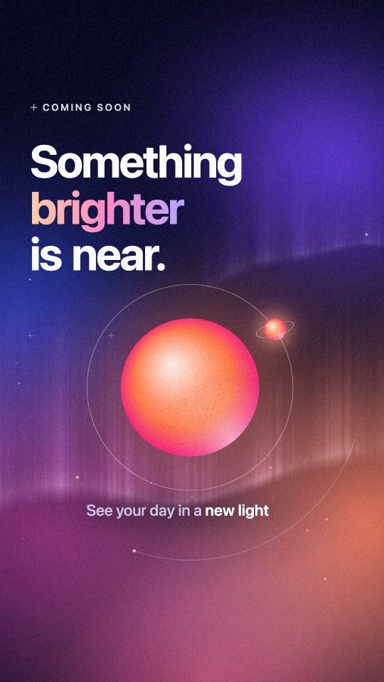

# Aurora

The grainy gradient-mesh brand film: the hero of a modern app or SaaS launch page, in motion. **The gradient itself is the picture.** A deep ground (ink navy or near-black, or off-white in the light preset) carries a mesh of four to six huge, heavily blurred colour fields that drift, breathe and turn; aurora ribbons, soft curtains of light with vertical rays, bend across it like silk; a visible film grain lies over everything, which is what makes the gradients read as designed rather than as banding. The only objects are soft 3D gradient orbs and flat gradient rings, shaded by the mesh's own colours with a grainy terminator. The only structure is 1.5 px hairline circles, arcs and tiny plus marks. The only type is very large, tight, clean sans in white (ink on the light preset), optionally with one word filled by the gradient. Most of the frame is empty.

Pick it for product launches, teasers and "now available" payoffs, app and SaaS brand films, feature announcements, event openers, keynote title cards, anything that should feel premium, calm and new with almost no content. Not for explanations that need diagrams, characters, UI, data or many words; not for stories with a place or a plot; not for anything that should feel handmade.

**The one rule: nothing in the frame has a hard-edged flat fill except the type and one pill. If you want to show a thing, show light.**

## Palette (`AUR.presets` in kit.js)

| preset | ground | deep | fields `cols[0..4]` | gradient word `grad` | ink / sub |
|---|---|---|---|---|---|
| `dusk` | `#0b0b2a` navy | `#05051a` | violet `#6d3bff`, magenta `#e0409a`, orange `#ff7a3d`, blue `#3147e8`, rose `#ff5470` | `#ffd0a1` → `#ff8ac6` → `#b9a6ff` | `#ffffff` / `#d6d2f5` |
| `mint` | `#06131a` near-black | `#02070b` | teal `#10c8a6`, lime `#b4ef3a`, sky `#2f9dff`, deep teal `#0c7c92`, pale mint `#62f0c6` | `#e2ff9a` → `#7df5d3` → `#9ad4ff` | `#ffffff` / `#cfeee8` |
| `dawn` (light) | `#f6f0e9` off-white | `#e9dfd6` | peach `#ffab82`, rose `#ff86ad`, lilac `#b49cff`, apricot `#ffd08f`, sky `#8cc2ff` | `#ff6a3a` → `#ee3f8c` → `#7350ee` | `#15142e` / `#4f4b6b` |

- Other constants: `AUR.paper #07081c` (the blank sheet a morph happens on), `AUR.hero #ff8a5c` (the hero orb).
- On the dark presets the fields are **screened** onto the ground (light adds up); on `dawn` they are laid on normally (pigment on paper), ribbons and glows too, and the type and the pill turn ink.
- A field is one radial falloff, alpha 0.4–0.95 at its centre, radius 420–800 px (40–75% of the frame width), stretched 1.05–1.5× along one axis. Five of them cover the frame; where two overlap they make the third colour, which is the point.
- An object has **one** colour (`c`); its light side is that colour mixed 42% to white, its shade is the same colour with the hue turned −52° and the lightness down 0.17 (orange shades to magenta, mint to green-yellow), its bounce light is the hue turned +165°. So an orb never needs more than one hex, and the morph can blend two orbs as two hexes.
- Type is one family (`AUR_SANS`: the system UI sans with fallbacks), weight 700, letter-spacing −3.5% of the size, line height 1.02; small labels are weight 600 caps tracked +20%.
- Keep to one preset per era and at most one extra accent (the hero).

## How the medium is built

- **The mesh** (`aurMesh`): the ground (a diagonal gradient from `deep` to `ground`), then the fields, then two **silk folds** (wide soft bands of the deep colour laid across the colour at a slant, drifting: they give the mesh its depth), then a corner vignette. All of it is drawn on a scratch canvas at 1/6 size that covers the world plus a 180 px margin, and scaled up smoothly: that is the blur. No `ctx.filter`, no `shadowBlur`.
- **Ribbons** (`aurRibbon`): an open path is smoothed, resampled every 6 px and drawn as vertical strips, each a gradient with a bright hem on the path and a ray fading away from it (440–560 px). Each ray has a fixed seeded brightness and the rays crawl sideways, so the curtain has striation; the path undulates on two sine waves. Drawn at 1/3 size and scaled up, so the rays stay soft.
- **Bodies** (`aurBody`, `aurOrb`): a crisp outline filled with an off-centre radial gradient (light from the upper left), a bounce light screened onto the far limb, 2,000–6,000 fixed 1–2 px specks of light and shade concentrated on the terminator, a soft specular, and a glow of the body's colour behind it. Rings (`aurRing`) are a conic sweep of three or four colours that turns, with a shaded inner edge and a lit outer one; `half: 'back' | 'front'` lets an orb sit inside one.
- **Structure**: hairlines are 1.5 px whatever the camera does (widths are divided by the zoom), alpha 0.2–0.5, sometimes dashed 3/12, sometimes with a 4.5 px dot riding them; plus marks are 8–9 px arms on a 220 px grid, twinkling slowly; dust is 1.6–4 px motes that rise and fade.
- **Grain** (`STYLE.post` → `aurGrain`): three seeded 256 px tiles of ±1 luminance noise, drawn at 2 px per grain, alpha 0.08, a different one every boil step (two frames). The cycle is three placements long on purpose: a video encoder finds each placement again a few frames back. Grain that never repeats doubled the demo's file (24 MB against 12 MB); no grain at all is 5.5 MB, and banded.
- **Type** draws after the camera at screen size (through `DEFER`), over a soft veil of the ground colour (alpha 0.34) that keeps it readable wherever the mesh has drifted, and fades out 0.2 s before a bridge and back in after it.

## Motion habits

- On 1s (`ones: true`), slow and floaty. Nothing snaps and nothing bounces hard: `aurIn(t0, d)` (ease in-out, 0.8–1.3 s), `aurRise(t0, a, b)` (a heavy, barely overshooting spring for orbs that rise and settle), `aurFloat(key, amp)` (the idle drift of anything that hangs in space).
- **The mesh never holds still:** every field wanders ±120 px on its own slow sine, breathes ±7% and turns; the whole mesh turns about 2° a second; the folds slide.
- **Ribbons undulate** and their rays crawl; a ribbon can unroll from one end (`frac`).
- **Objects arrive from below and settle**, then float a few pixels. Hairline orbits draw on round them over about a second; a dot rides the line as it draws. A small satellite (the hero) circles on an orbit, or rides a ring and passes behind the orb.
- **Headlines arrive word by word:** each word rises 30% of its size and comes out of a soft blur over 0.7 s, 0.14–0.25 s apart (put the stagger on the 8th-note grid). The pill settles in last on a soft spring.
- **Camera:** one slow push per era (z 1 → 1.06 over the era, centred on the object). No pans, no cuts on the beat.
- **Bridges:** the old era dims while it is seen through a feathered round opening that closes onto the orb; on the dimmed mesh the orb turns from one colour to the other inside two breathing hairline orbits (the kit keeps the blend saturated half way, so orange to mint passes through lime, not grey); the new era opens out of it.
- **Sound** is air: wide pads, soft bell notes where words land, breath-like noise for ribbons, one deep soft note at the turn.

## Frame checklist (in addition to `grammar/FRAME.md`)

1. **Squint test: it is a gradient, not a scene.** Two or three colours melting into a deep ground, one round object, a block of big type. If you can name a place, a card or a panel, it is another style.
2. **At least 40% of the frame is ground or near-ground**, and the type sits in the deepest corner of the mesh (plan the fields round the type, not the type round the fields).
3. **Every line of type passes on contrast**: white on a field at more than about half strength fails; move the field, or raise `veil`. The gradient word is lighter than every field behind it (darker, on `dawn`).
4. **The grain is visible at full size** on every smooth area and no gradient shows steps.
5. **No muddy overlaps:** two fields that screen to grey-brown or olive (orange over blue, lime at low alpha over dark teal) are moved apart or one is strengthened.
6. **One object, or one object and its satellite.** It is lit from the upper left, has a hue-shifted shade, a bounce light and a glow; it is never outlined.
7. **Quiet structure is present and quiet:** one to three hairlines and a few plus marks, never brighter than alpha 0.5, never crossing the type.
8. **Something drifts in every part of the frame:** the fields, a ribbon, dust, an orbit; a frame half a second later is visibly different.
9. **Type is one family, huge and few:** a headline of at most three lines and about six words at 120–150 px, one small line or one pill, one tracked tag; at most one gradient word.
10. **Bridge objects are round forms of similar size, each one colour**, clear of everything else at the bridge time.
11. **Content sits inside x 60–940, y 250–1500**; only the mesh, ribbons and dust run to the edges.

## Kit API (`kit.js`, on top of `kit/core.js`)

- Palette and constants: `AUR { presets { dusk, mint, dawn }, paper, hero, res, soft, margin, grain, grainPx, grainN }`, `AUR_SANS`, `AUR_CUR` (the preset of the era being drawn; set by `aurMesh`, the default for every other helper, each of which also takes `preset`), `aurPreset(nameOrObject)`.
- Colour: `aurRGB(c)`, `aurA(c, alpha)`, `aurMix(a, b, u)`, `aurMixN(cols, s)`, `aurHex(c)`, `aurShift(c, hueDegrees, lightness, saturation)`.
- Timing: `aurIn(t0, d)`, `aurRise(t0, a, b, { k, d })`, `aurFloat(key, amp, speed)` → `[dx, dy]`, `aurBridgeK()` (1 outside bridges, 0 inside).
- **The ground**
  - `aurMesh(preset, { key, fields: [{ x, y, r, c, a, sx }], drift, speed, turn, folds, fold, vig, dim, dimTo, a, set })` — the ground and its fields; call it first in every scene. Also `aurMesh({ preset, ...options })`. `c` is an index into the preset's `cols` or a colour. `aurFields(preset, key, n)` gives seeded default fields on a ring round the frame.
  - `aurRibbon(path, { h, dir, cols, a, amp, speed, frac, fine, key })` — an aurora curtain along an open path (`dir` −1: rays go up).
  - `aurGlow(x, y, r, c, { ry, a, mode })` — a soft pool of light; `aurShade(x, y, rx, ry, a)` — a soft pool of the ground, a quiet place for type.
  - `aurSoft(name, res, fn, { mode, a })` — run any drawing on a small scratch canvas and lay it back scaled up (everything `fn` draws comes back blurred).
- **Objects**
  - `aurBody(P, { c | cols: [light, mid, shade], rim, light, glow, a, key })` — any closed outline as one soft lit form.
  - `aurOrb(x, y, r, o)`, `aurOrbPts(x, y, r)` (the bridge outline).
  - `aurRing(x, y, r, { w, tilt, rot, cols, spin, half, glow, a })`, `aurRingPt(x, y, r, angle, { tilt, rot })` → `[x, y, front]`.
  - The hero: `aurHero(x, y, r, { c, key, halo, bob })` — a small warm orb with a glow and a tilted hairline halo; sets `SPARK_AT`.
- **Structure**: `aurHair(x, y, r, { a0, a1, frac, a, w, dash, ticks, dot, tilt, rot, c })`, `aurLine(x0, y0, x1, y1, { frac, a, w })`, `aurPlus(x, y, s, { a, w })`, `aurMarks(key, { x0, y0, x1, y1, step, s, a, at, skip(x, y) })`, `aurDust(key, n, { x0, y0, x1, y1, rise, speed, a, r })`.
- **Type** (through `DEFER`; `world: true` draws at once, under the camera):
  - `aurHeadline('Something\n*brighter*\nis near.', { x, y, size, align, lh, weight, track, at, stagger, dur, veil, c, grad })` — `*starred*` words take the gradient; `at` is seconds after the era starts.
  - `aurCaption('See your day in a *new light*', { x, y, size, at, veil })`, `aurTag('Coming soon', { x, y, size, at })`, `aurPill('Get it today', x, y, { size, at, arrow, dot, outline })`.
  - `aurText(str, x, y, size, { weight, track, align, c, a })`, `aurTextW`, `aurFont`, `aurParse`, `aurRR` (a rounded-rectangle path), `aurSafe()`.
- Grain: `aurGrain(alpha)`, `aurGrainTile(i)`. Plumbing: `aurCv`, `aurZoom`, `aurCen`, `aurPath`, `aurSmooth`.
- Piece option: `AUR_ERAS = [{ preset, key, fields, ... }, ...]`, one mesh spec per era. Scenes call `aurMesh(AUR_ERAS[i])`, and `STYLE.backdrop` then uses the two eras' own meshes, dimmed and cross-faded, as the morph's sheet. Without it the sheet is the flat blend colour with one soft glow.
- `STYLE`: `paper` (`AUR.paper`), `backdrop` (the dimmed mesh), `window` (a feathered opening with one hairline and a breath of the object's colour), `blob` (an `aurBody` in the blended colour inside two hairline orbits), `hero` / `heroColor` / `heroPts` (the small orb), `post` (grain), `ones: true`.

## Do / don't

- **Do** lay out the fields by hand (`fields`) once the type is placed: colour goes where the type is not.
- **Do** give every orb one clean, saturated hex and let the kit derive its shade and bounce.
- **Do** use `ERA_BG = [AUR.presets.x.ground, ...]`, and make bridge shapes orbs (or other round forms) with 6-digit `c`.
- **Do** keep a second preset for the payoff: the change of palette is the event.
- **Do** put word arrivals and the pill on the beat grid, and score it with pads and bells, not drums.
- **Don't** draw panels, cards, charts, toggles, phones or any UI: one pill is the limit. **Don't** outline anything.
- **Don't** put white type over orange, lime or any field near full strength, and don't rely on the veil to fix a field that sits right behind the headline.
- **Don't** turn the grain off, make it finer than 2 px (an encoder smears it) or give it a long cycle (the file doubles).
- **Don't** stack more than six fields or let three overlap in the middle: it goes white on dark presets and grey on `dawn`.
- **Don't** fill the frame: if a third object seems needed, the idea belongs to another style.
- **Don't** put anything over a bridge object at the bridge time.

## How it differs from the closest shipped styles

- **glass** uses an aurora gradient as wallpaper behind its real subject, frosted UI panels holding stats, charts and toggles. Aurora has no panels and no UI at all: the mesh, a ribbon and one orb are the whole picture, the grain is strong and deliberate (glass has a faint one), and the type is three times larger.
- **liquid** is hard-edged, glossy gradient blobs that wobble, merge on necks and split, with squash and stretch. Aurora's colour has no edges (fields are blurred to nothing), nothing merges or splits, its objects are rigid lit spheres and rings, and it moves slowly.
- **neon** is light as tubes and lines on black; aurora is light as fog, with hairlines only as quiet measurement.
- **thermal** also blurs and grains a soft field, but through one false-colour ramp with a HUD; aurora's colours are chosen brand palettes and it has no instrument.

## Not matched / known weaknesses

- Built from the genre's conventions (launch-page gradient heroes and brand films), not measured against one reference; no compare sheets were made.
- The "mesh" is a set of screened radial fields with fold bands, not a true Bezier-patch mesh gradient: it cannot make sharp colour creases or the twisted-ribbon folds of a real mesh tool.
- The blur comes from drawing at 1/6 size; a camera push beyond about 1.4× would show the upscale as softness in the folds, and the scratch canvas covers only a 180 px margin round the frame, so wide pans show its edge.
- The headline's "blur-in" is six offset ghost copies, not a real blur: mid-reveal a word reads as doubled if frozen on one frame.
- The terminator specks are fixed to an orb's bounding box, not wrapped round a sphere: on a rotating or strongly non-round body they would not track.
- Rings are flat annuli (the band thins where it turns edge-on), not tori.
- A bridge between a dark preset and `dawn` works, but the dimmed sheet between them reads as grey for a few frames.
- Type is the system UI sans, so letterforms differ between macOS, Windows and Linux; `ctx.letterSpacing` needs a current Chromium (without it the type is simply less tight). Headlines do not wrap by themselves.
- The grain costs file size: the 6 s demo is 12.3 MB at the exporter's default quality.
- `dawn` was checked on stills of this demo with the second era switched to it, not in a full render. `aurBody` on a non-round outline, `aurLine`, `aurShade` on its own, the outline pill, a pill `dot`, `world: true` type, `aurFields` defaults, the `AUR_ERAS`-less backdrop, the hero-to-hero bridge (`STYLE.hero`) and formats other than 9:16 are not exercised by the demo. The demo does not loop seamlessly.

## Proven on

Its demo only. `demo/` (6s, 9:16, 120 BPM, 24fps): a launch film for an unnamed product. Dusk: a violet, magenta and orange mesh drifts on navy, a curtain of light undulates along the lower third, a warm orb rises and settles inside hairline orbits that draw on, a small satellite circles it, and "Something *brighter* is near." arrives word by word on the 8th notes with a small line under it. At 3.0 s the dusk dims and closes onto the orb, which turns from orange through lime to mint, and a teal, lime and sky world opens out of it: the orb now sits inside a tilted gradient ring that springs open, the satellite rides the ring behind and in front of it, and "Now *available.*" lands with a pill. A slow push on each orb. `tile.mjs`: deterministic; `review.mjs`: all checks pass.
