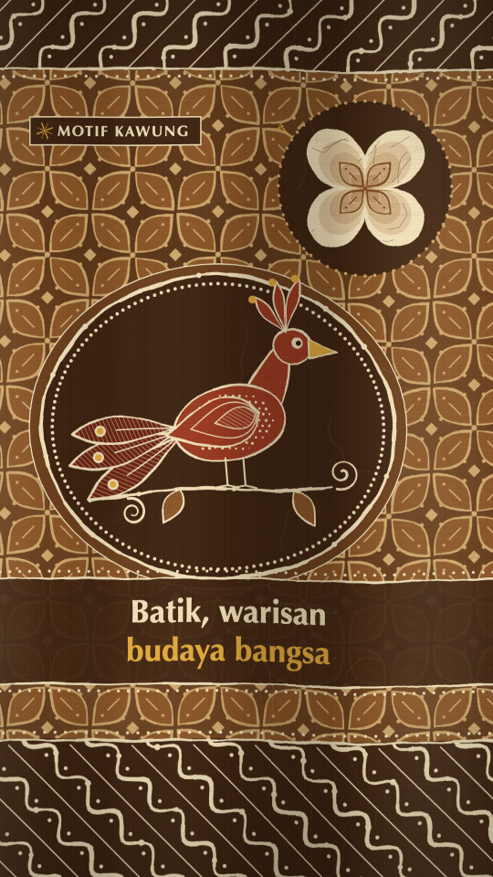

# Batik

Indonesian batik cloth: a dyed ground in **sogan brown** or **deep indigo** carrying **cream wax-resist lines** drawn with a canting. The frame is a length of patterned cloth, built from the classic motif families, all drawn in code: **kawung** (four pointed ovals on a grid, a small lozenge between), **parang** (diagonal S-wave bands, used as the cloth's borders), **mega mendung** (scalloped clouds as nested contours in graded blues or reds), **truntum** (small star flowers) and **isen-isen** filling (cecek dot rows, sawut fine lines). Lines have an uneven weight and small pools of wax; hairline crackle and a woven texture sit over everything; the whole cloth sways gently. Figures are motifs too: outlined in cream, dyed one flat colour, filled with dots and lines. Motion on 2s.

Pick it for Indonesian culture and heritage, UMKM and craft products, national days (Hari Batik Nasional, 17 Agustus), tourism, anything that should feel hand-made and local. It is not `wayang`: wayang is dark silhouettes on a lamp-lit screen with a stage; batik is a flat, fully patterned cloth with no light source and no stage.

**The one rule: everything is wax line + dye + isen.** A subject is a cream canting outline around a flat dyed area, filled with cecek or sawut. No gradients on figures, no shadows, no perspective, no bare flat vector shapes.

## Palette and meaning (`BT`, `BT_BLUES`, `BT_REDS` in kit.js)

| role | hex | use |
|---|---|---|
| sogan ground | `sogan #6b3f1d` | the brown cloth (era ground) |
| deep sogan / paper | `soganD #3d2311` | plain reserves (medallions, caption band, borders); the morph paper |
| light sogan | `soganL #8a5527`, `soganM #7b4a22` | dyed lobes of the background kawung, leaves; lines on a wax-filled shape |
| indigo ground | `indigo #15244a`, `indigoD #0c1630`, `indigoL #2c4680` | the blue cloth and its reserves |
| **wax** | `cream #f3e3bc` | every primary line, cecek, caption text |
| quiet wax | `creamD #cfa96e` | background pattern lines (so the hero's cream stays brightest) |
| **mengkudu red (the hero)** | `red #9c3a21`, `redD #6a2313` | Kukila's body; tail and far wing. Reserved for the hero. |
| **prada gold (the accent)** | `gold #e3ab3c`, `goldD #a8742a` | beak, crest tips, plume eyes, the caption's highlighted phrase, a few truntum. One small gold focus per area. |
| mega mendung blues | `BT_BLUES` `#dbe8f3 → #93b5dc → #5681bd → #2f5596 → #1d3566` | cloud contours, outer to core |
| mega mendung reds | `BT_REDS` `#f3d6b0 → #e09a66 → #c35a34 → #992f1c → #64180f` | the Cirebon red variant (pass as `tones`) |
| ink | `ink #24130a` | the eye's pupil, the canting's outline |

A frame is one ground (sogan **or** indigo) + cream + the hero's red + a little gold; blues appear only as mega mendung.

## Line, fill, texture

- **Canting line** (`btLine`): resampled every 9px, stroked in 3-segment runs whose width breathes between about 0.6× and 1.2× of `w`, with a slow wander of ≤ 2.4px along the normal, round caps, and wax pools every 110–220px. It is **steady** (keyed, no boil): wax does not move on cloth. Primary outlines 6–8px, hero parts about 5px, pattern lines 4–5px, isen 1.5–2.5px.
- **Fill** (`btFill`): one flat dye colour per area. Mega mendung is the only "gradient", made of 5 nested flat contours stepped 18.5% toward a point 10% below centre.
- **Isen-isen**: `btCecek` (staggered dot rows, gap 9–16px, r 1.6–2.6px), `btSawut` (parallel hairlines, gap 6–9px), `btDots` (a dotted line following a contour, gap 22–24px, r 3–4px, used inside or outside every important outline), `btCrackle` (dark hairline veins inside a wax-filled area).
- **Cloth** (post, every frame): uneven dye (46 soft blotches, in `btGround`), warp and weft threads every 3px, slubs, 150 crackle veins over the whole sheet, a vignette.
- **Type**: `BT_FONT` = `Optima, Candara, "Gill Sans", "Gill Sans MT", Calibri, "Trebuchet MS", "DejaVu Sans", "Noto Sans", sans-serif`, weight 700. Captions 70px cream on a plain band of deep ground ruled with a wax line and a cecek row, one phrase in gold. Tags 32px, letter-spaced, on a small ruled plaque with a gold truntum.
- Sizes at 1080×1920: kawung repeat 180px; parang band gap 92px; hero body 205–236px long (the bird about 2.4× that wide); medallion 744×636; clouds 330–520px wide.

## Motion habits

- On 2s (`ones: false`): it is hand work.
- **Lines draw on like wax** (`frac` on `btLine`, `btKawung`, `btParang`, `btScroll`, `btBird`): a round drop leads the line; `btCanting` (the copper pen) can ride the returned tip. Fills arrive with their outline; isen arrives last.
- **Patterns grow outward from a centre**: `btKawungField` reveals repeats by distance from (cx, cy) at `speed` px/s; `btCloud` opens core first, then each contour outward (`grow`); truntum open ray by ray.
- **The cloth sways** (`btPost`): the finished frame is redrawn in 18px vertical strips on a slow travelling wave (±4px, about 0.25 Hz), with fold shading travelling with it. Text sways with the cloth.
- The hero breathes and blinks (every 2.7s) when perched, its tail plumes drift; flying, the wing fan beats at 2.2 Hz and the plumes stream.
- Clouds drift ±14px; truntum pulse and turn slowly.
- Camera: a slow ≤ 4% push inside an era; after a morph the new era opens 7% close and settles on a slow spring. No shake.
- Morph: the window is rimmed like a motif (wax line + cecek ring); the blob is nested contours whose tint crosses from sogan through plain wax to blue; the blank cloth between eras carries a tone-on-tone kawung ghost.

## Frame checklist (on top of grammar/FRAME.md)

1. **The whole frame is cloth**: pattern or a ruled plain reserve everywhere, a border band top and bottom, no empty flat colour.
2. **Every subject is outline + dye + isen** — cream canting line, one flat colour, dots or hairlines inside.
3. **The hero sits on a plain reserve** (a medallion, open sky) so it reads against the pattern; background pattern lines are `creamD`, never full cream.
4. **At most two motif families at full strength** in one frame (kawung field + parang border; mega mendung + truntum); a third only as a small accent.
5. **Red is the hero, gold is small**: one red figure, gold only as dots, tips and the caption highlight.
6. **Something is being waxed, growing or drifting** in every held frame, and the cloth sways.
7. **Captions sit on their ruled band** inside x 60–940, y 250–1500, ≤ 2 lines, one gold phrase; nothing important behind the band.
8. Crackle and weave are visible at phone size (check the cream areas).

## Kit API (`kit.js`, on top of `kit/core.js`)

- Palette: `BT`, `BT_BLUES`, `BT_REDS`, `BT_FONT`. Option read from the piece: `const BT_SWAY = 0..8` (sway px, default 4; 0 = flat cloth) declared before the kit.
- Basics: `btPath(P, closed)`, `btCentroid(P)`, `btInset(P, k, c, ky)` (scale an outline about a point), `btCache(key, w, h, draw)` (draw a static piece once into a scratch canvas).
- Line and fill: `btLine(P, { w, c, closed, frac, key, amt, drops, step })` → the tip `{ x, y }` while `frac < 1`; `btFill(P, c, { al })`.
- Isen: `btCecek(P, { gap, r, c, al, key })`, `btSawut(P, { gap, w, ang, c, al })`, `btDots(P, { gap, r, closed, c, frac, al })`, `btCrackle(P, { n, c, key, w })`.
- Shapes: `btLeafPts(x0, y0, x1, y1, wid, bend, n, p)`, `btSpinePts(x0, y0, x1, y1, bend, n, u0, u1)`, `btScroll(x, y, r, { turns, dir, a0, w, c, frac, key })`.
- Cloth: `btGround(c)`, `btMottle()`, `btWeave()`, `btPost(amp)`.
- Kawung: `btKawungPts(x, y, r, rot, n)` (bridge outline), `btKawung(x, y, r, { frac, key, c, w, fill, rot })`, `btMlinjon(x, y, r, c, g)`, `btKawungCell(x, y, s, { frac, c, fill, key })`, `btKawungField({ s, cx, cy, t0, speed, dur, c, fill, x0, y0, x1, y1, skip(x, y) })`.
- Parang: `btParang(x, y, w, h, { gap, c, bg, frac, dir, key })`.
- Mega mendung: `btCloudPts(x, y, w, h, key, n)` (bridge outline), `btCloud(x, y, w, h, { key, tones, grow, w, line })`, `btLayers(P, c, u)` (the nested contours of a morphing shape; u 0 = kawung end, 1 = cloud end).
- Truntum: `btTruntum(x, y, r, { frac, c, rot, n, al })`.
- Hero: `btBird(x, y, s, { key, face, fly, flap, frac, tilt, fill, bob })` — Kukila; (x, y) the body's centre, s the body's length; sets `SPARK_AT`; returns `{ tip }` while drawing on. `btBirdPts(x, y, r)` (bridge outline). `btCanting(x, y, { ang, s })`.
- Captions (through `DEFER`): `btCaption('line one\nline *highlight*', { y, size, at, bg, hi, c, x })`, `btTag('LABEL', { at, bg, x, y })`. Both fade in the first 0.3s of a bridge's shrink and stay hidden while the next era's window grows (`btLeaving()`): after a bridge give the tag `at: 0.6` and the caption `at: 1.0`.
- `STYLE`: `paper` soganD, `backdrop` (dye + tone-on-tone kawung ghost), `window` (clip + wax rim + cecek ring), `blob` (`btLayers` + canting outline + cecek ring), `hero` (Kukila), `heroColor` red, `heroPts`, `post` btPost, `ones: false`.

## Do / don't

- **Do** start an era with pattern already on the cloth (give `btKawungField` a negative `t0`) and let it keep growing.
- **Do** put the hero and any bridge shape on a plain reserve with a dotted ring.
- **Do** bridge round motif to round motif (kawung flower → cloud, medallion → cloud); cream → pale blue stays clean.
- **Do** use `fill` on a bridge shape in the era (`btLayers(P, BT.cream, 0)`) so it already looks like the blob when the window closes on it.
- **Don't** pass translucent colours to `btLine` (the overlapping caps bead); fade a cached tile or wrap in `ctx.globalAlpha` only for whole layers.
- **Don't** draw anything through `screen()`/`toScreen` inside a `btCache` draw callback.
- **Don't** animate line wobble (no boil), add drop shadows or glows, or use more than one ground colour in a frame.
- **Don't** fill the frame with full-cream pattern lines: the hero disappears.
- **Don't** move a bridge shape (drift it) near the bridge time; the outline must match the era's drawing.

## Not matched / known weaknesses

- Built from the motif families' conventions, not measured from one specific cloth; the motifs are simplified (the parang is an S-wave with cecek, without the full mlinjon lozenge rows and "lidah api" hooks; the kawung has a vein and one dot per lobe).
- The canting line's width changes in 27px steps (stroke runs), which shows slightly on thick lines at 2× zoom.
- Cached kawung tiles are drawn at zoom 1, so under a camera zoom above about 1.15 the background pattern softens; the hero and live lines stay crisp.
- The sway redraws the frame in strips, so captions sway too (≤ 4px) and horizontal rules show sub-pixel steps; set `BT_SWAY = 0` for a flat cloth.
- `btCecek` dots are laid out on the outline's bounding box, so they swim a little inside a shape that rotates (kept off the wing feathers for that reason).
- The hero has one design with two poses (perched, flying), no walk and no side-on wing fold animation between them; people and objects must be composed by the piece from `btLeafPts`, `btLine`, `btFill` and isen.
- First frame costs about 90–240 ms while the caches fill; after that 13–36 ms per frame (export about 78 ms per frame including PNG writing).

## Proven on

`demo/` (6s, 9:16, 80 BPM, 24fps): on sogan cloth with parang borders, a kawung pattern grows outward while a canting waxes Kukila onto a plain medallion and a big kawung flower is drawn and filled with wax ("Batik, warisan *budaya bangsa*"); at 3.0s the flower morphs into a mega mendung cloud on indigo, more clouds open contour by contour, truntum stars come out and Kukila flies ("karya perajin *terbang mendunia*"). Score: siter-like plucks in a pelog-like five-note scale, gender chimes, a soft gong at 0s and 3.0s. Tile deterministic; review: morph on grid PASS, text PASS, story arc PASS, dead beats PASS, -15.9 LUFS, true peak -1.0 dBFS.
