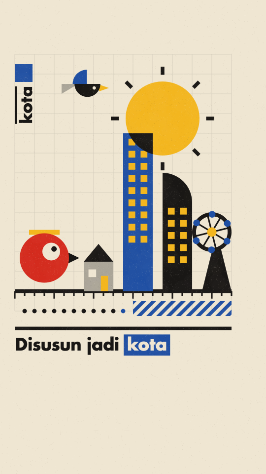

# Bauhaus

A 1920s Bauhaus poster: a modernist geometric composition printed on warm off-white paper. Pictures are built **only** from primitive geometry — circles, semicircles, quarter circles, squares, triangles, bars, concentric rings, stripes and dot grids — placed on a visible modular grid. Flat ink in red, yellow, blue, black and one grey; no outlines, no gradients, no shadows, no rounded cards. Objects are abstracted into the primitives: a sun is a disc with ray bars, a house a square and a triangle, a tree a disc on a bar, a wheel rings and spokes, a bird a semicircle and two triangles. Motion is mechanical and on the beat.

Pick it for shapes, counting, sorting and building, early maths and geometry, cities and machines, design and art history, "how parts make a whole", anything that should feel constructed, bold and cheerful. Not for soft, organic or emotional subjects, realistic characters, or anything that needs detail smaller than a module.

Different from its neighbours: **flat-vector** has icons, long shadows, facets, UI cards and springy mascots; **kinetic-type** makes words the picture. Here there are no icons or cards, type is a small label, and everything is a primitive on the grid.

**The one rule: if it is not a circle, a part of a circle, a square, a triangle or a bar, it is not in the frame — and it sits on the grid.**

## Palette and meaning (`BAU` in kit.js)

Six inks, nothing else. No tints, no transparency.

| role | hex | use |
|---|---|---|
| paper | `paper #efe6d2` | the sheet: the ground of every frame and of the morph; windows, the hero's eye |
| **hero** | `red #d42b1e` | Bola, the rolling disc. Reserved for the hero. |
| energy | `yellow #f3b61f` | the thing the story follows (the triangle that becomes the sun), lit windows, hubs, the caption's highlight block |
| structure | `blue #1f4fa3` | the calm second colour: the big circle, tower blocks, water stripes, the other highlight block |
| mass | `black #191715` | bars, rules, ruler ticks, type, the heaviest shapes, the overlap colour |
| quiet | `grey #aaa598` | the grid, background masses (a quarter circle, a stripe field, a house) |

A frame uses the paper, black, and two of the three colours in quantity; the third appears as an accent. Where two shapes overlap, print the overlap as a third flat colour with `bauOverlap` (black by default) — never see-through.

## Grid, ink and type

- **The grid** (`BAU_G`, `bauGrid`): 80 px modules from (60, 220) — 11 columns across the phone-safe width, 16 rows to y = 1500 — ruled in thin grey (1.6 px at 42%). Every primitive snaps its resting place to the half module (40 px); pass `snap: false` only for things in motion. The 45° diagonal is the favourite axis (`bauGrid({ diag: true })`, diagonal stripes, the bird's descent, the morph's construction axes).
- **Ink** (`bauInk`): every shape is one flat fill, then the same path is filled once more with a seeded 256 px tile of paper-coloured flecks, so the flat looks printed, slightly uneven. Tiny parts (`flat: true`) skip it.
- **Paper** (`STYLE.post`): a static, cached sheet of grain and fibres over the finished frame. It does not boil: a print holds still.
- **No strokes** for objects: a ring is a band (two arcs, filled), a line is a bar (`bauSeg`, `bauBar`). Corners are sharp (`bauPoly` uses straight segments).
- **Type** (`bauText`): `BAU_FONT` = `"Futura", "Century Gothic", "Avenir Next", "Jost", "Poppins", "Trebuchet MS", Arial, sans-serif`, weight 700, tracked −0.02 em, lowercase preferred, black. Labels may run up the edge (`rot: -90`). Type never sits on a picture; it sits on paper or on a yellow / blue block.

## Motion habits

- On 1s (`ones: true`). Nothing fades, nothing eases softly, nothing wobbles.
- **Arrivals** (`in` on every primitive, driven by `bauIn(t0, d)`): slide along a grid axis and **stop dead** (`bauGo` accelerates into the stop), or with **one** small overshoot (`over: 0.03–0.08`) in free space. Things that land on other things never overshoot.
- **Each primitive has its own entrance:** circles roll, quarter circles turn 90° about their corner, bars extend like rulers with ticks appearing as they pass, rings expand from the centre, stripes wipe, dots are set one by one, towers are pushed up out of the ground rule.
- **On the beat:** an arrival *ends* on its cue (start it 0.2–0.3 s earlier) so the stop coincides with the sound. One event per beat or eighth.
- **Turns are quarter and eighth turns** and whole turns (a knocked shape does exactly one turn); `bauTick` ratchets a value one step per beat (the sun's rays move a sixteenth of a turn each beat).
- **Idle life is machinery:** a pendulum, a dot on its orbit, a wheel turning at constant speed, a stripe field creeping, a beat counter adding a dot each beat, a bird's wing flipping between two quarter positions.
- **The hero** rolls (one full turn per 2πr travelled), hits things at full speed and recoils once, hops straight up and down, blinks with a bar.
- **Captions:** the rule extends left to right, words are wiped on one per eighth, the highlight block extends just before its word. Tag and caption are wiped off as a bridge starts.
- **Camera:** none. It is a printed sheet.

## Frame checklist (in addition to `grammar/FRAME.md`)

1. **Only primitives.** Name every object as a sum of circle / arc / square / triangle / bar. If you cannot, redraw it.
2. **Everything rests on the grid:** edges and centres on 40 px positions, sizes in half modules, angles in 45° steps. The grid itself is visible behind.
3. **Strict palette:** six inks; red only on the hero; no tints, gradients, shadows, outlines or rounded corners.
4. **Asymmetric balance with empty paper:** one heavy mass off-centre, a counterweight in the opposite corner, at least a third of the composition left bare.
5. **One overlap printed as a third colour** where two big shapes cross.
6. **A thick black rule** somewhere (the ground, the caption) and one fine-grained texture (stripes, a dot row, ruler ticks) against the big flats.
7. **Something is mid-move mechanically,** and two or three machine-like idle details are running.
8. **The tag runs up the left edge** (block + rule + turned word); **the caption is one line under a black rule** at y ≈ 1330–1440 with exactly one word on a yellow (black type) or blue (paper type) block. Nothing else enters y > 1300.
9. **Bridge objects are single primitives of similar size** (triangle → disc, square → disc), clear of everything else at the bridge time.

## Kit API (`kit.js`, on top of `kit/core.js`)

- Palette, font, grid: `BAU`, `BAU_FONT`, `BAU_G { x, y, u }`, `bauGX(i)`, `bauGY(j)` (grid lines), `bauSX(x, d)`, `bauSY(y, d)` (snap to the half module).
- Timing: `bauIn(t0, d)` (linear 0..1 progress: pass it as `in`), `bauGo(u, over)` (the mechanical move), `bauTick(t0, every, d)` (ratchet counter), `bauEnter(o, default)` (resolves `in`, `from: 'l' | 'r' | 't' | 'b' | 'grow' | 'turn'`, `dist`, `over`, `turn`).
- Ink and paths: `bauInk(c, { flat, rule })` (fill the current path), `bauMottle()`, `bauGrain()`, `bauPoly(P)`, `bauSeg(x1, y1, x2, y2, w)` (adds a bar to the current path), `bauShape(spec)` with spec `{ k: 'c', x, y, r }`, `{ k: 'r', x, y, w, h }`, `{ k: 'a', x, y, r, a0, span, r0 }` or `{ k: 'p', P }`, `bauOverlap(specA, specB, c)`.
- Outlines (for bridges): `bauCirclePts(x, y, r, n)`, `bauSquarePts(x, y, w, h, rot)`, `bauTriPts(x, y, w, h, dir, rot)` (dir `'u' | 'd' | 'l' | 'r'` isosceles, `'nw' | 'ne' | 'se' | 'sw'` right-angled), `bauCentroid(P)`.
- The construction set (pixel coordinates; all take `in`, `over`, `snap`):
  - `bauGrid({ c0, c1, r0, r1, c, al, w, in, diag })`
  - `bauCircle(x, y, r, c, { from, dist, roll, rot, mark })`
  - `bauArc(x, y, r, a0, span, c, { r0, from, turn })` — degrees; span 90 = quarter, 180 = semicircle; arrives with a quarter turn
  - `bauSquare(x, y, w, h, c, { from, dist, anchor })` — `from: 'grow'` extends it from the `anchor` edge
  - `bauTri(x, y, w, h, dir, c, { rot, from, dist })`
  - `bauBar(x1, y1, x2, y2, w, c, { ticks: { step, len, w, side, major } })` — extends from the first point
  - `bauRings(x, y, r, n, cols, {})` — colours from the outside in; expands from the centre
  - `bauStripes(x, y, w, h, n, c, { dir: 'h' | 'v' | 'd', scroll, from })` — wipes in
  - `bauDots(x, y, cols, rows, gap, r, c, { cf(i, j, idx), sq })` — set one by one
- Ready objects: `bauSun(x, y, r, { in, rot, rays, c, ray, disc })`, `bauHouse(x, base, w, { in, c, roof, door, rh })`, `bauTree(x, base, h, r, { in, c, trunk, w })`, `bauTower(x, base, w, h, c, { in, top: 'tri' | 'arc' | 'arcl' | 'semi' | 'step', topC, win: { cols, rows, c, lit, litC, m } })`, `bauWheel(x, y, r, rot, { in, over, c, spokes, hub, inner, cabins, cabinC })`, `bauBird(x, y, s, { face, flap, c, wing, beak, tail })`, `bauPendulum(x, y, len, ang, { c, r, w, rod })`, `bauOrbit(x, y, r, ang, { c, ring, w, dot })`.
- Hero: `bauHero(x, y, r, { rot, face, look: [x, y], mood: 'smile' | 'wow' | 'blink', key, c, cap })` — Bola: a red disc, one eye, a black triangle nose (reaches 1.42 r), a yellow bar cap; `rot` rolls the whole figure; sets `SPARK_AT`. `bauHeroPts(x, y, r)`.
- Type: `bauFont(size, weight, track)`, `bauTextW(str, size)`, `bauText(str, x, y, size, c, { align, rot, reveal, weight, track })`.
- Captions (through `DEFER`): `bauCaption('kata *sorot* kata', { x, y, w, size, hi, at, col, band })` (y = the baseline, 1420; shrinks to fit `w`), `bauTag('label', { x, y, size, block, c, at, col })`; `bauBridgeK()` is their visibility through a bridge.
- `STYLE`: `paper`, `backdrop` (the sheet in any colour with the grid), `window` (a clip framed by a flat band in the bridge colour and a thin black concentric ring), `blob` (the flat shape on its construction axes with an expanding ring), `hero`, `heroColor`, `heroPts`, `post` (paper grain), `ones: true`.

## Do / don't

- **Do** compose first, then animate: place the masses on the grid as a poster that would hold up as a still.
- **Do** let big shapes touch and overlap, and print the overlap.
- **Do** end every move on a beat and give it a dry sound (a clack, a tick).
- **Do** keep a counting or measuring device in the frame (ruler ticks, a dot row, a pendulum): it makes the mechanics visible.
- **Don't** draw outlines, faces with mouths, hands, curves that are not arcs of a circle, or anything "illustrated".
- **Don't** use tints, opacity, gradients, shadows, blur, rounded rectangles or a seventh colour.
- **Don't** ease softly, bounce repeatedly, squash or stretch; one overshoot at most.
- **Don't** put red on anything but the hero, or type on top of a picture.
- **Don't** set long captions: one line of ≤ ~22 characters at 68 px; a longer line shrinks to fit 880 px.
- **Don't** morph between very different proportions (a disc into a long bar), or put anything over a bridge object at the bridge time.

## Not matched / known weaknesses

- Built from the genre's conventions (Bayer, Schmidt, Kandinsky's form studies), not measured from a specific poster.
- The font is a system geometric sans: Futura on macOS, Century Gothic on Windows; on Linux it may fall back to Trebuchet / Arial, which is less geometric.
- The ink mottle is fixed to the sheet, so a moving shape slides under it; it is faint enough not to read as swimming at phone size.
- The mid-morph shape (e.g. a rounded triangle) is briefly not a pure primitive.
- `bauGrid` assumes an unrotated camera; the demo uses no camera at all, so line widths under a zoom are only handled by the `1 / zoom` rule, not tested.
- `bauTree`, `bauRings`, horizontal / vertical `bauStripes`, arc bands (`r0`) and `bauGrid({ diag })` were checked in a test still, not used in the demo.
- Captions are single-line only; the demo does not loop seamlessly.

## Proven on

Its demo only. `demo/` (6s, 9:16, 120 BPM, 24fps): on the gridded sheet a ground rule extends, then a black square, a blue circle and a yellow triangle arrive one per beat and stack; Bola rolls in, pokes the square at full speed, and the triangle is knocked up with one whole turn. At 3.0 s the triangle morphs into the sun; under it a city is pushed up out of the ground rule (a blue tower whose overlap with the sun prints black, a black block with a quarter-circle roof, a grey house, a big wheel on a triangle stand), windows light up one by one, a bird comes down the diagonal, and Bola rolls in and hops twice. `tile.mjs`: deterministic, about 3 ms a frame after the caches are built.
