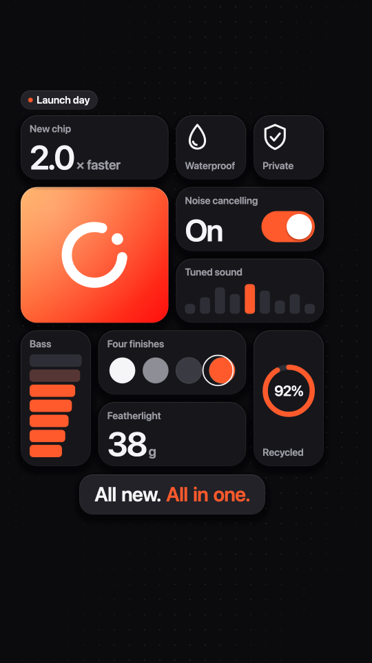

# Bento

A bento-grid feature board: the layout product launches use to show many features at once. The whole frame is one modular grid of **solid rounded tiles** with even gutters on a calm ground. Tiles span 1x1, 2x1, 1x2, 2x2 (or wider) cells, and each holds exactly **one idea** drawn in code: a huge numeral with a small label, a pictogram, a mini bar or line chart, a progress ring, a toggle, a row of colour swatches, a battery or level meter, a pill badge, or the gradient hero tile carrying the product mark. Neutral greys, one brand accent, a clean tight system sans with semibold numerals. Dark ground or light ground.

Pick it for product launches and feature round-ups, spec sheets, "what's new" reels, dashboards-as-story, year-in-numbers, pricing or plan comparisons, anything where the content is a handful of separate facts of similar weight. Not for a story with characters, places or one continuous scene; not for one big idea that needs the whole frame (use kinetic-type or keynote-like looks); not for real product screenshots (the tiles are drawn, not captured).

**The one rule: everything lives in a tile on the grid, and a tile says one thing.** Nothing floats between tiles, nothing straddles a gutter, and no tile carries two ideas.

## Palette and meaning (`BENTO` in kit.js)

| role | dark (`BENTO.dark`) | light (`BENTO.light`) | use |
|---|---|---|---|
| ground | `#0b0b0d` | `#f3f3f5` | the calm sheet under the grid; also `ERA_BG` |
| tile | `#17171b` | `#ffffff` | every ordinary tile: opaque, one shade off the ground |
| raised | `#222228` | `#f7f7f9` | the caption tile (dark theme), plain badges |
| track | `#2e2e36` | `#e4e4ea` | unlit things: ring tracks, idle bars, an off switch, unlit meter segments |
| ink | `#f5f5f7` | `#111114` | numerals, pictograms, state words |
| dim | `#9d9da6` | `#6e6e77` | labels, units, the word "Off" |
| faint | `#565660` | `#b9b9c2` | the battery outline |
| edge | white 14% to 3.5% (top to bottom) | ink 4.5% to 10% | the 1.5 px inner edge highlight of every tile |
| shadow | black 34% | `rgb(28,28,48)` 8.5% | six stacked offsets, 12 px down, about 19 px soft; nearly invisible on dark |

- **The accent** `#ff5a2c` (`BENTO.accent`, or the piece constant `BENTO_ACCENT`): the one brand colour. It marks what is *on*, *chosen* or *the newest*: the lit part of a ring, the highlighted bar, an on switch, the line of a chart, lit meter segments, the highlighted caption phrase, the tag's live dot.
- **One tinted tile per screen at most.** Either the hero tile (`fill: 'hero'`: a diagonal gradient from the accent turned +17 degrees and 7% lighter, through the accent, to -13 degrees and 6% darker, with a soft light on its top-left shoulder) or one `fill: 'accent'` tile (the accent, 7% lighter at the top to 6% darker at the bottom). On a tinted tile contents turn white (`bentoInk`), tracks become the accent mixed 30% to white.
- Swatch rows may show product colours, but keep them greys plus the accent unless the product really has more.
- No translucency, blur or frost anywhere: tiles are opaque. No long shadows, no outlines round shapes, no mascot.

## Geometry

- **Grid** (`bentoGrid`): the demo uses 4 columns x 5 rows in `rect [60, 334, 880, 1016]` (the phone-safe width, between the tag and the caption): cells 203.5 x 185.6 px, **gutter 22 px**, **corner radius 48 px**, tile padding 26 px. A 2x1 tile is 429 x 186, a 1x2 is 203.5 x 393, a 2x2 is 429 x 393, a 4x2 is 880 x 393.
- The grid is full: every cell belongs to a tile (`bentoCheck` reports empty cells, overlaps and tiles that leave the grid). Mix spans: at least one large tile, a couple of wide or tall ones, a couple of 1x1.
- **Type:** `BENTO_SANS` (system-ui, SF Pro, Segoe UI, Roboto, Helvetica Neue, Arial), weight 600 everywhere. Labels 29 px, dim, top-left of the tile (bottom-left under a pictogram or ring), shrunk to fit the tile's width. Numerals are as tall as the tile allows (about 1.08 x the space under the label, cap height about 0.78 of it), tracking -0.045 em, auto-shrunk to the tile's width; the unit follows at 0.4 x in dim. Caption 58 px on its own small tile centred at (CX, 1432); tag: a 30 px pill at (60, 262).
- **Pictograms** live in a unit box, stroke 0.17 of the half-size, round caps and joins; solid shapes (bolt, spark) are filled.
- **Ground:** a dot lattice every 44 px (2 px dots, 8.5% white on dark / 11% ink on light) with a slow diagonal swell; it shows only in the gutters and margins.
- Hairlines (edges, chart grid lines) divide by the camera zoom, so they stay 1.5 px under a push-in.

## Motion habits

- On 1s (`ones: true`), springs. Nothing eases linearly, nothing wobbles or boils.
- **Tiles pop in staggered:** scale 0.9 to 1 with a small overshoot (`springEase(k 300, d 17)`, about 1.7% over) and a 0.16 s fade; one tile per 16th note, spiralling out from the hero tile.
- **Contents animate after the tile lands** (0.2 s after its pop): numerals count (ease-out cubic, 0.5 to 0.7 s), bars grow one after another with a spring, lines draw left to right and end in a dot, rings sweep while their number counts, pictograms draw on stroke by stroke, meters fill, swatches pop in a row.
- **State changes are small events on the beat:** a switch flips (the knob stretches mid-way, the track fills with the accent, "Off" becomes "On"), the selection ring slides to another swatch, a tile dips under a tap (`press`).
- **The big move, once per board:** the grid re-flows (`bentoFlow`: every tile slides and resizes to a new arrangement on its own spring, 0.03 s apart, the headline first; tiles with no place in the new layout shrink out), or one tile takes over the frame (`bentoExpand`).
- **Idle life stays inside tiles:** the product mark turns slowly, a sheen crosses the hero tile every 2.4 s, the newest point of a line chart pulses, a level meter follows the music, the tag's dot pulses, the ground's dots swell.
- **Bridges are tiles:** the old board is seen through one tile's outline and closes onto it; on the bare ground that tile changes proportions (and swells 4% mid-way) while the ground glides from the old board's colour to the new one's; the new board opens out of the new tile. Bridge between two tinted tiles (hero tile to headline tile): the gradient and the mark fade out of the morphing tile in the first half (`BENTO_MORPH`).
- **Captions** pop in as a small tile, words rising one after another, and fade in the first 0.25 s of a bridge.
- **Camera:** none in the demo; a board is read flat. A slow push toward one tile is fine.

## Frame checklist (in addition to `grammar/FRAME.md`)

1. **Squint test: it is a bento board.** A calm ground, a full grid of rounded tiles with identical gutters, one coloured tile. If it reads as floating cards on a gradient it is `glass`; if as an illustration, it is `flat-vector`.
2. **Every tile says one thing** and you can name it in two words (a number, a switch, a chart). A tile with a number *and* a chart *and* an icon is three tiles.
3. **No text leaves its tile.** Labels and numerals sit inside the padding; nothing touches a tile's edge or the next tile. This is the classic failure: check wide numerals ("1234.5"), long labels in 1x1 tiles, and the unit after a numeral.
4. **Spans vary:** one large tile (2x2 or wider), some 2x1 or 1x2, some 1x1, and the grid has no empty cell.
5. **One accent, at most one tinted tile.** The accent appears small elsewhere (a bar, a ring, a switch) and always means on / chosen / newest.
6. **The hierarchy is by size, not colour:** the headline numeral is the biggest thing in the frame (300 px or more on a 2-row tile); labels are small and dim.
7. **Tiles are solid:** opaque fill, a 1.5 px edge highlight, a very soft shadow. No transparency, no blur, no outline round the tile.
8. **Something inside a tile is moving** in every held frame (a count, a sweep, a pulse, the mark turning), and at most one big move (re-flow or take-over) happens per board.
9. **Tag above, caption tile below, grid between:** the tag pill at y 262 to 318, the grid inside y 334 to 1350, the caption tile centred at y 1432; all inside x 60 to 940.
10. **Bridge objects are tiles of similar proportions** (2x2 into 3x2 is fine; 1x1 into 4x1 pinches), present on the first frame of the new board (no pop-in), their contents arriving after the board has opened.

## Kit API (`kit.js`, on top of `kit/core.js`)

- Palette and constants: `BENTO { dark, light, accent, onAccent, r, gap, pad, label }`, `BENTO_SANS`, `BENTO_ICON`.
- Piece options (plain constants in the piece): `BENTO_LIGHT = true` (the default ground is light), `BENTO_ACCENT = '#rrggbb'`, `BENTO_MORPH = { glyph: 'out' | 'in' | 'both' | 'none' }`.
- Theme: `bentoGround(theme?, { c, dots, step, a })` starts every scene (picks `'dark'` / `'light'` / the default and lays the ground), `bentoTheme(name)`, `bentoT()`, `bentoDefault()`, `bentoAccent()`, `bentoDots(colour)`.
- **The layout engine:**
  - `bentoGrid({ cols, rows, gap, rect: [x, y, w, h], r })` returns `G` with `G.cell(col, row, spanC, spanR)` (a rect) and `G.layout({ id: [col, row, spanC, spanR] })` (a map of rects).
  - `bentoCheck(G, spec)` returns the layout's problems (overlaps, out of grid, empty cells).
  - `bentoTile(G, cell, { at, fill, c, r, pad, a, shadow, press, wait, on }, fn?)` draws a tile (`cell` is `[col, row, spanC, spanR]` or any rect) and returns its inner rect `{ x, y, w, h, ox, oy, ow, oh, r, a, s, on, t0, live }`; `fill` is `'tile' | 'raised' | 'accent' | 'hero'` or a colour; `fn(inner)` draws clipped inside the tile.
  - `bentoRelayout(A, B, u, { stagger, order, ease })` (layout A to layout B at progress `u`), `bentoFlow(t0, A, B, { order, step, spring })` (the same on a clock, with springs), `bentoExpand(rect, u, { to, r, rTo })` (a tile taking over the frame). All return rects to pass to `bentoTile`.
  - Rect helpers: `bentoMixRect`, `bentoGrow`, `bentoInset`, `bentoPts(rect, r)` (a tile's outline for bridge shapes).
- **Content, one per tile** (each takes the inner rect, animates from `o.at` or the tile's `t0`, and takes `label`):
  - `bentoStat(r, { value, from, decimals, prefix, suffix, dur, size, align, c })` a counting numeral with a unit, auto-fitted.
  - `bentoIcon(r, name, { label, center, accent, s, dur })` a pictogram tile; `bentoPict(x, y, s, name, { c, frac, w })` one pictogram anywhere. Names: `bolt, check, shield, drop, heart, lock, wifi, wave, sun, moon, leaf, spark, chip, globe, arrow`.
  - `bentoChart(r, { data, kind: 'bars' | 'line' | 'area', hi: index | 'last' | 'max', max, dur, live })`.
  - `bentoRing(r, { value, suffix, text, w, dur, align, c })`.
  - `bentoToggle(r, { on, flip, onText, offText, state, w })`; `bentoSwitch(x, y, w, u, K)` the bare switch.
  - `bentoBadge(x, y, str, { kind: 'plain' | 'accent' | 'tint', size, dot, live, at, align })` returns `{ w, h }`.
  - `bentoSwatches(r, { colors, pick })` (`pick` may be fractional: the ring slides).
  - `bentoMeter(r, { value, kind: 'battery' | 'level', n, vertical, dur })` (upright in a tall tile).
  - `bentoHeroTile(G, cell, { at, press, frac, sheen, glyph })` the gradient tile with the mark.
- Surfaces and type: `bentoSurface(x, y, w, h, rad, fill, { shadow, c, on })`, `bentoSolid(P, fill, o)` (the same on any outline), `bentoSheen`, `bentoPop(at)`, `bentoIn(r, fn)`, `bentoInk(r)`, `bentoBody(r, o, K, at)`, `bentoText(str, x, y, size, c, { weight, align, base, a, track, maxW })`, `bentoTextW`, `bentoFit`, `bentoFont`, `bentoRR`, `bentoPoly`, `bentoCurve`, `bentoZ`.
- Colour: `bentoRGB`, `bentoA`, `bentoMix`, `bentoHex`, `bentoLum`, `bentoSat`, `bentoHue(c, deg, dl)`.
- The hero: `bentoHero(x, y, r, { at, frac, sheen, c })` (a rounded-square accent tile with the mark; sets `SPARK_AT`), `bentoHeroPts(x, y, r)`, `bentoGlyph(x, y, s, { c, frac, rot, a })` (the mark: an open ring and the dot that closes it).
- Overlays (through `DEFER`): `bentoCaption('All new. *All in one.*', { x, y, size, at })`, `bentoTag('Launch day', { x, y, size, live, kind, at })`; `bentoLeaving()`, `bentoArrive(at)`.
- `STYLE`: `paper` (the default ground), `backdrop` (the ground and its dots; in a bridge it glides from `ERA_BG[eraA]` to `ERA_BG[eraB]` instead of fading to paper), `window` (a tile-shaped opening that gains a tile's shadow and edge as it nears tile size), `blob` (a solid tile in the blended colour, 4% swell, gradient and mark per `BENTO_MORPH`), `hero` / `heroColor` / `heroPts` (the accent tile), `post` (draws nothing; resets the theme), `ones: true`.

## Do / don't

- **Do** lay out the board as a `{ id: [col, row, spanC, spanR] }` map first and run `bentoCheck`; decide the one big tile, then fill round it.
- **Do** call `bentoGround()` first in every scene: it sets the theme the rest of the scene draws in.
- **Do** pop tiles on the beat grid (16ths) and let contents follow; give each board one state change (a switch, a selection) and one big move.
- **Do** make the bridge object the tinted tile on both sides, and give `ERA_BG` each board's ground so the ground glides.
- **Do** keep labels to one or two words; let the numeral carry the tile.
- **Don't** put two ideas in a tile, text across a gutter, or anything outside the grid except the tag and the caption tile.
- **Don't** use a second accent, a second tinted tile on the same screen, or coloured icons everywhere.
- **Don't** add blur, translucent panels, gradients on the ground, glows or long shadows (`glass`, `aurora`-style looks do that).
- **Don't** pop the bridge tile in (`at` omitted: it is there from the era's first frame), and don't start its numeral before the board has opened.
- **Don't** re-flow more than once per board, and don't re-flow while tiles are still popping in.
- **Don't** use real brand names, logos or product UI; the mark is `bentoGlyph`.

## How it differs from the closest shipped styles

- **glass** also shows stats, charts, toggles and rings in rounded panels, but they are frosted, translucent and float freely over an aurora. Bento's tiles are opaque, sit on a strict grid with equal gutters, and the ground is flat.
- **flat-vector** is illustration: flat facets, long shadows, icons, a mascot, free composition. Bento has no illustration and no character; the grid is the composition.
- **kinetic-type** puts huge type and counters on a Swiss grid, but the type is the picture and there are no containers; here every element is boxed.
- **isometric** shares the neutral product palette with one accent, but draws objects in 2:1 projection with hairlines.

## Not matched / known weaknesses

- Built from the genre's conventions (launch-keynote feature boards), not measured from one reference; the accent and the mark are invented.
- Type is the system sans, so glyph widths and numeral shapes differ between platforms (SF on macOS, Segoe UI on Windows, Roboto or DejaVu on Linux); numerals are not tabular, so a counting number can shift its unit by a pixel or two.
- A numeral is limited by its tile's height: in a one-row tile (186 px) it is only about 100 px tall. Headline numbers need a two-row tile.
- During a re-flow tiles cross and briefly overlap each other (they are drawn in scene order; draw the headline tile last).
- A bridge between a dark and a light board passes through a mid grey ground for one or two frames.
- The morph resamples outlines by angle, so the rounded corners soften slightly mid-morph; very different spans (1x1 into 4x1) pinch.
- The window's edge and shadow are drawn in screen pixels and are not themed per ground.
- Tuned for 9:16 at 1080 x 1920; other formats need their own grid `rect` and were not tested.
- Exercised only in a scratch test, not in the demo: `bentoRelayout`, `bentoExpand`, `bentoHero` and the hero-to-hero bridge (`SP`), the `fn` form of `bentoTile`, `BENTO_LIGHT` / `BENTO_ACCENT` / `BENTO_MORPH`, `kind: 'line'`, the flat battery and flat level meter, `accent` and `tint` badges, and eleven of the fifteen pictograms. Camera moves are untested. The demo does not loop seamlessly.

## Proven on

Its demo only. `demo/` (6s, 9:16, 120 BPM, 24fps): a launch board for an invented, unnamed pocket speaker. On the dark ground the gradient hero tile pops in and its mark draws on; nine tiles land on the 16ths round it (a "2.0 x faster" numeral, drop and shield pictograms, a noise-cancelling switch, a bar chart with one accent bar, a level meter that follows the music, four finish swatches, a 92% ring, a 38 g numeral); the switch flips on, the selection ring slides to the accent finish, the hero tile dips under a tap. At 3.0 s the board closes onto the hero tile, which widens from 2x2 to 3x2 as the ground glides to light and its mark fades; the light battery board opens out of it: "48 h" counts up on the one tinted tile, eight tiles pop in (an area chart, a bolt, a battery filling, a leaf, a 96% ring, "18 min", a low-power switch, a week of bars), then at 4.75 s the grid re-flows so the headline takes the top two rows and the battery tile leaves, and low power switches on. Captions: "All new. All in one." and "48 hours. One charge." Score: a plucked pattern in A over a soft kick, one pop per tile up a pentatonic ladder, switch clicks, a lift to D at the reveal, ticks under the count, a swoosh for the re-flow.
