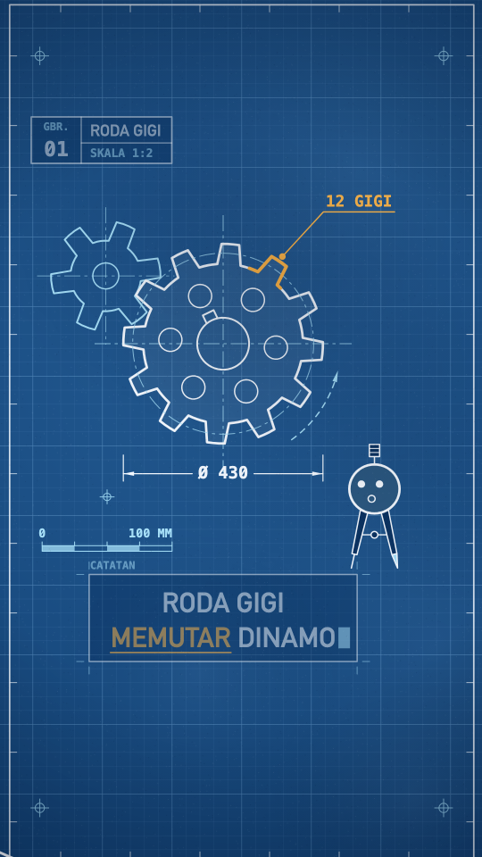

# Blueprint

A technical drawing on deep blueprint-blue paper: a fine and a coarse grid, a sheet frame with zone ticks and small registration crosses, and the subject drawn in **constant-weight white and pale-cyan lines that draw themselves on** — a stroke reveal with a little plotter head (a ring and cross hairs) riding the tip. Around the subject sits the language of drafting: dash-dot centre lines, dashed hidden lines, 45° section hatching, dimension lines with arrowheads and a measurement, callout labels on leader lines, a scale bar, a title block. Lettering is engineering capitals. One warm accent, amber, marks the single thing the drawing is about. Motion on 1s.

Pick it for engineering, products, mechanisms, anatomy-of-a-thing and any "how it works" topic. It is a poor fit for emotional stories, crowds or landscapes.

**The one rule: everything is a line of constant weight on blue paper.** No solid bright fills, no gradients on objects, no line that thickens with the camera. A shape is an outline; its inside is a faint wash (≤ 0.08 alpha), hatching, or a dark paper fill that hides the grid behind a small part.

## Palette and meaning (`BP` in kit.js)

| role | hex | use |
|---|---|---|
| paper | `paper #10477f` | the sheet; morph paper; era 1's ERA_BG |
| second sheet | `paper2 #0d3d72` | a slightly deeper sheet for a second era |
| dark paper | `paperD #0a3261` | note boxes, the title block, fills that hide the grid behind small parts |
| **object line** | `line #f4f9ff` | the subject's visible edges, dimension lines, body text |
| **pale cyan** | `cyan #a6dff8` | secondary parts, centre lines, hidden lines, hatching, registration crosses, small labels, the hero's colour |
| grid | `grid #8fc3ee` | the fine grid (0.13 alpha) and coarse grid (0.30 alpha) |
| **amber accent** | `amber #ffb545` | the one thing pointed out: one edge or part, its callout, the caption's highlighted phrase. Nothing else. |

A frame is paper + white + cyan, and amber on one subject only (plus the caption highlight).

## Line, fill, texture

- `bpLine(P, c, o)` is the only stroke. Weights in `BP_W` (screen px, divided by the camera zoom so they stay constant): `obj 5.5` visible edges of the subject, `part 4` secondary parts, `thin 3` details, `dim 2.6` dimension and leader lines, grid 1–1.5. Round caps and joins; dashed lines use butt caps.
- Line types: solid = visible edge; `dash: 'hidden'` (15/10) = hidden edge, flow paths, the morph window's echo; `dash: 'centre'` (36/9/7/9) = centre lines and pitch circles. `march` makes dashes travel (rotation, current, flow).
- Fills: `bpFill` (a faint wash), `bpHatch` (45° section lines anchored to the sheet, so they do not swim when a part moves), `bpWash` (a soft round pool of colour, e.g. a lit lamp, clipped to its glass).
- The sheet (`bpSheet`): flat paper + one soft light pool, fine grid every 30 px, coarse grid every 150 px (both in world space: they move with the camera), a frame 40 px in with zone ticks every 150 px, four registration crosses. `bpPost` lays static paper speckle, uneven cyanotype blotches and a vignette on top (rendered once, seeded).
- Type: `BP_CAPS` = `"DIN Alternate", Bahnschrift, "Roboto Condensed", "Arial Narrow", "Helvetica Neue", Arial, "DejaVu Sans", sans-serif` for captions and titles (62 px / 36 px, weight 700); `BP_MONO` = `"SF Mono", Menlo, Consolas, "DejaVu Sans Mono", "Liberation Mono", "Courier New", monospace` for labels and measurements (30–36 px; 24–26 px only inside the title block, the scale bar and the note tab). All text is upper-cased by the kit.

## Motion habits

- On 1s (`ones: true`). Easing is smooth in-out for line reveals, a small overshoot (`EZ.back`) when arrowheads, target dots and rays land.
- **Everything draws itself on.** Construction first (centre lines are on the sheet before the object), then the outline (0.5–0.9 s), then inner details staggered 0.06–0.1 s apart, then the measurement, then the callout. Never fade a line in; reveal it along its length.
- A dimension plays in order: extension lines, the line growing out from the label to both ends, arrowheads, the label typed.
- A callout plays: target dot, leader, shelf, label typed. It may follow a moving target.
- Type is typed on (30 characters a second) with a block cursor that keeps blinking at 2 Hz.
- Mechanisms move the way they would: gears turn in mesh (ratio by tooth count), dashes march along flow paths, rays pulse on the beat.
- Camera: a slow push of ≤ 4% inside an era; after a morph the new era opens 8% close and settles on a soft spring. No shake.
- Morph: the old era is seen through a window with a heavy white rim and a dashed cyan echo; mid-morph the shape is a hatched section on its own centre lines with an amber registration cross at its centre, on blank gridded paper.

## Frame checklist (on top of grammar/FRAME.md)

1. **The grid shows** — fine and coarse — and the sheet frame or a registration cross is in view.
2. **Constant line weight:** the subject at 5.5 px, details thinner, never a filled bright shape.
3. **The subject sits on centre lines**, and at least one of: a dimension with a measurement, a callout on a leader, a hidden or centre-type line.
4. **Exactly one amber subject** per frame (plus the caption's highlighted phrase).
5. **Something is being drawn or is working** in every held frame: a plotter head on a line, a part turning, dashes marching, the cursor blinking.
6. **Leaders and dimension lines do not cross each other or run through labels**; labels sit outside the object.
7. **The title block is top-left, the note box (caption) bottom-centre**, both inside the safe area (x 60–940, y 250–1500); captions ≤ 2 lines, one highlighted phrase.
8. **The hero stands on the sheet** beside the drawing, looking at the thing being pointed out.

## Kit API (`kit.js`, on top of `kit/core.js`)

- Palette and constants: `BP`, `BP_MONO`, `BP_CAPS`, `BP_W { obj, part, thin, dim, grid }`, `BP_DASH { hidden, centre }`.
- Lines: `bpLine(P, c, { w, closed, frac, dash, march, a, pen, penC, world })`; `bpDraw(P, c, t0, dur, o)` (a line that draws itself from `t0` over `dur`, plotter head on; returns progress); `bpPen(x, y, c)`; `bpPath(P, closed)`; `bpZoom()`.
- Fills: `bpFill(P, c, a)`, `bpHatch(P, c, { gap, a, w, frac })`, `bpWash(x, y, r, c, a)`.
- Geometry: `bpCirclePts(x, y, r, n, a0, a1)` (an arc if a0/a1 given), `bpRectPts(x, y, w, h)`, `bpGearPts(x, y, rTip, rRoot, n, rot)`, `bpGearTooth(x, y, rTip, rRoot, n, rot, k)` (tooth k as an open polyline), `bpBulbPts(x, y, r)`, `bpCentroid(P)`.
- Sheet: `bpSheet({ c, fine, coarse, frame })`, `bpGrid(fine, coarse)`, `bpFrame(margin)`, `bpCross(x, y, s, c, { a, w })`, `bpCentre(x, y, rx, ry, { frac, c, a, w })` (0 skips an axis).
- Drafting: `bpDim(x1, y1, x2, y2, label, { off, gap, frac, c, size })`, `bpCallout(tx, ty, lx, ly, label, { frac, c, size, side, arrow, pen })`, `bpArrow(x, y, ang, s, c)`, `bpScale(x, y, w, { n, from, to, c, size })`, `bpTitleBlock(x, y, { no, title, sub, frac, w, h })`.
- Type: `bpFont(size, { weight, fam })`, `bpTextW(str, size, o)`, `bpText(str, x, y, size, c, { align, base, frac, fam, weight, rot, a, raw })`.
- Hero: `bpHero(x, y, r, { key, look, lookY, mood: 'smile' | 'wow', squash, bob, spread, c })` — Jangka, a little pair of drafting compasses: a round hinge head with two eyes and a knurled grip, a needle leg and a pencil leg, a thumbwheel bar; (x, y) its centre, r half its height; sets `SPARK_AT`. `bpHeroPts(x, y, r)` (bridge outline).
- Captions (through `DEFER`): `bpCaption('LINE ONE\nLINE *ACCENT*', { y, size, at, cps, hi, note, x })` (a ruled note box, typed on); `bpTag('01', 'TITLE', { sub, at, x, y })` (the title block; `at: -1` shows it complete from the first frame). Both fade during the first 0.3 s of a bridge's shrink (`bpLeaving()`).
- `bpPost()` (paper speckle, blotches, vignette; cached).
- `STYLE`: `paper` BP.paper, `backdrop` blank gridded paper, `window` (clip + white rim + dashed cyan echo), `blob` (hatched section on centre lines, amber centre cross), `hero` (Jangka), `heroColor` cyan, `heroPts`, `post` bpPost, `ones: true`.

## Do / don't

- **Do** put construction on the sheet first, so the first frame is never empty.
- **Do** let a number or a part name do the explaining: a measurement, a tooth count, three named parts.
- **Do** keep amber for one subject, and give it the callout.
- **Do** bridge between outlines of similar proportions (a gear into a bulb, a wheel into a dial).
- **Don't** fill shapes with solid white or amber, or scale line weights with the camera.
- **Don't** fade lines in, or pop a whole object on at once.
- **Don't** put text in the sheet margins (it falls under the phone UI); keep labels at x ≤ 940, y 250–1500.
- **Don't** cross leaders, or run a dimension line through a label.
- **Don't** use more than three callouts and one dimension in a 9:16 frame.

## Not matched / known weaknesses

- Built from the genre's conventions, not measured from a specific reference.
- Gear teeth are trapezoids, not involutes: two meshing gears turn at the right ratio but their flanks can touch or overlap by a few pixels at some phases.
- `bpDim` always puts the label in a gap in the middle of the line; a span shorter than its label (under ~150 px) is not handled (no outside arrows).
- Closed outlines reveal from their first point in one direction; there is no two-pen or centre-out reveal for outlines.
- The caption's cursor block and typed text assume one size per caption; long captions (over ~20 characters a line at 62 px) need a smaller `size`.
- Fonts depend on the machine: DIN Alternate on macOS, Bahnschrift on Windows, a condensed or plain sans elsewhere, so caption widths differ slightly between platforms.
- The demo's exported mix measures a true peak of -0.9 dBFS, a hair over the -1 dBFS target.

## Proven on

`demo/` (6 s, 9:16, 120 BPM, 24 fps): on a blue gridded sheet a 12-tooth gear draws itself on its centre lines with a pinion in mesh, a dimension line measures it (Ø 430), an amber callout counts its teeth (12 GIGI) and follows the tooth as the gear starts to turn, while Jangka hops; caption "RODA GIGI *MEMUTAR* DINAMO". At 3.0 s the gear morphs into a light bulb: the screw base is hatched, the filament is drawn in amber and lights on the beat with pulsing rays, callouts name KACA, FILAMEN and ULIR, a 110 MM dimension lands and dashed current marches into the base; caption "DAN LAMPU PUN *MENYALA*". Tile deterministic; review: morph on grid, text PASS, story arc PASS, dead beats PASS, -14.9 LUFS, true peak -0.9 dBFS; about 10–20 ms/frame in the tile, 48 ms/frame in export.
