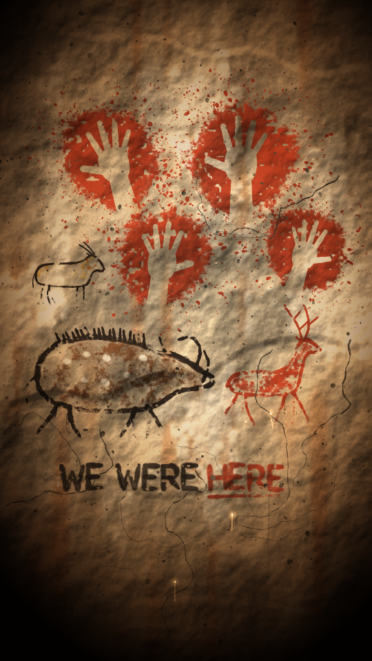

# Cave painting

Prehistoric rock art seen by torchlight. The ground is a living limestone wall deep in a cave: warm grey-buff, never flat, with swells and bedding ledges, vertical iron stains, pale calcite, cracks and pits. On it sits pigment in the prehistoric range only: red ochre, yellow ochre, brown umber, charcoal and a little white clay. Every mark is one of three kinds: a **daubed line** (a finger or pad dragged along, fat and wet where it lands, thinning and breaking up as it runs dry), a **rubbed fill** (patchy, the rock showing through), or **blown pigment** round a covered shape (the negative hand stencils of the Maros-Pangkep caves of Sulawesi: a clean rock-coloured hand in a speckled red cloud). Animals are simple side views (deer, bison, horse, babirusa, anoa) that float and overlap, with no ground line and no perspective. One unseen flame lights a warm pool that falls to near-black at the frame edges, flickers and wanders.

Pick it for origins and "the first..." stories, deep time, human ancestry, hunting and animals, memory and legacy ("we were here"), Indonesian prehistory (Sulawesi, Kalimantan), campfire tales, anything that should feel ancient, handmade and a little sacred. Not for UI, data, precise diagrams, long text, bright or cool palettes, or anything modern and clean.

**The one rule: it is pigment on rock, by firelight. If a mark is not a dry daub, a patchy rub or blown speckle, and if the rock's roughness does not break it, it is not in the frame. The wall never moves; only the light does.**

## Palette and meaning (`CAVE` in kit.js)

| role | hex | use |
|---|---|---|
| wall | `rock #c3b297` | limestone, the mean tone of every frame; `STYLE.paper`, `ERA_BG` |
| wall, cool | `grey #b3ada0` | greyer limestone the buff drifts into |
| stain | `stain #a8754a` | vertical iron staining where water has run |
| crust | `calcite #e6ddcb` | pale calcite patches |
| dark mineral | `soot #5a4c40` | darker patches of the rock |
| **red ochre** | `red #a8381f` | the living: the hero (Rusa the stag), the hand stencils, the caption's one word, finger dots |
| yellow ochre | `yellow #cc9a3a` | rubbed bodies of the big animals |
| brown umber | `umber #70462a` | rubbed bodies, a second animal |
| charcoal | `black #221b17` | contours, manes, horns, hunters, lettering |
| white clay | `white #efe7d6` | rare: dots laid over a dark rubbed body, the rubbed patch under a caption. It is nearly the rock's own tone, so it only reads on something darker |
| darkness | `dark #070504` | what the light falls to; the unlit cave during a bridge |
| flame | `flame #ffb25a` | sparks and lit dust only, never a mark |

A frame is mostly bare rock. One animal carries a fill colour, red is kept for the hero and the hands, charcoal draws the rest.

## How the medium is built

- **The wall** (`caveRock(name)`, cached per name, seeded): a half-resolution height field of five noise octaves, each weighted so its slopes shade about equally, plus five wavy bedding ledges and any declared bulges (`caveDefWall`). It is lit from the upper left with highlights as well as shadows (shade 0.45–1.3), coloured by low-frequency fields (buff to grey, vertical stain streaks, calcite, dark patches), grained per pixel, then cracked (5 branching cracks) and pitted (620 pits) with a lit lip on one side. Built once (about 0.4 s).
- **Roughness map** (`N`, cached with the wall): for every pixel, how thick pigment has to be to stay there. Hollows between grains are high, the tops of grains low, cracks and deep pits can never be painted.
- **The pigment layer** (`cavePaint`): inside the callback `ctx` is an offscreen layer whose **alpha is the pigment's thickness**. When the callback returns the layer is developed in one pass: a pixel keeps its pigment only where thickness beats `N`, and is shaded by the wall's own relief. Thick paint (0.8) covers all but pits and cracks, a rub (0.5) catches about half the grains, a ghost (0.3) is a sparse speckle, and any soft edge turns into scattered grains. Nothing is regenerated per frame: the speckle is the cached map.
- **Daub** (`caveDaub`): the path is resampled and given a fixed hand wobble (it does not boil). Along it runs a load of pigment: 1 where the finger lands, falling to `1 − dry` over `dip` px, then the finger is re-dipped and the line starts fat again. Load drives width (70–100%) and thickness. It is drawn as one filled union of discs and quads (sharp corners never pinch) with a wider thin rim (develops ragged), then dried along its length with soft dabs. A slight taper where the finger lifts.
- **Rub** (`caveRub`): any closed outline, filled thin, crossed by heavier passes of the pad in one direction, with bare patches where the pad missed and a thinner margin toward the edge.
- **Blown pigment** (`caveSpray`, `caveHand`): one large and five small radial clouds of thickness (so it develops lumpy, dense in the middle, speckle at the rim), four cached layers of fat droplets flung further out (they arrive in steps as `frac` grows), and the covered shape cut out crisply. The hand is a palm, five tapered fingers and a stub of forearm.
- **Animals** (`caveAnimal`): a rubbed body, a back line and a belly line daubed separately, four stick legs that run dry toward the hoof, a few strokes for horns, antlers, tail and mane, an eye dot. Two leg poses; the one not in use stays as a fainter ghost set.
- **Lettering** (`caveText`): no font. Capitals, digits and `. , ! ? - ' :` are 1–3 daub strokes each on a cap-height grid, turned and shifted a little per glyph. `size` behaves like a font size (caps are 0.72 × size tall, strokes 0.15 × size).
- **Light** (`STYLE.post`): the frame is multiplied by an elliptical warm gradient (radius 1180 px, 0.74 wide; full light to 0.3 r, 0.62 at 0.66 r, 0.03 at the rim). On every 2s step it jumps up to 16 px, changes size by up to 7% and dims up to 7%, with a deeper dip about one step in seven. Then 46 dust motes and up to 3 sparks are added with `lighter`, each mote as bright as the light where it floats.

## Motion habits

- On 2s (`ones: false`). No easing on marks, no fades, no boil: paint that is on the wall stays exactly where it is.
- **Daubed on:** every mark has `frac`; drive it with `caveIn(t0, d)`. A line grows from where the finger lands; an animal takes 0.7–1.1 s (back, belly, legs, fill rubbed in from one side, then horns and mane); finger dots land one per sixteenth; letters stroke by stroke.
- **Blown on:** a hand stencil accumulates over about 0.45 s (two breaths) round a hand that is not shown; then the hand is taken off the wall: a dark soft shadow that swells, slides and fades in 0.3 s (`lift`).
- **The light does the moving.** `caveAim(x, y)` walks the torch through a few stations per era, so the pool visits what is being painted; without it the pool wanders on its own. Flicker on every step.
- **Animals move in the flicker:** the leg pose swaps on the beat (`caveStep(0.5) % 2`, or every eighth when something is chased) while the other pose stays as a ghost, the old trick of the many-legged cave animals. Bodies never slide.
- **Idle life:** flicker, the drifting pool, dust motes, sparks rising from below the frame, the leg swap.
- **Bridges:** done with light. The pool closes onto the bridge object and the rest of the wall falls to near-black (a ghost of it stays at 8%); in the dark the object is repainted as its counterpart (a painted shape thins while a blown cloud builds round a covered hand); the light opens on the new wall.
- **Captions:** a pale patch is rubbed on, then the words are daubed left to right, then a red finger stroke under the one red word. They thin to grain as a bridge starts.
- **Camera:** none. The wall is fixed to the screen.

## Frame checklist (in addition to `grammar/FRAME.md`)

1. **The rock reads as rock at phone size:** light and dark sides of swells, at least one ledge or crack, stains. If it looks like paper or a flat colour, the wall is wrong.
2. **Pigment breaks over the rock:** rims are ragged, long lines visibly thin before the finger is re-dipped, fills are patchy with rock showing through, pits show as holes in the paint.
3. **Only the five pigments,** and red ochre only on the hero, the hands, dots and the caption's one word.
4. **Three kinds of mark only:** daub, rub, blown speckle. No hairlines, no outlined flat shapes, no gradients inside a figure.
5. **The lit pool holds the subject and the caption;** the corners are near-black. Aim the torch between them (y about 850–1000 on 9:16), not at the top of the frame.
6. **Animals are side views with small heads, heavy bodies and thin legs,** floating with no ground line; a second ghost set of legs is visible on at least one.
7. **Hands are negative:** clean rock inside a red cloud, fingers spread, never a painted hand shape.
8. **Something is being daubed or blown right now,** and the light is different from the last step.
9. **Caption: one short line of daubed capitals** (about 12 characters at 92 px) at y ≈ 1350–1445, x 60–940, one word red with a stroke under it, on rock that is lit.
10. **Bridge objects are round, compact and alone:** nothing else within about 80 px at the bridge time, similar size on both sides.

## Kit API (`kit.js`, on top of `kit/core.js`)

- Palette: `CAVE { rock, grey, stain, calcite, soot, red, yellow, umber, black, white, dark, flame }`.
- Timing: `caveIn(t0, d)` (pass as `frac`), `caveStep(every, phase)`, `caveAim(x, y, r)` (the torch for this frame).
- Wall: `caveDefWall(name, { seed, bulges: [[x, y, rx, ry, amt]] })` (declare before first use; a bulge is a swelling to hang a hump or belly on), `caveRock(name)` → `{ cv, N, S }`. A piece may set `const CAVE_WALLS = ['a', 'b']` (one wall name per era) for the bridge hooks.
- The layer: `cavePaint(fn, { wall, over, box })` — lay the wall, run `fn` on the pigment layer, develop. `over: true` paints over what is on `ctx` (captions, hooks); `box` limits the develop pass. Every mark below called outside `cavePaint` wraps itself in an `over` pass.
- **Generic helpers that turn any outline into the medium:**
  - `caveDaub(P, { c, w, frac, key, dry, dip, d, wob, closed })` — the line; returns the finger's position.
  - `caveRub(P, { c, d, frac, key, a, edge })` — the fill for any closed outline.
  - `caveShape(P, { c, line, d, w, frac, key, k })` — rub plus a daubed contour.
  - `caveSpray(x, y, r, { c, d, frac, key, cut(g), core })` — blown pigment round whatever `cut` fills on `g`.
- Signs: `caveDot(x, y, r, o)`, `caveDots([[x, y, r]], { c, frac, key })`, `caveDisc(x, y, r, o)`, `caveDiscPts(x, y, r, n)`.
- Hands: `caveHand(x, y, s, { frac, rot, flip, c, lift, arm, reach, key })` (s = palm width; about 1.9 s tall), `caveHandPath(g, x, y, s, rot, flip, arm)`.
- Animals: `caveAnimal(kind, x, y, s, { flip, c | 'none', line, d, frac, step, ghost, w, mane, key })` with kind `'deer' | 'bison' | 'horse' | 'babirusa' | 'anoa'` (s = px per unit; a body is about 2.4 units long, legs reach y + 1.15 s); `CAVE_ANIMALS` holds the outlines. `caveHunter(x, y, s, { c, flip, step, frac, spear, throw, key })`.
- Hero: `caveHero(x, y, r, { frac, flip, step })` — Rusa, a small red-ochre stag (r = half its size); sets `SPARK_AT`. `caveHeroPts(x, y, r)`.
- Type: `caveText(str, x, y, size, { c, frac, align, key, w, d, track })`, `caveTextW(str, size, track)`.
- Caption (through `DEFER`): `caveCaption('WE WERE *HERE*', { x, y, w, size, at, dur, ground })`; `caveBridgeK()` is its visibility through a bridge.
- Light: `caveLight()`, `caveLightAt(L, x, y)`, `caveLit(P, src, w, pad)` (a picture seen in a pool shaped like P).
- Geometry: `caveSmooth(P, closed, it)`, `caveCen(P)`, `cavePath(g, P, closed)`.
- `STYLE`: `paper`, `backdrop` (the unlit cave; the blended colour is ignored), `window` (the era in a feathered pool of light shaped like the bridge object, the rest at 8%), `blob` (the object repainted on lit bare rock; a bridge shape may carry `spray: { x, y, r, key, cut(g) }` to say it is a blown cloud), `hero`, `heroColor`, `heroPts`, `post` (torchlight, dust, sparks), `ones: false`.

## Do / don't

- **Do** leave most of the wall bare and let figures overlap and float.
- **Do** draw big animals 400–600 px long with lines 16–20 px wide; small ones lose their legs to the grain below about 150 px.
- **Do** give every mark a stable `key` and fixed coordinates (geometry is cached by key and outline).
- **Do** hang a hump or a belly on a bulge of the wall, and walk the torch to what is being painted.
- **Do** score it with skin drum, breath, a breathy flute and fire crackle; a scrape per daub, a puff per breath of pigment.
- **Don't** move, scale, fade or boil paint once it is on the wall. Change the pose, or the light.
- **Don't** use blue, green, pure white or pure black, gradients, shadows under figures, a ground line or perspective.
- **Don't** paint a positive hand, or outline a hand stencil.
- **Don't** put white clay on bare rock (it disappears) or long captions on the wall.
- **Don't** aim the torch so the caption or the subject sits beyond 0.6 of the pool's radius.
- **Don't** bridge from or to anything that touches its neighbours.

## How it differs from the closest shipped styles

- **sand** is monochrome, backlit from below and constantly re-formed; here pigment is coloured, fixed for good, front-lit by a moving flame, on rock instead of glass.
- **chalkboard** is pale chalk on a dark slate with boiling grain and handwriting; here dark and red pigment sits on pale rock, nothing boils, and the grain comes from the wall's own relief.
- **graffiti** is wet matte aerosol in loud colours with drips and crisp positive stencils on brick; here the spray is mouth-blown, dry, one earth red, and the stencil is always negative.
- **linocut** and **ink-wash** are prints and paper; this has no paper, no printed edge and no brush.

## Not matched / known weaknesses

- Built from the genre's conventions (Lascaux / Altamira animals, Maros-Pangkep hand stencils), not measured from a photograph. Europe and Sulawesi are mixed on one wall for the demo.
- The relief light is baked into the wall from one direction; the torch only changes brightness and position of the pool, it does not re-light the bumps.
- The wall and the roughness map are fixed to the screen at the piece's main format. A camera move slides the paint over the rock, so the look has no camera.
- Develop reads the whole pigment layer back every frame: 80–300 ms a frame in the demo (several large hand stencils are the slow part).
- White clay is close to the rock's tone; tusks and white dots only read over a dark fill.
- The lettering is built from strokes, so `tools/textcheck.mjs` cannot see it directly: `caveText` also issues a transparent `fillText` of the same box so the check has something to measure. Only capitals, digits and a few marks exist; anything else is skipped as a space.
- The bridge's pool of light is a blurred copy of the bridge outline grown by 46 px (canvas `filter: blur`); neighbours closer than about 80 px show in it.
- `caveAnimal('horse')` is used only small in the demo; `flip`, `c: 'none'`, `caveShape` on non-round outlines, the hero-to-hero bridge (`STYLE.hero`), `CAVE_WALLS` with two different walls and formats other than 9:16 are not exercised by the demo.
- Captions are single-line; the demo does not loop seamlessly.

## Proven on

Its demo only. `demo/` (6 s, 9:16, 120 BPM, 24 fps): on a limestone wall a red disc is rubbed and ringed, a yellow-ochre bison is daubed line by line on a bulge of the rock, a small horse, Rusa the red stag, two stick hunters and seven finger dots follow, a spear flies and every leg starts swapping pose; the caption `WE HUNTED` is daubed on. At 3.0 s the light closes onto the disc, in the dark it is blown over into the red cloud of a hand stencil, the hand's shadow lifts off and the light opens: three more hands are blown on breath by breath, a babirusa with white clay dots and a small anoa are daubed, the stag walks in the flicker, `WE WERE HERE`. Score: skin drum, breath, a bone-flute line in A minor pentatonic, fire crackle, scrapes and puffs. `tile.mjs`: deterministic; `review.mjs`: all checks pass.
