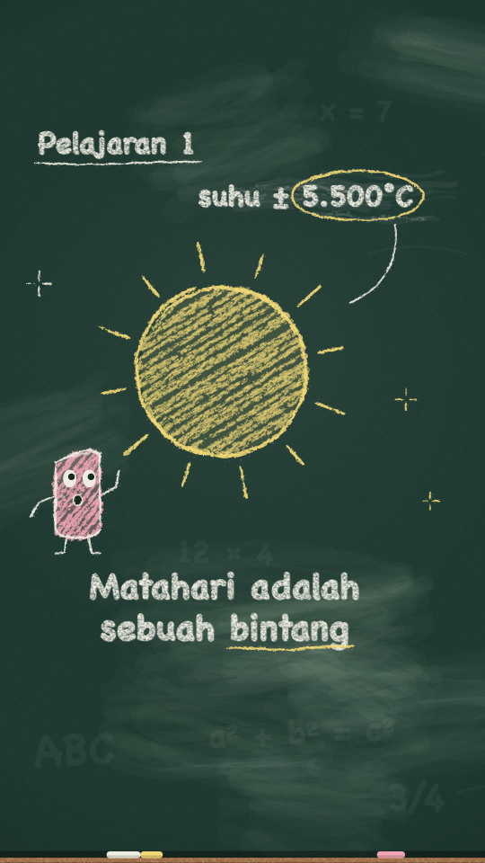

# Chalkboard

Chalk drawings and handwriting on a classroom chalkboard, for lessons and explainers (kids and adults). A deep green-black slate carries the faint clouds of earlier erasing; white chalk draws everything, and a few coloured chalks point at what matters. Things are **chalked in, scribbled in colour, then marked** (an underline, a ring, a tick), and old work leaves the board under an **eraser swipe** that leaves dust behind.

**The one rule:** nothing is flat paint or a clean vector line. Every mark is grain: speckles and drag dashes along a hand-wobbled path, broken where the pressure drops, so the board shows through.

## Palette (`CH` in kit.js)

| role | value | use |
|---|---|---|
| board (paper) | `#1f3a32` (dark `#16291f`, light `#2a4a40`) | the slate; also the blank sheet a morph happens on |
| white chalk | `#f1efe4` (dim `#c9cfc4`) | every outline, all lettering, arrows, the hero's eyes and limbs; dim for orbits, moons, faint guides |
| yellow chalk | `#f3d977` | THE emphasis colour: the word to read (underline / ring), one glowing object (the sun, a lit bulb) |
| pink chalk | `#f2a7b6` | the hero (a stick of pink chalk); at most one other accent (a motion arrow) |
| blue chalk | `#9cd0ee` | water, sky, the Earth |
| green chalk | `#b8e2a4` | land, a tick (correct) |
| orange chalk | `#f2b27a` | spare, for a second category in a diagram |
| props | wood `#7a5233` / `#9c6c45`, felt `#8e8f8a` | the eraser and the chalk ledge: real objects, flat and small |

## The chalk stroke model

- **`chLine` = body + grain marks + edge dust.** The path is resampled, wobbled (`chWob`, phases reseed on `B`) and written on (`frac`). Along it: a soft body ribbon (alpha `under`, default 0.2) whose **width follows the pressure** and which breaks off entirely where the stick skips; then per sample ~0.8·w short marks dragged **along the tangent** (two weights, fine and coarse; never axis-aligned squares, which read as pixels) scattered across the width with a triangular falloff (dense centre, ragged edges); then a few loose 1 px dust specks just outside the edge.
- **Pressure.** A keyed (static) pressure map per stroke: a slow swell, a dry drop-out every ~180 px (density down to 20%, the body gone), and a taper at both ends. Pressure drives both grain density and stroke width (30–108% of `w`). Lower `press` = drier, thinner, more broken (0.5 gives a dotted guide line). Speckle *positions* reseed on the boil; the pressure map and path never move — the chalk shimmers, it doesn't swim.
- **Fills are side-of-chalk scribble** (`chFill`): zig-zag chords computed against the outline (not clipped), each row offset a little and overshooting the edge by up to 8 px, drawn as one wide (1.12·gap, so rows just overlap), lower-density `chLine` — grainy coverage with board showing through, over a faint rubbed-in wash (`base`, ~0.07–0.3) that is clipped to the write-on front, so no flat disc appears ahead of the scribble.
- **Text** (`chText`): the local hand font is rendered once per string/size/colour into a cached canvas; each frame it is copied to a cached scratch canvas and knocked through a seeded grain tile (holes and short drag marks, `destination-out`) at an offset that reseeds on `B`, then drawn twice (a 35% dusty second edge 1.6 px off). Letters write on left to right (a clip at the glyph positions).
- **The board** (`chBoard`): cached overlay over the slate colour — a lit centre and dark edges, slate grain, ghosts of old lessons (`a² + b² = c²`, `12 × 4`, `ABC` at 5% white, placed clear of the tag, the equation row at y ≈ 480 and the caption), long faint ghost strokes, nine eraser-swirl smudge clouds, and a wooden chalk ledge with three chalk stubs at the very bottom (below the safe area). `post()` adds a few hundred boiling dust motes.
- **Line weights at 1080 wide:** outlines 9–11, props 5–7, fills auto (≈13), orbits/guides 4 at alpha 0.55, lettering 54–78 px bold.

## Motion habits

- **On 2s** (`ones: false`): the grain of every stroke and every text mask reseeds on `B`.
- **Write-ons, not pops.** Outline first (`frac`), a chalk stick (`chStick`) riding the tip via `chTip`; then the colour scribble (`part`); then rays / labels; then the emphasis mark. Only reactions pop (a hop, a tick).
- **The eraser wipe** (`chWipe(path, width, frac)`) is the signature transition inside an era: call it after drawing what it erases; the band returns to board with feathered dust streaks (`chSmear`: soft streaks of mixed length plus dry grain, keyed to the whole path so they do not crawl), the eraser prop rides the front, dust puffs off it. The smear stays on the board for the rest of the era. The prop disappears at `frac` 1: give it a follow-through in the scene (the demo lifts it off to the right with `chEraser`).
- **Emphasis lands after the line is down:** underline (`chUnderline`), ring (`chCircle`, overshoots its start), arrow (`chArrow`, the head flicks in last), tick / cross / star / twinkle.
- **Morphs** happen on the bare board: the old era is erased down into the shape (dusty smears outside the rim, the eraser sweeping half a turn round it), its tag and caption are **wiped left to right** during the shrink (`chErasing`, leaving smears) so nothing un-erased hangs over the window, the blob is a colour scribble inside a white chalk outline, and the new era opens out of a chalked rim.
- The hero ("Kapur", a pink chalk stick with a worn, slanted top) hops on the beat, points (`arms`), looks at the subject (`look`), and blinks; moods `calm`, `wow`, `happy`. Its eyes and mouth are white chalk over a rubbed-dark patch, so the face reads over the scribble at phone size.

## Frame checklist (chalkboard)

1. **Grain test at 100%.** Zoom to any outline: it must break into specks and dashes with board between them, with at least one dry drop-out. A clean continuous line means `chLine` was bypassed (no raw `ctx.stroke` for drawings).
2. **No flat fills.** Every coloured area is a scribble with board showing through; only props (eraser, ledge) and eye-whites are flat.
3. **White carries the frame.** Count colours: white everywhere, yellow on one word or one glowing thing, pink on the hero. A third accent needs a reason (a diagram category).
4. **Text reads at phone size.** Captions 70–80 px, ≤ ~18 characters a line, two lines max, white; equations ≥ 54 px. The grain mask must not eat strokes — if a word looks moth-eaten at 50% scale, raise size or weight, not contrast.
5. **The board stays a board.** Smudge clouds and ghosts visible but under 6% white; nothing full-bleed; the morph happens on bare slate.
6. **Order of the hand.** At any moment one thing is being written; the stick or the eraser is on it.
7. **Safe area.** Content inside x 60–940, y 250–1500. The tag sits at y ≈ 340, the caption at y ≈ 1330–1420; the ledge lives below 1820.
8. **Speed.** < ~50 ms/frame for a typical lesson frame (demo: 10–45 ms; the first frame builds the board texture, ~110–150 ms).

## Kit API (`styles/chalkboard/kit.js`)

- **Strokes:** `chLine(P, { w, col, a, key, frac, amp, step, closed, dens, press, under })`, `chWob(P, key, amp)`, `chClose(P)`, `chTip(P, frac)`, `chLoopPts(cx, cy, rx, ry, over, a0)`
- **Fill:** `chFill(P, col, { ang, gap, w, a, part, key, base, over, dens, press, under })`
- **Text:** `chText(str, x, y, size, { col, align, frac, key, a, weight, rot })` returns `[x0, x1]`; `chTextW(str, size)`; `chTextEntry(str, size, col, weight).xs` (glyph positions, to mark a word)
- **Emphasis:** `chUnderline(x0, x1, y, { col, w, frac, bow, double })`, `chCircle(cx, cy, rx, ry, { col, frac })`, `chArrow(P, { col, w, frac, head })`, `chStar(x, y, r, o)`, `chTick(x, y, s, o)`, `chCross(x, y, s, o)`, `chTwinkle(x, y, r, { ph, col })`
- **Lesson props:** `chNumberLine(x0, x1, y, n, { start, frac, labels })`, `chAxes(x, y, w, h, { frac, curve: (u) => v })`, `chBox(x, y, w, h, { label, fill, frac })`, `chSun(x, y, r, { frac, turn, rays })`, `chEarth(x, y, r, { frac })`, `chBook(x, y, s, o)`, `chBulb(x, y, s, { frac, lit })`
- **Tools:** `chStick(x, y, ang, s, col)` (the chalk in hand), `chEraser(x, y, ang, s)`, `chWipe(path, width, frac, { key, tool, dust })`, `chSmear(path, frac, halfWidth, key, dust)` (the dust an eraser leaves), `chErasing()` (0..1 while the current era's captions are being wiped before a morph; reads `BRIDGES`), `chErased(xa, xb, yc, halfH, er, key, draw)`
- **Board:** `chBoard({ fill })`, `chBoardTex()`
- **Hero:** `chHero(x, y, r, { mood, look, arms, sx, sy, rot, legs, step, key })` sets `SPARK_AT`; `chHeroPts(x, y, r)`
- **Captions (DEFER):** `chTag('Pelajaran 1')`, `chCaption(['line one', 'line two'], [lineIndex, 'word', 'underline' | 'circle', colour], { y, size, at })`
- **STYLE:** `backdrop` (slate tinted toward c, smudges kept, a fresh erase swirl mid-transition), `window` (dust smears round the rim, white chalk rim, the eraser riding it while shrinking), `blob` (colour scribble + white outline), `hero`, `heroColor` (pink), `heroPts`, `post` (dust motes)
- **Needs from the head:** `HAND` (e.g. `"Chalkboard SE", "Chalkboard", "Segoe Print", "Ink Free", "Comic Sans MS", "Comic Neue", cursive`), `CX`

## Do / don't

- **Do** key everything (`key`), let only the grain reseed on `B`, and cache only static things (board texture, text bases, the grain tile).
- **Do** erase with `chWipe` instead of fading things out; leave the smear.
- **Do** put a chalk stick on the line being written and the eraser on the swipe.
- **Don't** use flat fills, gradients, drop shadows on chalk, or pure `#ffffff`.
- **Don't** fill a frame edge to edge; a lesson board has air.
- **Don't** redeclare core names (`ink`, `hatch`, `pencil`, `stipple`, `grain`, `resample`, `trace`, `ellipsePts`): the kit's are `chLine`, `chFill`, `chText`, …
- **Don't** load fonts, images or URLs. Chalkduster (macOS) looks chalkier but is hard to read at phone size; Chalkboard SE plus the grain mask reads better.

## Not matched / known limits

- Fonts are system fonts: on Windows the text falls back to Segoe Print / Ink Free (thinner) — raise sizes there.
- Very long strokes (window rims) use a coarser step. The body ribbon is a plain polygon: on a very sharp corner of a wide stroke it can pinch.
- The eraser prop is drawn flat (top view) and does not smear what it passes over in real time beyond the band.
- Captions are wiped by an invisible hand during a morph's shrink (no eraser prop on them: the one eraser is on the rim); on 2s that wipe is only five poses.
- `chEarth`'s continents are two generic blobs, not a map. The hero is a plain stick of chalk: its charm is the face and the hop, not the silhouette.
- The scribble's wash (`base`) is flat colour under the grain; above ~0.3 it starts to read as paint.

**Proven on:** this demo (6s, 24fps / 120 BPM, 9:16): an eraser wipes last lesson, the sun is chalked in with its temperature, the sun's circle morphs into the Earth, the Moon orbits it and "1 putaran ≈ 27 hari" writes itself.
