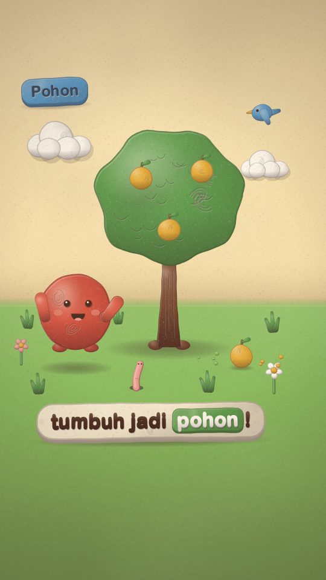

# Clay

Claymation: plasticine stop-motion shot on a small studio set. Everything is a lump of soft matte clay — a chunky rounded volume lit from the top-left, with a shaded underside, a faint rim, fingerprints, knife marks and visible seams where two pieces were pressed together. Lines are rolled "sausages". Things stand on a tabletop with a soft contact shadow, in front of a plain card backdrop that bends into the table; a gentle vignette closes the frame. Outlines are slightly lumpy and are re-seeded on every boil step, so the clay "breathes" the way a re-posed puppet does. Letters are chunky pieces of clay on a pressed strip, or stamped into a slab. Motion on 2s, poppy, with squash and stretch.

Pick it for children's content, food, crafts, friendly explainers, anything that should feel handmade, warm and a little funny. Not for data, UI or anything that needs thin precise lines.

**The one rule: every shape is a volume.** Nothing is a flat fill: a shape has a lit side, a shaded side, a rim and (if it stands on the table) a shadow. Clay never fades or teleports: it drops, gets rolled, pressed flat, pinched or pops out.

## Palette and meaning (`CL` in kit.js)

Saturated but slightly dusty plasticine colours on calm grounds.

| role | hex | use |
|---|---|---|
| morph paper | `paper #efe4cf` | the neutral cream card a morph happens on |
| card backdrops | `sky #8fbcc4`, `butter #f2d9a0` | the plain card behind the set: dusty sky blue ("before"), warm butter ("after") |
| tabletops | `cream #f1e3c6`, `grass #8dbb5d` | the bare table, a grass-green slab |
| **hero** | `red #d4513c` | Bulat, the round hero. Reserved for the hero. |
| accent | `mustard #e3aa35` | fruit, tags, the caption's highlight tab, flower centres, beaks |
| growth | `leaf #5f9a4a` | tree crowns, grass, stems, the "result" highlight tab |
| critters | `blue #5f9fc8` | small living details (a beetle, a bird), tags on warm cards |
| earth | `brown #7b4a2e` | seeds, trunks, stems |
| ink | `choc #4f2f20` | letters, eyes, mouths, grooves (never pure black) |
| small parts | `pink #e79a8f`, `stone #b9b0a3`, `white #fbf4e6` | worms and tongues, pebbles, clouds, petals, eye glints |
| light and shade | `light #fff6e0`, `shade #2e1a1e` | every colour lifts toward `light` and deepens toward `shade` (`clyTone`); all shadows are `shade` at low alpha |

A frame uses one card + one table + the hero's red + two or three clay colours. Morph between earthy neighbours (brown → leaf, mustard → red); the blend is a believable mixed clay.

## Volume, texture and shadow

- **A lump** (`clyLump`): the outline gets fixed lumps from its key (`clyBlobPts`) and a 1–2.4 px wobble re-seeded each boil step (core `wobble`). Fill = a radial gradient from a highlight at the upper-left (tone +0.24) through the base colour to the lower-right edge (tone −0.30); then, clipped to the shape: a linear underside shade (to 26% `shade`), five soft seeded hollows and bumps, a fine matte speckle (a seeded 256 px tile, anchored to the shape so it travels with it), a soft matte highlight (never a glossy glint), fingerprints, and a rim: a light lip along the top-left and a darker edge all round.
- **A slab** (`flat: true`, `thick`): lit evenly across its top face, with a visible darker side below it. Caption strips, tabs and tags.
- **Fingerprints** (`dents`): sets of three concentric pressed arcs (dark line + light lip), at fixed seeded places, nudged ≤ 1.2 px per boil step.
- **Seams and grooves** (`clySeam`): a dark line with a thin light lip under it — where an arm meets the body, a knife mark on bark, the smile, the line on a seed.
- **A roll** (`clyRoll`): four stacked round-capped strokes (shaded underside, body, lit top, a thin light line) and small knife nicks across it.
- **Shadows:** a flattened radial gradient on the table under everything that stands (`clyShadow`; it shrinks and fades as the thing lifts), and a flat offset copy on the card behind things stuck to the backdrop (`cast`). No `shadowBlur`, no filters.
- **The set** (`clySet`): painted once per colour pair into an offscreen canvas — the card with a lamp's pool of light, the bend where it turns away from the light, the tabletop with a soft edge and a darker front, big seeded blotches and the speckle. `STYLE.post` adds the vignette (cached) and a ±2% exposure flicker per boil step.
- **Type:** `CLY_FONT` = `"Arial Rounded MT Bold", "Varela Round", "Nunito", "Baloo 2", "Segoe UI", "Trebuchet MS", "DejaVu Sans", Arial, sans-serif`, weight 800, set letter by letter (each letter tilts a hair and is re-posed every other boil step). Raised letters have a shadow, a dark side and a lit face; stamped letters are a dark fill with a light lip below. Captions 64 px, tags 50 px.

## Motion habits

- On 2s (`ones: false`); the outline boil runs on the same step, so held poses still breathe.
- **Squash and stretch on everything that lands** (`clyLand`: wide and low, then tall, then settled, ~0.5 s) with a few crumbs thrown up (`clyBits`). A push pinches a ball tall and thin; a jump stretches it.
- **Entrances are physical:** drop in from above, hop in from the side, pop out with a back-ease (`popS`), rise out of a hole. Nothing fades in.
- **The hero** hops rather than slides (two hops to cross a third of the frame), lands with a squash, waves on a 4-step loop, blinks every ~3 s.
- **Idle life:** clouds slide along the card, a worm sways, grass and flowers lean on 2s, a beetle walks, a bird flaps between two wing poses.
- **Captions:** the strip pops open, letters are pressed on one by one (0.035 s apart); the highlighted word's tab appears just before its letters. Strip and tag squash away as a bridge starts and pop back after it.
- **Camera:** a slow ≤ 6% push inside an era; after a morph the new era opens ~12% close on the object and settles. Never shake.
- **Morph:** on the cream card, the ball of clay is pressed flat against the table (26% squash at the midpoint, its bottom staying put) while its outline and colour change; the window is ringed by a rolled sausage in the object's colour that thins onto the object.

## Frame checklist (on top of grammar/FRAME.md)

1. **Every shape reads as a volume:** highlight top-left, shade bottom-right, a rim. A flat fill anywhere is a bug.
2. **Everything on the table has a contact shadow** and its base sits below the table line (y ≈ 1000 in the demo); things on the card have a flat cast shadow instead.
3. **The medium shows at phone size:** lumpy outlines, at least one seam and a few fingerprints on the big shapes; lines are rolls, never hairlines.
4. **Red belongs to the hero.** Give it a ground it stands out from (sky, cream, butter, grass all work); no red fruit or flowers.
5. **The set stays calm:** one plain card, one table; ≥ 45% of the safe area is bare set. No patterns or gradients beyond the lamp's pool.
6. **The caption is one line on a pressed strip** inside the safe area (x 60–940, y 250–1500), with exactly one word on a coloured tab whose text contrasts with it (dark on mustard, cream on leaf).
7. **Something is being handled:** dropped, pushed, pressed, popped out, or bouncing — plus two or three idle critters.
8. **Bridge objects are round-ish lumps of similar proportions,** clear of everything else at the bridge time.

## Kit API (`kit.js`, on top of `kit/core.js`)

- Palette and font: `CL`, `CLY_FONT`.
- Colour: `clyRGB(c)`, `clyMix(a, b, u)`, `clyTone(c, k)` (k < 0 deeper, k > 0 lighter), `clyA(c, alpha)`, `clyLum(c)`; all accept hex or `rgb()`.
- Geometry: `clyBlobPts(x, y, rx, ry, { key, lump, n, rot, bumps, bn })`, `clyCapsule(x0, y0, x1, y1, r0, r1, n)`, `clyCentroid(P)`, `clyHeroPts(x, y, r, n, sx, sy)`, `clyCrownPts(x, y, r, key)`.
- Surface: `clyLump(P, c, { key, amt, raw, dents, flat, thick, cast, grain, inner(bb), al })`, `clyRoll(P, w, c, { key, amt, raw, closed, cast, nicks, al })`, `clySeam(P, { w, c, al, lip, closed })`, `clyPrints(bb, n, key)`, `clyShadow(x, y, rx, ry, al)`, `clyBlotch(g, x0, y0, w, h, n, key, r0, r1, al)`, `clyGrain()` (the speckle pattern).
- Set: `clySet(card, table, { hz })` (world coords, cached), `clyVignette()`.
- Timing and impacts: `clyLand(t0, amt, freq, damp)` (a damped squash value), `clyBits(x, y, tSinceImpact, c | [c…], { key, n, power, r, spread })`.
- Hero: `clyHero(x, y, r, { key, sx, sy, lift, arms: [left, right], look: [x, y], mood: 'smile' | 'happy' | 'wow', c, shadow, dents })` — Bulat; (x, y) the body centre at rest, r the body radius, standing on y + r; sets `SPARK_AT`.
- Props: `clySeed(P, c, { key, rot, dents })`, `clyFruit(x, y, r, c, { key, s, squash, leaf })`, `clyTree(x, base, { x, y, r }, { key, h, w, c, trunk })`, `clyCloud(x, y, w, { key, c })`, `clyWorm(x, y, len, { key, c, w, out })`, `clyTuft(x, y, s, c, key)`, `clyFlower(x, y, s, c, key)`, `clyPebble(x, y, rx, ry, key, c)`, `clyBird(x, y, s, wing, key, c)`.
- Type: `clyFont(size)`, `clyTextW(str, size)`, `clyText(str, x, y, size, c, { align, key, reveal, stamp, jit })`.
- Captions (through `DEFER`): `clyCaption('words *highlight* words', { y, x, size, at, c, hi, col })`, `clyTag('Label', { x, y, size, at, c })`; `clyBridgeK()` is their scale through a bridge.
- `STYLE`: `paper` cream card, `backdrop` (the card in any colour, with the lamp pool and grain), `window` (clip + a rolled ring), `blob` (the pressed, re-shaped ball), `hero`, `heroColor`, `heroPts`, `post` (vignette + exposure flicker), `ones: false`.

## Do / don't

- **Do** build things from a few lumps pressed together and let the rims overlap: the overlap is the seam.
- **Do** put a shadow under everything on the table and shrink it when the thing lifts.
- **Do** act the idea out with hands-on verbs: roll, press, pinch, push, drop, pop.
- **Do** give every key a stable name: lumps, fingerprints and bark marks are seeded by it and must not reshuffle.
- **Don't** draw hairlines, flat fills, sharp corners or glossy white glints; clay is matte and thick.
- **Don't** fade things in or slide them smoothly; on 2s, they hop.
- **Don't** use `shadowBlur`, filters or per-pixel loops per frame; everything expensive is cached once.
- **Don't** set long text: one short line of ≤ ~22 characters per caption; thick letters close up below ~44 px.
- **Don't** morph a ball into a long thin shape, or put anything over a bridge object at the bridge time.

## Not matched / known weaknesses

- Built from the genre's conventions, not measured from a specific reference film.
- It is 2D drawing shaded to look 3D: the light is always top-left, lumps never cast shadows on each other, and a rotated shape keeps an unrotated highlight.
- The radial shading is sized from a shape's bounding box; very long shapes should be slabs (`flat: true`) or rolls.
- Letters come from a system font, so they are clay-shaded type rather than hand-rolled letterforms, and the face varies by platform (Arial Rounded on macOS; Segoe UI / DejaVu elsewhere are less round).
- The fine speckle is one repeating 256 px tile; it is too fine to show a repeat at normal size.
- Captions are single-line only.
- The demo does not loop seamlessly (the last frame is the tree, the first the empty table).

## Proven on

Its demo only. `demo/` (6s, 9:16, 120 BPM, 24fps): on a sky-blue card and a cream table a brown clay seed drops in spinning and lands with a squash, Bulat hops in and pushes it (it pinches tall), then the seed jumps on its own and Bulat is amazed; clouds slide, a worm watches from its hole, a blue beetle walks by — tag "Biji", caption "Sebutir *biji* kecil". At 3.0s the seed is pressed flat and re-shaped into the crown of a clay tree on a butter card and a grass slab: four mustard fruit pop out, one drops and bounces, Bulat cheers and hops, a bird flaps past, grass and flowers lean, the worm comes back — tag "Pohon", caption "tumbuh jadi *pohon*!". Tile deterministic; ~11–25 ms/frame once the set is cached (the first frame of each set ~85 ms); review: morph on grid, text PASS, story arc PASS, dead beats PASS, -14.9 LUFS, true peak -4.4 dBFS.
