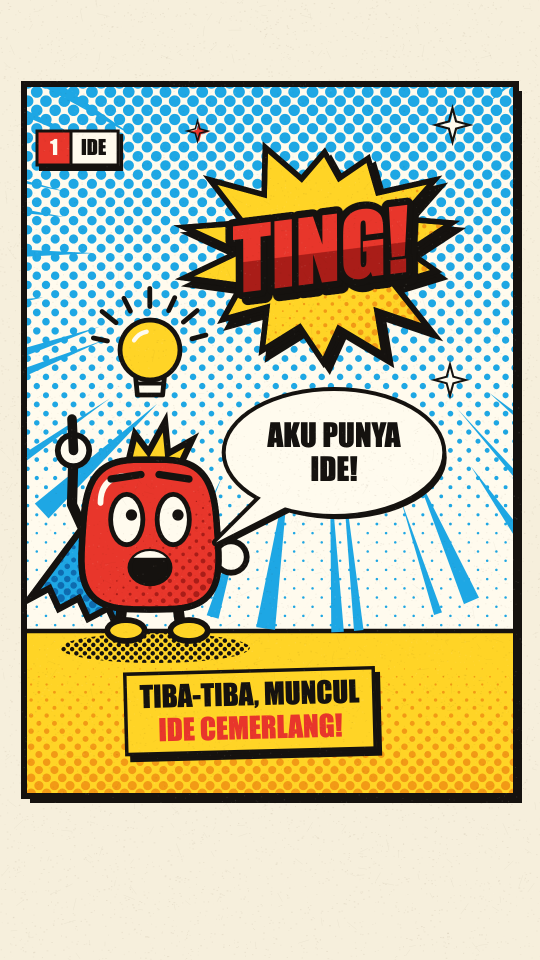

# Comic

A pop-art comic book page: **thick black ink outlines**, flat saturated primaries (red, yellow, cyan-blue) on off-white newsprint, **Ben-Day halftone dots** for every shade and gradient, radial **speed-line bursts**, **panels** with thick borders, hard shadows and paper gutters, **speech bubbles with tails**, jagged **starbursts holding sound-effect words**, and **yellow caption boxes** with a black border. Lettering is heavy condensed capitals with a black outline and a hard offset shadow. Motion is snappy and on 2s: things pop in with overshoot.

Pick it for humour, action, product hype, reveals with a punchline, and stories for teens. Not for calm, tender or data-heavy pieces.

**The one rule: ink, flat colour, dots.** Every shape is a flat fill inside a black line; every shade is a dot screen of a second flat colour. No soft gradients, no blur, no transparency for shading.

## Palette and meaning (`CM` in kit.js)

| role | hex | use |
|---|---|---|
| paper | `paper #f6efdc` (`paperD`) | the page, the gutters between panels; morph paper |
| panel white | `white #fffbee` | balloons, eyes, mitts, light panel grounds, speed lines on colour |
| **ink** | `ink #15120f` | every outline, hard shadows, body text, ground-shadow dots |
| **red** | `red #e8362b` (`redD` for its dots) | the hero (Bang); the highlighted caption phrase; SFX lettering on yellow |
| **yellow** | `yellow #ffd426` (`yellowD` for its dots) | starbursts, caption boxes, SFX lettering on blue, bulbs, suns |
| **blue** | `blue #1ea7e4` (`blueD`, `blueL`) | backgrounds: dot gradients on white (calm) or a flat field (action); the cape |

A panel is paper/white + ink + two primaries dominant, the third as an accent. Red belongs to the hero: avoid red backgrounds. Yellow ↔ yellow and yellow ↔ red morphs stay vivid; blue ↔ red goes through a dull violet-grey.

## Line, fill, texture

- **Ink:** `cmShape` strokes at 8px by default; the hero's line is `r * 0.085`; panels 12px; starbursts and bridge rims 11–13px. Lines are world-scaled (they thicken when the camera punches in, like an enlarged drawing). Mitre joins on jagged things (bursts, panels, boxes), round on bodies.
- **Hard shadow:** an ink copy offset down-right (≈ 1.1w, 1.3w; 12,14 for panels and bursts), never blurred.
- **Dots (`cmDots`):** a 45° screen, pitch 20–26px for grounds, ≈ `r * 0.125` on the hero. Dot radius follows a linear or radial gradient from 0 to `pitch * 0.46`. Shade toward the lower right. The lattice is anchored to the current transform, so body dots move with the body.
- **Misregistration (option):** `const CM_MISREG = 3;` in a piece part shifts every colour fill 3px right / 1.8px down from its ink line (lettering fills by half that). Leave it undeclared for a clean print. Keep it ≤ 4.
- **Newsprint:** `cmPost` lays one static seeded speckle of fibres over every frame (cached canvas, no per-frame cost).
- **Type:** `CM_FONT` = `Impact, Haettenschweiler, "Arial Narrow Bold", Anton, "League Gothic", Oswald, "Bebas Neue", "DejaVu Sans Condensed", "Liberation Sans Narrow", "Arial Black", sans-serif`, capitals only. Weight 400 where Impact exists (it has one weight), 800 on the fallbacks (`cmWeight()` measures once). SFX words 150–200px with a 8.5% outline, a hard shadow, a two-tone fill split at mid-height, tilted −7° to −11° and skewed. Balloon text 54–70px plain ink. Caption text 58px ink on yellow, one phrase red. Tag 40px.

## Motion habits

- On 2s (`ones: false`). Everything arrives with `cmPop(t0)`: a closed-form spring that overshoots about 15% and settles within 0.3s. Nothing fades in.
- A pop gets **impact ticks** (`cmTicks`) flying outward for 0.3s and, for the big one, a 7% camera punch-in that decays fast.
- Starburst spikes reseed every 3 boils; speed lines reseed every 1–2 boils; SFX words shiver a pixel or two on 2s; sparkles pulse; the cape hem flaps; the hero blinks about every 3s.
- Characters jump with a squash on landing; flight is a spring along a diagonal with zip streaks behind.
- Exit: captions and tags snap shut in the first 0.3s of a bridge; they wait for the next era's window to finish growing before popping in (`cmArrive`).
- Morph: the old panel is seen through the bridge shape as a cut-out with an ink rim and hard shadow; the blob is flat colour + dots + ink over faint grey speed lines on dotted paper.
- Put pops on beats and 8ths; the score answers each with a snap, ding or pop.

## Frame checklist (on top of grammar/FRAME.md)

1. **Every shape has a black outline** of consistent weight; nothing bright floats without ink.
2. **Dots are visible at phone size** in at least two places (a ground gradient, a body shade); pitch ≥ 20px on grounds.
3. **The frame is a panel on paper:** a thick border, a hard shadow, a gutter of page showing around it.
4. **One sound-effect word at most** per panel, in a starburst or free-standing, ≥ 150px, tilted, outlined, shadowed.
5. **At most three pieces of text** per panel: SFX, one balloon (≤ 2 lines, ≤ 4 words a line), one caption box (≤ 2 lines).
6. **Balloon tails point at a mouth** and do not cross the face or another text.
7. **Two primaries dominate, the third accents.** The hero's red is not used for backgrounds.
8. **Something just popped or is streaking:** ticks, speed lines, shiver, a flapping cape in every held frame.
9. Captions sit in the safe area (x 60–940, baseline ≤ 1480), SFX words fully inside the panel border.

## Kit API (`kit.js`, on top of `kit/core.js`)

- Palette and type: `CM`, `CM_FONT`, `cmWeight()`, `cmFont(size, { italic, weight, fam })`, `cmTextW(str, size, o)`.
- Geometry: `cmPath(P, closed)`, `cmCirclePts(x, y, r, n)`, `cmRectPts(x, y, w, h)`, `cmBox(P)` → `[x0, y0, x1, y1]`, `cmCentroid(P)`, `cmBurstPts(x, y, rx, ry, n, { key, boil, inner, jit, rot })` (jagged starburst), `cmCloudPts(x, y, rx, ry, n, { phase })` (scalloped cloud).
- Timing and options: `cmPop(t0, { k, d })` (0 → overshoot → 1), `cmMis()` (the colour plate offset from `CM_MISREG`), `cmLeaving()`, `cmArrive(t0)`.
- Ink: `cmShape(P, fill, { w, line, shadow: true | [dx, dy], shadowC, closed, join })` (fill `null` = outline only), `cmLine(P, { w, c, cap })`.
- Dots: `cmDots(P, c, { pitch, r0, r1, angle, pow, box, from, to, radial: { x, y, r0, r1 }, g })` — clipped to outline `P` (or `null` with `box`); gradient linear (`from` → `to`), radial, or flat (`g`).
- Action: `cmSpeed(cx, cy, r0, r1, { n, c, key, w, hold, reach })` (radial speed lines), `cmZip(x, y, ang, { n, len, spread, c, w, key, hold })` (parallel streaks), `cmTicks(x, y, r0, r1, t0, { n, len, w, c, dur, key, rot })` (impact ticks), `cmSparkle(x, y, s, c, { rot, w })`, `cmPuff(x, y, r, { c, w, n, phase })`.
- Page: `cmPaper(c)`, `cmPanel(P, draw, { bg, w, shadow })` (clips `draw()` to the panel, then border and shadow).
- Lettering: `cmText(str, x, y, size, fill, { outline, shadow, line, shadowC, rot, skew, scale, align, base, grad: [top, bottom], italic })`, `cmSfx(str, x, y, size, fill, { t0, shiver, …cmText options })`, `cmBurst(str, x, y, { rx, ry, n, fill, dots, textC, size, rot, t0, key, boil, inner, grad, w })` (starburst + word; returns the outline).
- Balloons: `cmBubble('LINE\nLINE', cx, cy, { tail: [x, y], kind: 'speech' | 'thought' | 'shout', size, t0, out, fill, c, rx, ry, w })`.
- Props: `cmBulb(x, y, s, { t0, key })` (an idea bulb with flicking rays).
- Hero: `cmHero(x, y, r, { key, mood: 'think' | 'aha' | 'grin' | 'dash', look, lookY, squash, rot, wind, stride, bob, hands, c })` — Bang, a red squircle kid with a yellow quiff, white eyes and mitts, black limbs, yellow boots, a blue cape; (x, y) the body centre, feet at `y + 1.3r`; sets `SPARK_AT`. `cmHeroPts(x, y, r)` (bridge outline).
- Captions (through `DEFER`): `cmCaption('LINE ONE\n*HIGHLIGHT*', { x, y, size, at, hi, fill, tilt })` (`y` = baseline of the last line, `at` = seconds after the era starts), `cmTag('1', 'LABEL', { c, x, y, at })`.
- `cmPost()` (newsprint speckle), `cmGrain()` (its cached canvas).
- `STYLE`: `paper` page, `backdrop` flat colour + faint ink dots, `window` (hard shadow + clip + 13px ink rim), `blob` (grey speed lines + flat colour + dots + ink + shadow), `hero` (Bang), `heroColor` red, `heroPts`, `post` cmPost, `ones: false`.

## Do / don't

- **Do** write all lettering in capitals and keep it short; an SFX word is one word and an exclamation mark.
- **Do** use Indonesian sound words: TING! (idea), DUAR! (explosion), WUSS! (speed), BRAK! (crash), JRENG! (reveal), KRIUK! (crunch).
- **Do** draw the fill, then `cmDots`, then the outline again (`cmShape(P, null, …)`) so dots never sit on the ink.
- **Do** use the same outline function for a bridge shape and the drawn shape (`cmBurstPts` with the same `key` and `boil`).
- **Do** slant an action panel (a quad instead of a rectangle) and keep a calm panel square.
- **Don't** use alpha, blur or soft gradients for shading; don't use more than three colours plus ink in a panel.
- **Don't** set long sentences in the SFX face, or lower-case anything.
- **Don't** put a balloon over the hero's raised arm or face; move the arm or the balloon.
- **Don't** raise `CM_MISREG` past 4: eyes and small lettering start to look broken instead of printed.
- **Don't** morph a starburst into a long thin shape, or red into blue.

## Not matched / known weaknesses

- Built from the genre's conventions, not measured from a specific reference.
- Lettering depends on the system: Impact on macOS / Windows; on Linux the fallback is a bold condensed sans, which is wider and less punchy, so line widths differ slightly between machines.
- SFX words are one string on one baseline (tilt, skew, shiver); no per-letter bounce, arc or size ramp.
- Dot screens are single-colour circles on a fixed 45° lattice; no CMYK rosette, no dot-shape variation. Dots inside a rotated or scaled object rotate with it.
- Misregistration shifts fills only; it is not a true per-plate offset of the whole image.
- One hero with four moods; no second character, no side or back view. The cape is a simple flap that looks jagged when streaming.
- Balloon tails are straight triangles; a tail aimed along the balloon's long axis gets thin.
- Captions are hidden for the 1.2s of a bridge, so an era under about 2.5s leaves little reading time.

## Proven on

`demo/` (6s, 9:16, 120 BPM, 24fps, `CM_MISREG = 3`): panel 1, Bang is stuck ("HMM…", drifting question marks) on a blue dot-gradient ground; at 0.5s a yellow starburst pops with "TING!", a bulb lights, he jumps with a finger up and says "AKU PUNYA IDE!", caption "TIBA-TIBA, MUNCUL IDE CEMERLANG!". At 3.0s the starburst morphs into a sun disc; panel 2 is a slanted action panel on flat blue with white speed lines, a red spiked ring behind the sun, dust puffs, Bang shooting in from the corner with "WUSS!", caption "…DAN LANGSUNG BERAKSI!". Tile deterministic; about 10–25 ms/frame; review: morph on grid, text PASS, story arc PASS, dead beats PASS, −15.4 LUFS, true peak −1.0 dBFS.
