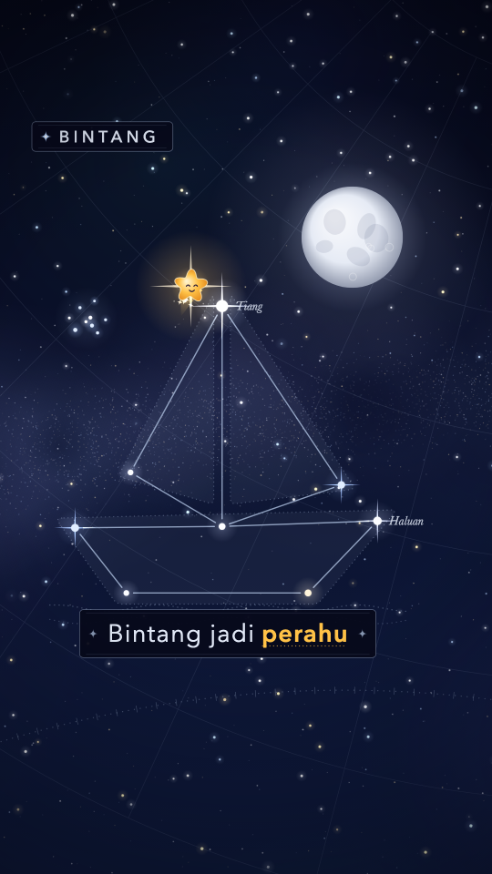

# Constellation

A celestial atlas come alive. The ground is a deep night sky: near-black indigo at the top falling to midnight blue, a faint milky-way band made of thousands of tiny stars, a little violet and teal nebula haze. Every subject is a **constellation**: 6–20 bright stars of different magnitudes (a small sharp disc, a soft halo, four-point diffraction spikes on the brightest) joined by thin pale lines that stop short of each star, the way lines do in a star atlas. Behind the figure a very faint filled silhouette with a dotted contour hints at what it depicts. Around it sits chart furniture in hairlines at low alpha: arcs of a coordinate grid, a dotted ecliptic, a ring with degree ticks, small italic star names. Planets are small shaded discs with a ring or a crescent phase; there is a moon, comets and shooting stars with tapering tails, orbits as thin ellipses. Motion on 1s, calm and wondrous.

Pick it for space and science, night-sky and "signs of creation" (tadabbur alam) pieces, big-number facts, calm openers and closers. Not for busy UI, dense data, daylight scenes or anything that needs solid coloured shapes. Use generic, invented star figures or everyday objects (a boat, a bird, a tree, a lantern, a whale); do not draw zodiac / astrology figures or people.

**The one rule: pictures are made of stars.** A subject is never a filled drawing: it is points of light joined by lines, with at most a whisper of an atlas illustration behind. Only true celestial bodies (moon, planet, comet, the hero) are solid.

How it differs from its neighbours: `neon` is glowing tubes and saturated colour; `math` is a black stage with axes and graphs; `line-art` is one continuous line on a light ground. Here the line is secondary — the stars carry the picture and the sky is never empty.

## Palette and meaning (`CST` in kit.js)

| role | hex | use |
|---|---|---|
| morph paper | `paper #0a0f26` | the bare sky a morph happens on |
| sky | `night #060818` → `night2 #101c40` | the vertical gradient (top → bottom); `deep #03040c` for fades and the vignette |
| star white | `star #f6f8ff` | most stars, flashes, line heads |
| warm star | `warm #ffe6b0` | pale gold-white stars, a lantern flame, a small moon |
| cool star | `cool #b9d6ff` | ice-blue stars, clusters, comets |
| **hero / highlight** | `gold #ffc247` (`goldD #e2861a`, `goldL #fff3cc`) | Kejora the little star, and the caption's one highlighted word. Nothing else. |
| chart lines | `line #a9bcda` | constellation lines, grid, rings, orbits, dotted contours |
| text | `ink #e3eaf8`, `dim #7f90b4` | captions, tags, star names |
| haze | `violet #7b5fd0`, `teal #3db5ad` | nebula clouds, at 5–11% alpha only |
| bodies | `moon #e6ebf5`, `planet #86bccb`, `ring #d5dcef` | the moon, a planet and its ring (planets may take other cool or dusty colours — never gold) |
| plates | `band #070a1b` | the dark plate under captions and tags (95% opaque) |

A frame is ~85% dark sky. Brightness, not hue, carries the hierarchy: brightest = the hero and the figure's lead star, then the figure, then the furniture, then the field.

## Line, light and type

- **The sky** (`cstSky`): one 2900 px square layer painted once (16 nebula clouds, ~46 soft band glows, 9000 tiny milky-way stars with dust lanes punched out, 2600 field stars with a power-law brightness). Per frame it is only rotated about a pole or drifted, and ~110 twinklers are added on their own slow seeded clocks.
- **A star** (`cstStar`): radius = magnitude (3 faint … 11 very bright). Halo = radial gradient 4.6 r, additive; spikes on r ≥ 7.5 (5.6 r long, a hair thick); the disc is tinted 45% toward its colour.
- **Constellation lines** (`cstLink`): 2.8 px at 82% alpha in `line`, round caps, stopping 9 px short of each star's disc. A white dot rides the drawing end.
- **Atlas illustration** (`cstIllus`): 7.5% fill + a dotted contour at 42%, corners softened. It must stay a whisper.
- **Furniture:** hairlines 1.2–1.8 px at 10–60% alpha; all widths are divided by the camera zoom so they stay hairlines.
- **Bodies:** discs lit from the upper left with a radial gradient, a soft additive glow, no outline. A ring is drawn half behind and half in front of its planet.
- **Type:** `CST_FONT` = `"Avenir Next", "Gill Sans", Optima, "Helvetica Neue", "Segoe UI", Arial, sans-serif`, weight 400 (500–600 for tags and the highlight), tracked wide (tags 0.24 em, upper case; captions 0.045 em). Star names are `CST_ITALIC` (Baskerville / Palatino / Georgia italic), 27 px. Captions 54 px in `ink` on a dark plate with a hairline frame and a four-point star at each end; one word in gold with a dotted underline. Tags 36 px on a smaller plate at the top left.
- No `shadowBlur`, no filters, no per-pixel loops per frame; a cached vignette is the only post pass.

## Motion habits

- On 1s (`ones: true`), smooth and unhurried. Nothing bounces hard; stars pop with a small back-ease and a thin flash ring.
- **Figures build in order:** a star lights, a line runs to the next star, that star lights — one unit per line (`progress`, or beat-locked with `cstTimed`). Stars not lit yet can show as faint "ghost" dots. The atlas illustration fades up only after the lines have joined.
- **The hero flies the pen** (`cstFigurePen`): it travels along each line as it is drawn, its tail pointing back the way it came, and hovers beside the finished figure.
- **The sky always moves a little:** a slow rotation about a pole (~0.02 rad/s) or a drift (~10 px/s); twinkles are seeded and slow (periods 2.5–6 s).
- **Occasional events:** one shooting star per era at most (0.55 s, then gone); moons run along their orbits; a chart ring draws round and keeps turning slowly; waves and haloes breathe.
- **Captions and tags:** the plate opens sideways and the text fades in inside it; both close as a bridge starts and reopen once the next era is open.
- **Camera:** a slow drift or push of ≤ 5–6% inside an era; after a morph the new era may open ~12% close on the body and settle. Never shake, never whip.
- **Morph:** on the bare sky, a lit body changes outline and colour inside a turning chart ring with five small stars riding on it; the window's rim is a hairline with a string of small stars.

## Frame checklist (on top of grammar/FRAME.md)

1. **The subject is a constellation:** 6–20 stars, at least three clearly different magnitudes, one lead star with spikes. If it reads without its lines, it is too literal; if it does not read with them, add the illustration, not more lines.
2. **Lines stop short of the stars** and never cross a star's disc; no line is thicker than 3 px.
3. **The illustration whispers:** you should have to look for it. If it is the first thing you see, lower it.
4. **Gold is only the hero and the highlighted word.** Warm stars are pale (`warm`), never gold.
5. **The sky is deep and uneven:** the gradient, the band and the haze are all visible; no flat black, no evenly scattered dots. But ≥ 60% of the safe area stays quiet sky.
6. **Furniture supports, never competes:** at most three kinds per frame (e.g. grid + ring + names), all at low alpha.
7. **The caption sits on its opaque plate** inside x 60–940, y 250–1500, one line, one gold word; no star or figure crosses the caption or the tag.
8. **Something is alive:** twinkles plus one of — a figure being joined, a moon on its orbit, a ring drawing, a shooting star, the hero flying.
9. **Bridge objects are round bodies** (moon, planet, a lead star's halo) of similar size, clear of every figure, label and the hero at the bridge time.

## Kit API (`kit.js`, on top of `kit/core.js`)

- Palette, fonts: `CST`, `CST_FONT`, `CST_ITALIC`.
- Colour and small helpers: `cstRGB(c)`, `cstA(c, alpha)`, `cstMix(a, b, u)` (hex or `rgb()` in), `cstPx()` (one screen pixel in world units), `cstCentroid(P)`, `cstEase(f)`.
- Sky: `cstSky({ key, pole: [x, y], rot, dx, dy, al, top, bottom, twinkle })`, `cstSkyLayer(key)` (the cached layer `{ cv, tw }`), `cstGlow(c)` (cached glow sprite), `cstDim(al, c)` (fade the era toward black), `cstVignette()`.
- Stars: `cstStar(x, y, r, { c, s, al, tw, halo, spikes, rot })`, `cstFlash(x, y, tSinceLit, { dur, r, grow, c, al })`, `cstCluster(x, y, r, n, key, { c, al })`.
- Figures:
  - `cstFigure(points, edges, { progress, ghost, illus, illusAl, labels, lineC, lineAl, w, gap, al, key, hero })` — points `[x, y, r?, colour?, name?]` or `{ x, y, r, c, name, side }`; edges `[[i, j], …]` in drawing order. `progress` 0..1: stars pop in one by one, each line runs star to star, then the figure settles.
  - `cstFromOutline(pts, n, key)` → `{ points, edges, illus }`: turns ANY closed outline into a constellation (the n most telling corners, plus one or two inner stars when n ≥ 9).
  - `cstFigurePen(points, edges, progress)` → `[x, y, k, f]`: where the pen (and the hero) is.
  - `cstTimed(times, t = TT)` → progress, with line k finishing at `times[k + 1]` (needs `edges.length + 1` times); `CST_SETTLE` = the settle tail in line units; `cstPlan(points, edges)` → when each star lights.
  - `cstLink(a, b, { frac, gap, w, c, al, head })`, `cstIllus(shapes, { al, c, fill, dot, gap, w, step })` (shapes: one outline, a list of outlines, or `{ P, open: true }`).
  - Ready figures → `{ points, edges, illus }`: `cstBoat(x, y, s)`, `cstBird(x, y, s)`, `cstTree(x, y, s)`, `cstLantern(x, y, s)`; `cstFig(x, y, s, pts, edges, illus)` places your own unit-coordinate figure.
- Chart furniture: `cstGrid({ pole, r0, dr, n, spokes, rot, rmax, al, c })`, `cstDotted(P, { frac, gap, w, c, al, ticks })`, `cstEcliptic(x0, y0, x1, y1, bow, o)`, `cstRing(x, y, r, { frac, rot, step, major, inner, labels: [[deg, 'text'], …], size, c, al })`, `cstCross(x, y, s, { c, al, rot, circle })`, `cstOrbit(x, y, rx, ry, rot, { frac, dash, c, al, w, a0 })`, `cstOrbitPt(x, y, rx, ry, rot, a)` → `[x, y, front]`.
- Bodies: `cstPhaseClip(x, y, r, phase, rot, c)` (clip to a disc's lit part), `cstMoon(x, y, r, { phase, rot, c, al, glow, key })`, `cstPlanet(x, y, r, { c, ring: true | { rx, ry, tilt, c, al, s }, bands, phase, rot, glow, al, key })`, `cstComet(x, y, ang, len, { r, c, al, w })`, `cstShoot(tSinceStart, { from, to, dur, len, c, r })`.
- Hero: `cstHero(x, y, r, { dir, tail, mood: 'smile' | 'happy' | 'wow', look: [x, y], bob, spin, al, key })` — Kejora; `dir` is the way the tail points; sets `SPARK_AT`. `cstHeroPts(x, y, r)` is its outline.
- Type: `cstFont(size, { italic, weight, track })`, `cstTextW(str, size, o)`, `cstText(str, x, y, size, c, { align, track, italic, weight, al, upper })`, `cstLabel(str, x, y, { r, side: 'r' | 'l' | 't' | 'b', size, c, al })`.
- Captions (through `DEFER`): `cstCaption('words *highlight* words', { y, x, size, at, hi, c })`, `cstTag('Label', { x, y, size, at, c })`; `cstPlate(x, y, w, h, al)` is their plate; `cstBridgeK()` their openness through a bridge.
- `STYLE`: `paper` bare sky, `backdrop` (colour + the cached star field), `window` (clip + a starred hairline rim), `blob` (a lit body in a turning chart ring), `hero`, `heroColor`, `heroPts`, `post` (vignette), `ones: true`.

## Do / don't

- **Do** design a figure as stars first: put stars on the corners that define the silhouette, vary their sizes, name one or two.
- **Do** order the edges as one pen path where you can, so the hero can fly it without jumping.
- **Do** give every figure, cluster and body a stable `key`: twinkles and seeded details hang on it.
- **Do** keep one calm sky motion per era (rotate *or* drift) and let events be rare.
- **Don't** fill subjects with colour, outline bodies, or draw thick lines; don't use gold for anything but the hero and the highlighted word.
- **Don't** put a figure, label or the hero over the caption plate, the tag or a bridge object.
- **Don't** scatter extra bright stars near a figure: its stars must be the brightest things around it.
- **Don't** draw zodiac / astrology signs, people, or anything frightening; keep figures generic (boat, bird, tree, lantern, whale).
- **Don't** set long text: one line of ≤ ~24 characters per caption; star names are decoration and unreadable on a phone — never put information only there.

## Not matched / known weaknesses

- Built from the conventions of star atlases and planetarium graphics, not measured from one reference.
- The sky is a flat layer: rotation is a 2D turn about a point, not a true celestial sphere; figures do not turn with it.
- Small star names and ring numerals (24–27 px) are atlas furniture and are not legible at phone size.
- The morph body is a plain lit disc: a moon's maria or a planet's bands and ring pop in when the window opens.
- `cstFromOutline` picks corners well on simple outlines; very concave or thin shapes may need hand-placed stars.
- Uses canvas `letterSpacing` (Chromium 99+); without it the tracking falls back to normal spacing.
- The sky layer is ~34 MB of canvas and its first paint costs ~150–200 ms (once).
- The demo does not loop seamlessly.

## Proven on

Its demo only. `demo/` (6s, 9:16, 120 BPM, 24fps): the sky fades up under a full moon; Kejora flies in and lights eight stars on the 8ths while lines join them into a boat (perahu) that then rocks on dotted waves — the sky drifts, a cluster twinkles, a shooting star crosses; tag "Bintang", caption "Bintang jadi *perahu*". At 3.0s the moon morphs into a ringed planet at the centre of a chart ring: the ring forms, two moons run round their orbit, the sky turns about the planet, Kejora lights a ten-star bird (burung) above it and a shooting star crosses; tag "Langit", caption "Langit penuh *tanda*". Tile deterministic; ~18–47 ms/frame once the sky is cached (first frame ~190 ms); review: morph on grid, text PASS, story arc PASS, dead beats PASS, 0 flat frames, -14.7 LUFS, true peak -3.4 dBFS.
