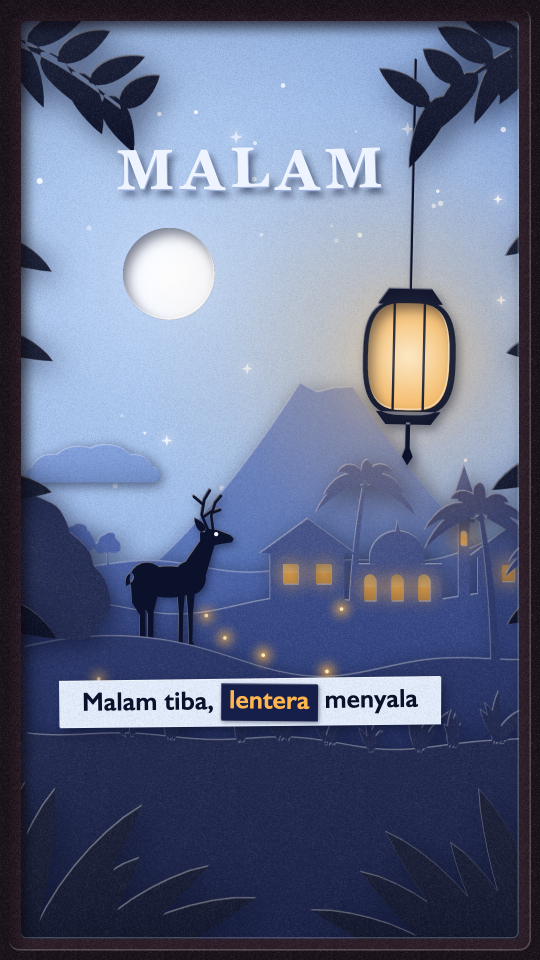

# Diorama

A **layered paper-cut light box** (a shadow-box diorama). The picture is 5–8 sheets of plain paper stacked in depth, each cut into a silhouette — a volcano, hills, a village, palms, a frame of leaves — and lit from behind. The back of the box is a pale glowing sheet with the light cut through it (a sun or moon disc with a soft bloom); every sheet in front is a step deeper in value, down to nearly dark leaves against the glass. **One hue family per era**: a warm dusk, a blue night. No outlines, no patterns, no faces in ink: only cut edges. A dark double mat frames the whole picture like a box. Motion on 1s, slow and calm.

**The one rule: a thing exists only as a cut edge on a sheet, and a sheet's colour says how deep it sits.** Lighter = further back (nearer the lamp), darker = nearer the viewer. Detail is a hole (a window, a star, an eye) that shows whatever is behind it, never a mark drawn on top.

This is not `cut-paper` (torn coloured paper, crayon, patterns, characters with faces, many hues) and not `wayang` (one flat black tone pressed to a screen). Here the depth is the subject.

## Palette and meaning (`DIO` in kit.js)

Each era is a ramp: `light`, then `tones[0..8]` from far to near.

| role | dusk (`DIO.dusk`) | night (`DIO.night`) |
|---|---|---|
| the lamp behind the box (`light`) | `#fff6dc` | `#f3f7ff` |
| sky sheet near the light → far corners (`tones[0..2]`) | `#fde6b0` `#f8cf85` `#f2b866` | `#bcd5f5` `#93b4ea` `#7396dc` |
| furthest scenery (`tones[3]`, also `ERA_BG`) | `#de8a42` amber | `#4f70c0` sky blue |
| middle sheets (`tones[4..6]`) | `#cb6e36` `#aa522d` `#823a26` terracotta | `#3d57a4` `#2e4287` `#212f68` indigo |
| nearest sheet / leaf frame (`tones[7]`) | `#58251d` maroon-brown | `#161f49` navy |
| the hero, small pieces, type on the strip (`tones[8]`) | `#351513` | `#0b112b` |
| bloom and haze (`glow`) | `#ffdc96` | `#c4d8ff` |
| cut-out letters (`text`), caption strip (`strip`) | `#fff3d2`, `#fff1cf` | `#eef4ff`, `#e6efff` |
| the caption's highlighted word (`hi`, on a `tones[7]` chip) | `#ffd27a` | `#ffb650` |

Outside the ramps: `warm #ffb650` / `warmHi #fff0c2` — **the one warm accent of the night** (the lantern, lit windows, fireflies; nothing else is warm there); `mat #170f16` and `mat2 #2b1c27` — the box; `paper #4a2735` — the mulberry sheet a morph happens on; `shade rgba(14,6,14,0.6)` — cast shadow outside an era.

## Paper, edge, shadow

- **A sheet** (`dioSheet`) is flat colour, no outline. It gets, baked once into its own cropped canvas: a **lit lip** 2–3px wide on its top-left cuts (the sheet colour 40% toward white), a faint top-to-bottom value falloff (+6% white → 12% black), **haze** (the lamp's glow colour around the light, strongest on far sheets: `0.34·(1−depth)²`), a very faint grain (light and dark specks ≈ 5% average, a few fibres; one fixed 256px tile), and its **cast shadow** on whatever is behind: offset (12, 12)·gap down-right, blur 48·gap, the ramp's darkest tone at 60%. The blur is wider than the offset on purpose, so a soft dark edge also shows *above* a ridge.
- **Holes** are real: windows are punched out of the village sheet and show the sheet behind; at night `dioWindows` paints warm paper behind them and a small glow in front.
- **The light** (`dioDisc` / `dioLamp` / `dioHole`): an outline cut through the sheet in front, a hot centre fading to the light colour, the cut edge's shadow falling *inside* (down-right), a lit lip on the far wall, a bloom around it that pulses slowly.
- **Moving pieces** (`dioPiece`, `dioCut`: the deer, birds, leaves, the lantern, the caption strip) use a live `shadowBlur` (20·gap, offset 8/11·gap) and the same lip trick (drawn once in the lip colour, again 1.4/2.2px down-right in the body colour).
- **The box** (`dioMat`, in `STYLE.post`): outer mat inset 18px, inner mat inset 42px, each throwing its shadow into the picture; the sky sheet carries the dark corners.
- Sizes at 1080×1920: sun r 118, moon r 92, lantern body 215 tall, deer 250 tall, title 112px, caption 52px.

## Motion habits

- On 1s (`ones: true`), slow, soft easing (`EZ.o3`, `EZ.io`), **no bounce**: paper slides, it doesn't spring.
- **Depth is the motion language.** `dioEye()` is a slow drift of the viewer's eye (±34px, a pure function of time); every sheet moves by `drift × depth`, so the back never moves and the leaf frame moves most. Add a camera push of ≤ 4–7% on top.
- **Scenes build back to front**: sheets rise from below (`dioRise`, 760px over 1.0s, 0.3–0.35s apart) and the leaf frame slides in from both sides last.
- The light pulses (≈ 3s period); clouds drift a few px a second; stars come on one by one and twinkle at their own rates; fireflies wander and blink; windows light one at a time; the lantern sways ±1.6°.
- The hero slides along its ridge like a figure in a slot (a small hop while moving), then idles: head lift, ear and tail flicks, a blink.
- **Morph**: the old era is seen through a hole in a blank mulberry sheet; around the hole two wider cuts step lighter toward the light (a stack of sheets); the hole closes onto the light disc, the disc's outline changes shape as a lit hole, and the new era opens out of it. Bridge the *light* (sun disc → lantern, moon → window, lamp → doorway) with shapes of similar proportions.
- Type: title letters rise in one by one (0.07s apart), each slightly crooked; the caption strip slides up 70px; both fade in the first 0.25s of a bridge.

## Frame checklist (on top of grammar/FRAME.md)

1. **One hue family.** Every sheet in the frame is a step of the same ramp; the only other colour allowed is the night's warm accent, and only on things that give light.
2. **Value = depth, in order.** Back to front goes light to dark with no step skipped backwards; neighbouring sheets differ by at least one tone.
3. **The lamp is visible** (or its bloom is) and is the brightest thing in the frame; nothing crosses it at a morph.
4. **Every sheet throws a shadow and shows a lit lip** — if two sheets read as one shape, their tones are too close or one is missing its shadow.
5. **No lines, no gradients as drawing, no textures as pattern.** Detail is a silhouette's outline or a punched hole.
6. **The mat frames it**; a leaf (or cloud, or wave) frame against the glass closes the corners; the important things sit on the middle sheets.
7. **Something drifts in every held frame** (parallax, the pulse, birds, stars, fireflies), slowly.
8. Type is paper too: pale cut letters with a cast shadow at the top (y ≈ 376), the caption on its strip at y ≈ 1404, the highlighted word on a dark chip.

## Kit API (`kit.js`, on top of `kit/core.js`)

- Palette and colour: `DIO`, `DIO_SERIF`, `DIO_SANS`, `dioEra('dusk' | 'night')` (call first in every scene), `dioTone(i)`, `dioShade(a)`, `dioMix(a, b, u)`, `dioA(c, a)`, `dioRGB`.
- Depth: `dioEye()`, `dioOff(depth)` (a sheet's parallax offset — add it to bridge outlines), `dioLayer(depth, fn, { dx, dy })` (draw moving things on a sheet's plane), `dioRise(t0, dist, dur)`, `dioLeaving()`, `dioArrive()`.
- Paper: `dioSheet(key, geo | () => geo, tone, { depth, dx, dy, gap, lip, a, haze, floor, bare })` — the cached static sheet (`geo` = polygons or `{ P, holes }`; `floor` = a y below which the sheet is plain paper, drawn as one flat fill; `bare: true` adds grain to that fill while it is in view); `dioPiece(fn, col, { gap, shadow, lip })`, `dioCut(polys, col, o)` — moving pieces; `dioHole(P, c, o)`, `dioLamp(P, c, glow, pulse)`, `dioGlow(x, y, r, a, c)`, `dioLip(P, col, w)`, `dioStep(P, col, fn)` / `dioSteps(P, c)` (screen-space cuts for the morph), `dioGrainTile()`.
- Back of the box: `dioSky(x, y)` (the sky sheet, brightest at the light; sets the light for haze), `dioDisc(x, y, r, { pulse, c })`, `dioPulse()`, `dioStars(key, n, { y0, y1, avoid, t0, stagger })`.
- Silhouettes (all return polygons): `dioRidge(key, y, { amp, freq, tilt, bumps })` → `y(x)`, `dioHillPts(ridge)`, `dioVolcanoPts(x, y, w, h)`, `dioCloudPts(x, y, w, key)`, `dioFrondPts(x, y, len, ang, droop, wid)` (leaf, frond, blade), `dioBlobPts`, `dioTree`, `dioPalm`, `dioGrass`, `dioHouse` and `dioMosque` (→ `{ P, holes }`), `dioArchPts`, `dioJoin(...geos)`, `dioLeafFrame(side, part, key)` + `dioLeafSheets(key, tone, { slide })`, `dioCirclePts`, `dioRectPts`, `dioArc`, `dioStarPts`, `dioMove`.
- Life: `dioBird(x, y, s, phase, col)` + `dioBirdPts`, `dioLeavesFall(key, n, col, { x0, x1, y0, y1 })`, `dioFireflies(key, n, { x, y, w, h, t0 })`, `dioWindows(holes, 'back' | 'glow', lit, { depth, dy })`, `dioLantern(x, y, s, { top, sway, lit, ribs })` + `dioLanternPts` (bridge outline).
- Hero: `dioDeer(x, y, s, { face, graze, look, ear, tail, antlers, col, ramp })` — a paper deer in profile with a pale cut-out eye that blinks; sets `SPARK_AT`. `dioDeerPts` (bridge outline).
- Type (through `DEFER`): `dioTitle('SENJA', { y, size, spacing, at })`, `dioCaption('Senja turun di *lembah*', { y, size, at, hi, rot })` (the starred word goes on the dark chip).
- `STYLE`: `paper` mulberry, `backdrop` (a grained sheet of colour c), `window` (the era through stepped cuts with a shadowed, lit edge), `blob` (the light as a hole changing shape, with its bloom), `hero` / `heroPts` (`dioDeer`), `heroColor` night `tones[8]`, `post` (`dioMat`), `ones: true`.

## Do / don't

- **Do** give every sheet its own key and keep its shape static; slide it, don't redraw it. Things that change shape are `dioPiece`s and should be small.
- **Do** put ridges in a const (`dioRidge`) and stand houses, trees and the hero on them with `ridge(x)`.
- **Do** reuse the same sheets in another ramp for a change of time or weather — the same valley at dusk and at night is the look's best trick.
- **Do** give far hills a `floor` when a nearer sheet hides their lower half (it is what keeps a frame near 35 ms).
- **Don't** add a second hue, an outline, a face, or a pattern; don't put a `ctx.filter` blur or a full-frame `shadowBlur` in a scene.
- **Don't** bounce or snap: no springs with overshoot, no pops.
- **Don't** let a nearer sheet be lighter than the one behind it, or let anything cross the light at a morph.
- **Don't** store state between frames: parallax, sway and bridge outlines are all functions of `TT` (the bridge's `B()` runs before the scene does).

## Not matched / known weaknesses

- Built from the craft's conventions, not measured from a reference piece.
- The first frame of each era builds its sheet caches (≈ 0.3 s once per ramp); live playback hitches there, exports don't care.
- Sheets are cached at world size and scaled by the camera, so keep pushes small (≤ 7%); a big zoom would soften the cut edges.
- The flat fill below a `floor` has grain only while `bare` is set; hide the join behind a nearer sheet in held frames.
- Only the dusk and night ramps exist; a new era needs its own nine-tone ramp in one hue.

## Proven on

Its demo only (`demo/`, 6.0s: "Senja" → the sun disc becomes a paper lantern → "Malam").
