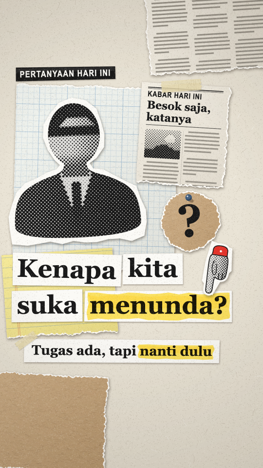

# Editorial collage

The editorial video-essay collage, the news-explainer look: scraps of paper and halftone "photo" cut-outs slapped onto a desk, with a yellow highlighter and a red marker doing the pointing. The ground is warm grey-beige desk paper with grain and fibres; on it lie torn sheets (newsprint, white, kraft, graph paper, a yellow legal pad), newspaper clippings with a real headline and greeked columns, index cards and label-maker strips, held by masking tape, pins, clips and staples. Any outline becomes a cut-out: a monochrome dot screen on white, an uneven white scissor-cut margin, a soft drop shadow, a small tilt. Headlines are heavy serif words, each on its own cut strip. A small cut-out pointing hand with a red cuff hops to whatever is being discussed and taps it. Motion is stop-motion on 2s: pieces slap in from off-frame and settle in four steps.

**The one rule: paper and ink carry the picture; yellow and red only point.** The highlighter marks the one keyword, the marker circles, links, crosses and stamps. Neither is ever a fill, a paper colour or decoration.

Good for: narrated explainers about issues, news and opinions, "the story behind X", media criticism, history-of-an-idea essays, timelines of events, commentary shorts in 9:16.

Built from a written brief and the genre's conventions. It is an original look: no specific channel was measured or imitated, and no reference frames were matched.

## Palette and meaning (`EC` in kit.js)

| role | hex | use |
|---|---|---|
| desk | `desk #e9e3d5` | the ground and `STYLE.paper` (dark variant: a charcoal board `#1c1c1e`) |
| ink | `ink #191919` | type, halftone dots, label strips, greeked rules |
| paper stock | `news #f3eee2`, `white #fbfaf6`, `kraft #c9a77c`, `graph #f1f5f0` (pale blue grid), `legal #f7ea8f` (blue rules, red margin) | scraps; white is also every cut-out's margin and the caption strips |
| torn fibre | `fibre #fffdf8` | the white core a tear exposes, the rim of a bridge's torn hole |
| **highlighter** | `yellow #ffe24a` | multiplied onto paper over the keyword being said; one keyword per sentence |
| **marker** | `red #e3342b` | circles, underlines, arrows, crosses, the stamp; and the hero's cuff |
| photo tint | `steel #3f5b7a` | the one cool tint: a cut-out's dots (and the default pin), to tell two photos apart |
| greek | `grey #9a958b` | bars standing in for body text |
| tape | `rgba(236,223,178,0.80)` | masking tape |

**Dark variant:** `const EC_DARK = true;` before the kit (a `src/options.js` in the piece's `build` list, between `kit/core.js` and `style`) makes the ground a charcoal board. Paper, type and marks stay the same; marker and stamp are drawn opaque instead of multiplied. Rendered once as a test (three stills of the demo), not exported or reviewed.

## Type

- `EC_SERIF` = `"Playfair Display", Georgia, "Times New Roman", "Liberation Serif", "DejaVu Serif", serif`, weight 900 (800 on caption strips): headlines, captions, the headline of a clipping. On a stock macOS or Windows this resolves to Georgia Bold.
- `EC_COND` = `"Arial Narrow", "HelveticaNeue-CondensedBold", "Roboto Condensed", "Liberation Sans Narrow", "DejaVu Sans Condensed", Impact, sans-serif`, bold caps, tracked 7–9%: label strips, kickers, the stamp.
- `EC_TYPE` = `"Courier New", Courier, "Liberation Mono", "DejaVu Sans Mono", monospace`, bold: typed notes on index cards, source lines.
- **Headline words:** 90–120px, one word per strip (`ecHeadline`), 2 lines of 2 words read best; the same face on every strip (it is not a ransom note), only the strips differ by a degree or two.
- **Title block** (`ecTitle`): kicker 36px caps on a black label strip, headline 68px on a newsprint strip, top-left of the safe area.
- **Caption** (`ecCaption`): 56px serif on a white strip centred at `CX`, y ≈ 1440, one `*keyword*` under the highlighter. It shrinks to fit 800px; keep it under about 28 characters so it stays ≥ 50px.
- Labels and typed lines ≥ 30px. Body text is never written: columns are grey bars (`ecGreek`), so nothing fake can be read.

## Motion habits

- On 2s (`ones: false`). Everything is stepped; there is no easing between steps and no motion blur.
- **Pieces slap in** (`ecSlap`, used by every placed piece through `t0`): on `t0` the piece is already a third of the way in from off-frame, turned and lifted (shadow far and pale); next step it overshoots by 7% and counter-rotates; then two small steps and it lies still with a tight shadow. `t0` is the frame the piece is first seen, so it can be a spoken word's time.
- **Fixings come a beat later** (`ecTape`, `ecPin`, `ecClip`, `ecStaple` take their own `t0`): a one-step press, 16% large then settled.
- **Marks are drawn, never faded:** the highlighter sweeps left to right in 0.3s, the marker loop takes 0.4s and overshoots its start, an arrow draws for 0.4s and then gets its two head strokes, a cross is two quick strokes. A mark is already one step long on its `t0`.
- **The stamp thuds:** nothing before `t0`, then one frame at 130%, one at 107%, then still (this one is keyed on the real frame, not on 2s).
- **Idle life:** every sheet breathes by under a degree and is nudged half a pixel each step (as if re-placed under the camera), torn edges re-tear slightly every step (three variants), grain shifts every step, a tape end lifts for a few steps now and then, the hand bobs along its pointing axis and taps (one step back, a jab, a rebound), a clock's hands tick.
- **Camera:** a slow push (≤ 4%) or a drift across the desk; after a bridge the new era opens about 7% close and settles on a spring. No shake.
- **Transitions:** the shape morph. The old era is seen through a hole torn in the top sheet (white fibre rim, a shadow just inside the edge), the hole closes on a scrap, the scrap changes shape and stock on the bare desk, and the new era opens out of it. Use two scraps of similar proportions (a round one → a squarish one). Captions and the title are pulled off the frame in the first 0.3s of a bridge (the caption drops out of the bottom, the title slides off left) and land again when it is over.
- **One new scrap per sentence** is the rhythm; a hard cut is rarely needed because every new piece is its own small cut.

## Frame checklist (on top of grammar/FRAME.md)

1. **It reads as layered paper:** at least three depths overlap somewhere in the frame (a background sheet, a cut-out or clipping on it, a strip, mark or tape on top), each with its shadow. A frame of separate, non-touching pieces is flat vector.
2. **The halftone shows at phone size:** every cut-out is ≥ 250px on its short side with a dot pitch of 9–12px, and its silhouette is recognisable without its label.
3. **Yellow and red only point:** at most one highlighter sweep and two marker marks being added in a beat; neither colour appears as a paper or a fill.
4. **One steel-blue photo at most** per frame; the rest are ink.
5. **Every piece is tilted** (1–5°), none is square to the frame, and no two neighbours share an angle.
6. **Real words only:** headline, kicker, caption, stamp and typed notes are real, short and passed in by the piece; everything else is grey bars.
7. **Text sits on paper:** a strip, a label, a card or a clipping. Never bare type on the desk.
8. **The caption band is free:** nothing important between y 1380 and 1500 except the caption strip (with a voice-over, leave it to the subtitles and drop `ecCaption`).
9. **Something moves in every held frame** (a breath, a fluttering tape end, the hand, a ticking hand, the grain).
10. **What matters is inside x 60–940, y 250–1500;** sheets may bleed off the frame, their content may not.

## Kit API (`kit.js`, on top of `kit/core.js`)

Every reveal takes an absolute start time `t0` (absent = already lying there). Positions and sizes are arguments in world px; use `W`, `H`, `CX`, `LX`, `LY`, `UNIT` for other formats.

- Palette and type: `EC`, `EC_DARKMODE`, `EC_SERIF`, `EC_COND`, `EC_TYPE`; `ecFont(kind, size, weight)`, `ecTextW(str, size, kind, weight, track)`, `ecText(str, x, y, size, color, { font: 'serif' | 'cond' | 'type', weight, align, track, al })`, `ecWrap(str, size, maxW, kind, weight)`.
- Motion: `ecSlap(t0, { from: [dx, dy], spin, out, key })` → `{ dx, dy, rot, lift, s, n }` or null before `t0` (`out` = an absolute time the piece is pulled away); `ecPop(t0)` (the one-step press); `ecEv(t0, d)` (a mark's progress, one step in at `t0`); `ecHop(a, b, t0, d, height)`; `EC_STEP`.
- Ground: `ecDesk({ c, key, fibres })` (first call of a scene), `ecFibres(key, x0, y0, x1, y1, n)`, `ecGrain()` (called by `STYLE.post`).
- **Cut-outs:** `ecCutout(subject, x, y, size, { rot, t0, from, spin, out, tint: 'ink' | 'steel', pitch, tone(u, v), opt, key, border, lift, breathe, over(at, k) })` — `subject` is a name in `EC_SUBJECTS` (`bust`, `hand`, `building`, `skyline`, `megaphone`, `globe`, `coins`, `phone`, `clock`), a `{ P, tone, sharp }`, or any outline `[[x, y], ...]`; `size` is the height; `over` draws live on top in the cut-out's frame (`ecClockHands(at, k, h, m, s)` for the clock). `ecHalftone(bb, tone, { pitch, angle, c })` is the dot screen itself. `ecCutout('bust', ..., { opt: { bar: false } })` drops the bar over the eyes.
- **Scraps:** `ecScrap(kind, x, y, w, h, { rot, t0, from, out, key, round, P, tear: [top, right, bottom, left], amt, fibre, bake(w, h), draw(w, h, m) })` — `kind` = `'news' | 'white' | 'kraft' | 'graph' | 'legal'` or a colour; `bake` is static drawing kept in the sheet's sprite, `draw` is live drawing that rides on it (text, marks). `ecClipping(headline, x, y, w, h, { size, cols, image: true | '<subject>', kicker, ... })`, `ecCard(lines, x, y, w, h, { title, size, draw(w, h, m, lineY) })`, `ecLabel(str, x, y, size, { c, align, t0 })` → box, `ecGreek(x, y, w, h, key, { lh, bar, c })` (inside `bake`).
- **Headline strips:** `ecStrip(word, x, y, size, { t0, hi, paper, rot })` → `{ x, y, w, h, top, cx, cy, right, bottom }`; `ecHeadline(lines, x, y, size, { t0, stagger, lh, gap, paper, out })` → the word boxes (a word is `'text'` or `{ s, t0, hi, size, paper }`; `hi` = the time the highlighter sweeps it).
- **Fixings:** `ecTape(x, y, len, rot, { w, t0, flutter, key })`, `ecPin(x, y, r, { c, t0 })`, `ecClip(x, y, s, rot, { t0 })`, `ecStaple(x, y, len, rot, { t0 })`.
- **Pointing:** `ecHighlight(x, y, w, h, t0, { d, c, key })` (box from its top left), `ecCircle(x, y, rx, ry, t0, { d, tilt, turns, w })`, `ecUnderline(x, y, w, t0, { double })`, `ecArrow(a, b, t0, { bend, head, d })`, `ecCross(x, y, s, t0)`, `ecStamp(text, x, y, size, t0, { rot, c, sub })`, and `ecMarker(P, t0, { d, w, c, amt })` for any other marker line.
- **Hero:** `ecHero(x, y, r, { a, tap: [times], key, t0, center })` — `(x, y)` is the fingertip, `r` half the hand's length, `a` where it points (0 = right; it mirrors itself when pointing left so the fist stays underneath); sets `SPARK_AT` to the fingertip.
- **Captions (through `DEFER`):** `ecTitle(kicker, headline, { at | t0, size, kc, y, x, hiAt })` (headline optional, `\n` for two lines), `ecCaption('text with *keyword*', { at | t0, hiAt, y, size, maxW })`; `ecLeaving()`, `ecEraIn()` keep them off the bridge.
- Geometry: `ecRoundPts(x, y, r)`, `ecBoxPts(x, y, w, h, rot)` (bridge shapes), `ecTear(P, key, o)` → `{ outer, inner }`, `ecScissor(P, key, lo, hi, step)`, `ecRough(P, amt, key)`, `ecResN(P, n)`, `ecPoly(P)`.
- Sprites: `ecSprite(key, w, h, pad, draw)`, `ecPut(sprite, x, y, o, live)`, `EC_CACHE`. Static textures are drawn once per key; inside `draw` use only seeded, frame-independent code (no `wobble`, `stipple`, `grain`: they key on `B`).
- `STYLE`: `paper` (the desk), `backdrop` (the desk in the blend colour, with fibres), `window` (a torn hole: white fibre rim, inner shadow), `blob` (a torn scrap in the blend colour with a fibre edge and shadow), `hero` / `heroColor` / `heroPts` (the hand), `post` (shifting grain + a faint lamp vignette), `ones: false`.

## With a voice-over

The voice is the clock; cue paper on words (`VW(line, word)` from SKILL.md → Voice):

- **Slap a cut-out in on the noun that names it:** `ecCutout('building', x, y, 520, { t0: VW('l2', 'pemerintah') })`. A piece is visible on its `t0` frame, so no lead is needed.
- **Sweep the highlighter on the keyword as it is spoken:** `{ s: 'menunda?', hi: VW('l1', 'menunda') }` in `ecHeadline`, or `ecHighlight(...)` over a line of a clipping.
- **Draw the red circle or arrow on "this", "here", "look":** `ecCircle(x, y, rx, ry, VW('l3', 'ini'))`; the loop needs 0.4s, so the word after it should not need another mark.
- **One new scrap per sentence.** Start the sentence's scrap about 0.3s after the previous line ends; let older scraps stay (the desk fills up) and clear with `out` or a bridge every 3–4 sentences.
- **Leave the bottom caption band free for subtitles:** drop `ecCaption` (or move it with `y`) and keep y 1380–1500 empty; `ecTitle` at the top stays.
- Land the stamp in a pause, not under speech: its thud is the loudest effect in the kit.

**Your own photos and screenshots:** files in the piece's `assets/` folder can be framed as cut-outs (SKILL.md → Assets): draw the image with `drawAsset` inside an `ecScrap('white', ..., { draw })` or over an `ecCutout` outline's `over` callback, so it gets the white margin, tilt, shadow and slap (this path is not exercised by the demo). The kit itself ships no images: every subject in `EC_SUBJECTS` is drawn in code and generic on purpose (the bust has no face, only a bar).

## Do / don't

- **Do** overlap: a clipping over the corner of a photo, a strip over both, tape over the join.
- **Do** give every piece its own `key` when two share a kind and size (the key seeds the tear, the tilt jitter and the slap direction).
- **Do** bring text-bearing pieces in over a short distance (`from: [0, -300]`), so their words are inside the safe area from the first frame; throw cut-outs in from far.
- **Do** pass every word in from the piece (headline, kicker, stamp, card lines): the kit has no built-in strings.
- **Don't** use yellow or red as a paper, a label fill for decoration, or a photo tint. A red label strip (`ecLabel(..., { c: EC.red })`) is a pointer too: one per piece at most.
- **Don't** write fake body text, fake mastheads, real outlet names or logos; a clipping is greeked except for its headline and kicker.
- **Don't** put a real person's likeness in a cut-out drawn in code; use the bust, or the user's own photo from `assets/`.
- **Don't** fade or ease anything: pieces step, marks are drawn, the stamp punches.
- **Don't** use `ecHighlight` on the bare dark board (it is multiplied and vanishes); highlight words on paper.
- **Don't** animate a cut-out's `size` or a scrap's `w`/`h` every frame: each size is a new cached sprite. Move and turn pieces instead.

## Not matched / known weaknesses

- Built from a written brief, not from measured references; proportions, tilt ranges and timings are judgement, checked only against its own demo.
- The subjects are schematic: they read as "a person", "a clock", "a phone" by silhouette and a few tones, not as photographs. The globe's continents are noise, the coin stack and skyline are the weakest (they need ≥ 300px and a label or context to read). Only `bust`, `phone`, `clock` (and the hand as the hero) are in the demo; the other six subjects were checked on a test sheet only.
- Halftone is one screen at 45°; no rosette, no duotone, no photo grain inside the dots. A cut-out below about 200px has too few dots to hold a shape.
- The white margin of a cut-out is a faceted polygon plus a minimum 9px band; in deep concavities (between fingers) it fills in solid, as real scissors would, but on a very spiky outline the facets can look arbitrary.
- The stamp is a cached sprite, so `tools/textcheck.mjs` does not trace its text: keep it inside the safe area by eye. Greeked bars are not text and are not checked either.
- Fonts depend on the system: Georgia Bold and Arial Narrow Bold on macOS / Windows, Liberation or DejaVu on Linux (wider). The condensed fallback differs most; check label widths on the target system.
- Frame time: about 25 ms steady, but the first frame that shows a sheet builds its sprite (65–170 ms on the demo's first frame and at era changes; torn sheets are built in three edge variants). Many large scraps make the first second slow, not the rest.
- Grain makes files heavy (the 6s demo is about 17 MB at the exporter's default quality).
- The morph blends kraft into newsprint through a pale tan; two very different stocks (legal yellow → graph blue-white) pass through a greenish mid tone. Keep bridge scraps in warm papers.
- In a bridge the hole's rim is a fixed 4–17px of fibre regardless of the hole's size, so the last steps of a shrink show more rim than world.
- The dark variant was rendered as stills only; the 16:9 layout was not built (helpers use `W`, `H`, `CX`, `UNIT` and `SAFE`, the demo's scene coordinates are 9:16).
- The hand's bob and each sheet's breath are independent sines, so on a long hold they can look mechanical.

## Proven on

`demo/` (6s, 9:16, 120 BPM, 24fps, every cue on the 8th grid): on the desk, a halftone bust on graph paper, a clipping ("Besok saja, katanya") that slaps in and is taped, and the question "Kenapa kita suka menunda?" landing word by word on paper strips; the highlighter sweeps "menunda?" at 1.25, the hand hops in and taps it, the caption "Tugas ada, tapi *nanti dulu*" drops in, a round kraft scrap with a "?" is pinned on at 1.75; at 3.0s that scrap morphs into a squarish newsprint clipping holding an alarm clock whose hands tick; a steel-blue phone slaps in beside it, the marker circles the phone (4.0) and draws an arrow to the clock (4.25), a to-do card gets its one cross on "REBAHAN" (4.5), the stamp NANTI SAJA thuds at 5.0 and the hand taps it; title "ALASAN KLASIK / “Lima menit lagi.”", caption "Padahal, *nanti* itu kapan?". Tile deterministic (frames 12 36 60 70 74 80 100 130: 149 / 25 / 32 / 6 / 6 / 65 / 65 / 24 ms, the first and the 65s being sprite builds); review: morph on the 8th grid PASS, story arc PASS (2/2), text PASS (0 cut-off / overlap, 0 in the safe zone), dead beats PASS, −15.9 LUFS, true peak −1.0 dBFS, loudest window at the stamp (5.0s).
