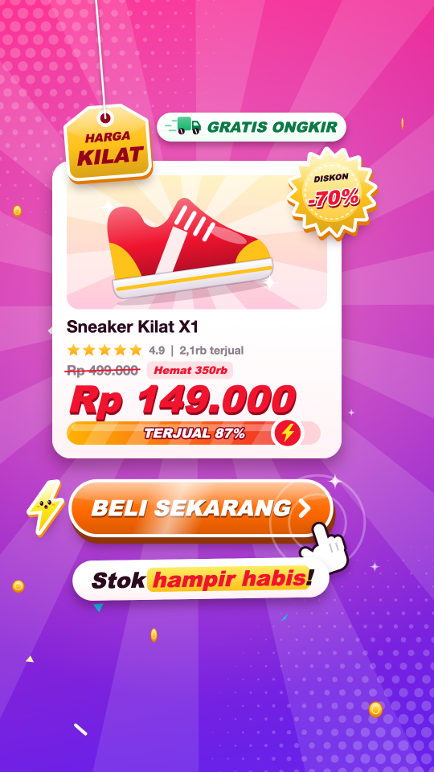

# Flash-sale

The loud online-marketplace campaign banner come alive: the look of double-date sale events, generic and brand-free. A hot gradient ground with sunray stripes turning slowly, halftone dot corners, falling confetti and coins, twinkles. Everything on it is a glossy, slightly 3D **plate**: a vertical gradient fill, a thick white outline, a top gloss highlight and a soft drop shadow, with a darker extrusion under the big ones. Type is bold italic, white-stroked, standing on a darker extrusion. The frame is furnished with promo objects: a white product card holding a product pictogram drawn in code, a rating row, a struck-through old price and a big new price; a jagged starburst discount badge; a price tag swinging on a string; a perforated voucher ticket; a two-line lockup with a bolt; a flip-digit countdown; a stock bar; a free-shipping truck pill; a pulsing call-to-action button with a tapping hand.

Pick it for physical-product promo ads, marketplace and retail campaigns, price drops, vouchers, "ends tonight" countdowns, bundle and free-shipping offers. Not for calm, premium or editorial moods (use `keynote` or `glass`), not for software features (use `bento`, `ui-mockup` or `neo-brutal`), not for stories with scenery or characters.

**The one rule: every object is a glossy plate with a white outline and a soft shadow on a hot gradient ground, and one thing per frame is clearly the biggest (the lockup, or the price).** If an object has a black border, a hard shadow or a flat unshaded fill, it belongs to `neo-brutal`, not here.

**Brand-free by construction:** the kit writes no word, price or currency. Every string (`'FLASH'`, `'-70%'`, the currency prefix, `'SOLD 87%'`) is passed in by the piece; `fsFmt(n, sep)` only groups digits. No real marketplace, shop or product names, logos or mascots, and the product pictograms carry no maker's marks.

## Palette and meaning (`FS`, `FS_PRESETS` in kit.js)

Grounds are presets: `fsGround({ preset })`, or `const FS_PRESET = 'berry'` before the kit for the default.

| preset | top `g0` | bottom `g1` | glow | type extrusion `deep` | `bg` (for `ERA_BG`) |
|---|---|---|---|---|---|
| `hot` (default) | `#ff1f3d` | `#ff8a00` | `#ffd23a` | `#8f0020` | `#ff4a1c` |
| `berry` | `#ff2d8f` | `#6a21e8` | `#ff9ad5` | `#3f0b8f` | `#b02bc8` |
| `ice` | `#1230c8` | `#12c2f0` | `#9af0ff` | `#061a6e` | `#1478dc` |

| name | hex | use |
|---|---|---|
| `white` | `#ffffff` | every outline, cards, the voucher body, pills, the caption, the bottom word of the lockup |
| `ink` | `#2b0a1e` | flat type on white, the kicker pill, the hand's outline, the mascot's face |
| `mute` / `line` | `#8d7f8c` / `#efe3ea` | old prices and rating text; hairlines on cards |
| `red` / `redD` | `#f0142f` / `#96001c` | **the price**, the discount figure, the strike line, voucher stubs; `redD` is its extrusion |
| `gold` / `goldD` / `goldL` | `#ffc21a` / `#e07a00` / `#fff3a8` | money and discount: the starburst, the tag, coins, stars, the top word of the lockup |
| `orange` | `#ff6a00` | the call-to-action button |
| `green` / `greenD` | `#10b56a` / `#087a45` | free shipping only (truck and label) |
| `night` / `nightL` | `#24103a` / `#40216a` | the countdown's flip cards |
| `pink`, `violet`, `blue`, `cyan` | `#ff2d8f`, `#6a21e8`, `#1e6bff`, `#12c2f0` | confetti, product colours, accents |
| `hero` / `heroD` | `#ffe81a` / `#ff8a00` | **lemon, reserved for the bolt mascot** (and the small bolt glyph that stands for it in the kicker and the stock bar); gold, not lemon, for everything else yellow |
| `paper` | `#ff6a14` | the morph's blank sheet (`STYLE.paper`): the ground between two eras |

- The picture panel of a card is a pastel tint (`#fff3c4` to `#ffc9de` by default) with white rays, so any product colour reads on it.
- Colours given to the renderer (`ERA_BG`, bridge shapes' `c`, `heroColor`) are 6-digit hexes; `fsLite` / `fsDark` / `fsMix` also accept the `rgb()` blends the renderer hands back mid-morph.

## Surface and geometry

Measured at 1080 wide. Outline and shadow are **screen** pixels and stay constant under a camera or a pop scale (`fsZoom()` divides them out).

| what | value |
|---|---|
| outline | `FS.ow` = 8 px, white, round joins (cards, pills and captions that are already white take 0) |
| soft shadow | `rgba(48,0,32,0.36)`, blur 26 px, dropped `FS.sh` = 16 px straight down; cards 22 / 40, small pills 10 / 16 |
| fill | vertical gradient: the colour lightened 28 % at the top, the colour at 55 %, darkened 16 % at the bottom |
| gloss | a white ellipse over the top half, 50 % fading to 0, clipped to the plate |
| extrusion | the same outline in a darker shade, stepped down and 0.35 right: badge `r x 0.09`, button 16 px, tag 8 px, voucher 7 px, mascot `r x 0.09` |
| type | `"Arial Black", "Helvetica Neue", "Segoe UI Black", ... sans-serif`, italic 900; white stroke `size x 0.1`, extrusion `size x 0.075` in the preset's `deep`, a soft shadow under it; cap height 0.716 em (`FS_CAP`) |
| flat type | `plain: true` (cards, pills, the caption): same face without stroke or extrusion; card titles and small print use `FS_UI` upright 600-800 |
| sizes | lockup 210-230 px, the new price 92 px, button label 54 px, caption 54 px, kicker and pill 36-40 px, card title 42 px, small print 26-34 px |
| corners | card 46 px, voucher `h x 0.14`, pills `h / 2`, flip cards `h x 0.14` |
| rotation | lockup lines -2 degrees, badge label -6 degrees, voucher +2-3 degrees, caption -1 degree; cards, timers, buttons and bars stay level |
| ground | diagonal gradient, a radial glow at the ray centre, 14 white ray wedges (15 % near, 8 % far) turning 0.3 rad/s, halftone dots (38 px pitch, up to 15 px, 20 % white) in the top-left and bottom-right corners, breathing |
| piece options | `const FS_PRESET = 'ice', FS_OW = 10, FS_SH = 20;` before the kit (e.g. `src/options.js` in piece.json `"build"`) |

## Motion habits

On 1s (`ones: true`). Fast and punchy; things arrive on the beat with overshoot. **Cue times are the moment of impact**, so the sound for a thing goes on the same time.

- **Slam** (`fsSlam(t, from)`): big type, vouchers, buttons and captions come from off-frame in 0.17 s, land ON `t`, carry ~22 px past and spring back.
- **Pop** (`fsPop(t)`, or `at` on badges, pills, stars, the mascot, the countdown): small two frames before, biggest ON `t` (1.2 x), then springs to 1; `fsWob(t)` adds the rotation wobble that follows.
- **Numbers run:** the discount counts up as its badge lands and the price runs down from the old figure to the new one (`fsCount`), fast then settling, and lands on a beat with a pop, a gloss sweep (`sweep`) and a confetti popper (`fsPopper`). The old price is struck in 4 frames as the run starts.
- **The countdown ticks once a second** (`fsTimer`): the changed digit's top flap falls and the new bottom half lands in 0.25 s; the colons blink on the half second.
- **The tag swings** (`fsSwing`): kicked as it drops in, dying to a small idle sway.
- **The CTA pulses on every beat** (`fsPulse`) and is tapped: the hand flies in on an arc, the button sinks into its extrusion (`fsPress`), rings open (`fsRipple`).
- **Bars fill, stripes march, the truck drives on the spot** (wheels turn, speed lines flick), the chevron on the button nudges.
- **Bridge:** the old frame is seen through a white-outlined plate shrinking onto the object; the plate changes shape and colour on the ray ground, swelling and throwing six twinkles; the new frame opens out of the counterpart. Captions and the kicker hide for the bridge.
- **Background life, always on:** rays turning, confetti and coins falling and flipping, twinkles, the halftone dots breathing, the card's own rays, the product bobbing.

## Frame checklist (in addition to `grammar/FRAME.md`)

1. **One biggest thing.** The lockup in a teaser frame, the card (and inside it the new price) in a product frame. Nothing else comes within about two thirds of its size.
2. **Glossy plates only.** Every object has the gradient, the gloss, the white outline (or a white body) and the soft shadow. No black borders, no hard offset shadows, no flat unshaded blocks.
3. **The ground is alive and hot:** gradient, turning rays, halftone corners, confetti or coins and at least a few twinkles. Never a flat colour.
4. **The price reads first inside the card:** the new price is the largest type on the card and red; the old price is grey, smaller and struck through; both are written by the piece with one currency format.
5. **The offer is acted out, not labelled:** the number counts, the price drops, the bar fills, the clock ticks, the tag swings. A frame of still badges is a poster.
6. **Three or four kinds of promo object per frame, no more than six.** Lockup + badge + voucher + countdown, or card + tag + badge + pill + CTA. Each has its own zone; only the badge and the tag may overlap the card's corners.
7. **Nothing covers the price, the CTA label or the countdown digits.** Check the badge's and tag's landing spots, the popper and the hand's path.
8. **Text is legible:** heavy italic at 36 px or more for pills, 54 px for the caption and button, white stroke and extrusion on anything set directly on the ground; small print (26-34 px) only on white cards.
9. **Something lands on the beat** in every half second: a slam, a pop, a tick, a price landing, a tap.
10. **Phone-safe:** lockup, card, countdown, CTA and caption inside x 60-940, y 250-1500. Rays, dots, confetti and the tag's string run off the frame.
11. **Brand-free:** no real marketplace, shop or product names, logos, colour-plus-mascot combinations or maker's marks on the pictograms.

## Kit API (`kit.js`, on top of `kit/core.js`)

Containers take a **top-left corner**; objects take their **centre**; `fsText` takes a baseline; `fsTag` takes its nail. Needs `CX` (caption centre x) from the piece head.

| helper | what it draws / returns |
|---|---|
| `FS`, `FS_PRESETS`, `FS_FONT`, `FS_UI`, `FS_CAP` | palette and sizes; the three grounds; the display and small-print stacks; cap height in em |
| `fsPlate(path, c, bb, o)` | **the primitive:** shadow, extrusion, white outline, gradient, gloss for any path. `o`: `ow`, `line`, `depth`, `ext`, `sh`, `blur`, `shadow: false`, `gloss: false`, `flat`, `c0`, `c1`, `fill` |
| `fsBox(x, y, w, h, c, o)` | a rounded plate; `o`: `r`, `rot`, `s`, `press`, `draw(w, h)` (content in its own frame, clipped) + plate options |
| `fsShape(P, c, o)` | any outline as a plate (pictograms, the morph blob) |
| `fsText(str, x, y, size, color, o)` | extruded bold italic type, returns the width. `o`: `align`, `rot`, `s`, `maxW`, `stroke`, `sc`, `depth`, `ext`, `grad`, `plain`, `italic`, `weight`, `font` |
| `fsTextW`, `fsFont`, `fsFmt(n, sep)` | measure; set the font; group digits (`1.234.567`) |
| `fsGround(o)` | the ground: `preset` or `g0` / `g1` / `glow`, `cx`, `cy` (ray centre), `rays`, `speed`, `rayA`, `dots: false` |
| `fsConfetti(o)`, `fsPopper(x, y, t, o)` | falling confetti and coins (`n`, `coins`, `key`, `colors`); a burst thrown at time `t` |
| `fsSparkle(x, y, r, o)`, `fsSparkles(n, o)` | one twinkle; `n` scattered over an area |
| `fsSweep(w, h, t, o)` | a diagonal gloss band crossing a box once from time `t` (call inside `draw`; cards, vouchers and buttons take `sweep: t`) |
| `fsCard(x, y, w, h, o)` | the product card: `product`, `pc`, `pc2`, `panel`, `title`, `rating`, `ratingText`, `old`, `now`, `strike`, `nowS`, `chip`, `chipS`, `stock: { frac, label }`, `starsAt`, `sweep`, `draw` |
| `fsProduct(kind, x, y, r, o)` | pictograms: `sneaker`, `headphones`, `bag`, `bottle`, `blender`; `o`: `c`, `c2`, `rot`, `s` |
| `fsStars(x, y, size, rating, o)` | five rating stars filled to `rating`; `at` pops them one by one; returns the width |
| `fsOld(str, x, y, size, o)`, `fsPrice(x, y, o)` | a struck-through old price (`strike` 0..1); an old price over a big new one (`old`, `now`, `size`) |
| `fsBurst(x, y, r, label, o)` | the starburst discount badge; `o`: `at`, `sub`, `n`, `jag`, `spin`, `c`, `tc`, `rot` |
| `fsTag(ax, ay, len, w, h, c, o)` | the hanging price tag; `o`: `ang` (use `fsSwing`), `lines: [small, big]`, `draw(w, h)`, `pin: false` |
| `fsCoupon(x, y, w, h, c, o)` | the perforated voucher; `o`: `split`, `unit`, `value`, `title`, `sub`, `code`, `stub`, `rot`, `at`, `sweep` |
| `fsLockup(x, y, size, o)` | the two-line lockup; `o`: `top`, `bottom`, `at1`, `at2`, `size2`, `dx2`, `maxW`, `maxW2`, `bolt: false`, `boltAt`, `preset` |
| `fsTimer(x, y, total, o)`, `fsFlip(...)` | the HH:MM:SS flip countdown from `total` seconds; `o`: `size`, `t0`, `at`, `labels`; one flip card |
| `fsStock(x, y, w, h, frac, label, o)` | the stock bar with marching stripes and a bolt at its head |
| `fsShip(x, y, label, o)` | the free-shipping truck pill; `o`: `size`, `at`; returns the width |
| `fsButton(x, y, w, h, label, c, o)` | the CTA pill; `o`: `pulse`, `press`, `size`, `sweep`, `chevron: false` |
| `fsHand(x, y, r, o)`, `fsRipple(x, y, r, t)` | the tapping hand (x, y = fingertip; `press`); tap rings after time `t` |
| `fsBolt(x, y, r, c, o)` | a glossy bolt without a face (`flat: true` for a glyph) |
| `fsHero(x, y, r, o)`, `fsHeroPts(x, y, r)` | Zap, the lemon bolt mascot (`r` = half its height); `o`: `mood` (`happy`, `wow`, `wink`), `look`, `rot`, `bob`, `at`; its outline for bridges |
| `fsSlam(t, from, o)`, `fsPop(t, o)`, `fsWob(t, amp)` | `[dx, dy]` for a landing at `t`; a pop scale; the wobble after it |
| `fsPulse(per, amt)`, `fsPress(times)`, `fsCount(t0, t1, a, b)`, `fsSwing(t, o)` | beat pulse scale; tap envelope 0..1; a running number; a pendulum angle |
| `fsCaption('Only *today*!', o)`, `fsKicker('MEGA SALE', o)` | DEFER: the white caption pill (the part between `* *` in red on a gold chip); the dark top-left pill with a bolt |
| `fsMix`, `fsLite`, `fsDark`, `fsA`, `fsRGB`, `fsVGrad`, `fsZoom`, `fsInBridge` | colour and gradient helpers; the current zoom; inside a morph bridge? |
| `STYLE` | `backdrop` = the ray ground tinted by the blend colour; `window` = a white-outlined plate with a soft shadow; `blob` = a glossy extruded plate that swells and twinkles; `hero` / `heroPts` / `heroColor` = Zap (`SP(x, y, r)` bridges); `post` = nothing; `ones: true` |

## Do / don't

**Do**
- Build new objects from `fsBox` / `fsShape` / `fsPlate` so they get the outline, gloss and shadow for free.
- Pass every word and price in from the piece, with one currency helper (`const rp = (n) => 'Rp ' + fsFmt(n)`).
- Make numbers move: count the discount, run the price down, fill the bar, tick the clock.
- Put the ray centre behind the frame's biggest thing; change preset between eras for a second act.
- Hold the mascot still (`bob: 0`) for the last 0.4 s before a bridge that starts from it, and keep badges off the bridge object.
- Allow the countdown's mid-flip frames in `piece.json` `review.textIgnore` (the old and new digit share a card for 0.25 s).

**Don't**
- No black outlines, hard offset shadows or flat unshaded blocks (that is `neo-brutal`); no ink lines, Ben-Day panels or speech bubbles (that is `comic`).
- No real brands, marketplace names, logos or recognisable mascots; no hardcoded currency in the kit.
- Don't let two things compete for biggest; don't put small print on the gradient ground.
- Don't cover the price, the CTA label or the countdown with a badge, the popper or the hand.
- Don't spend lemon on anything but the bolt; don't use green for anything but shipping.
- Don't slow it down: nothing drifts in over a second, nothing fades gently.

## How it differs from the closest shipped styles

- **neo-brutal** shares stickers, badges and loud colour, but is flat with a 7 px black border and a hard shadow on everything. Here nothing has a black border: surfaces are graded, glossy, white-rimmed, softly shadowed and extruded.
- **comic** has starbursts too, but as inked sound-effect shapes on a printed page with dots and panels. Here the burst is a gold retail seal carrying a counting discount.
- **bento** shows product features in a calm modular grid; this sells one priced product with urgency.
- **ui-mockup** shows an app being used inside a device; this is the campaign banner itself.

## Not matched / known weaknesses

- Made from a written brief, not measured against reference frames: palette, outline and shadow numbers are chosen, not sampled.
- The soft shadows use the canvas `shadowBlur`, which costs time: the demo renders at about 40-70 ms a frame, and a frame with many more plates will be slower.
- `fsText`'s extrusion is the letterforms redrawn in steps, so very deep extrusions (over ~0.12 em) show stepping; the italic is the system's oblique of the heavy face.
- The countdown draws the old and the new digit on one card during a flip, which `tools/textcheck.mjs` reports as overlapping text unless the piece lists those moments in `review.textIgnore`.
- The product pictograms are simple side or front views (five kinds); a piece with a real product should use its own photo through `drawAsset` inside the card's `draw`.
- `fsCard`'s layout is tuned for about 720 x 740; it scales with the width, but a much shorter card needs `panelH` and fewer rows.
- The morph resamples outlines by angle, so the bolt's notches soften while it shrinks and changes shape.
- Type depends on the machine's heavy grotesk (Arial Black on macOS and Windows; Linux falls back to bold Liberation / DejaVu Sans, lighter and wider). Layouts use `maxW` where a line must fit.
- Only 9:16 was built, with no camera move; helpers take absolute pixels (use `LX` / `LY` / `UNIT` for other formats). The `ice` preset and the headphones, bag, bottle and blender pictograms are not in the demo.
- The demo's true peak is -0.8 dBFS (the kit's limiter), a hair over review.mjs's -1 guide.

## Proven on

Its demo only (`demo/`: 6 s, 1080x1920, 24 fps, 120 BPM; a teaser era on `hot` with the lockup, mascot, counting badge, voucher and countdown, one bolt-to-card morph at 3.0 s, then a product era on `berry` with the card, price drop, stock bar, swinging tag, free-shipping pill and tapped CTA; two captions; a synthesized score). `tools/tile.mjs` prints `deterministic: true`; `tools/review.mjs` passes cuts, morphs, story arc, text and dead beats.
