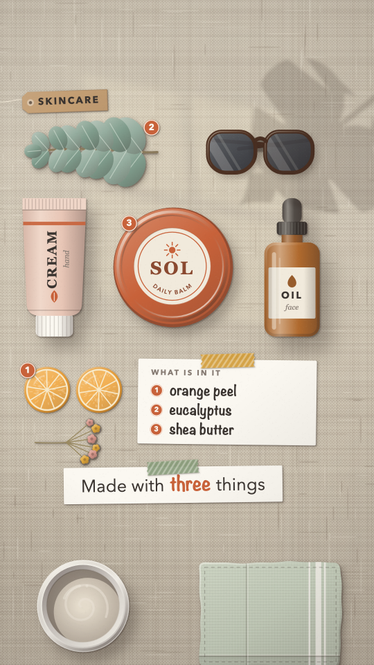

# Flat lay

A top-down "knolling" product photograph come alive. The camera looks straight down at a tabletop and every object is seen from above: a round tin with a paper label, a carton, a tube lying on its side, a cup of coffee with a crescent of window in it, a plate, a spoon, a folded cloth, sunglasses, a notebook, and small props (eucalyptus, coffee beans, citrus slices, dried flowers, sugar cubes). The table is a real material drawn in code: linen with a visible weave, pale oak planks with grain and gaps, terrazzo, matte coloured paper, white marble. One soft daylight comes from the upper left, so every object has the same two-part shadow to the lower right and a light edge on its upper-left side, and the shadow of a plant or a patch of window sun lies across the table. The layout is the point: objects sit squared on an invisible grid with even gaps, or one hero product sits in the centre with props around it. A stylist's annotations finish it: a hand-lettered note with a thin curved arrow, a kraft tag, a caption card held by washi tape, a numbered-dot ingredient list.

Pick it for physical-product ads and launches: food and drink, fashion, craft, stationery, skincare, "what's in the box", ingredients, routines, gift sets, recipes. Not for stories with characters, abstract ideas, data, software, or anything that needs depth, perspective or a horizon.

**The one rule: straight down, one window, everything squared. Every object is a top view with the same shadow, and nothing sits at a casual angle unless it is a small prop.**

## Palette (`FL` in kit.js)

| name | hex | use |
|---|---|---|
| `paper` | `#e9e4da` | the neutral matte sheet a morph happens on; `STYLE.paper` |
| `linen` | `#d9cfbd` | natural linen surface |
| `oak` | `#d8ba8e` | pale oak planks |
| `terrazzo` | `#ebe6dc` | terrazzo's cement (chips: terracotta, sage, mustard, slate, rose, taupe, coffee, white) |
| `marble` | `#efedea` | white marble (veins `rgb(120,122,132)`) |
| `blush` `sageP` `sky` | `#e8c6b6` `#c9d3c0` `#c9d9e2` | matte coloured paper surfaces, also soft packaging |
| `white` `cream` | `#fbf8f1` `#f1eadc` | ceramic, cards, labels; unbleached cloth, label paper |
| `kraft` | `#c8a276` | cartons, the tag |
| `ink` `soft` | `#3a3430` `#857a72` | lettering and arrows; small print |
| `terra` | `#c8623a` | terracotta: **reserved** for the hero tin, numbered dots and the caption's key word |
| `sage` `leaf` `mustard` `navy` `rose` | `#8ea481` `#7f9c8c` `#dfa63a` `#2e3d5a` `#d6968a` | second packaging colours, leaves, washi tape, dried flowers |
| `coffee` `bean` `steel` `wood` `amber` `citrus` `pith` | `#4a2a1a` `#5c3521` `#bfc2c6` `#b98b58` `#b06a2e` `#f0a236` `#f7e9c9` | what things are made of |

- Shadows are warm, never black: `rgb(48,36,30)` (`FL_SHD`). Lit sides go toward `rgb(255,251,242)`, shaded sides toward `rgb(52,38,34)` (`flLit`, `flDk`).
- A frame holds the surface's colour, white / cream, **one** strong product colour (the terracotta) and at most two quiet ones (sage, navy, blush, kraft).
- **Colours for the renderer:** `ERA_BG` is the surface's colour (`FL.oak`, `FL.linen` ...); a bridge shape's `c` is the object's 6-digit hex (`FL.white` for a cup, `FL.terra` for the tin). Mid-morph the blend arrives as `rgb()`; every kit colour function accepts it.

## Light, shadow and texture

- **The light** comes from the upper left; shadows fall along `FL_SH = [0.62, 0.78]` (down-right). `flL()` gives the direction toward the light in the current drawing space, so an object that is turning as it slides in is still lit from the frame's upper left.
- **The shadow** (`flShadow`, drawn by `flItem` with the object, so it moves with it): a wide soft shadow offset by the object's height `h` along `FL_SH` (blur `0.75 h + 5`, 30% alpha) plus a tight contact shadow (offset 2.2, blur 2.5, 42%). Heights in the object's own units (it is about 200 units long): cloth 8, plate 9, glasses 11, notebook 13, tin 17, tube 22, carton 26, bottle 28, bowl 28, cup 34. An object in the air (`lift`) throws a longer, softer, paler shadow and no contact shadow.
- **The object's light edge**: a lit-to-shaded gradient across the body (`flBody`), a light stroke inside the outline on the window's side and a dark one on the far side (`flEdge`), ridges and grooves on round things (`flRing`), a dark sliver of side wall on the far side of lids, cartons and plates. Cylinders lying down (tube, bottle, spoon handle) carry a long highlight on the window's side (`flCyl`).
- **A cup from above**: wall, a rim that catches the light, the inner wall dark on the window's side, the liquid with the rim's crescent shadow on the window's side, a crescent highlight and a dot (the window in the liquid), travelling ripple rings.
- **Surfaces** (`flSurface`) are built once from seeded noise and kept, larger than the frame by 160 px each way for camera drift, with the window's falloff baked in (22% lighter upper left, 20% darker lower right):
  - `linen`: a plain weave on an 8 px period, threads of uneven weight every 4 px in both directions, slubs, soft mottling.
  - `oak`: six planks down the frame with butt joints, 74 wandering grain lines a board, cathedral figure on about half the boards, a knot now and then, dark gaps with a light lip.
  - `terrazzo`: cement speckle and about 800 angular chips in eight colours, a few large.
  - `paper`: any colour, fine speckle and fibres.
  - `marble`: grey clouds and six wandering veins drawn soft, then sharp, with branches.
- **On the table**: `flWindowLight` (a 2 x 2 patch of sun, blurred, 16–22% warm white, drifting) under the objects; `flLeafShadow` (three fronds, or a monstera leaf, 16–20%, blur 8) over them.
- **Lettering**: on products, invented words in tracked bold sans caps or bold serif caps with a small italic serif line and an invented mark (`flMark`: sun, leaf, drop, bean, wave); round labels carry type on an arc. Annotations are hand-lettered (`FL_HAND`: Noteworthy, Bradley Hand, Segoe Print, Ink Free, Comic Sans MS) in `ink`. Captions are light sans (`FL_SANS`, weight 400, 50 px) with the key word hand-lettered in terracotta, 12% larger.
- **Finish of the frame** (`post`): fixed fine grain and a soft vignette (corners 20% darker).

## Motion habits

- On 1s (`ones: true`), tidy and satisfying.
- **Products slide in from a frame edge already turned about half a radian and snap square** (`flItem`'s `at`, `from: 'l' | 'r' | 't' | 'b'`, `spin`): 0.3 s ease-out, then one small overshoot of 15 px and 4° that dies in a quarter second. One product per eighth note, landing on the beat.
- **Props are set down from above** (`from: 'drop'`, `flScatter`): they appear 40% larger with a long shadow, spin up to a quarter turn and settle in 0.24 s, 0.04–0.1 s apart.
- **The shadow tells the height**: long and soft while a thing is in the air, tight when it lands.
- **Arrows draw themselves** (0.35 s) and then the note writes on from the left (0.4 s); list lines write on one after another, each after its numbered dot pops; the dots pop onto the items they name at the same moment.
- **Cards drop or slide in, then the tape is pulled across** (0.14 s).
- **Camera**: one slow push per era (z 1 → 1.04) toward the main object; no cuts inside an era, no rotation.
- **Idle life**: ripple rings in the cup, steam curling toward the upper right, the plant's shadow swaying 2°, the sun patch drifting 15 px a second, eucalyptus leaves stirring, a glare sliding over sunglasses, a glint crossing the hero's lid.
- **Bridges**: the table is a photograph cut to the bridge object's outline that lifts off a plain matte sheet and closes onto it; on the sheet one solid lid-like object changes outline and colour; the new table opens out of it. Tag and caption lift off before the bridge and are laid down after it.
- **Sound**: dry and close. A short slide across the table ending in a soft wooden knock for each product, ticks for beans and cubes, a pencil scratch for writing, a small pop for each numbered dot.

## Frame checklist (in addition to `grammar/FRAME.md`)

1. **Squint test: a tidy photograph from directly above.** No horizon, no perspective, no object seen from the side or at three quarters.
2. **The surface reads as its material at phone size**: weave, planks and grain, chips or veins are visible, and the table is lighter toward the upper left.
3. **Every object has both shadows, all to the lower right**, and each shadow's length matches the object's height (a cup's is longer than a cloth's). No object without a shadow, no shadow pointing another way.
4. **Every object has a light edge on its upper-left side** and at least two true details (a rim and a label, a crimp and a cap, a hem and a stripe).
5. **Squared and evenly spaced**: products are at 0° or a quarter turn, centred in their grid cells, gaps equal (28 px on the demo grid). Only small props may lie at free angles, and they sit in a tidy row or a small cluster.
6. **One hero**, the largest or the central thing, in the reserved terracotta; nothing else wears that colour except the numbered dots and the caption's key word.
7. **Labels are invented** (no real brand names or logos) and fit inside their label; type on a round lid follows the arc.
8. **Annotations look placed by a stylist**: a note sits in a gap with its arrow ending on the object, a card is held by tape, numbered dots match the list. At most one note, one list and one caption in a frame.
9. **Something on the table is alive**: steam, a ripple, the leaf shadow, the sun patch (three or more per era).
10. **Text inside the safe area** (x 60–940, y 250–1500): tag top left, caption card at y ≈ 1400, notes and cards in the grid's gaps. What runs off the bottom edge is set dressing without readable text.
11. **Bridge objects are top views of similar proportions** (a cup → a tin, a plate → a bowl, a carton → a notebook), fully landed at the bridge time.

## Kit API (`kit.js`, on top of `kit/core.js`)

- Palette and constants: `FL { ... }`, `FL_SH` (shadow direction), `FL_SHD` (shadow colour), `FL_SANS`, `FL_SERIF`, `FL_HAND`.
- Colour: `flRGB`, `flMix(a, b, k)`, `flLit(c, k)`, `flDk(c, k)`, `flA(c, alpha)`.
- Paths (they add to the current path): `flCirc`, `flEll`, `flPoly`, `flPath(path | points)`, `flFill(path, style)`, `flLine`, `flWavy(P, amt, key)` (a fixed wavy edge), outlines for bridges `flCirclePts(x, y, r)`, `flRectPts(x, y, w, h, r)`.
- **The light:** `flL()`, `flLG(r, stops, x, y)`, `flBody(c, r, k)`, `flEdge(path, w, r, al)`, `flRing(x, y, r, w, rev, al)`, `flCyl(c, halfWidth, k)`, `flSoft(draw, colour, blur, dx, dy)` (anything as a blurred mark), `flShadow(path, { h, lift, al })`.
- **The table:** `flSurface('linen' | 'oak' | 'terrazzo' | 'paper' | 'marble', { c, seed })`, `flTable(c)` (the plain sheet), `flGrain()`.
- **Layout:** `flGrid({ x, y, w, h, cols, rows, gap })` → `{ cell(col, row, colSpan, rowSpan) → { x, y, w, h, cx, cy, s }, marks(alpha), cw, ch, ... }`; `flAround(cx, cy, r, n, a0)`.
- **The builder:** `flItem(kind, x, y, s, o)` — `s` = half the object's long side in px. Kinds and their options:
  - `'tin'` `{ c, label, sub, mark, knurl, labelC, glint }` (with `knurl` a jar lid; `label: false` a plain lid)
  - `'box'` `{ c, w, label, sub, mark, accent, labelC }`, `'tube'` `{ c, cap, label, sub, mark, accent }`, `'bottle'` `{ c, cap, label, sub, mark }`
  - `'cup'` `{ c, liquid, handle, ripple }`, `'bowl'` `{ c, liquid, grains { n, c, s }, swirl, ripple, empty }`, `'plate'` `{ c, well, band }`
  - `'spoon'` `{ c }`, `'cloth'` `{ c, hh, stripe, key }`, `'notebook'` `{ c, label }`, `'glasses'` `{ c, lens, glare }`
  - props: `'bean'`, `'citrus'`, `'sprig'` `{ sway }`, `'monstera'`, `'flower'`, `'sugar'`
  - every kind: `rot`, `h` (override its height), `shadow: false`, and the arrival `at`, `from`, `spin`, `dist` (`flArrive(o)` returns `{ dx, dy, rot, lift, sc, al }` for your own things).
  - A new kind is one entry: `FL_ITEMS.name = { h, path(o), draw(o) }`, drawn about the origin inside ±100 units.
- `flScatter(kind, pts | n, s, { at, step, key, box })`, `flHero(x, y, r, o)` (the terracotta tin; sets `SPARK_AT`).
- **Lettering:** `flType(str, x, y, size, c, { font, weight, italic, track, align, base, al, rot })`, `flTypeW`, `flHand(str, x, y, size, c, { frac, align, rot })`, `flArcType(str, r, size, c, { bottom, track, max })`, `flMark(kind, x, y, r, c)`.
- **Annotations (world coords):** `flArrow(a, b, { frac, bend, c, w })`, `flNote(str, x, y, { to, from, at, size, bend })`, `flDot(n, x, y, { at, r, c })`, `flList(items, x, y, { size, gap, at, step })`, `flTape(x, y, w, { c, rot, h, in })`, `flCard(x, y, w, h, { c, rot, tape, tapeW, draw, at, from, spin })`.
- **Background life:** `flLeafShadow({ x, y, s, rot, sway, speed, al, kind })`, `flWindowLight({ x, y, w, h, cols, rows, skew, al, vx, vy })`, `flSteam(x, y, s, { n, dir, al, speed })`.
- **Through `DEFER`, at screen size:** `flTag('coffee', { x, y, size, at })`, `flCaption('A place for *everything*', { x, y, size, tape, c, at, w })`; `flBridgeK()` (1 outside bridges, 0 inside).
- `STYLE`: `paper`, `backdrop` (the matte sheet under the window light), `window` (the era as a cut photograph with a white edge and the two-part shadow), `blob` (a solid lid-like object in the blended colour), `hero` / `heroColor` / `heroPts` (the tin), `post` (grain and vignette), `ones: true`.

## Do / don't

- **Do** start from the grid: decide the cells, then put one object in each, centred, `s` a few px under the cell's half size.
- **Do** draw order from the table up: surface, sun patch, objects (a saucer before its cup), steam, the leaf shadow, notes; tag and caption last.
- **Do** give a pair that travels together (cup and saucer) the same `at`, `from` and `spin`.
- **Do** let things run off the frame's bottom or side edge as set dressing: a cropped notebook, a leaf, a cloth.
- **Do** invent every label. No real brand names, logos or recognisable packaging.
- **Do** keep `rot` at 0 or a quarter turn for products; props may turn freely.
- **Don't** draw anything in perspective or from the side, and don't tilt or rotate the camera.
- **Don't** change the light: no second shadow direction, no rim light, no glow, no hard black shadow.
- **Don't** let two products overlap or touch; only a cup on its saucer, a prop on a plate, tape on a card.
- **Don't** fill every gap: the empty table between objects is what makes it tidy.
- **Don't** spend terracotta on a second product, and don't use more than one strong colour beside it.
- **Don't** call `wobble` or boil anything: a photograph holds still, only the listed idle life moves.

## Not matched / known limits

- Made from a written brief, not from measured reference media: the numbers above are the kit's own.
- A product's label is on it while it slides in, so `review.mjs`'s text check reports label words "cut off by the frame edge" on the single frames where a carton or lid is still crossing the edge (three in the demo). Captions, tags, notes and lists stay inside the safe area.
- Proportions were tuned for 9:16 at 1080 × 1920; 1:1 and 16:9 were not rendered.
- Not exercised by the demo: the `terrazzo`, `paper` and `marble` surfaces (each rendered once as a still under the demo's objects while building the kit, not in a piece), `flAround`, `flRectPts`, the `empty` bowl, a wooden spoon, the hero-to-hero bridge (`STYLE.hero`), export `--blur`. The demo does not loop seamlessly.

## Proven on

Its demo only. `demo/` (6 s, 9:16, 120 BPM, 24 fps): on pale oak a coffee set slides in from the frame edges, one piece per eighth note, and snaps square onto a 3 x 4 grid (a cup on its saucer, a carton, a spoon, a bowl of sugar, a jar lid, a folded cloth); five beans and two sugar cubes are set down, an arrow draws itself to the cup and "still warm" is written; the coffee ripples, steam curls, a frond's shadow sways and a sun patch drifts, all during one slow push. At 3.0 s the table closes onto the cup, the white disc becomes a terracotta one, and a linen table opens out of the hero tin: a tube, a dropper bottle, sunglasses, a eucalyptus sprig, two citrus slices and dried flowers arrive round it, a card is taped down, and a numbered list writes itself while the numbered dots pop onto the things they name; a glint crosses the tin. `tile.mjs`: deterministic; `review.mjs`: cuts, morph, story arc and dead-beat checks pass, the text check fails on the three sliding-label frames described above.
