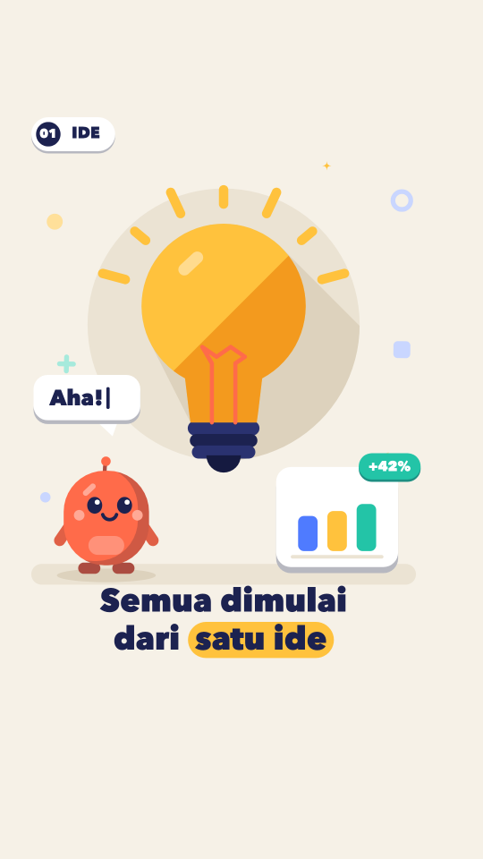

# Flat vector

The polished explainer / product-video look: clean geometric shapes with **no outlines**, rounded corners, a tight palette on a cream or deep-navy ground, one coral accent, flat single-tone shading (a darker facet, a bottom lip, a 45° long shadow — never a blur), bold rounded sans type in pills, icons and UI cards built from primitives, and a capsule mascot with two big dot eyes and a bobble antenna. Motion on 1s; every entrance is a spring pop with a little overshoot, staggered; hops have anticipation, stretch, a landing squash and follow-through.

**The one rule: shapes are flat fills and nothing else.** Depth comes only from a second, darker flat tone of the same shape (facet, lip, long shadow), never from strokes around shapes, blur, glow or texture.

## Palette and meaning (`FV` in kit.js)

| role | hex | use |
|---|---|---|
| light ground | `cream #f6f1e7` | era ground (default paper) |
| floor / badge disc | `creamD #ebe3d3` | floor pill, the disc behind the main object |
| long shadow on cream | `creamDD #ddd2bd` | long shadows, ground shadows, inactive text pills |
| dark ground | `navy #1c2250` | the second ground; also the ink (text, eyes, bulb base) |
| on navy | `navyL #2a3270`, `navyD #151a40` | badge disc / tag pill; long shadow and floor on navy |
| **accent** | `coral #ff6b4a` (`coralD`, `coralL`) | the hero and the morph's window ring, nothing else (the kit's tag disc, caption pill and chart bars deliberately avoid it) |
| mid 1 | `yellow #ffc23d` (`yellowD`, `yellowL`) | light, rays, the caption's highlight pill (on cream and on navy), the tag disc on navy |
| mid 2 | `teal #23c4a7` (`tealD`, `tealL`) | success, land, check |
| mid 3 | `blue #4f7bff` (`blueD`, `blueL`) | sea, chat, chart bar |
| surface | `white #ffffff` | UI cards, bubbles, check marks |
| secondary text | `inkL #7a7fa6` | small labels on white cards |

Tints (`…L`) are for background floaters only. A frame uses the ground, the accent, at most two mids and white. **Dark variant:** `const FV_DARK = true;` before the kit (a `src/options.js` in the piece's `build` list) makes navy the paper and flips the default caption/tag/shadow colours. A scene may also pick its ground itself with `fvGround(FV.cream | FV.navy)` and pass `{ dark }` to captions and tags, as the demo does (cream era → navy era).

## Shape and shading

- **No outlines.** Strokes exist only as marks *inside* shapes (a check, a smile, a filament) or as thin orbits — round caps, round joins.
- Corners always rounded: cards `r` ≈ 10–14% of the short side, buttons and tags are full pills, characters are capsules.
- **Facet** (`facet`): a half-plane through the centroid (default 45°, lower right) filled with `rgba(16,19,47,0.20)` — or a warm hex for yellows (`#f39a1e`), so yellow never goes olive. Push it with `off` so the dark side is ~30–40% of the shape.
- **Rim** (`rim: [dx, dy]`, `fvCrescent`): the contoured version for round things (the mascot, the globe): the part of the shape that a copy pushed toward the light does not cover, so the shadow follows the edge as a crescent.
- **Lip** (`lip`): the shape repeated `lip` px lower in a darker tone — the 2.5D card / button. 4–14 px.
- **Long shadow** (`shadow`): the convex hull of the shape and itself pushed 45° down-right, one flat tone darker than what it falls on. Clip it inside a badge disc (`badgeDisc` in the demo) so it never runs across the frame.
- **Highlight** (`hi`): one small white sliver at 42% upper-left, on round objects only.
- Gradients: allowed but subtle (`grad`, ±12% lightness top to bottom). Default off.
- Type: `FV_SANS` = `"Avenir Next", "Segoe UI", "Helvetica Neue", Arial, "Liberation Sans", "DejaVu Sans", sans-serif`, weight 800. Captions 78px centred at `CX`, ≤ 2 lines; tags 36px in a pill; labels on cards 28–52px.

## Motion habits

- On 1s (`ones: true`). Motion blur works: `export.mjs --blur 4`.
- **Every entrance is a spring pop** (`fvPopIn(t0, anchorX, anchorY, draw, SPRING.playful)`) anchored where the object rests (its feet, its base, the floor). UI cards use `SPRING.smooth`, characters and badges `SPRING.playful`, highlight pills `SPRING.snappy`.
- **Stagger** everything that comes in groups: 0.045–0.07s between rays, words, floaters; 0.12s between icons.
- Values that change keep moving on springs: `springTrack` for chart bars (a new reading every beat), counters ease out then tick.
- **A hop is a full chain** (built into `fvMascot`'s `hop`): a 0.16s crouch, stretch on the way up and down, a springy landing squash with a blink, then follow-through: the arms and the antenna trail the body by ~2 frames and settle after it. Give other objects the same care: `1 + fvKick(t0)` on a scale makes a thing swell and settle when it changes state (the bulb switching on).
- Cues sit on the 16th grid (0.125s at 120 BPM = 3 frames); the big ones on beats.
- Idle life never stops: the mascot breathes (±2.5% squash), blinks (every ~3s), its antenna sways, floaters drift on slow sines, rays pulse, globes turn, cursors blink at 2 Hz.
- Camera: slow ease push (≤ 5%) inside an era; after a morph the new era opens ~10% close and settles out on a slow spring (`springMove(tc, 1.1, 1.0, { k: 22, d: 9.5 })`). Never shake.
- Morph: the bridge shapes should have similar proportions (bulb glass → globe). Pick bridge colours whose straight RGB mix stays clean (yellow → teal goes through green; yellow → blue goes grey).

## Frame checklist (on top of grammar/FRAME.md)

1. **No outline anywhere** around a shape; depth only from one darker flat tone.
2. **One focal object** on a badge disc, about 50–55% of the frame width, in the upper-middle; the mascot and one supporting card share a floor line below it.
3. **Palette discipline:** ground + coral + ≤ 3 mids + white. Coral is the hero's: no badge, bar, cursor or floater wears it.
4. **Shadows go one way** (45° down-right) and are one tone darker than the surface they fall on, clipped to their disc.
5. **Type is bold, short, in the safe area** (x 60–940, y 250–1500), with one highlighted phrase per caption.
6. **Generous empty ground** — at least a third of the safe area holds nothing but ground and a few faint floaters.
7. **Something is moving** in every held frame (blink, float, tick, turn).
8. **Every entrance overshoots and settles**; nothing fades in linearly except the old era's captions leaving.

## Kit API (`kit.js`, on top of `kit/core.js`)

- Palette and colour: `FV`, `FV_DARKMODE`, `FV_SANS`, `FV_SHADE`, `FV_LIP`; `fvRGB`, `fvHex`, `fvMix(a, b, u)`, `fvShade(c, k)`, `fvTint(c, k)`, `fvLum(c)` (accept `#hex` or `rgb()`).
- Geometry: `fvPath(P)`, `fvHull(P)`, `fvCentroid(P)`, `fvShift(P, dx, dy)`, `fvCirclePts`, `fvRectPts`, `fvPillPts`, `fvZoom()` (divide widths by it for screen-constant rings under the camera).
- Shapes: `fvShape(P, c, { shadow, shadowC, shadowA, lip, lipC, facet: true | { a, off, col }, rim: [dx, dy] | { dx, dy, col }, grad, hi })`, `fvRect(x, y, w, h, r, c, o)`, `fvCircle(x, y, r, c, o)`, `fvPill(x, y, w, h, c, o)`, `fvLongShadow(P, len, col, ang)`, `fvFacet(P, o)`, `fvCrescent(P, dx, dy, col)`, `fvStroke(P, c, w, { closed, al, dash })`.
- Springs: `fvPop(t0, preset)` (0 → 1 with overshoot), `fvPopIn(t0, x, y, draw, preset)`, `fvRise(t0, dy, preset)`, `fvKick(t0, amp, freq, damp)` (a damped wobble around 0, for `1 + fvKick` scale bumps), `fvBlink(key, period)`.
- Type: `fvFont(size, weight)`, `fvText(str, x, y, size, color, { align, base, weight, al, maxW })` (`maxW` shrinks the size to fit; use it for anything on a card), `fvTextW`.
- Objects: `fvBulb(x, y, r, { on, off, shadow })` + `fvBulbPts` (bridge outline), `fvRays(x, y, r0, len, t0, { n, w, c, a0, a1 })`, `fvGlobe(x, y, r, { spin, sea, land, shadow })` + `fvGlobePts`, `fvGearPts`.
- Icons: `fvIcon(kind, x, y, s, o)` — `check` (`frac` write-on), `chart` (`vals` [3], `cols` [3]), `gear` (`rot`; a real even-odd hole, so it sits on any ground), `chat` (`dots` bounce), `phone`, `card`, `bulb` (`on`), `globe` (`spin`), `star`; all take `c` and `lip`.
- Background life: `fvFloater(kind, x, y, s, c, { ph, amp, f, spin })` — `circle`, `ring`, `plus`, `square`, `tri`, `star` (twinkles).
- Hero: `fvMascot(x, y, s, { key, color, look: n | [x, y], hop: t | [t…], wave, mood: 'smile' | 'wow', pop, dark, shadowC, antenna: false })` — (x, y) between its feet, s its body height (the antenna adds ~0.14 s; a hop lifts it 0.32 s for `FV_HOP` = 0.42s); sets `SPARK_AT`. `fvMascotPts` (bridge outline: the capsule, no antenna).
- Captions (through `DEFER`): `fvCaption('line one\nline *highlight*', { y, size, at, dark, hi })`, `fvTag('01', 'LABEL', { dark })`; both fade out during the first 0.3s of a bridge's shrink (`fvLeaving()`), and in an era that opens out of a bridge they wait until the growing window has passed them (`fvArrive()`). Caption words rise 0.45 × size, so keep the last baseline ≤ 1455 with the default safe zone.
- `fvGround(c)`.
- `STYLE`: `paper` (cream, or navy with `FV_DARK`), `backdrop` (flat fill; paper, not the renderer's RGB blend, while a window grows), `window` (a clean mask with a 10px coral ring hugging it and a 4px yellow ring trailing 34px outside), `blob` (flat fill, saturation lifted mid-morph, + facet + highlight + a 60px long shadow on the paper), `hero` (`fvMascot`), `heroColor` coral, `heroPts` (capsule), `post` (nothing), `ones: true`.

## Do / don't

- **Do** anchor pop-ins where things rest (feet on the floor, a bulb on its base) so they grow up out of their place.
- **Do** keep UI cards white with a lip; put the colour in what is on them (bars, avatars, buttons).
- **Do** give captions one highlighted phrase (`*…*`): a yellow pill with ink text on either ground (`hi` overrides the colour).
- **Don't** stroke around shapes, add blur/glow shadows, or use semi-transparent overlapping colour (except the facet tone).
- **Don't** use more than one long-shadow direction, or let a long shadow run off its disc into the frame.
- **Don't** use the accent for decoration; tints are for floaters.
- **Don't** route an orbiting or moving prop over the mascot's head while it hops (it rises 0.32 s plus the antenna).
- **Don't** morph a round shape into a long thin bar (the renderer resamples by angle and pinches).

## Not matched / known weaknesses

- Built from the genre's conventions, not measured from a specific reference.
- The morph blob's colour is the renderer's straight RGB mix (yellow → teal passes a leaf green that is not in the palette); the kit only lifts its saturation.
- The `phone` and `card` icons still carry a coral avatar dot; recolour or avoid them beside the hero.
- The bulb's filament is coral on the orange facet: low contrast, reads as a small crown at phone size.
- The facet is a straight half-plane, so concave outlines get a straight cut (use `rim` on round shapes); long shadows use the convex hull (fine for convex shapes).
- Font weight depends on the system: Avenir Next Heavy (macOS) / Segoe UI Black-ish bold (Windows) / DejaVu Bold (Linux) differ in width — leave ~10% slack in caption lines.

## Proven on

`demo/` (6s, 9:16, 120 BPM, 24fps): on cream, the mascot waits by an empty badge disc; a light bulb pops in, switches on with a kick and staggered rays, the mascot hops (crouch, stretch, squash, arms and antenna settling after), a chart card ticks each beat and "Aha!" is typed in a bubble; at 3.0s the bulb's glass morphs into a turning globe on navy, ringed by an orbit of icons popping in, the mascot waving and hopping and a user counter ticking up. Score: D pad and bass, then a chord stab + sub on the morph (the loudest hit) and a fuller groove in G. Tile deterministic, 5–10 ms/frame; `review.mjs` all PASS, -15.4 LUFS, true peak -1.0 dBFS.
