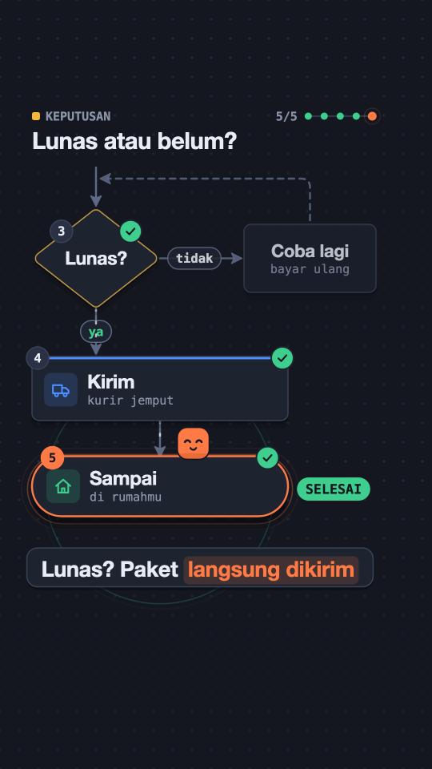

# Flow diagram

An animated flowchart / system diagram on a modern diagramming canvas: a graphite ground with an even dot grid, flat rounded nodes with a category colour band, an icon chip, a step number and a done tick, orthogonal edges with rounded elbows that draw on and then get their arrowhead, label chips sitting on the edges ("ya" / "tidak"), dashed swimlanes, sticky notes. A packet travels the edges and each node lights exactly when the packet lands. The hero is that packet come alive: a signal-orange rounded token with two eyes that rides the edges and sits on the node that is active. Motion on 1s, springs with a small overshoot, a camera that follows the active node.

**The one rule: orange means "now".** The signal colour is spent only on what is active at this moment (the active node's border and pulse rings, the edge being travelled, the current step dot, the caption's keyword) and on the hero. Category colours say what kind of thing a node is; green says done; everything else is graphite.

Good for: narrated "how it works" explainers in 9:16 — processes, pipelines, cause and effect, decisions and their branches, request / response paths, onboarding steps. Not a technical drawing (that is `blueprint`: white hairlines, dimension lines) and not neon (no glow).

## Palette and meaning (`FD` in kit.js)

| role | hex | use |
|---|---|---|
| canvas | `bg #14171f` | the ground (`STYLE.paper`, both eras) |
| dot grid | `dot #262b38` | dots every 48px, constant size under zoom, alpha drifting slowly |
| node surface | `node #1e2330`, `node2 #2a3144` | node fill, caption plate; chips, notes, idle step badges |
| node border | `border #3a4256` | idle borders, swimlane dashes, the step row's line |
| edge | `edge #5d6884` | idle edges and arrowheads (lighter than the border so lines read on the canvas) |
| text | `text #e8ecf4`, `muted #8b94a8` | titles; sub labels, kickers, counters |
| categories | `blue #4c8dff`, `violet #9b7bff`, `green #3ecf8e`, `amber #f5b83d` | a 7px top band on boxes / docs, a tinted border on diamonds, pills, cylinders and circles, the icon chip. Pick a meaning per piece (e.g. blue = user action, violet = payment, amber = decision, green = outcome) |
| done | `green #3ecf8e` | the tick badge, finished step dots, the completion ring |
| **signal** | `signal #ff7a45` (`signalD #d95f2e`) | active now + the hero. Nothing else |

**Light variant:** `const FD_LIGHT = true;` before the kit (a `src/options.js` in the piece's `build` list): off-white canvas `#f5f6f8`, white nodes, softer shadows, the same category and signal colours.

## Type

- `FD_SANS` = `-apple-system, "SF Pro Display", "Segoe UI", Inter, Roboto, "Helvetica Neue", Arial, …`, weight 600 for node titles, 700 for headlines and the caption keyword.
- `FD_MONO` = `"SF Mono", Menlo, Consolas, "Cascadia Mono", "Roboto Mono", "DejaVu Sans Mono", monospace` for sub labels, edge chips, step numbers, kickers, badges and the step counter.
- Sizes at 1080 wide: headline 58, caption 54 (never under 50), node title 48 by default (44–48; never under 44 on screen), sub labels 30 mono, edge chips, notes, badges and step numbers 31, kicker, swimlane tab and step counter 30.
- Default node box: 620 × 170 (`fdStack`), about 70% of the 9:16 safe width; the demo uses 640.
- A node title that is wider than its node shrinks to fit; keep titles to one or two short words so that never happens.
- Indonesian strings: one word per node where possible ("Pesan", "Bayar", "Kirim"), the detail in the mono sub label, the sentence in the caption.

## Motion habits

- On 1s (`ones: true`). Every reveal takes an absolute `t0`, so a piece cues it on a beat or on a spoken word.
- **Nodes pop** on a spring with a small overshoot (about 5%), alpha in over two frames. Edges, chips, notes and badges use the same family of springs.
- **Edges draw on** from source to target in 0.3–0.4s (cubic out); the arrowhead lands at the end with its own small pop; the label chip pops as the line passes it.
- **The order of a step:** the edge starts → the next node pops (idle) → the packet / hero leaves → it lands 0.5s later and on that frame the node goes active (signal border, two pulse rings, a 7px lift) and the node it left gets its green tick. While the hero is on an edge, that edge carries the signal colour.
- **The hero walks the flow** (`fdWalk`): a hop off its seat onto the edge, a ride along it with a short trail, a hop up onto the next node's top edge, a landing squash. It blinks, bobs when idle, looks where it is going, goes wide-eyed at a decision and smiles at the end.
- **Idle life never stops:** marching dashes on edges already travelled (`fdFlow`), pulse rings round the active node and the current step dot, a dashed loop whose dashes creep, the dot grid's alpha drifting, the hero's blink and bob.
- **Camera** (`pieceCam`): starts close on the first node and pulls back and down as the flow grows (the demo goes 1.10 → 1.0), putting the active node near the middle; after a morph the new era opens about 7% close and settles on a spring. No shake, no rotation. Line widths, dots and rims stay the same thickness at any zoom.
- **Containers grow** with their contents (a swimlane's height on a spring) instead of being drawn at full size around one node.
- **Transitions:** one shape morph per section change, from the node the old section ended on to a shape of similar proportions in the next (the demo: the decision diamond → a circle that opens as a lens on the same decision). The blob is drawn as the packet (flat signal colour, darker inner rim, the hero's eyes), so it reads as the hero changing shape. Titles, captions and the step row leave in the first 0.3s of a bridge and return when it ends.

## Frame checklist (on top of grammar/FRAME.md)

1. **One node is "now".** Exactly one active node (or one edge being travelled) carries the signal colour, and the hero is on it.
2. **The main column fills the frame:** node boxes span 70–80% of the safe width (620–700px of x 60–940); at most 5 nodes visible in 9:16, a side-branch node ≥ 320px wide; a longer flow moves the camera or morphs to the next section instead of shrinking.
3. **Every edge has a direction and lands on a border:** an arrowhead at the target, elbows orthogonal with rounded corners, no edge crossing a node or another edge's label.
4. **A branch says which way is which:** a chip on each outgoing edge; the path not taken is dimmed but still legible (nodes fade to 62% by default, edges to 75%; the demo uses 78% / 85%), not removed.
5. **Readable at phone size:** titles ≥ 44px, mono labels and chips ≥ 30px, caption ≥ 50px, nothing under the platform UI (content inside x 60–940, y 250–1500); check `review/phone.jpg`.
6. **The canvas shows:** dots visible behind the diagram, soft flat shadows under nodes, no glow, no gradient, no outline heavier than 5px.
7. **Something moves** in every held frame (marching dashes, pulse rings, blink).
8. **The state agrees with itself:** the step row, the done ticks, the active node and the caption's keyword all describe the same moment.

## Kit API (`kit.js`, on top of `kit/core.js`)

Nodes are placed by their **centre** `(x, y)` with a size `(w, h)`; groups by their top-left corner. Sizes and positions are arguments (use `W`, `H`, `CX`, `LX`, `LY`), so a 16:9 layout works with the same calls. A state option (`active`, `done`, `dim`) is `true`, a start time, or `[from, to]`.

- Palette and type: `FD`, `FD_LIGHTMODE`, `FD_SANS`, `FD_MONO`, `FD_R` (18); `fdText(str, x, y, size, color, { align, weight, mono, al })`, `fdTextW`, `fdFont`, `fdRR(x, y, w, h, r)` (a rounded-rect path), `fdZ()` (camera zoom), `fdOn(v)` (a state → 0..1), `fdPop(t0, k, d)`, `fdA(hex, alpha)`, `fdMix(hexA, hexB, u)`.
- Ground: `fdGround({ color, pitch, r, al })`, `fdDots(o)`.
- Layout: `fdBox(x, y, w, h, shape, id)` → `{ id, x, y, w, h, shape, top, right, bottom, left, tl, tr, seat }` (anchor points, badge corners, the hero's seat) without drawing; `fdStack(items, { x, y, gap, w, h, dir: 'down' | 'right', branch })` (defaults: 620 × 170 nodes, gap 100, branch 420) (alias `fdLayout`) → the boxes of a column or a row, also by id (`boxes.by.kirim`); an item is `{ id, w, h, shape, gap, side: -1 | 1, dx, dy }`, where `side` puts it in a side column on the row of the previous main node.
- Nodes: `fdNode(id, x, y, w, h, o)` or `fdNode(box, o)` → the box. `o`: `shape` (`'box' | 'pill' | 'diamond' | 'cylinder' | 'doc' | 'circle'`), `title`, `sub`, `color`, `icon`, `t0`, `active`, `done`, `dim` (`dimTo`, default 0.62), `step`, `size` (default 48), `subSize` (default 30). Icons (`fdIcon(name, cx, cy, size, color)`): `gear, user, database, mail, check, cross, clock, bolt, cloud, doc, cart, card, truck, home, box, retry`.
- Edges: `fdEdge(a, b, o)` → the path. `a` / `b` are boxes or `[x, y]` points. `o`: `t0`, `d`, `route` (`'elbow' | 'straight' | 'curve'`), `from` / `to` (sides; picked from the direction when omitted: straight down a column, out sideways and in from above for a side branch), `via` (corner points for a hand-routed loop), `mid`, `r`, `label`, `labelAt`, `labelColor`, `dashed`, `march` (px/s), `color`, `active`, `dim` (`dimTo`), `head: false`, `w`. `fdRoute(a, b, o)` gives the same path without drawing (route first, draw later). `fdPath.at(P, f)`, `fdPath.angle(P, f)`, `fdPath.slice(P, f0, f1)`, `fdPath.len(P)`.
- Travel and life: `fdToken(path, t0, d, { kind: 'dot' | 'mail' | 'doc', color, r, hold })` → `{ x, y, u, on, arrived }`; `fdFlow(path, { t0, color, speed, al })` (marching dashes); `fdPing(x, y, t0, { color, r, d })` (a completion ring).
- Containers and marks: `fdGroup(x, y, w, h, label, { t0, color, fill, march })`, `fdNote(x, y, text, { to: [x, y], t0, color })`, `fdBadge(x, y, text, { t0, color, textColor })`.
- Through `DEFER` (screen size): `fdTitle(kicker, headline, { x, y, at, size, color })`, `fdCaption('text with a *keyword*', { y, size, at, x, maxW, plate })` (`\n` breaks lines; a line wider than `maxW` shrinks, never under 50px), `fdProgress(steps, current, { x, y, at, label })`. All hide during bridges (`fdLeaving()`, `fdEraIn()`).
- Hero: `fdHero(x, y, r, { key, squash, look, lookY, mood: 'idle' | 'wow' | 'happy', trail, idle, color })` — sets `SPARK_AT`; `fdSeat(box, r)` → where it sits on a node; `fdWalk(legs)` with `legs = [{ from, path, to, t0, d }]` → `{ x, y, squash, look, lookY, moving, trail, leg }`.
- Bridge shapes: `fdShapePts(box, grow)`, `fdCirclePts(x, y, r)`, `fdPanelPts(x, y, w, h, r)`.
- `STYLE`: `paper` (the canvas), `backdrop` (canvas + dots, always), `window` (hard mask, flat shadow, a 6px signal-colour rim), `blob` (flat fill, darker inner rim, the hero's eyes), `hero` (`fdHero`), `heroColor` signal, `heroPts` (a rounded square), `post` (nothing), `ones: true`.

## With a voice-over

- **The voice is the clock.** Cue each node's `t0` on the word that names it: `fdNode(box, { t0: VW(line, 'bayar') })`.
- **The edge leads the word:** start the edge about 0.3s before the next node's word (`t0: VW(...) - 0.3`), so the arrow is arriving as the word is said.
- **Light on arrival:** send the hero (or `fdToken`) so it lands on the word, and give the node `active: thatTime` and the node before it `done: thatTime` — the node lights when the packet arrives, not before.
- **≤ 5 nodes visible at once in 9:16**, at the default size (boxes 70–80% of the safe width). For a longer flow move the camera down the column (`pieceCam` following the active node) or morph to the next section; do not shrink the nodes to fit more.
- **Leave the bottom caption band free for subtitles.** With burned-in subtitles, drop `fdCaption` (or use it only for a two-word keyword) and keep the diagram above y ≈ 1340 (the demo's lowest node ends at 1296); the title and step row stay.
- One sentence = one step. If a sentence names two nodes, cue both on their own words rather than revealing them together.
- A decision gets a breath: hold on the active diamond for the question, then draw the taken branch on the answer word and the other branch dimmed a beat later.

## Do / don't

- **Do** lay the flow out first (`fdStack` / `fdBox`), route the edges, then draw: ground → groups → edges → flows → nodes → notes → hero → title / steps / caption.
- **Do** give every node a category colour with a meaning, and keep that meaning for the whole piece.
- **Do** dim what is not on the taken path; the eye should find the signal colour first, then green ticks behind it.
- **Do** let the picture act the step out (a tick, a ring, the hero's face) and let the caption name it.
- **Don't** use the signal colour for decoration, category bands, badges or icons.
- **Don't** add glow, gradients, 3D or hand-drawn wobble; the look is flat and crisp.
- **Don't** fade whole diagrams in at once: build them in the order the process happens.
- **Don't** let two label chips or a chip and a node touch; move the chip along the edge with `labelAt`.
- **Don't** run an edge through the bottom caption band or under the platform UI on the right (x > 940).

## Not matched / known weaknesses

- **Built from a written brief, not from measured references.** Colours, sizes and timings follow the brief and the conventions of diagramming tools; nothing was frame-matched against a reference video.
- Edges are routed by simple rules (straight, one or two elbows, a hand-given `via` list). There is no obstacle avoidance: a piece has to pick sides and waypoints so edges do not cross nodes.
- The hero covers an edge's label chip for a few frames while it rides over it (the "ya" chip in the demo).
- Text inside nodes is one line; a long title shrinks rather than wraps, and a sub label that is too long is not fitted at all.
- Icons on diamonds are not drawn (title and sub only); circles show an icon only when they have no title.
- The dot grid is deliberately quiet (`#262b38` on `#14171f`); on a dim phone screen it nearly disappears, and the 420px under the caption is plain canvas.
- At the default size a 9:16 frame holds three stacked nodes plus a decision, or a decision with one side node and two wide nodes; a side branch has to sit beside a narrower node (the demo puts "Coba lagi" beside the diamond), because a 640px column leaves no room for a second column. The "tidak" edge between them is short (about 205px for a 131px chip and the arrowhead).
- The morph is quick (0.4s of blob); mid-way the diamond → circle is a lemon shape. The grow window opens on a nearly empty canvas for about a third of a second before the new era's title and caption return.
- System fonts differ by platform (SF Pro / Segoe UI / Roboto), so widths shift a little; check node titles on the target system.
- The light variant and the row (16:9) layout, the cylinder, doc and circle shapes, the curved route and the mail / doc tokens were checked on one test frame only, not in an exported piece.
- The demo's mix measures a true peak of −0.9 dBFS, a hair over the −1 target.

## Proven on

`demo/` (6s, 9:16, 120 BPM, 24fps, every cue on the 8th grid): "Cara pesananmu sampai". Node boxes are 640px wide (73% of the safe width), titles 44–48px, sub labels 30px, chips 31px. On the dotted canvas the hero sits on **Pesan** (active) inside a dashed APLIKASI swimlane; the edge draws at 0.25, **Bayar** pops at 0.5, the hero rides down and lands on 1.0 as Bayar lights and Pesan gets its tick; the same again to the decision diamond **Lunas?** on 2.0, with an "otomatis" note at 2.25, while the camera pulls back from 1.10 to 1.0 and the swimlane grows. At 3.0s the diamond morphs into a circle that opens as a lens on the branch: "ya" draws at 3.25, **Kirim** pops at 3.5 and lights on 4.0; "tidak" runs dimmed but legible to **Coba lagi** (bayar ulang) beside the decision, with a dashed loop creeping back to the top; **Sampai** lights on 5.0 with a green ring, a tick, a smiling hero and a SELESAI badge. Captions "Pesan dulu, lalu *bayar*" and "Lunas? Paket *langsung dikirim*". Tile deterministic, 4–8 ms/frame (first frame about 17 ms); review: cuts on grid, morph on grid, story arc (2/2), text (0 cut-off / overlap, 0 in the safe zone) and dead-beat checks PASS, no flat frames; −15.5 LUFS integrated, true peak −0.9 dBFS.
