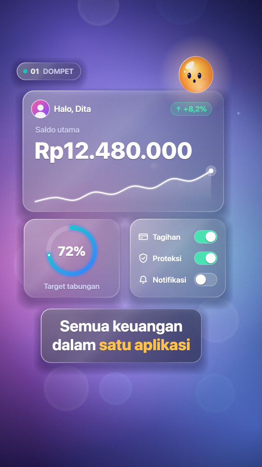

# Glass

Glassmorphism UI over an aurora gradient mesh: a dark-to-vivid backdrop of large, slowly drifting soft colour fields (violet, blue, teal, pink) with out-of-focus light discs and tiny glints, and on top **frosted-glass panels** — rounded rectangles that blur what is behind them, with a translucent white fill, a bright top-left edge, a soft drop shadow and a faint inner sheen. Panels hold simple UI: a stat number, a line or bar chart, toggle pills, an avatar, a progress ring, an icon. Clean system sans, white text. Panels float in with a little scale and rise, and everything sways slowly at its own depth (parallax). Motion on 1s.

Pick it for apps, SaaS, fintech, dashboards and product features: anything where "the product is a calm, modern screen".

**The one rule: content lives on glass.** Every piece of information sits on a frosted panel; the aurora behind carries only colour and light. Nothing bright and flat is drawn straight on the backdrop except the hero.

## Palette and meaning (`GL` in kit.js)

| role | hex | use |
|---|---|---|
| ground / paper | `ground #0b0a26`, `deep #070617`, `mid #17124a` | the dark base under the aurora; shadows; morph paper |
| aurora fields | `violet #7c4dff`, `blue #3d7dff`, `teal #1fd6c4`, `pink #ff5fa2` | the drifting colour fields, bokeh, avatar gradients. Decoration only: never a meaning |
| **mint** | `mint #46e6b0` | success / positive: a toggle that is on, a check badge, a rising value, the highlighted bar |
| **sun** (hero) | `sun #ffc24d`, `sunD #ee7f2a` | Embun the orb, the one warm thing in a cool frame; at most the caption highlight borrows it |
| text | `white #ffffff`, `inkD #cfd0f2` | values and titles; secondary labels |
| details | `rose #ff7a90`, `eye #1b1442` | the hero's cheeks; its eyes and mouth |

A frame uses the aurora (two or three fields showing) + white glass + mint for the one "good" state + the amber hero. Era palettes differ by which fields lead (era 1 violet/pink, era 2 teal/blue in the demo).

## Line, fill and texture

- **Glass** (`glGlass` / `glPanel`): (1) drop shadow = ten faint growing layers of `deep`, dropped 20px; (2) frost = the pixels behind the panel copied down four half-size scratch canvases and back up, clipped to the panel (a real blur, a few small `drawImage` calls); (3) white fill gradient 0.27 (top-left) → 0.08 (bottom-right); (4) sheen = a corner glow + one faint diagonal band; (5) edge = a 2.4px stroke (screen-constant under the camera), white 0.92 at the top-left fading to 0.1, back to 0.45 at the bottom-right.
- No `ctx.filter`, no `shadowBlur`. Corner radius 44 on cards, half-height on pills, 72 on the square badge card.
- UI marks are white: 5px chart lines with a soft area under them, rounded bars, rings with a 20% stroke and round caps, 3.5px line icons. Only "on / done / up" is mint.
- Type: `GL_SANS` = `system-ui, -apple-system, "SF Pro Display", "Segoe UI", Roboto, "Helvetica Neue", Arial, "Noto Sans", "DejaVu Sans", sans-serif`. Big value 92px / 800; card titles 34px / 600; labels 30–32px in `inkD`; caption 64px / 700 with the highlighted phrase 800 in colour. Every string has a soft dark offset under it (3.5% of its size) so it holds on bright aurora.
- Post: a soft vignette and fine seeded grain (keeps the gradients from banding).

## Motion habits

- On 1s (`ones: true`), springs everywhere.
- **Float in:** a card fades in over 0.28s while it scales 0.84 → 1 and rises 90px on `SPRING.smooth` (`glCard` with `t0`). Stagger cards 0.1–0.25s; the main card is there on the first frame.
- **Parallax sway:** every layer shares one slow sway (`glSway(depth)`); the aurora moves against it (−0.7), bokeh −0.3, cards 0.5–1.0, pills and the hero 1.1–1.3. Cards also bob a few px on their own phase.
- Values **count up** (`glCount`) while the chart draws on and the ring fills, all ending on one beat; toggles flip on beats with `SPRING.snappy` (`glFlip`).
- The hero drops in and lands with a squash, watches the number, hops when it lands; in a beat section it bounces on every beat.
- Camera: a slow ≤ 4% push inside an era; after a morph the new era opens 9% close and settles on a slow spring.
- Morph: the old era is seen through a glass-rimmed window closing on a round UI part; on the bare aurora the part becomes a tinted glass gem with two glints; the new era opens out of a rounded card. Tags and captions wait until the opening window has nearly finished (`glArrive`).

## Frame checklist (on top of grammar/FRAME.md)

1. **Every panel reads as glass:** a brighter top-left edge, a visible soft shadow, the aurora showing through, softened.
2. **The aurora shows at least two colour fields** and stays darker than the text: white 30px labels must read on every panel.
3. **3–6 panels**, aligned to one column grid (x 100–900, 40px gutters), none overlapping another panel's text.
4. **One mint success state** per frame at most (plus small "on" toggles); the amber belongs to the hero.
5. **Something is counting, drawing on, filling or flipping** in every held frame; nothing sits fully still (sway + bob).
6. **The hero touches the UI:** sitting on a card edge or beside the focal panel, looking at the value that matters.
7. **The caption is on its own darker glass bar** in the safe area (x 60–940, y 250–1500), ≤ 2 lines, one highlighted phrase.
8. Vignette + grain in post on every frame.

## Kit API (`kit.js`, on top of `kit/core.js`)

- Palette and type: `GL`, `GL_SANS`.
- Colour: `glA(c, a)` (hex or `rgb()` → `rgba()`), `glMix(a, b, u)`, `glRGB(c)`.
- Geometry: `glPath(P, closed)`, `glRRectPts(x, y, w, h, r)`, `glCirclePts(x, y, r, n)`, `glCentroid(P)`, `glZoom()`, `glSway(depth)` → `[dx, dy]`, `glScratch(name, w, h)` (a cached scratch canvas).
- Backdrop: `glAurora({ key, cols, n, speed, dim, par, top, mid, bottom })` (call it first in every scene), `glBokeh(key, n, { cols, a, rMin, rMax, depth })`, `glGlints(key, n, { box, s, depth })`, `glGlint(x, y, s, a, c)`.
- Glass: `glFrost(bb)` (blur what is drawn inside screen box `{x0, y0, x1, y1}` into the current clip), `glGlass(P, { tint, a, dark, frost, shadow, shadowD, edge, sheen })`, `glPanel(x, y, w, h, { r, …glGlass options })`, `glCard(x, y, w, h, { t0, key, depth, rise, spring, r, … }, draw)` (a floating panel; `draw(pose)` runs with the card's transform, in the card's own coordinates), `glCardPose(x, y, w, h, o)` → `{ a, s, dx, dy, cx, cy, map(px, py) }` (where the card is now: use `map` for bridge shapes and for things that sit on a card).
- Type and numbers: `glFont(size, weight)`, `glTextW(str, size, weight)`, `glText(str, x, y, size, c, { weight, align, base, a, shadow })`, `glNum(n)` (`12.480.000`), `glRp(n)` (`Rp12.480.000`), `glCount(t0, dur, a, b, step)`.
- UI parts: `glSpark(x, y, w, h, vals, { c, frac, w, fill, dot })`, `glBars(x, y, w, h, vals, { c, hi, hiC, t0, stagger, gap, spring })`, `glToggle(x, y, w, on, { c })`, `glFlip(t, from, to)`, `glAvatar(x, y, r, { c1, c2 })`, `glRing(x, y, r, frac, { c, c2, w, track })`, `glIcon(name, x, y, s, c, { w, frac })` (names: `check`, `arrowUp`, `arrowDown`, `bolt`, `card`, `bell`, `shield`, `user`, `heart`, `lock`, `send`, `plus`, `chart`), `glChip(str, x, y, { size, c, bg, icon, align, weight, a })`, `glBadge(x, y, r, { c, frac, icon })`.
- Hero: `glHero(x, y, r, { key, look, lookY, mood: 'smile' | 'wow', squash, bob, a })` — Embun, an amber glass orb with two eyes; (x, y) its centre; sets `SPARK_AT`. `glHeroPts(x, y, r, n)` (bridge outline).
- Captions (through `DEFER`): `glCaption('line one\nline *highlight*', { y, x, size, at, hi, dark })`, `glTag('01', 'LABEL', { c })`; `glLeaving()` (fade in the first 0.3s of a bridge's shrink), `glArrive(at)` (not before the opening bridge has nearly finished). `glCaptionNow`, `glTagNow` draw immediately.
- `glPost()` (vignette, grain), `glGrainTile()`.
- `STYLE`: `paper` ground, `backdrop` (the aurora, calmer, tinted by the era colour, with glints), `window` (clip + a colour glow + a bright glass rim), `blob` (a tinted glass gem: glow, frosted pane, colour gradient, inner line, two glints), `hero` (Embun), `heroColor` sun, `heroPts`, `post` glPost, `ones: true`.

## Do / don't

- **Do** call `glAurora` first, then bokeh/glints, then cards: the frost blurs whatever is already drawn, so draw order is depth order.
- **Do** put text and marks inside a `glCard` callback so they float, fade and scale with their panel.
- **Do** bridge a round UI part (ring, avatar, badge, orb) into a squarish card or badge; take both outlines through `glCardPose(...).map` so the window closes exactly on the floating part.
- **Do** keep one big number per frame and let it count.
- **Don't** stack panels over other panels' text (the blur smears it into a grey patch), or use more than ~8 frosted panels in a frame (each costs about 2–4 ms).
- **Don't** draw text straight on the aurora, or colour text mint/pink on glass at small sizes (low contrast); small labels are white or `inkD`.
- **Don't** use `ctx.filter` / `shadowBlur`, or make the aurora brighter than mid-tone: white text stops reading.
- **Don't** spend the hero's amber on UI, or morph a round part into a long thin bar.

## Not matched / known weaknesses

- Built from the genre's conventions, not measured from a specific reference.
- The frost is a box-filter mip chain, not a Gaussian: it is right on soft content (aurora, bokeh, the hero's glow) but sharp, high-contrast things directly behind a panel (text, a thin line) can show faint blocky smearing. There is no refraction or chromatic edge.
- The frost reads the pixels already on the canvas, so a panel only blurs what was drawn before it; panels in the same card callback do not blur each other's later content.
- Text contrast depends on the aurora staying mid-dark; a pale field drifting under a panel lowers the contrast of `inkD` labels (the dark offset helps, it does not fix a white backdrop).
- Numerals use the system font's default figures, so a counting number can change width slightly from frame to frame (left-align counting values).
- System fonts differ by OS (SF on macOS, Segoe UI on Windows, Roboto / DejaVu on Linux): widths shift a little, so leave slack in tight rows.
- About 20–60 ms/frame at 1080×1920 in a single renderer (aurora + 4–7 frosted panels); the parallel export ran about 92 ms/frame.

## Proven on

`demo/` (6s, 9:16, 120 BPM, 24fps): over a violet-pink aurora, a balance card counts up to Rp12.480.000 while its chart draws, a savings ring fills to 72%, three toggles flip on the beat and Embun lands on the card and cheers ("Semua keuangan dalam *satu aplikasi*"); at 3.0s the savings ring morphs into a rounded "Berhasil" badge card on a teal-blue dashboard: two pills (Cepat, Aman), a transfer row, weekly bars, and the same ring reaching 100% ("Beres dalam *hitungan detik*"). Tile deterministic; review: morph on grid, text PASS, story arc PASS, dead beats PASS, -14.5 LUFS, true peak -1.0 dBFS.
