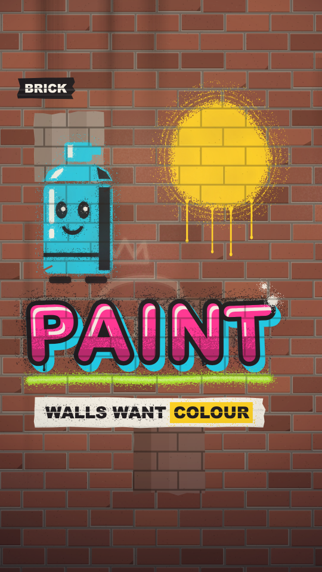

# Graffiti

Spray paint on a city wall. The ground is never paper: it is painted brick or raw concrete with mortar lines, seams, pores, dirt streaks, buffed patches and a faded earlier tag showing through. The paint is aerosol and matte, and it behaves in two ways side by side. **Freehand spray** has a dithered soft edge, fine overspray specks around it and thin vertical drips that end in a bead. **Stencil** has crisp cut edges with small ties where the card held together and only a thin halo of overspray. Pictures are stencil layers, back to front: a flat base colour, a dark shadow layer, a white highlight layer. Words are short bubble letters with a thick outline, a 3D block, a speckled fade and a shine. The wall's grooves stay visible through every colour, so the paint sits *in* the wall.

Pick it for street culture, music, skate, youth campaigns, protest and slogans, city stories, "make your mark" messages, bold one-word statements. Not for dense information, small type, calm or corporate subjects, or anything that needs more than three or four flat colours per picture.

Different from its neighbours: **comic** has a clean black ink line, Ben-Day dots and flat print colour on paper; here there are no dot screens, no continuous ink outline around pictures (only letters have one, and it is sprayed), and the ground is a textured wall. **liquid** is glossy gradient blobs; this paint is matte with speckled edges. **neon** glows; nothing here emits light (the only light is a street lamp off-frame that makes the whole wall flicker). **chalkboard** is dry dusty strokes on slate; this is wet aerosol that runs.

**The one rule: everything is paint on a wall — it has a speckled edge or a stencil-cut edge, the wall's grooves show through it, and something wet is still running.**

## Palette and meaning (`GRF` in kit.js)

A dull wall, loud paint.

| role | hex | use |
|---|---|---|
| wall 1 | `brick #84493a`, `brickD #5c3128`, `mortar #8d8076` | painted brick: era ground, `ERA_BG` |
| wall 2 | `concrete #8b8d8c`, `concreteD #5d6061` | raw concrete with formwork seams and tie holes: era ground, `ERA_BG` |
| buff | `buff #8e877d` | grey paint rolled over old work: the morph's ground (`STYLE.paper`) |
| **hero** | `cyan #19c8e6` | Kaleng the spray can; otherwise the 3D block behind letters. Keep big cyan fills for the hero. |
| loud | `pink #ff2e93` | the main word, the big blob: the thing to look at |
| energy | `yellow #ffd21f` | blobs, the second word, the caption's highlight block |
| fresh | `lime #a8e22a` | a stencil base, underlines, dots |
| highlight | `white #f4f1e8` | the third stencil layer, letter shine, small dots, the caption strip |
| shadow | `black #16141a` | the second stencil layer, letter outlines, wires, the tag strip |
| shades | `pinkD`, `cyanD`, `limeD`, `yellowD` | a coloured shadow layer instead of black |
| prop | `card #b89c72` | the stencil card (kraft board); it never stays in the frame |

A frame uses one wall, black, white and two or three paint colours. A stencil picture is exactly three colours. Never tint the wall itself bright.

## Wall, paint and type

- **The wall** (`grfWall(kind)` … `grfDone()`): built once per kind into two cached canvases — the wall, and its *relief* (mortar grooves, seams, tie holes, cracks, pores). `grfDone()` lays the relief back over all the paint at 27%, which is what makes paint read as sprayed onto masonry. Dirt streaks, soot along the bottom, three buffed roller patches and one faded fat-cap tag (signature, underline, crown) are part of the cache. `'brick:2'`, `'concrete:3'` give other layouts.
- **Specks** live in three seeded 384 px tiles (`fine` ~4% cover, `mid` ~20%, `dense` ~55%). A shape is drawn as a mask on a scratch canvas; stroking its outline with those tiles adds specks outside and punches holes inside, so an edge falls off as *dither*, not as blur. Nothing is regenerated per frame except a few dozen flying specks.
- **Spray edge** (`grfSpray`): solid middle → sparse holes → dense holes → outline → dense specks → sparse specks → far overspray. `soft` sets the width (16 px). Paint is laid at 96% so the wall just breathes through; a soft blotch tile makes the density uneven.
- **Fat-cap line** (`grfLine`): speck skirt, solid body, a brighter centre where the paint is thickest; round ends.
- **Stencil edge** (`grfStencil`): straight knife cuts (`sharp`, the default), `ties` and `gaps` cut back out, a halo of fine specks 24 px wide. No outline.
- **Drips** (`grfDrips`, `grfDripAt`): a flared top, a thin run, a bead with a tiny wet glint. They start 0.05–0.45 s after the paint lands and creep by `1 − e^(−t/τ)`, so some are still moving seconds later.
- **Type**: `GRF_BUBBLE` = `"Arial Rounded MT Bold", "Varela Round", "Baloo 2", "Nunito", "Segoe UI Black", "Arial Black", "DejaVu Sans", …` for bubble words; `GRF_BLOCK` = `"Arial Black", "Segoe UI Black", "Helvetica Neue", "DejaVu Sans", …` for stencilled capitals with one thin bridge cut through the letters. Captions and tags are capitals on a roller strip.
- **Light** (`STYLE.post`): a faint warm pool high on the wall, dark corners, and a tube that flickers — the whole frame dips 6–12% for a frame or two, about once a second.

## Motion habits

- On 1s (`ones: true`). The wall never moves; no camera in the demo.
- **Sprayed on along the path of an invisible can.** `p` on `grfSpray` reveals the fill: `mode: 'zig'` in side-to-side passes from the top down, `mode: 'burst'` as one growing puff. Speckle leads, solid follows about 180 px behind. Put a `grfPuff` and `grfSpit` at `grfCanAt(...)` while it runs.
- **Stencils slap on and peel off.** `p` on `grfStencil` (or `t` on `grfPiece`): the card drops onto the wall in two frames (big shadow → small shadow), the can passes over it leaving colour on the card, the card lifts, turns and leaves. One layer takes 0.375 s (an 8th at 80 BPM); three layers a beat and a half.
- **Letters pop** one per 16th with a back-ease and a puff of mist; the hero squashes a little on each one, as if pressing his nozzle.
- **Drips come late.** Give `dripT = TT − landed − 0.25`. Never start a drip in the same frame as its fill.
- **Idle life:** a drip still creeping, mist drifting (`grfMist`), the street light flickering, a blink.
- **Morphs are paint.** The old piece is buffed out (grey roller paint over the wall) while a sprayed ring closes on the blob; the blob re-sprays itself into the next outline with a softer edge and flying specks, its drips hanging throughout; the wall under the buff changes from brick to concrete.
- Nothing slides across the wall. Paint appears, runs, or is painted over. The hero may squash, blink and hop a few pixels; he does not walk.

## Frame checklist (in addition to `grammar/FRAME.md`)

1. **It is a wall first.** Mortar lines or seams, stains, at least one buffed patch and the faded old tag are visible somewhere outside the new paint.
2. **Both paint behaviours are in the frame:** at least one freehand element (blob, line, dot) with a speckled soft edge, and at least one stencil element with crisp edges and a halo.
3. **Overspray is visible** as separate fine specks around fills and letters at phone size — not a smooth glow.
4. **Something has run:** at least one drip with a bead, straight down, thinner than 10 px.
5. **Stencil pictures are three flat layers** — base, shadow, white — and no outline surrounds them.
6. **The wall's grooves cross the paint** (`grfDone()` was called).
7. **One word, 3–6 letters, fully legible:** outline, 3D block, fade, shine; nothing overlaps it.
8. **Paint is saturated, the wall is dull.** No paint colour on more than about a third of the frame.
9. **Tag strip top-left, caption strip at y ≈ 1335–1435** with one word on a colour block; nothing else below y 1310.
10. **Bridge blobs are round freehand blobs of similar size,** sprayed at least 2 s before the bridge with `dripKey: 'bridge'`, clear of everything else at the bridge time.

## Kit API (`kit.js`, on top of `kit/core.js`)

- Palette, fonts, colour: `GRF`, `GRF_BUBBLE`, `GRF_BLOCK`, `grfRGB(c)`, `grfMix(a, b, u)`, `grfLift(c, k)`, `grfShade(c, k)`.
- Wall: `grfWall('brick' | 'concrete' | 'brick:2' …)` first, `grfDone(al = 0.27)` last (relief over the paint). Piece option: `const GRF_ERA_WALL = ['brick', 'concrete']` tells the morph backdrop each era's wall.
- **Any closed outline, freehand:** `grfSpray(P, colour, { p, mode: 'zig' | 'burst', band, lag, from, soft, al, thin, sharp, drips, dripT, dripKey, dripLen, dripW, key })`. One outline when `soft > 0`.
- **Any closed outline, stencil:** `grfStencil(P, colour, { p, holes, ties, gaps, halo, sharp, al, thin, card, margin, band, lag, key })`. `P` may be a list of outlines (their union).
- Stencil pictures: `grfPiece(layers, { t, each, key, card })` with `layers = [{ P, c, ...stencil options }]`, back to front; returns the number of finished layers.
- Lines and dots: `grfLine(P, width, colour, { p, core, al, closed, spit, drips: [fractions], dripT, dripLen, key })`, `grfDot(x, y, r, colour, { p, … })`.
- Drips: `grfDrips(P, colour, { n, t, key, len, w, k })`, `grfDripAt(x, y, len, w, colour)`.
- The can and its mist: `grfCanAt(bbox, p, o)`, `grfPuff(x, y, r, colour, al)`, `grfSpit(x, y, r, colour, { n, key, al })`, `grfMist(colour, { n, box, al, key, vx })`.
- Outlines: `grfBlobPts(x, y, r, key, n)`, `grfStarPts(x, y, r, n, k, rot)`, `grfRough(P, amt, key, step)`; plus core's `ellipsePts`, `rrectPts`, `xform`.
- Ready pictures: `grfHero(x, y, r, { t, each, c, dark, hi, tilt, sx, sy, look: [x, y], blink, mood: 'smile' | 'wow', spray, sprayC, key })` — Kaleng, a cyan spray can with a face (sets `SPARK_AT`); `grfCanLayers`, `grfCanNozzle`, `grfHeroPts`. `grfBird(x, y, r, { t, each, c, dark, hi, flip, wing, blink, tilt, key })`, `grfBirdLayers`.
- Lettering: `grfWord(str, x centre, y baseline, size, { fill, fill2, line, shade, hi, t, step, w, ow, depth, drips, dripLen, key })`; `grfText(str, x, y, size, colour, { align, kind, p, halo, cut, al })`; `grfFont(size, kind)`, `grfTextW(str, size, kind)`.
- Captions (through `DEFER`): `grfCaption('words *highlight* words', { x, y, w, size, hi, bg, col, at, upper })` (y = the strip's centre, 1385; shrinks to fit `w`), `grfTag('label', { x, y, size, bg, c, at })`, `grfStrip(x, y, w, h, colour, key, u)`; `grfBridgeK()` is their visibility through a bridge.
- Light: `grfFlick(t)` (how dark the flicker is at t — the demo's score ticks on it).
- Internals worth knowing: `grfOn(i, bbox, draw)` (draw on scratch canvas i under the current transform), `grfStamp(i, sb, colour, al, op)`, `grfLay`, `grfPat(kind, colour)` (speck patterns, black or tinted), `grfReveal`, `grfZig`.
- `STYLE`: `paper` (buff), `backdrop` (the wall with buff rolled over it; brick cross-fades to concrete mid-morph), `window` (a clip with a sprayed ring in the blob's colour and the blob's drips when it is nearly closed), `blob` (the blob re-sprayed between outlines, softer edge, flying specks, drips), `hero`, `heroColor`, `heroPts`, `post` (street light and flicker), `ones: true`. `GRF_DRIP_T` (2.5 s) is the age of the drips the hooks draw.

## Do / don't

- **Do** start every scene with `grfWall` and end it with `grfDone` (before the tag and caption).
- **Do** mix the two behaviours: a soft blob behind a crisp stencil is the look.
- **Do** build pictures in three layers and let each card slap, spray, peel on the beat.
- **Do** let paint run a moment after it lands, and keep one drip creeping while the frame holds.
- **Do** keep words to 3–6 capitals and give them room; let `w` shrink them to fit.
- **Don't** draw an ink outline around a picture, use dot screens, gradients, gloss or glow.
- **Don't** make overspray a smooth blur or a halo of light: it is separate specks.
- **Don't** go wildstyle: no interlocking, arrows through letters or illegible shapes.
- **Don't** slide or rotate painted things across the wall, and don't move the camera below zoom 1 (the wall cache is one frame).
- **Don't** pass a list of overlapping outlines to `grfSpray` with `soft > 0` (inner boundaries get eroded); use `grfStencil` or one outline.
- **Don't** put paint under the caption strip, or anything over a bridge blob at the bridge time.

## Not matched / known weaknesses

- Built from the genre's conventions (stencil street art, bubble throw-ups), not measured from one reference.
- Bubble letters depend on a rounded system face: Arial Rounded MT Bold on macOS; on Windows and Linux they fall back to Segoe UI Black / Arial Black / DejaVu Sans Bold, which are blockier (the thick round-joined outline keeps them soft).
- Speck tiles are fixed to the wall: a shape that moves (the hero's squash) has its specks re-form rather than travel. Fine for the few pixels things move here.
- Stencil ties are small cuts across the edge, not true bridges holding islands; give real ones with `gaps` and `holes`.
- At the end of the shrink the window clips the blob's drips, so the hook redraws them; they can shift a few pixels at that hand-over.
- `grfWall` has no parallax and no camera test; 'brick:N' layouts are random, not composed — check where the patches and old tag land.
- `grfStarPts`, `grfRough`, `holes`, `gaps`, coloured shadow layers (`pinkD` …) and `grfWall` seeds were not used in the demo.
- The exporter reports a true peak of −0.9 dBFS for the demo's score (target ≤ −1). The demo does not loop seamlessly.

## Proven on

Its demo only. `demo/` (6s, 9:16, 80 BPM, 24fps): on a brick wall under a flickering street light a round yellow blob bursts on and starts to run; Kaleng is stencilled on in three layers (cyan, black, white), blinks, and presses his nozzle as PAINT pops on letter by letter, then a lime fat-cap underline and two white dots. At 3.0 s the wall is buffed grey, the yellow blob re-sprays itself pink and the wall under it turns to concrete; a black wire is sprayed across, a lime stencil bird lands on it in three layers, FLY pops on, dots pop, the bird hops and flaps. Two bars of boom-bap with can hiss, card slaps, peels, pops and a tube that ticks when the light flickers. Deterministic; `review.mjs` passes cuts, morph grid, story arc, text and dead beats.
