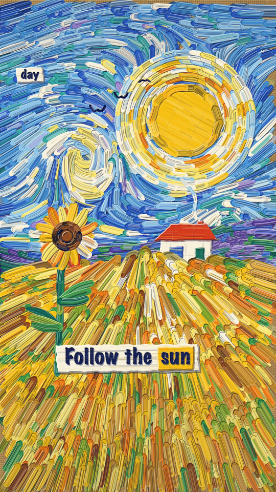

# Impasto

A heavy oil painting in the manner of post-impressionist impasto, laid on while you watch. The whole picture is built from thick, opaque, directional brush marks that follow a flow field: a sky turns in eddies, a field runs to the horizon in ridged rows, a hill follows its own ridge. Every mark is a short loaded stroke: a body of paint that lands fat and lifts ragged, bristle tracks along its length, two tube colours dragged together on one brush, a thin lit ridge on the edge that faces the single raking light and a thin cast shadow on the other. Flat things (a wall, a roof, a moon, a caption plaque) are palette-knife slabs. Under everything is a toned canvas whose weave shows in the gaps between marks and round the edge of the picture.

Pick it for landscape, weather, night and day, seasons, harvest, flowers, emotion and turbulence, art-history pieces, anything that should feel physical, warm and hand-made with a lot of energy in it. It is pictorial: any outline can be filled with marks. Not for UI, data, diagrams, small text, thin lines or precise edges, and not for calm, airy or minimal subjects (the surface is always busy).

**The one rule: everything is a loaded mark or a knife slab, and every mark has a direction. No outlines: an edge is where the direction and the colour of the marks change.** If a shape could be removed and leave a clean hole, it was drawn, not painted.

## Palette and meaning (`IMP` in kit.js)

Saturated, opaque tube colours. A region is never one colour: it is a weighted palette, and each mark drags two of its colours together.

| role | hex | use |
|---|---|---|
| toned canvas | `ground #a8824e` (`groundD #8a683a`, `groundL #c4a271`) | the sienna ground: gaps between marks, the picture's edge, the morph's blank sheet |
| darkest paint | `ink #0d1238` | a blue-black, never pure black: shadows of ridges, crows, the dark end of every colour |
| night and depth | `prussian #152052`, `ultra #1f2f9a`, `cobalt #2c5fc6` | night sky, far hills, shadows, caption letters (`prussian`) |
| air | `cerulean #4a98d8`, `sky #8fc6e8`, `turq #35a9a2` | day sky, glow round a light, moonlit ridges |
| the cool accent | `violet #5b3f9e`, `lilac #9c88d2` | distance, smoke, the complement dropped into yellows |
| **light** | `chrome #f6c015`, `lemon #f8e365` | the sun, the moon, stars, wheat, **the hero's petals** |
| heat | `orange #ee7c17`, `verm #d53c1e` | lit windows, roofs, the back row of petals, the warm touch in a yellow field |
| growth | `viridian #176f5a`, `emerald #3c9b49`, `sap #86a82d`, `olive #5b6923` | fields at night, stems, leaves, the green dropped into wheat |
| earth | `ochre #c98d2b`, `sienna #8f4b21`, `umber #3b2719` | furrows, the sunflower's disc, shadows in warm areas |
| white | `white #f7f1dc` | lead white, a little warm: clouds, walls, the caption plaque, the brightest touches |

A region's palette is 4–7 colours with weights: two or three neighbours for the local colour, one light, and a small weight of the complement, e.g. the night sky `[[ultra, 5], [cobalt, 4], [prussian, 3], [cerulean, 1.6], [violet, 1.2], [viridian, 0.6]]`. A second palette (`pal2`) takes over where `mix(x, y)` says so (a glow round the moon, the heart of an eddy, a cloud). Chrome yellow against ultramarine is the look's main chord; the hero owns the yellow-with-a-dark-centre shape.

## How the medium is built

- **The mark** (`impMarkDraw`): four points along the flow. A filled body that is widest just after it lands and narrows to a tip; two or three soft bands of the second colour; 3–8 hairline bristle tracks (lighter and darker), each ending at its own point, some running past the tip (the dry, ragged end); a lit line on the edge whose normal faces `IMP.light` (top left) and a cast shadow just outside the other edge, both broken and scaled by how squarely the edge faces the light; a crescent of piled paint at the heel and the tip. Default width 26 px, length 3.4 × width. Marks are fully opaque and overlap.
- **Filling an outline** (`impFill`): a jittered hexagonal scatter of seeds inside the outline, in three passes that are laid in order: a block-in of big dark marks that covers the canvas, the thick paint in bands, then a row of marks along the outline itself. Each seed's colour comes from the weighted palette through a smooth noise field, so neighbours share a brush-load and the surface reads as patches, not confetti. Each mark is traced through the flow at its place.
- **Flow fields**: `impFlowSwirl` (a base direction plus eddies that turn the marks round their centres), `impFlowRing`, `impFlowRadial` (furrows to a vanishing point, rays), `impFlowAlong` (along a ridge). Direction is the drawing: the same palette with another flow is another material.
- **Knife slabs** (`impKnife`): any outline filled with one flat drag: fine streaks along the drag, the second colour pulled in, faint chatter across it, a lip that is lit on the side towards the light and dark on the other, a cast shadow underneath, a slightly irregular edge. Slabs are the only flat areas in a frame.
- **The canvas** (`impGround`): the sienna ground scrubbed on in soft streaks, with warp and weft threads, weave holes and slubs. The picture stops about 24 px inside the frame (`IMP.pic`), ragged, so the weave frames it.
- **Relief** (`STYLE.post`): one signed emboss over the finished frame, made only of canvas compositing (half the frame plus half the inverted frame shifted 2, 3 px, greyed, laid back with `overlay`). It raises every tonal step the same way, towards the same light, so marks drawn by different helpers sit in one surface.
- **Type** (`impText`): `IMP_FONT` = `"Marker Felt", "Segoe Print", "Comic Sans MS", "Chalkboard SE", "Bradley Hand", "DejaVu Sans", "Liberation Sans", Arial, sans-serif`, weight 700: brush-written letters with a cast shadow, a lit edge and bristle tracks inside the glyphs. Always on a knife slab, never straight on the marks.
- **Caching**: a region that does not change is painted once into its own layer (keyed by `key`, the outline, the brush and the palette) and later frames add only the newly laid marks. A `live` region is repainted on each motion step. Everything is seeded: `tile.mjs` is deterministic.

## Motion habits

- On 2s (`ones: false`). Nothing fades and nothing is tweened smoothly.
- **Laid on:** every region has `frac`; drive it with `impIn(t0, d)`. The block-in appears first, then the thick marks in bands along the flow, then the marks on the outline. The newest ten marks are wet: lighter, with a gloss line.
- **The flow drifts:** a `live` region with `drift` lets its marks ride along the flow in a cycle, each on its own phase, while the eddies breathe: the sky churns, and a mark that reaches the end of its cycle is laid again upstream. Keep it to the sky or water; ground stays put.
- **Halos turn:** `impRing` and `impStar` take `rot`; step it on the eighth (`impStep(0.25) * 0.1`), odd rings the other way.
- **The knife drags:** `impKnife` with `frac` pulls a slab across with a pile of paint riding its front edge (a moon, a wall, the caption plaque).
- **Re-laid wet:** `impWet(region, sel)` paints a band of a finished region's marks wet again: a gust crossing wheat, light on water.
- **The hero** is moved as a whole on 2s: its petals spread (`open`), its head swings (`turn`) and the stem bends with it, it nods (`nod`) on the beat.
- **Bridges:** the picture is scraped back to the canvas round the bridge shape (the remaining marks thin to stains), the shape is left as a knife slab in a creeping rim of marks, its colour changes, and the new picture's block-in comes up as the window opens. Captions are scraped off as the bridge starts.
- **Camera:** none in the demo; it is a painting on a canvas.

## Frame checklist (in addition to `grammar/FRAME.md`)

1. **Individual marks are visible at phone size** in every region, and you can tell which way each region flows.
2. **No region is one colour:** at least three hues are visible in it, with a touch of the complement.
3. **No outlines.** Forms are separated by a change of direction and colour; the row of marks on an outline runs along it.
4. **The light is one light:** lit ridges face top left, shadows fall bottom right, on marks, slabs and letters alike.
5. **Flat areas are knife slabs** with streaks and a lip, and there are only a few of them. A flat fill without streaks is a vector shape.
6. **The canvas shows** round the edge of the picture and in a few gaps; the picture's edge is ragged, not a rectangle.
7. **The sky (or water) turns:** at least one eddy, with lighter paint in its heart.
8. **Yellow against blue** somewhere in the frame, and the hero's yellow sits on a dark or blue ground, never on a yellow field.
9. **Something is being laid:** a band of wet marks, a slab mid-drag, a halo turning, a gust.
10. **Caption: one line on a white slab** at y ≈ 1340–1455, one word on its own chrome slab. Nothing important behind it.
11. **Bridge objects are orbs or other compact slabs of similar proportions**, clear of everything else at the bridge time.

## Kit API (`kit.js`, on top of `kit/core.js`)

- Palette and constants: `IMP { ground, groundD, groundL, ink, prussian, ultra, cobalt, cerulean, sky, turq, violet, lilac, chrome, lemon, orange, verm, viridian, emerald, sap, olive, ochre, sienna, umber, white, light, pic, w }`, `IMP_FONT`, `IMP_PETAL`, `IMP_PETAL_B`, `IMP_LEAF`.
- Timing: `impIn(t0, d)` (0..1: pass as `frac`), `impStep(every, phase)` (a counter for beat-stepped life), `impBridgeK()`.
- Colour: `impMix(a, b, u)`, `impTone(c, k)` (lighter / darker), `impPal(pal | colour)`, `impPick(pal, u)`, `impNoise(x, y, scale, seed)`.
- **The generic helper that turns any outline into the medium:** `impFill(P, pal, { key, flow, w, len, gap, patch, frac, order(x, y), under, edge, hole, pal2, mix(x, y), tone(x, y), live, drift, rate, wet, sig })` — flow-following marks from a weighted palette, cached per `key`; returns the region. `impWet(region, sel(x, y))` re-lays some of its marks wet.
- Flow fields: `impFlowSwirl(base, [{ x, y, r, s, k, pull }])`, `impFlowRing(cx, cy, spiral)`, `impFlowRadial(cx, cy, wave, wl)`, `impFlowAlong(fn, wave, wl)`.
- The stroke primitive: `impStroke(P, c, { w, c2, key, wet, frac })` (one loaded mark along a polyline), `impDab(x, y, c, { w, len, a, c2 })`, `impBlob(x, y, r, c, { c2, key })` (one round heavy touch); low level: `impMarkDraw(g, X, w, c0, c1, seed, wet)`, `impTrace(flow, x, y, len)`, `impStraight(x, y, a, len, bend)`.
- Placed marks (all take `w`, `len`, `frac`, `key`): `impRing(cx, cy, r0, r1, pal, { rot, counter, spiral, pal2, mix(u) })`, `impRays(cx, cy, r0, r1, pal, { n, rot, bend, sx })`, `impAlong(P, pal, { closed, inset, step, rot, cull })`.
- The knife: `impKnife(P, c, { a, c2, frac, key, raw, rough, lift, lip })`, `impRough(P, amt, key)`.
- Ready-made: `impOrb(P, c, { frac, raw, a, c2 })` (a moon or sun: a slab in a creeping rim; the bridge's blob is drawn with it), `impStar(x, y, r, { rot, frac, pal, pal2, core })`, `impBird(x, y, s, { flap, c })`.
- Hero: `impSunflower(x, y, r, { open, turn, nod, stem, frac, key })` — (x, y) is the head's centre, r the petal tips; sets `SPARK_AT`. `impSunflowerPts(x, y, r)`.
- Geometry: `impDiscPts(x, y, r, n)`, `impRectPts(x, y, w, h)`, `impSunPts(x, y, r, lobes, amp, rot)`, `impCen(P)`, `impInside(P, x, y)`, `impHash(P)`, `impPath(g, P)`.
- Type: `impFont(size, weight)`, `impTextW(str, size)`, `impText(str, x, y, size, c, { align, weight, key, c2 })`.
- Captions (through `DEFER`): `impCaption('Paint it *thick*', { x, y, w, size, at, c, hi, ink })` (y = the baseline, 1420; shrinks to fit `w`, 800), `impTag('night', { x, y, size, at })`.
- Surface: `impGround()` (call it first in every scene), `impGroundCv()`, `impScrub()`.
- `STYLE`: `paper` (the ground), `backdrop` (the canvas with the scraped-thin remains of the era's colour), `window` (a clip inside a wreath of marks that tightens as it closes), `blob` (`impOrb`), `hero` (the sunflower's head), `heroColor`, `heroPts`, `post` (the relief pass), `ones: false`.

## Do / don't

- **Do** decide the flow of every region first: round, along, towards, across.
- **Do** give each region its own brush size: big marks near, smaller far (30 px field, 24 px hill).
- **Do** put the lightest paint where the light is (`pal2` + `mix`) and model with `tone`, not with a gradient.
- **Do** use `edge: false` for regions that run off the picture or meet another region along a straight line; the default outline row is for forms (a hill, a tree, a haystack).
- **Do** give every region a stable `key`, keep its outline fixed, and animate with `frac`, `live` flows and `impWet`.
- **Do** score it with soft brush swishes in streams, a scrape for the knife, small bells for stars.
- **Don't** draw lines, outlines, hatching or dots; no transparent washes, gradients, blurs or glows.
- **Don't** make a region `live` unless its flow really moves: a live sky costs about 100 ms a step, a cached region almost nothing.
- **Don't** set type on the marks; captions go on a slab, about 16 characters at 76 px.
- **Don't** put the hero on a ground of its own colour, or anything over a bridge object at the bridge time.
- **Don't** use marks narrower than about 10 px: below that the bristle tracks vanish and it turns into coloured pencil.

## How it differs from the closest shipped styles

- **pointillism** is small round dabs of pure colour side by side, mixed by the eye, with canvas between them and no direction. Impasto is long directional marks that overlap, cover the canvas, mix on the brush and stand up in relief.
- **watercolor** is thin, transparent and wet, with soft tide edges and the white of the paper as light. Impasto is opaque and thick; its light is the palest paint and the lit ridges, and nothing bleeds.
- **storybook** uses flat watercolour washes inside pencil outlines. Impasto has no outlines and no flat washes.
- **mosaic** also builds pictures from many pieces following a contour, but its pieces are hard tiles with grout; here the pieces are curved, ragged, overlapping and modelled by light.

## Not matched / known weaknesses

- Built from the genre's conventions, not measured from a specific painting; the relief is a 2D suggestion (lit edge, cast edge, one emboss), not a height map, so there is no true specular gloss and marks do not shade one another by height.
- Marks have rounded heels and can read as "pills" where many of the same size sit side by side on a calm flow; vary `w`, `len` and `gap` between regions.
- Colour patches come from an isotropic noise field, not from streamlines, so a brush-load does not carry along the flow for more than a mark or two.
- `impFill` clips nothing: marks whose centre is inside the outline overhang it by up to half their length, so small or thin outlines (under about 3 × `w`) lose their shape; use `impAlong`, `impRays`, `impStroke` or a knife slab for those.
- A `live` region repaints fully each step (the demo's sky: about 1,700 marks, 100–150 ms); frames cost 120–300 ms at 1080 × 1920, so the live preview runs below real time. The 6 s demo exports in about 40 s.
- Region layers are cached at the piece's main format and are not released; a piece with dozens of large regions should reuse keys.
- The caption font is a system brush hand (Marker Felt on macOS, Segoe Print on Windows, DejaVu Sans on Linux, which is plainer); the painted look comes from the shadow, lit edge and bristle tracks, not from the typeface.
- `backdrop` takes its colour from `ERA_BG`, not from the blend the renderer passes.
- The hero-to-hero bridge (`STYLE.hero`), `impDab`, `impStroke` with `frac`, `hole`, `order`, `spiral` and camera moves are not exercised by the demo; other formats than 9:16 were not tested. Captions are single-line only; the demo does not loop seamlessly.

## Proven on

Its demo only. `demo/` (6s, 9:16, 120 BPM, 24fps): on a toned canvas a night sky is blocked in and then brushed thick in ultramarine and cobalt, churning round two eddies; a lemon moon is dragged on with the knife and a halo of marks turns round it; six stars are dabbed in one per eighth; a dark hill follows its ridge, a farmhouse is built from five knife slabs and its window lights up orange, smoke climbs from the chimney, a field runs to a vanishing point in ridged green rows, and a sunflower is painted in the foreground, asleep, and nods once. At 3.0 s the picture is scraped back to the moon, which turns chrome yellow and becomes the sun; the same picture is repainted in daylight: a cerulean sky with white eddies, wheat in chrome and ochre, white walls and a vermilion roof, three crows crossing, two gusts re-laying wet marks across the wheat, and the sunflower opening and swinging round to the sun, then nodding on the last two beats. `tile.mjs`: deterministic; `review.mjs`: all checks pass.
