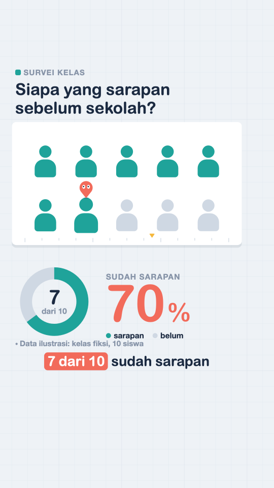

# Infographic

A friendly editorial data-explainer in the isotype / data-journalism tradition, made for narrated explainer videos in 9:16: **the chart is the picture**. People-scale pictograms that take colour one by one, donuts that sweep, columns and bars that grow with their numbers counting on top, a line that draws on behind a travelling head dot, one very large counter. White rounded cards with a flat offset shadow sit on a pale cool sheet with a faint plotting grid; everything is flat fills, rounded caps and corners and thin axis hairlines. The hero is a small coral map pin with two eyes that stands on whichever datum is being talked about. Motion on 1s, springs, values and their visuals always moving and finishing together.

**The one rule: colour is the legend.** Teal, amber and indigo each stand for one series for the whole piece; coral is kept for the number the story follows (and for the hero that points at it). Grey is "the rest".

How it differs from its neighbours: in `kinetic-type` the type is the picture and there is one accent on paper and ink; in `bento` a tile grid is the picture. Here the picture is a chart, colour is categorical and carries meaning, and numbers are made concrete with countable units.

Good for: narrated explainers, "7 out of 10" facts, survey results, before/after and A-vs-B comparisons, trends over time, budget or time splits, school and public-information videos.

**Built from a written brief, not from measured references.** No reference video or stills were analysed for this style; the palette, sizes and timings are design decisions, not measurements.

## Palette and meaning (`IG` in kit.js)

| role | hex | use |
|---|---|---|
| ground | `ground #eef2f6` | the sheet (`STYLE.paper`), with the plotting grid `grid #dfe6ee` |
| card | `card #ffffff` | chart panels, on a flat shadow `rgba(27,42,65,0.09)` offset 10px down |
| ink | `ink #1b2a41` (navy) | headlines, values, baselines, callout pills |
| grey | `grey #8794a8` | small-caps labels, axis numbers, the source line |
| light grey | `greyL #cfd8e3` | empty pictogram units, donut tracks, gridlines |
| series 1 | `teal #1fa39a` | the first category (`IG_CAT[0]`) |
| series 2 | `amber #f5b83d` | the second category; small markers |
| series 3 | `indigo #5567e8` | the third category; trend lines |
| **the followed number** | `coral #f26b5b` | the hero, the one highlighted column / bar, the big counter, the caption's keyword pill. Not in `IG_CAT`: never a plain series colour |

**Dark variant:** `const IG_DARK = true;` before the kit (a `src/options.js` in the piece's `build` list, after `kit/core.js`) gives a navy ground `#1b2a41`, cards `#24364f`, pale ink `#eef2f6`. Checked on stills only (it renders and reads); the demo is the light variant.

## Type

- Numbers and headlines: a rounded bold face, `"Arial Rounded MT Bold"` (macOS; it has one weight, so the kit asks for it at 400 to avoid fake bold), else `Nunito` / `Varela Round` / `Quicksand` where installed, else the system sans (`"Segoe UI", "Helvetica Neue", "Noto Sans", "Liberation Sans", "DejaVu Sans", Arial`) at 800.
- Labels (`igLabel`): the system sans at 700, UPPER CASE, tracked 7% (canvas has no true small caps that work everywhere), grey, **30px minimum**.
- Sizes at 1080 wide: headline 64, caption 54, big counter 150–200, values on charts 36, axis numbers and labels 30, source line 30.
- Counters are laid out at their **final** width (number right-aligned in its final box), so the suffix does not jitter while digits change. Canvas cannot switch on tabular figures; the faces above have equal-width digits by default.
- `igNum` formats id-ID: `12.480`, `2,5`.

## Motion habits

- On 1s (`ones: true`). Springs: `SPRING.snappy` for columns, bars and discs; `SPRING.playful` for pops (legend dots, chips, the hero); ease-out for anything that must land exactly on a time (counters, `igIn`).
- **A value and its visual are one thing.** A column's label counts with the column's spring; a donut's centre numeral counts with the sweep; a pictogram array returns `count` / `value` so the counter beside it steps with the units; `igLine` returns the value under its head. They start together and finish together.
- **Units fill one at a time** with a small pop (scale +24%, decaying); the rest stay grey. Stagger 0.08–0.12s for a quick fill, or one unit per 8th note when the count is the beat.
- Columns and bars are staggered 0.1s; the axis draws on 0.3s before them.
- The line draws left to right (ease in-out) with a head dot; point dots pop as the head passes; the area fill fades in only after the line has arrived; the last point then pulses.
- The hero hops on parabolas and **arrives** on the cue (`igHops` takes arrival times), stretches in the air, squashes on landing, bobs and blinks while it waits.
- Idle life in every held frame: the grid breathes and one grid row lights in turn, the hero bobs and blinks, a tick marker steps along a ruler (`igTick`), the line's end pulses, a `clock` icon's hands turn (`live`).
- Camera: at most a 3% push inside an era; after a morph the new era opens about 6% close and settles on a spring. No shake, no rotation.
- Transition: one shape morph between shapes of similar proportions: a donut closed into a solid disc (`fill`) becomes the next chart's card (`igCardPts`). Titles, captions and the source line leave in the first 0.3s of a bridge and return when it is over.

## Frame checklist (on top of grammar/FRAME.md)

1. **A chart is the largest thing in the frame.** Not a headline, not an icon: a pictogram array, a donut, columns, bars or a line.
2. **One coral datum per frame** besides the hero, and the hero stands on it.
3. **Every colour in the frame is explained** by a legend chip, an axis label or the caption. No decorative colour.
4. **The number is countable.** Where the claim is "n of m", m units are drawn and n are filled; a percentage alone is not enough.
5. **Every chart has what it needs to be read:** a baseline, category labels, values (or an axis), and the source line. Invented numbers say so on screen.
6. **Flat only:** no gradients, glow, outlines or textures; corners 10–16px; the only shadow is the cards' flat offset.
7. **Readable at phone size:** labels ≥ 30px, caption ≥ 50px, a pictogram unit ≥ 100px tall; check `review/phone.jpg`.
8. **Number and picture agree** in every frame, including mid-count: pause on any frame and the counter matches what is filled.
9. **Something moves** in every held frame.

## Kit API (`kit.js`, on top of `kit/core.js`)

Every reveal takes an absolute start time `t0` in seconds. Everything is placed by explicit `x, y, w, h`; the screen-space helpers (title, caption, source) scale by `UNIT` and read `W`, `H`, `CX` and `SAFE`.

- Palette and type: `IG`, `IG_CAT`, `IG_DARKMODE`, `IG_ROUND`, `IG_SANS`; `igFont(size, { sans, weight, track })`, `igTextW`, `igText(str, x, y, size, color, { align, sans, weight, track, al })` → width, `igLabel(str, x, y, size, color, o)` (upper case, tracked), `igLabelW`, `igNum(v, dec)`.
- Timing: `igSpr(t0, preset)` (0 → 1 spring), `igIn(t0, d)` (0 → 1 ease-out, lands at `t0 + d`), `igPop(t0, amt, k)` (a scale pop), `igBlink(key)`, `igZoom()`, `igNiceMax(v, ticks)`.
- Shapes: `igRR(x, y, w, h, r | [tl, tr, br, bl])` (path), `igDisc`, `igHair(x1, y1, x2, y2, c, w)` (screen-constant hairline), `igPath(P, closed)`, `igCirclePts`, `igCardPts(x, y, w, h, r)` (bridge shapes).
- Ground and cards: `igGround({ c, grid, step })`, `igGridLines()`, `igCard(x, y, w, h, { c, r, drop, shadow, line, t0 })`.
- Pictograms: `igIcon(name, x, y, s, c, { detail, live, rot })` with `person`, `coin`, `house`, `leaf`, `drop`, `phone`, `clock`, `book`, `dot` ((x, y) = centre, s = height). `igPictoGrid(name, x, y, w, t0, { n, cols, filled, stagger, c, off, s, rowH, tIn, times, colors })` → `{ cells: [{ x, y, s, t, on, top }], count, value, tEnd, w, h }`; `filled` may be fractional (the last unit is clipped). `igPictoRow(...)` = one row.
- Numbers: `igCounter(x, y, size, to, t0, { from, d, land, v, dec, prefix, suffix, suffixK, c, align, label, pop })` → `{ w, x0, right, v }` (`land` = the time the number arrives; `v` = an explicit value from a chart), `igDelta(x, y, '12%', { down, c, size, t0, align })` (a chip with a drawn triangle).
- Charts: `igColumns(x, y, w, h, data, t0, { hi, c, max, ticks, stagger, axW, top, fill, dec, unit, hiIn, axisT })` → `{ cols: [{ x, top, w, v, t }], base, plotTop, max, Y(v) }`; `igBars(x, y, w, h, data, t0, { hi, c, max, stagger, barH, track, dec, unit })` → `{ rows: [{ y, end, v, t }] }`; `igLine(x, y, w, h, points, t0, { d, u, c, lw, min, max, ticks, axis, labels, area, dots, head, note: { i, text, dx, dy } })` → `{ head, v, P, u, done, base, tAt(i) }`; `igDonut(x, y, r, w, segments, t0, { d, u, total, track, gap, labels, unit, fill, fillC, centre: { to, v, suffix, size, c, label } })` → `{ head, top, u, R, anchors }`. `data` = `[{ v, label, c }]`.
- Two quantities: `igScale(x, y, a, b, t0, { r, gap, dec, unit })` (circles with proportional **area** on one baseline), `igCompare(x, y, w, a, b, t0, { icon, per, s, stagger, dec, unit })` (two rows of units).
- Annotation: `igLegend(x, y, [{ c, label }], { size, gap, t0, stagger })` → width, `igCallout(x, y, text, { dx, dy, c, size, t0, pill, tc, dot })` (dot, elbow leader, pill), `igTick(x0, x1, y, { n, every, c })` (the stepping marker).
- Hero: `igHero(x, y, r, { key, color, look, squash, mood: 'pin' | 'wow', tilt, shadow, bob, eyes })`: (x, y) is the pin's **tip**, r the head's radius; sets `SPARK_AT`. `igPinPts(x, y, r)`, `igHop(a, b, t0, d, height)`, `igHops(points, arrivalTimes, height, d, { wait })` → `{ x, y, squash, air }`.
- Screen text (through `DEFER`): `igTitle(kicker, 'headline\nline two', { x, y, size, at, t0, c, maxW })`, `igCaption('text with a *keyword*', { y, size, at, t0, hi, hiT, c, maxW, x })` (default baseline 0.75 H = 1440; the keyword sits on a coral pill), `igSource(str, { x, y, size, at, t0 })`. All three use `igLeaving()` / `igEraIn()` to stay out of bridges.
- `STYLE`: `paper` (ground), `backdrop` (flat ground + the plotting grid during a bridge), `window` (a hard mask with a thin ink ring while it hugs the bridge shape), `blob` (flat fill on the cards' offset shadow), `hero` (`igHero`), `heroColor` coral, `heroPts` (the pin), `post` (nothing), `ones: true`.

## With a voice-over

The voice is the clock: cue each reveal on the word that names it, with `t0: VW(line, word)` (see SKILL.md, voice-over timing).

| spoken | helper | cue |
|---|---|---|
| the count ("tujuh dari sepuluh") | `igPictoGrid` | `t0` a little before the phrase so the **last** unit fills on the number: `t0: VW(id, 'tujuh') - (filled - 1) * stagger`, or pass `times` |
| a number ("tujuh puluh persen", "dua belas ribu") | `igCounter` | `land: VW(id, 'tujuh')`: the counter **lands on the spoken number**, it does not start there |
| a category ("hari Rabu", "kelompok kedua") | `igColumns` / `igBars` `hi` and the hero's hop | the hop's **arrival** time (`igHops`) = `VW(id, 'Rabu')`; the chart itself starts 0.3–0.5s before the sentence |
| a share ("sepertiga", "sebagian besar") | `igDonut` | `t0: VW(...) - d`, so the sweep closes on the word |
| a change ("naik", "turun", "dua kali lipat") | `igLine` then `igDelta` | the line starts on the sentence, the chip pops on the word (`t0: VW(id, 'naik')`) |
| a comparison ("dibanding", "lebih banyak dari") | `igScale` / `igCompare` | first quantity on its noun, second on its own |
| a remark about one point | `igCallout` or `igLine`'s `note` | on the word |
| the source ("menurut ...") | `igSource` | at the start of the scene, quietly |

- Keep one coral number per sentence. If two numbers are spoken, the second gets a series colour.
- **Leave the bottom caption band free for subtitles:** when the piece burns in or expects subtitles, do not call `igCaption` (or move it: `{ y: H * 0.66 }`), and keep charts and the source line above y ≈ 1340 on 9:16. The demo uses the band for its own caption because it has no voice.
- Put the payoff (the highlighted column, the counter landing) in the pause before the line that names it when it carries a sound: a hit under speech is ducked away.

## Do / don't

- **Do** pick the series colours once and keep them for the whole piece; show a legend the first time.
- **Do** draw the denominator: ten people for "7 of 10", the grey track for a donut.
- **Do** put the highlighted value inside its column (`hiIn`) when the hero is going to stand on it.
- **Do** write the source or "data ilustrasi" on screen; invented numbers must be labelled as such.
- **Do** start axes at zero for columns and bars. A line may use `min`, and then it needs its axis or labels.
- **Don't** use coral for a second thing in the same frame, or as a plain series colour.
- **Don't** scale pictograms to show quantity (a twice-as-tall person reads as four times as much): repeat units, or use `igScale`, whose areas are proportional.
- **Don't** add gradients, glows, outlines, 3D or textures; don't round corners past 16px (that is `bento`).
- **Don't** let a counter run ahead of or behind its chart; feed it the chart's own `value` / `v`.
- **Don't** put more than two charts in one 9:16 frame, or more than about seven columns.

## Not matched / known weaknesses

- Built from a written brief; nothing here was measured from a reference, and it has only been used in its own demo.
- Fonts differ by system. With Arial Rounded (macOS) headlines and numbers are rounded but there is only one weight, so hierarchy comes from size and colour alone; on Windows / Linux without Nunito the numbers fall back to a plain bold sans and the look is less friendly. Widths change with the font: check long headlines on the target system (`igTitle` shrinks a line that is too wide).
- No true tabular-figure switch in canvas; counters hold their final width instead. A proportional-digit fallback font would still wobble inside that box.
- `igBars`, `igScale`, `igCompare`, `igCallout`, donut leader labels (`labels: true`), most pictograms other than `person` and multi-segment donuts are written but **not used in the demo**; they were not exercised by the tile, text check or review. Expect to adjust them on first use.
- Only 1080×1920 was rendered. The helpers take explicit boxes and the screen text scales by `UNIT`, but 16:9 and 1:1 layouts were not built or checked.
- The dark variant was checked on three stills, not reviewed as a video.
- `igLine` joins points with straight segments (no smoothing) and reveals by x, so a steep segment appears faster than a flat one.
- Columns narrower than about 60px cannot hold the inside value (`hiIn` falls back to above the column when the column is short).
- The disc → card morph is short (about 0.4s) and its middle shape is a pillow; the blob passes through a pale teal tint. The window's ink ring is only visible for a few frames next to the bridge shape.
- The hero's blink is keyed on the frame count, so it can fall on any moment.
- In the demo's first era the source line sits close under the donut and the legend.
- The demo's true peak measured −0.9 dBFS, 0.1 dB above the −1 dBFS target printed by `review.mjs`.

## Proven on

`demo/` (6s, 9:16, 120 BPM, 24fps, every cue on the 8th grid; **all numbers invented, a fictional class of ten, labelled "Data ilustrasi" on screen**): on a white card ten grey pupils take teal one per 8th note from 0.5 to 2.0, the pin hero hopping from head to head, while a donut sweeps to 7 of 10 and a coral "70%" steps with them (10, 20 … 70), under the title "Siapa yang sarapan sebelum sekolah?" and the caption "*7 dari 10* sudah sarapan"; at 2.25 the donut closes into a solid teal disc and the hero lands on it; at 3.0s the disc morphs into the rounded card of era 2, where five columns grow (Sen–Jum, 5 / 6 / 9 / 7 / 4), Wednesday in coral with its value inside, the hero dropping onto it on 4.25; below, an indigo line draws on from 4.5 to 5.5 while the average under its head counts 4,8 → 6,2 and a "▲ 29%" chip pops, with the caption "Rabu paling ramai: *9 siswa*".

Tile (frames 12 36 60 70 74 80 100 130): `deterministic: true`, 3–9 ms/frame (first frame about 20 ms). `review.mjs`: cuts on grid PASS, morph centred on the 8th grid PASS, story arc PASS (2/2), text PASS (0 cut-off / overlap, 0 in the safe zone), dead beats PASS (0 stretches), no flat frames; −15.3 LUFS integrated, true peak −0.9 dBFS.
