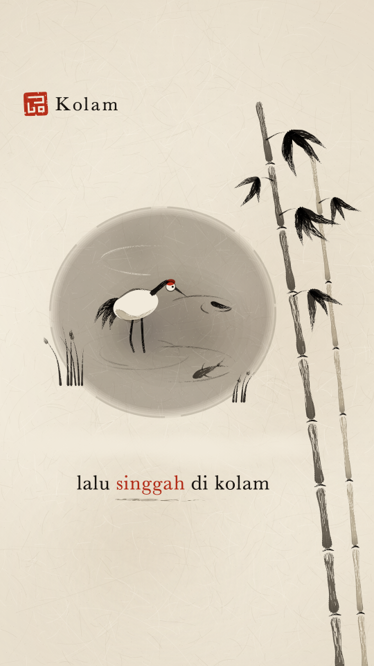

# Ink wash

East Asian brush painting (sumi-e) on rice paper. Black ink in six grey values on a warm off-white sheet with soft fibres. Everything is made of two marks. The **brush stroke** has pressure: it swells and tapers, starts with a loaded dark head and ends in dry-brush streaks ("flying white") where the bristles split. The **wet wash** is pale grey with a feathered edge, a faint tide line and blooms; far mountains dissolve downward into mist. Most of the sheet is left bare, and the bare paper is part of the picture: mist, water, sky and a white bird are all unpainted paper. There is exactly one colour, vermilion, for a small square seal and one spot on the hero. Motion is on 2s and calm: strokes are drawn on with the brush tip leading, washes soak outward, mist drifts, a leaf falls, and things hold.

Pick it for calm, reflective or poetic pieces: nature, seasons, patience, stories with one animal, quotes, openings and endings. Not for data, UI, busy scenes, bright or funny content, or anything that needs many colours or small precise detail.

**The one rule: leave it out.** At least 60% of the frame is bare paper, every object is a handful of strokes, and nothing is outlined all the way round. If a frame feels empty, hold it longer; do not fill it.

## Palette and meaning (`INW` in kit.js)

| role | hex | use |
|---|---|---|
| paper | `paper #f1eadb` | the sheet, the morph ground, mist, water glints, a white bird's body |
| 1 burnt ink | `ink #1a1714` | the nearest things and the accents: leaves, necks, tail plumes, a near ridge, type |
| 2 dark ink | `dark #3b3733` | trunks, ridge lines, reeds, beaks, the enso ring of a morph window |
| 3 middle ink | `mid #6f6a63` | bamboo stalks, fish, texture strokes, ripples, the near cliff's wash |
| 4 light ink | `light #a19b91` | a pond, a middle mountain's wash, the rule under a caption |
| 5 pale wash | `pale #c9c2b4` | far mountains, the moon, reflections, far bamboo, a bird's belly |
| 6 faintest | `mist #dfd9ca` | haze and halos only (it barely shows on the paper) |
| **accent** | `red #c5341f` | VERMILION: the seal, the hero's crown, the caption's one word. Nothing else. (A red sun is allowed instead of the hero's spot, never both.) |

Tone is distance: the farther a thing is, the paler and softer it is, and the less line it gets. A frame uses three or four of the six values. Morph between neighbouring greys (pale to light); the blend is simply a wash getting darker.

## Line, texture, type

- **A stroke** (`inwStroke`): a few control points, smoothed, re-seeded by under a pixel on every boil step. Its width follows a pressure shape: `taper` (press, travel, lift), `leaf` (touch, press at a third, flick out), `bone` (press, travel, press: a bamboo joint), `flick` (press and whip away), `swell`, `even`, or any function. Blunt ends are rounded presses. Width also breathes by 7% along the stroke and 3.5% per boil step.
- **Dry brush**: `inwBristle(colour, variant)` is a cached 512x48 strip of ink. Along it, each of 22 bristle rows runs dry at its own point and then skips (the outer rows first), the edges are nicked, and a little ink pools at the two edges. A stroke lays the strip along its path in thin slices scaled to the pressure, so the streaks follow the stroke and close up where it tapers. `dry: [u0, u1]` says how dry the brush is at the start and at the end (0 wet, 1 split). Four seeded variants per colour; nothing is computed per pixel in a frame.
- **Loaded head, wet tip**: the first brush-width of a stroke is darker (`load`), and while a stroke is being drawn its leading tip is dark and pointed.
- **Ink is transparent**: strokes and washes are multiplied onto the paper, so crossing leaves get darker. A stroke meant to be white (a wing over a wash) is drawn in paper colour with `over: true`.
- **A wash** (`inwWash`): six stacked translucent fills from just outside to well inside the outline (a feathered edge without any blur filter), darker and lighter blooms clipped inside, and a broken, soft tide line. `inwPeak` is the mountain version: crisp at the ridge, a vertical fade to nothing at `base`. `inwMist` lays soft lobes of bare paper over whatever is under it.
- **The sheet** (`inwSet`): painted once into an offscreen canvas: large warm blotches, about 1400 short and 100 long fibres (dark and light), specks, a faint darkening toward the corners. It stays in screen space under the camera. `STYLE.post` lays a second set of light fibres and specks over the finished frame, so ink looks soaked into the paper.
- **Type**: `INW_FONT` = `Baskerville, "Baskerville Old Face", "Iowan Old Style", "Palatino Linotype", Palatino, "Book Antiqua", "Noto Serif", "DejaVu Serif", Georgia, "Times New Roman", serif`, weight 400, in burnt ink, set letter by letter with a hair of jitter. Captions 60 px with 0.04 em tracking, tags 56 px with 0.12 em tracking. No box, no shadow, no outline.
- **The seal** (`inwSeal`): a vermilion square with a carved rectilinear meander (abstract, no characters), a little worn at the edges.

## Motion habits

- On 2s (`ones: false`). The boil is small: a stroke's edge shifts by under a pixel, its width by a few percent. Washes and paper do not boil.
- **Things are brushed on, never faded or popped**: a stroke grows along its path with its taper (`frac`), a mountain is ridge first, then its wash soaks down, then texture strokes; bamboo goes joint by joint from the foot, then twigs, then leaves one at a time. One stroke takes 0.2–0.9 s.
- **Washes soak outward** from their centre (`grow`), fast at first.
- **Then hold.** After a thing is painted it only breathes: leaves and reeds lean a few degrees on 2s, a boat bobs, mist slides 12–18 px per second, far birds drift, a fish swims an arc.
- **The hero** flies on slow wingbeats (one beat per second, wings down on the beat), glides down with its wings up, folds them over about 0.4 s, and reacts with its neck: straight up when alert (`mood: 'wow'`), bowed to the water (`bow`).
- **Water answers**: anything that touches water makes two or three broken rings that spread and fade over about 1.4 s.
- **Captions**: letters soak in one after another (0.03 s apart), then one dry stroke is pulled under the line. The tag is the seal pressed on (it lands slightly large and settles), then its word. Both fade out as a bridge starts and return after it.
- **Camera**: a drift of at most 5% inside an era; after a morph the new era opens about 10% close on the object and settles. Never shake, never cut fast.
- **Morph**: the old era is seen through a hole ringed by an enso (one round dry stroke) that thins as it closes on the object; on the bare sheet the object is a wet wash changing outline and tone with an enso pulled round it mid-way; the new era opens out of the same ring.

## Frame checklist (on top of grammar/FRAME.md)

1. **At least 60% of the frame is bare paper**, and the emptiness has a shape (mist between ranges, sky round a moon, water under a boat).
2. **The brush shows at phone size**: at least one wide stroke with visible flying white and a clear swell and taper (a ridge, a trunk, a bamboo stalk, a leaf cluster). No constant-width outlines, no hatching.
3. **Three depths in three tones**: a pale soft far layer, a middle layer, one small dark near accent. The darkest ink covers the least area.
4. **Vermilion appears twice at most**: the seal and one spot (the hero's crown, or the sun), plus the caption's one word. No red props.
5. **Nothing is closed**: shapes are implied by a stroke on one side and a wash or bare paper on the other. A fully outlined, evenly filled shape is a bug.
6. **The caption stands on bare paper**: one line, ink, one vermilion word, inside x 60–940, with nothing painted in its band (y 1330–1460 by default) and nothing behind the tag.
7. **Something is being painted or something is alive**: a stroke in progress, a wash soaking, or the hero and two or three idle details moving.
8. **Bridge objects are round washes** (a moon, a pond, a stone, a fan) of similar proportions, drawn with `inwWash` defaults and key `'inwblob'`, clear of everything else at the bridge time.

## Kit API (`kit.js`, on top of `kit/core.js`)

- Palette and font: `INW`, `INW_FONT`.
- Colour and geometry: `inwRGB(c)`, `inwMix(a, b, u)`, `inwA(c, alpha)` (all accept hex or `rgb()`), `inwCentroid(P)`, `inwCurve(P, n, closed)` (a smooth curve through control points).
- Sheet: `inwSet(c)` (the bare sheet, screen space, cached), `inwPaperTex()`, `inwTooth()`.
- Brush: `inwStroke(P, { w, c, shape, cap: [head, tail], frac, dry: [u0, u1], load, al, key, amt, raw, smooth, n, v, over })`, `inwBristle(c, v)` (the cached dry-brush strip), `INW_SHAPE` / `INW_CAP` (the pressure shapes), `inwEnso(x, y, r, { w, c, sweep, a0, … })`, `inwDots(x, y, n, spread, { c, al, r, key })` (spatter).
- Washes: `inwWash(P, { c, al, feather, grow, from, edge, blooms, key })`, `inwPeak(ridge, { c, al, base, soak, soft, key })`, `inwMountain(ridge, { t, c, line, w, al, base, cun, cunC, key })`, `inwMist(x, y, w, h, { drift, n, al, c, key })`, `inwMoon(x, y, r, { soak, c, halo })`.
- Props (each takes `t` = 0..1 to be brushed on): `inwPine(x, y, s, { t, dir, key })`, `inwNeedles(x, y, len, a0, a1, n, { t, c, key })`, `inwBamboo(x0, y0, x1, y1, { t, n, w, c, bend, leaves: [[u, side, count, length], …], key })` (returns the stalk's point function), `inwLeaves(x, y, { n, len, ang, spread, t, c, key })`, `inwLeaf(x, y, len, ang, { key, … })`, `inwReeds(x, y, { n, h, lean, t, c, key })`, `inwBoat(x, y, s, { t, key })`, `inwBird(x, y, s, { flap, frac, c, key })`, `inwFish(x, y, s, ang, { c, spot, wig, al, key })` (`spot: INW.red` makes it a koi), `inwRipple(x, y, r, { sy, w, c, al, arcs, over, key })`, `inwRipples(x, y, age, { r, n, dur, … })`, `inwSeal(x, y, s, { p, rot, c, key })`.
- Hero: `inwHero(x, y, r, { pose: 'stand' | 'fly', dir, flap, wing, bow, wade, mood: 'smile' | 'happy' | 'wow', key })` — Bangau, a red-crowned crane; (x, y) the body's centre, r half its standing height; sets `SPARK_AT`. `inwHeroPts(x, y, r, n)`.
- Type: `inwFont(size, { weight, italic })`, `inwTextW(str, size, { track })`, `inwText(str, x, y, size, c, { align, key, reveal, track, al, weight, italic })`.
- Captions (through `DEFER`): `inwCaption('words *highlight* words', { y, x, size, at, col, hi, rule })`, `inwTag('Label', { x, y, size, at, c })`; `inwBridgeK()` is their opacity through a bridge.
- `STYLE`: `paper`, `backdrop` (the sheet in any colour), `window` (clip + an enso ring), `blob` (a wash + an enso mid-way), `hero`, `heroColor`, `heroPts`, `post` (the paper's tooth), `ones: false`.

## Do / don't

- **Do** order the painting from pale to dark and from far to near, as a painter would; ink is multiplied, so a pale stroke cannot cover a dark one.
- **Do** give every stroke a stable `key`: its wobble, width and bristle variant are seeded by it.
- **Do** let ridge lines run into mist: end a ridge near its `base`, and lay `inwMist` over the foot of every mountain.
- **Do** use `dry` on purpose: `[0, 0.5]` for wet leaves, `[0.1, 0.9]` for a ridge or trunk, `[0.4, 1]` for texture and water strokes.
- **Do** keep type to one short line (about 24 characters) and let it stand alone.
- **Don't** outline shapes, hatch, or draw constant-width lines (that is `line-art` and `crosshatch`).
- **Don't** add a second colour, a coloured ground, gradients as backgrounds, drop shadows or boxes behind text.
- **Don't** fill the frame, and don't put anything in the caption's band.
- **Don't** use `ctx.filter`, `shadowBlur` or per-pixel loops in a frame; softness comes from stacked fills and gradients, texture from the cached strip.
- **Don't** make strokes thinner than about 4 px (the bristle texture disappears) or animate many strokes at once; one or two brushes at a time.

## Not matched / known weaknesses

- Built from the genre's conventions, not measured against a specific painting.
- A stroke is a strip of straight slices: on a very tight curve with a wide brush the slices fan and the streaks kink. Keep the turning radius above about twice the width.
- Wash feathering scales the outline about its centroid, so it suits round and blobby shapes; long or concave washes should be `inwPeak` or a wide dry stroke.
- `inwPeak` fades straight down; its two ends slope outward, so a ridge that stops high above its `base` shows a soft slanted side. End ridges low or cover the ends with mist.
- Mist is flat paper colour, so it also veils the paper's fibres slightly (it reads as mist, but it is visible on bare paper).
- Type is a system serif (Baskerville on macOS; Palatino, Noto Serif or Georgia elsewhere), not brush lettering, and the face varies by platform. Captions are single-line.
- The hero is a side-view bird only (stand and fly); it has no front view and its `mood` changes only the neck and wings.
- The demo's pond is a plain round wash; it reads as a pond mainly through the rings, the fish and the wading bird.
- The demo does not loop seamlessly (it ends on the pond and starts on the empty sheet).

## Proven on

Its demo only. `demo/` (6s, 9:16, 120 BPM, 24fps): on bare rice paper a pale moon soaks in, a far range soaks in under drifting mist, a middle mountain is brushed on (ridge, wash, texture strokes), then a dark near cliff with a crooked pine; far birds drift, a small boat slides across the water, and Bangau the crane flies in on slow wingbeats — tag "Gunung", caption "Bangau *terbang* jauh". At 3.0s an enso closes on the moon, which becomes a round pond: its deep middle soaks outward, reeds are flicked on, bamboo is brushed in joint by joint with its leaves, a grey fish swims an arc, the crane glides down and lands in the water (rings spread), a leaf falls and settles, and the crane bows to look at it — tag "Kolam", caption "lalu *singgah* di kolam". Tile deterministic; about 65–85 ms/frame in the mountain era and 40–50 ms/frame in the pond era once the sheet is cached (the first frame about 160 ms); review: morph on grid, text PASS, story arc PASS, dead beats PASS, no flat frames, -14.8 LUFS, true peak -1.4 dBFS.
