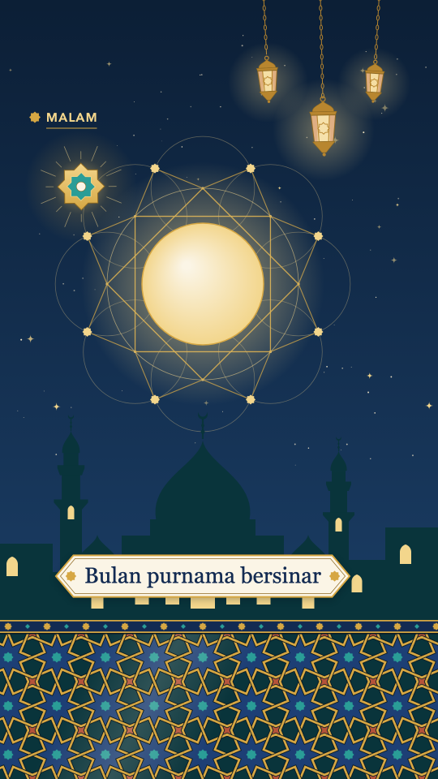

# Islamic geometric ornament

Islamic geometric ornament and architecture, for Islamic educational shorts for children. 8-fold star strapwork is constructed with compass and ruler (Hankin's polygons-in-contact method on the 4.8.8 grid) and woven over and under. Around it: pointed horseshoe arches with striped voussoirs, onion domes, minarets, mashrabiya lattice, hanging lanterns (fanous) and crescents. Tiles are flat zellige glazes with a slow sheen, and the strapwork is crisp gold with a dark keyline. Motion runs on 1s with smooth eases. The signature move is a pattern that **constructs itself**: compass circles sweep on, the strapwork grows out of the tile midpoints, then the tiles glaze in, rippling out from a centre.

**The one rule: no figures, ever.** No people, prophets, angels, animals with faces or faces on objects. The hero is a glowing star with no face. Captions are clean Latin type (Indonesian is fine). Never fake Arabic script with random strokes.

## Palette (`IG` in kit.js; all 6-digit hex)

| token | hex | meaning |
|---|---|---|
| `night` / `nightL` | `#0c1f36` / `#1a3c63` | night sky, top to horizon |
| `lapis` / `lapisD` | `#1d3f75` / `#132b52` | alfiz frames, 8-star tiles at night, caption text, mashrabiya ground |
| `teal` / `tealD` | `#0f4f57` / `#09343b` | skyline silhouettes, the ground of a zellige panel |
| `turq` / `turqL` | `#2a9d97` / `#7fd0c4` | dome glaze, 8-star tiles by day, the hero's core |
| `gold` / `goldL` / `goldD` | `#d6a743` / `#f3d68c` / `#8f6a22` | strapwork, rims and finials; glows and the moon; fine keylines on cream |
| `brass` | `#b8862f` | lantern metal and chains |
| `terra` / `terraL` | `#b5533a` / `#d98767` | 4-point cross tiles, voussoir stripes, merlons |
| `cream` / `ivory` / `sand` | `#f3e6c8` / `#fbf5e6` / `#e9d6ad` | walls, the caption cartouche, faint day patterns |
| `ink` | `#0a1a24` | the keyline on both sides of every gold strap |
| `paper` | `#103a46` | the morph's blank sheet (deep teal with faint gold strapwork) |

Each frame uses one ground (night lapis or day cream) and at most two tile colours plus gold. Gold is the line colour, not a fill, except for the moon, the hero, finials and stars.

## Line and pattern geometry

- **Pattern** (`igPattern`): octagons sit on a square grid of period `s`, with squares between them (4.8.8). Every tile-edge midpoint sends two rays inward at the contact angle θ = 67.5°, and adjacent rays meet at X. The octagons become 8-point stars with 45° tips, and the squares become 4-point crosses. Lines run straight through each midpoint, so the strands cross there. **Weave:** at each midpoint, the ray turning toward its tile's *next* vertex is "over". Both tiles are listed in the same orientation, so this alternates along every strand. The over piece (2.6 × band width each side) is re-laid with butt caps on top. The pattern repeats exactly (period `s`), and a static pattern's geometry is cached by key.
- **Strap:** a gold band `bw` ≈ 4.5% of `s` (5–7px at s = 120–150), keylined in `ink` at about 0.32 × bw on each side. Every strand is the outline of a star tile, so a finished tile is stroked as one closed polygon with **mitred** joins: bends and tips are sharp and lines meet exactly. Only tiles that are still growing are drawn as separate round-capped segments.
- **Whole tiles in a band:** pick `s` and `oy` so a frieze holds whole rows (a 360px band = three rows at s = 120 with `oy` on the middle row). The border then cuts only along the tiling's own mirror lines.
- **A drawn construction must be exact.** The demo's rosette is the model: a master circle R0; eight circles on it of radius R0·√(1 + k² − 2k·cos 22.5°), k = 1/0.7654; two squares in the master circle; an outer khatam of radius k·R0 turned 22.5°. Its tips fall exactly where neighbouring circles cross and its notches on the squares' corners. Never eyeball a radius.
- **Hairlines** for construction lines, ribs, lantern mullions and the hero's outline are constant on screen (`igHair(px)` divides by the camera zoom).
- **Stars** are exact {n/k} polygons (`igStarPts`): 8 = {8/2}, the khatam (two squares, inner radius 0.765); 12 = {12/4} (0.518); 10 = {10/3}. They are drawn with straight polylines, never core's smoothed `trace`, which would round the tips.
- **Arches** (`igArchPts`): two-centred and pointed (`point` 0.35–0.4 = the centre offset as a fraction of the half-width), with an optional horseshoe return (`horse`, radians below the springing line). **Domes** (`igDomePts`) are a cubic onion profile with a 16% bulge and a pointed tip.
- **Type:** captions in a serif (`Georgia, "Iowan Old Style", "Palatino Linotype", …`) at 54px on an ivory cartouche, an elongated hexagon with a 4px gold border, an inner hairline and two small 8-stars. Tags are spaced sans caps at 30px with a gold star and a rule.

## Motion habits

- On 1s (`ones: true`), with smooth eases: `EZ.io` for construction, `EZ.o3` for reveals, `springMove(…, SPRING.heavy | smooth)` for the hero's glide. Nothing boils or jitters.
- **Construction** goes radially from a centre (`ox, oy`) over 1.8–2.4s. Each tile's local time runs: compass circles 0–0.3 (fading out by 0.8), strap 0.12–0.62, glaze 0.5–0.95. Pair it with plucks in the score.
- **Idle life:** stars twinkle (sine, per-star rate); lanterns sway ±0.04–0.06 rad at 0.27–0.4 Hz and their glow flickers softly; lit windows breathe; a glaze sheen drifts across the zellige; the hero pulses (±4.5%), turns slowly and bobs.
- The **hero gains points** (`gain` 0..1, n0 → n1): the new star unfolds from behind while the old one shrinks and fades. A ring flashes after.
- **Cues sit on the 16th grid** (0.125s at 120 BPM) and the score plays one note per construction step (one pluck per compass circle).
- Captions and tags fade out over the 0.2s before a bridge and back in after it (no pop).
- Camera: still, or a slow push of 3–4%. Morphs go between round, similar-sized shapes (moon → dome, star → star, lantern glow → dome).

## Frame checklist (on top of grammar/FRAME.md)

1. **No figurative imagery.** No people, prophets, angels or faces anywhere (not on the hero, the moon, lanterns or the sun). The hero is a star (or a lantern) with no eyes and no mouth.
2. **No fake script.** Text is Latin serif or sans. Arabic appears only if the user supplies the real text and it is set in a real Arabic font.
3. **Stars are symmetric and sharp:** exact {n/k} polygons, tips not rounded, the pattern visibly 8-fold.
4. **The pattern tiles seamlessly.** Strands run straight through every midpoint, the over-under alternates, and nothing is cut off inside a panel (only its clip edge cuts it).
5. **Gold is linework, keylined.** Every strap has a dark keyline; rims are gold on ink. No gold gradients except the moon, the hero and glows.
6. **Flat glazes**, at most a soft sheen. No noise, grain or drop shadows (the caption cartouche's soft shadow is the one exception).
7. **Symmetry in architecture:** arches, domes and facades are mirror-symmetric about their axis. Asymmetry belongs to life (sway, the hero's position).
8. **Text in the safe area** (x 60–940, y 250–1500), on a cartouche whenever it sits over pattern. Ornament may run to the frame edge.
9. **One centre of construction per frame.** Two patterns constructing at once fight for the eye.

## Kit API (`kit.js`, on top of `kit/core.js`)

- Palette and fonts: `IG`, `IG_SERIF`, `IG_SANS`. Helpers: `igZoom()`, `igHair(px)`, `igPoly(P, closed)`, `igStroke(color, w, { hair, al, cap, join })` (mitred joins by default), `igShape(P, fill, { rim, rw, hair, al })`, `igInset(P, px)` (scales toward the centroid), `igOffset(P, d)` (a true parallel offset, d > 0 outward: constant-width rims and arch rings), `igCentroid`, `igBez`, `igMix(hexA, hexB, u)` (returns hex), `igRGBA(hex, a)`.
- Stars: `igStarPts(x, y, r, n, { ri, rot })`, `igStarBlend(x, y, r, n0, n1, u, rot)` (a by-angle blend for outlines), `igStarRi(n)`.
- **Pattern:** `igPattern(P, { s, ox, oy, theta, prog, spread, ground, oct, sq, inner, innerSq, strap, key, bw, kw, weave, mid, lines, w, hair, sheen, sheenSpeed, sheenPh, circles, cc, ghost, ghostAl, al })`. This tiles the woven 8-fold pattern into any outline P (world coords). `lines: '#hex'` draws it as plain lines in one colour: backdrops, a dome's tiling, mashrabiya. `inner` sets a small 8-star in every star tile, `innerSq` a dot in every cross. `ghost: '#hex'` shows the whole layout as a faint hairline underdrawing while `prog < 1`, so a panel is never an empty slab before it constructs. `igPatternGeo(…)` returns the cached geometry: `segs` (with `over`), `stars` (`P` the polygon, `c` the centre, `kind`, `segs`), `circles`.
- Architecture: `igArchPts(cx, yb, w, h, { point, horse })`, `igDomePts(cx, yb, w, h, { bulge, neck })`, `igCrescentPts(x, y, r, { k, r2, rot })`, `igCrescent(x, y, r, c)`, `igFinial(x, yb, h, c)`, `igMinaret(x, yb, w, h, { c, trim, win, cap, line })` (`trim: null` makes a silhouette; `line` adds a fine keyline, needed for a cream minaret on a cream sky), `igBand(x0, x1, y, h, { cx, ground, c, c2, rule, period })` (a border strip: two gold rules, small 8-stars alternating with diamonds, symmetric about `cx`).
- Life: `igLantern(x, y0, len, s, { amp, f, ph, glow, brass })`, `igStars(x0, y0, x1, y1, n, { key, avoid: [x, y, r] or a list of them, big })`.
- Hero: `igHero(x, y, r, { n0, n1, gain, ring, rot, core })` sets `SPARK_AT`.
- Captions (through `DEFER`, faded out while a bridge is running): `igCaption(str, { y, at, size, maxW, x, bg, c })` (a line too long for `maxW` shrinks its type to fit, down to 30px), `igTag(label, { c, at, x, y })`.
- `STYLE`:
  - `paper` `#103a46`.
  - `backdrop` fills the frame with c, with faint gold strapwork at s = 180 and a soft darkening toward the corners.
  - `window` shows the world through P, with an ink and gold rim, an inner gold hairline and an 8-star finial at the top point.
  - `blob` is a glazed tile (light from the upper left) with ivory strapwork inside and a keylined gold rim, set in a glow with a compass ring, 32 rays and an 8-star outline that turn one notch through the morph.
  - `hero` is `igHero`; `heroColor` is gold; `heroPts` is the star outline sampled by angle, so the ray count `n` of `SP(x, y, r, n)` is the point count.
  - `ones: true`, no `post`.

## Do / don't

- **Do** let the pattern construct once per scene, from a meaningful centre (the arch's middle, the moon).
- **Do** clip patterns into architecture: arch interiors, dome tiling, window lattices, friezes, floors.
- **Do** give cream architecture on a cream sky a fine `goldD` keyline (`igMinaret`'s `line`, a stroked wall).
- **Do** use an odd number of voussoirs (a keystone on the axis, the same colour at both feet) and build the arch ring with `igOffset` so its width is constant.
- **Do** keep each scene's pattern scale consistent (s 90–130 for panels, 30 for lattice, 180–210 for faint backgrounds).
- **Don't** draw faces, figures or animals. Don't put text inside a pattern without a cartouche.
- **Don't** use core's `trace`/`wobble`/`ink` for this look: they smooth and boil the lines.
- **Don't** morph a tall minaret into a round moon: it pinches. Use round to round (moon, dome, star, lantern glow).

## Not matched / known weaknesses

- Only the 8-fold 4.8.8 family is generated. 10-fold and 12-fold girih panels are not tiled (the 12-point star exists only as a single star).
- The weave is shown with keylined over-pieces; the under strand is not physically gapped, so at high zoom it reads as "keyline over gold".
- Construction circles show the grid circles (the octagons' incircles), not the full classical derivation from one master circle.
- The caption cartouche's width depends on the system serif's metrics; a long line shrinks automatically, but below about 36px it stops being phone-readable: shorten the text instead.
- The hero's gold glow is strong on the night ground and only a warm haze on the cream day ground; by day it relies on its `goldD` outline and turquoise core.
- The floor and frieze are flat-on tilings under an elevation view (the flat-illustration convention); there is no perspective floor.
- The morph midpoint's colour is the plain blend of the two bridge colours (moon gold into dome turquoise passes through a sage green).
- A caption placed over a skyline covers part of it (the demo's night caption sits across the lit windows).

## Proven on

`demo/` (6s, 9:16, 120 BPM, 24fps):
- **Night:** an exact compass rosette constructs itself around a rising full moon (master circle, eight circles a 16th apart, two squares, the outer khatam, tips lighting on the beat at 2.0s), a woven frieze of three whole tile rows builds over its faint underdrawing, three lanterns sway, the stars twinkle, a lit skyline breathes, and the star hero glides in.
- **Morph at 3.0s:** the moon becomes a turquoise tiled dome.
- **Day:** the hero rises from the dome's tip and gains points (8 → 12, done on the beat at 5.0s with a chime), zellige constructs inside the striped horseshoe arch on its two columns, glints wink on the dome, a lantern sways in the arch and mashrabiya lattices fill the side windows.
- **Score:** an open-fifth drone by night and a D major pad by day, an oud-like line in D hijaz with one pluck per compass circle, a quiet frame-drum pulse that rests through the morph, a chime on the payoff.

The tile is deterministic, at about 10–65 ms per frame (export averages about 50 ms).
