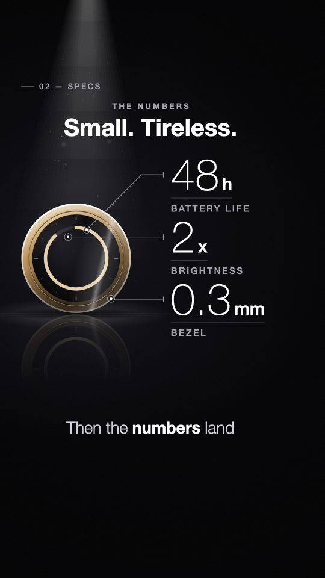

# Keynote

A product reveal on a dark stage: the visual language of a launch keynote. The ground is near-black with a very subtle vignette, a hairline floor line that dies away to both sides and a faint sheen on a glossy floor. **One** invented product stands on that floor under a soft spotlight cone. It starts as a silhouette with only a white rim light on its edges; then the key light sweeps across it and the finish (one colour: titanium, midnight blue or warm gold) appears as a surface gradient; a soft specular band crosses it; its mirror image fades into the floor under a contact shadow; dust motes drift in the beam. Round the product sits the type: very large thin numerals with a small semibold unit that count up and settle ("48 h", "2 x", "0.3 mm"), each over a hairline and a tracked small-caps label, joined to a part of the product by a hairline leader; a small-caps kicker over a semibold headline; one caption line. Type is pure white and graphite grey, never coloured, never glowing.

Pick it for product launches, feature and spec moments, "one more number" beats, hardware, packaging, a single object that deserves a stage, premium or serious moods. Not for stories with characters, many objects at once, busy diagrams, cheerful or hand-made moods, or anything that needs more than one colour.

**The one rule: one product, one light, one colour. Everything that is not the product is black, grey or white; everything that changes is the light.**

## Palette (`KEY` in kit.js)

| name | hex | use |
|---|---|---|
| `ground` | `#050507` | the stage; `STYLE.paper`; about 70% of every frame stays within a few levels of it |
| `sil` | `#08080b` | an unlit product: a hair above the ground so the silhouette reads against the wall |
| `g1` `g2` | `#15151b` `#24242b` | the wall's lift behind the product, the floor's sheen (at 15–65% alpha) |
| `g3` | `#3a3a43` | hairline rules under numerals |
| `g4` `g5` | `#6e6e78` `#a4a4ae` | the tag's rule; labels, kickers, leaders |
| `soft` | `#cfcfd6` | the caption's light words |
| `white` | `#ffffff` | numerals, units, headlines, the caption's key word, the rim light, the beam |

Finishes (`KEY.fin`, picked by `KEY_FINISH` or per call with `finish`): the only colour in the frame.

| finish | lo (shade) | base | hi (lit) |
|---|---|---|---|
| `titanium` (default) | `#2a2927` | `#8f8b84` | `#ebe6dd` |
| `midnight` | `#0b1428` | `#2f4e86` | `#a9c4f2` |
| `gold` | `#3b2912` | `#b48a4e` | `#f8e2b4` |

- Any other base colour works as a finish (`finish: '#7a2d3a'`): `keyFin` derives `hi` (68% toward white) and `lo` (74% toward black).
- **Colours for the renderer:** `ERA_BG` is the stage (`#08080b`); a bridge shape's `c` and `heroColor` are a finish's **base** hex. Mid-morph the blend arrives as `rgb()`, and `keyFin` turns it back into a finish (two different finishes blend through the morph).
- The finish colour is spent on the product only (its body, the charge ring on the puck's glass). No coloured type, no coloured lines, no coloured light.

## Line, light and texture

- **The product** (`keyProduct`): the outline is filled `sil`, then, clipped to it: the finish gradient (flat faces run hi → base → lo from the upper left; `shade: 'round'` runs lo, base, hi, base, lo across a turned form), a top-light wash (white 26% falling to nothing at 42% of the height) and an underside falloff (black to 55%), the product's own details (seams, a lens, a dial), the unlit side as a soft dark wedge when `sweep` < 1, the specular band (`screen`, 45–50% white, about a quarter of the width, slanted 13°), and last the rim light.
- **The rim light** is a white stroke *inside* the outline: 5 px, 100% at the top edge falling to 30% at the bottom, over a wider 20% inner stroke. Nothing is drawn outside the outline: no halo, no glow.
- **The floor**: a contact shadow (a flat black ellipse 1.24 × the product's width), then the product drawn again mirrored about the floor line and masked by a gradient (34% at the floor, 10% at 45% of the depth, gone at 62% of the product's height).
- **The beam** (`keySpot`): twelve nested cones added with `lighter`, 2.8% white each at the lamp, fading out before the floor, plus an elliptical pool on the floor (20% at its centre). It reads as haze, never as a shape with an edge.
- **Dust** (`keyDust`): 30–45 motes of 1.3–3.2 px inside the cone, a fifth of them large and out of focus, each drifting down a few px a second and twinkling; brightest in the middle of the beam.
- **Hairlines** are 2 px (rules, leaders, the floor line, the tag's rule); the kit divides them by the camera zoom so they stay 2 px during a push. Leaders are a 45° leg and a level run, with a white dot in a thin ring where they touch the product and a small stop at the label end.
- **Type** (`KEY_SANS`: Helvetica Neue, Segoe UI, Inter, Roboto, Noto Sans, Arial): numerals weight 200 at 120–150 px with the unit at 40% of that size in weight 500 on the same baseline; headline weight 600 at 80–92 px; kicker weight 600 at about 28 px, caps, tracked 0.24 em; labels weight 500 at 24–30 px, caps, tracked 0.16 em; caption weight 300 in `soft` with the key word weight 600 in white, 54 px.
- **Finish of the frame**: a vignette (corners 50% darker) and a fixed fine grain (`KEY.grain`, 1.8%, added) that keeps the near-black gradients from banding in the video. The grain is held still on purpose: moving grain made the 6 s demo ten times larger.

## Motion habits

- On 1s (`ones: true`), slow and confident. One curve: ease in-out (`keyIn(t0, d)`). Nothing bounces, pops, overshoots or shakes.
- **The light is the motion.** The rim comes up first (0.5 s), then the beam (0.9 s), then the key light sweeps across (`sweep` 0 → 1 over about 1.25 s), then a specular band crosses (`spec` 0 → 1 over 0.9 s). The product itself never moves.
- **Numerals count up and settle**: 0.75 s, ease in-out, right-aligned to their final width so the unit never jitters; the hairline under them draws on, the label fades in after. One spec at a time, about half a second apart, each preceded by its leader drawing on (0.4 s).
- **Type arrives one piece at a time**: kicker, then each headline line (0.2 s apart), caption words (0.09 s apart); each fades in while settling a few px upward. All screen-space type fades out 0.2 s before a bridge and back in after it.
- **Camera**: one slow push per era (`push`, z 1 → 1.03–1.06 over the whole era). No cuts inside an era, no whip moves.
- **Idle life**: the lamp sways about 10 px and breathes 5%, dust drifts, a status light pulses, the puck's charge ring fills and breathes.
- **Bridges**: the stage is seen through the product's outline, edged with its rim light, and closes onto it; on the empty stage the lit body changes shape while a specular band crosses it (no floor, no beam: the house lights are down); the new stage opens out of the new outline.
- **Sound**: a low drone and a slow pulse in the dark, air that brightens with the sweep, a sub and a warm major chord at the reveal, a soft tick for each step a numeral counts (fast, then slowing) and a bell when it settles.

## Frame checklist (in addition to `grammar/FRAME.md`)

1. **Squint test: a lit object on a black stage.** Most of the frame is near-black; the product and the white type are the only bright things. If the frame looks grey, busy or flat, there is too much light or too many things.
2. **Exactly one product**, standing on the floor line, with all five parts of its lighting: body gradient (or silhouette), rim light, contact shadow, mirror image, the beam above it.
3. **One colour**: the finish, on the product only. Type, lines, light and dust are white or grey.
4. **The light is doing something** in every shot: coming up, sweeping across, a band crossing, a ring filling. A fully lit, static product is a still.
5. **Numerals are the biggest type in the frame** (thin, 120 px or more), each with a unit, a hairline and a caps label; never more than three; none overlaps the product or another spec.
6. **Every leader starts on the part it names** (the ring, the glass, the rim) with its dot, runs 45° then level, and stops just short of its numeral.
7. **No glow on type, no outlines as a style, no grid, no neon tube, no frosted panel.** The only stroke on the product is the inner rim light.
8. **The floor is a line and a reflection, not a grey band**: the floor line fades to nothing before the frame's edges; the mirror image is gone within about 60% of the product's height.
9. **The beam is haze**: you notice it mostly by the dust in it. No hard cone edges.
10. **Type hierarchy holds at phone size**: tag (small, top left), kicker over headline, the numerals, one caption line at y ≈ 1440 with one bold word. Everything inside x 60–940, y 250–1500.
11. **Bridge objects are products of similar proportions** (a pebble case → a round puck), clear of type and leaders at the bridge time, coloured with a finish's base hex.

## Kit API (`kit.js`, on top of `kit/core.js`)

- Palette and constants: `KEY { ground, sil, g1..g5, soft, white, fin { titanium, midnight, gold }, rim, hair, grain }`, `KEY_SANS`.
- Colour and timing: `keyFin(name | hex | rgb() | finish)` → `{ base, hi, lo }`, `keyMix(a, b, u)`, `keyA(colour, alpha)`, `keyW(alpha)`, `keyK(alpha)`, `keyRGB`, `keyHex`, `keyZ()` (camera zoom), `keyIn(t0, d)`, `keyBridgeK()` (1 outside bridges, 0 inside).
- **The stage:** `keyStage({ floor, cx, light, span, vig })` (wall, floor sheen, floor line, vignette; `light` 0 = house lights down), `keySpot(x, y, { a, w, sw, sx, top, ry })` (the beam and its pool at floor point x, y), `keyDust(x, y, { a, n, key, w, sw, sx, top })` (motes in that beam), `keyShadow(x, y, rx, { a, sq })`, `keyReflect(floorY, draw, { a, depth })` (anything, mirrored in the floor; `draw` must not draw text), `keyVignette(al)`, `keyGrain(al)`.
- **The product, from any closed outline:**
  - `keyProduct(P, { finish, lit, sweep, soft, spec, specW, specA, rim, rimW, shade, floor, reflect, depth, shadow, detail })` — contact shadow, mirror image and lit body. `lit` 0 = silhouette; `sweep` 0..1 = how far the key light has crossed; `spec` 0..1 = where the specular band is; `detail(bb, fin, lit)` draws the product's own features inside the outline. Returns the bbox.
  - `keyBody(P, o)` — the lit body alone (same options; used by the morph).
  - Outlines: `keySlabPts(x, y, w, h, r)`, `keyCasePts(x, y, w, h, n)` (a superellipse pebble), `keyCylPts(x, y, w, h, e)`, `keyPuckPts(x, y, r)`.
- Ready-made, unbranded products (all take `keyProduct`'s options): `keyCase(x, y, w, h, { led })` (a pebble charging case: lid seam, thumb notch, status light), `keySpeaker(x, y, w, h, { led })` (a cylinder with a dotted fabric wrap and a light ring on its cap), `keySlab(x, y, w, h, { r })` (a rounded slab seen from the back: one lens, one band), and the hero `keyPuck(x, y, r, { ring, key })` (a watch-like puck: bezel, dark glass, hour ticks, a charge ring; sets `SPARK_AT`).
- **Specs and leaders (world coords, under the camera):** `keySpec(value, unit, label, x, y, { at, dur, dec, size, align, pre, weight, lsize, a })` — y is the numeral's baseline; returns `{ x0, x1, y0, y1, mid, done }`. `keyLeader(x0, y0, x1, y1, { at, dur, elbow, a, color })` — from the product point to the label anchor (use `y - size * 0.36` for the numeral's middle).
- **Type:** `keyType(str, x, y, size, { weight, color, track, align, a, at, dur, rise })` (one line; with `at` it fades in and settles). Through `DEFER`, at screen size: `keyHeadline(kicker, headline | [lines], { x, y, size, align, at, weight, ksize })`, `keyCaption('Then the *numbers* land', { x, y, size, at })`, `keyTag('02 — Specs', { x, y, size, at })`. `at` on these three is seconds into the era.
- Piece option (a plain constant anywhere in the piece): `const KEY_FINISH = 'gold';` and, for hero bridges on that finish, `STYLE.heroColor = KEY.fin[KEY_FINISH].base;` in `bridges.js`.
- `STYLE`: `paper` (the stage), `backdrop` (colour + vignette), `window` (the scene through the outline, edged with the rim light), `blob` (the lit body in the blended finish with a specular band crossing as it morphs), `hero` / `heroColor` / `heroPts` (the puck), `post` (grain), `ones: true`.

## Do / don't

- **Do** draw the product from its outline and give it two or three true details (a seam, a lens, a ring); keep them inside `detail` so they are lit, swept and mirrored with the body.
- **Do** stage the lighting in order: rim, beam, sweep, band. Hold the silhouette for at least half a second before the sweep.
- **Do** put the floor one or two px under the outline's lowest point and pass the same `floor` to `keyStage`, `keySpot` and the product.
- **Do** give every number a unit and a two-word label, and let it finish counting on a beat.
- **Do** leave the lower third nearly empty: the reflection and one caption line.
- **Do** invent the product. No real brand names, logos or recognisable trademarked shapes.
- **Don't** add a second product, a second colour, a background pattern, a grid or particles other than the dust.
- **Don't** glow, outline or colour the type; don't draw text inside `detail` or `keyReflect` (it would be mirrored).
- **Don't** move the product: move the light and the camera.
- **Don't** bounce or spring anything, and don't cut inside an era.
- **Don't** put specs over the beam's brightest part or over the product; don't run a leader across a numeral.
- **Don't** raise the house lights (`keyStage` `light` 1 is already the maximum): the look dies when the wall turns grey.

## How it differs from the closest shipped styles

- **neon** is light made of glowing tubes on black, several hues, a grid floor. Keynote has no tubes, no halos and no grid: light falls *on* one object, and the only stroke is an inner rim.
- **math** shares the black stage and smooth easing, but it is line diagrams and colour-coded variables; keynote is one shaded object and typography.
- **glass** is frosted UI panels over a coloured aurora; keynote has no panels and no coloured ground.
- **isometric** also shows products, as constant-weight line art on a flat ground; keynote is gradients and light with no outlines.

## Not matched / known weaknesses

- Built from the genre's conventions (dark-stage launch films), not measured against one reference film; the products, their names and their numbers are invented.
- The lighting is a 2D fake: gradients, a clipped wedge and a band. A product's shading does not follow its real form beyond `flat` and `round`; a strongly 3D object (a hinge, a strap, a bottle shoulder) needs its own `detail` drawing.
- The key-light sweep and the specular band always travel left to right along one fixed slant.
- The mirror image is an exact flip masked by a gradient (no blur, no ripple), and uses one scratch canvas per call: several mirrored products in one frame cost a full-frame composite each.
- Thin numerals depend on the system font having a weight 200: Helvetica Neue (macOS) has it; Segoe UI falls back to Light, Roboto to Thin or Light, Arial to regular, so numerals are heavier on some machines. Glyph widths differ a little between platforms.
- Tracking uses `ctx.letterSpacing` (Chromium, current Safari and Firefox); where it is missing, caps are set untracked.
- The grain is static; on a long hold over a pure-black area it can read as a faint fixed texture.
- Layout numbers were tuned for 9:16 at 1080 × 1920. `keyCaption` and `keyTag` pick other positions for wide formats, but 1:1 and 16:9 were not rendered.
- Not exercised by the demo: `keySpeaker`, `keySlab`, the `titanium` and `midnight` finishes and a custom hex finish (rendered once as stills while building the kit, not in a piece), a morph between two different finishes, the hero-to-hero bridge (`STYLE.hero`), `keySpec`'s `pre` / `align`, multi-line headlines, export `--blur`. The demo does not loop seamlessly (it ends lit and starts dark).

## Proven on

Its demo only. `demo/` (6 s, 9:16, 120 BPM, 24 fps, finish `gold`): a pebble-shaped case stands in the dark with only its rim lit; the beam comes up with dust drifting in it, the key light sweeps across and the gold finish appears, the headline "Out of the dark" arrives under its kicker, a specular band crosses the case and its status light comes on, all during one slow push. At 3.0 s the stage closes onto the case, the lit body becomes a round puck as a band crosses it, and a second stage opens out of it: the watch-like puck (the hero) at the left under its own beam, its charge ring filling, while three leaders reach out one after another and "48 h", "2 x" and "0.3 mm" count up and settle beside it; a last band crosses the glass. `tile.mjs`: deterministic; `review.mjs`: all checks pass.
