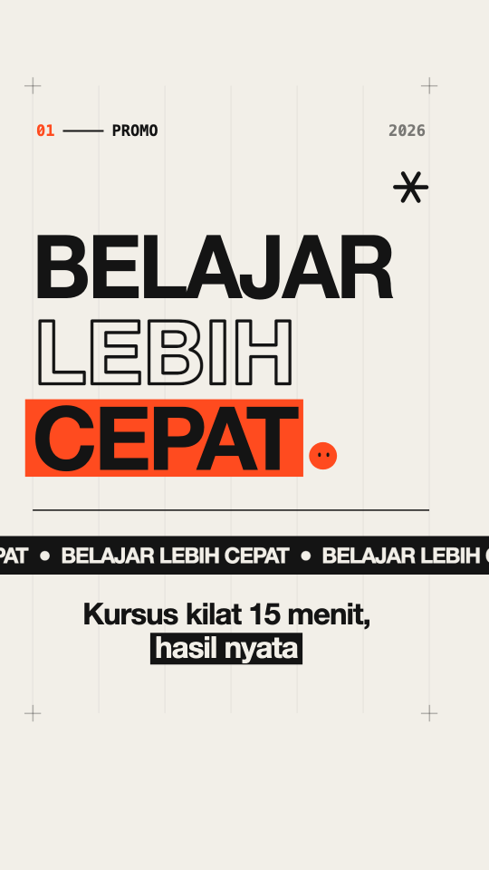

# Kinetic type

Kinetic typography with a Swiss / editorial infographic backbone: **the type is the picture**. Huge heavy grotesk words on a strict grid, near-black ink on warm off-white paper (or inverted, paper on ink), one loud signal accent. Words rise out from behind their own baseline masks line by line, punch on the beat, swap, condense to fit; a hollow (outline) word sits against solid ones; an accent bar sweeps in behind the one word that matters. Data is type too: counting numbers, flat bars, a percentage ring. Hairline rules, a faint column grid with crop marks and mono index tags ("01 —— PROMO") are the Swiss details. The hero is a full stop that came alive: an accent dot with two eyes that hops from word end to word end. Motion on 1s, expo-out / snappy-spring easing, everything on the beat grid.

**The one rule: one accent, and it marks the one thing to read.** Everything else is ink and paper. The accent goes on the hero and on at most one word, bar or ring per frame.

Good for: promos, hooks, quotes, CTAs, statistics, "3 reasons" lists, product claims, social reels where the words carry the message.

## Palette and meaning (`KT` in kit.js)

| role | hex | use |
|---|---|---|
| paper | `paper #f2efe8` | the light ground (default `STYLE.paper`) |
| rules on paper | `paperD #e2ddd2`, `paperDD #c9c3b6` | grid, faint marks |
| ink | `ink #141414` | all type on paper; the dark ground of an inverted era |
| lifted ink | `inkL #2a2a2a` | ring track / tracks on the ink ground |
| grey | `inkM #77736b` | the "other" bar in a comparison, secondary data |
| **accent** | `accent #ff4b1f` (`accentD`, `accentL`) | the hero, the one highlighted word / bar / ring head, index numbers |
| second | `blue #2f4bff` (`blueL`) | a second data series or one mark, sparingly; never text on it, never mixed with the accent in a morph (RGB mix goes muddy purple) |

**Dark variant:** `const KT_DARK = true;` before the kit (a `src/options.js` in the piece's `build` list) makes ink the paper and flips caption/tag defaults. A scene can also pick its own ground with `ktGround(KT.paper | KT.ink)` and pass `{ dark }` to captions and tags (the demo inverts for its second era).

## Type

- `KT_SANS` = `"Helvetica Neue", "Arial Black", "Segoe UI Black", "Segoe UI", Inter, Arial, "Liberation Sans", "DejaVu Sans", sans-serif`, weight 900 (falls to Bold where no Black exists), tracking −3.5% of the size (`ctx.letterSpacing`, where supported).
- `KT_MONO` for tags, labels, values and clocks: 30–34px, weight 700, upper case.
- **T1 display words:** 160–200px, left-aligned on the x = 80 column, line height ≈ 0.98 × size, max width 860 (780 when the dot hero must sit after the widest word) — longer words are **condensed** with `sx` (horizontal scale) down to `KT_MIN_SX` = 0.62; only a word that still does not fit is shrunk in size (`ktFit`). Up to 3–4 lines per block.
- **T2 captions:** 66–84px weight 800, centred at `CX`, ≤ 2 lines, one `*highlighted*` phrase on an accent bar (ink text on accent).
- Contrast per word: solid ink, **outline** (stroke 6–8px, hollow; it is inset by half its stroke and gets the stroke width back as letter spacing, so hollow letters don't collide under the tight tracking), ink-on-accent bar. Use at most these three in one block.
- Indonesian strings read at a glance: short words in caps for T1, sentence case for T2, `ktNum` formats numbers id-ID (12.480 / 2,5).

## Motion habits

- On 1s (`ones: true`); motion blur works (`export.mjs --blur 4`), use it lightly — type should stay crisp.
- **Entrances are mask reveals**: each line rises from behind its baseline mask (`ktWords`, expo out 0.35–0.4s), staggered 0.1–0.12s, or a whole new line lands on a beat. A line's `t0` is the beat it lands on: the rise starts `lead` (0.08s, two frames) earlier, so on the beat frame the word is about three quarters out and the punch hits a visible word. Exits go up through the same mask (`out`).
- **Punch on the beat:** the block scales +6% and decays fast (`ktPunch(times)`) on each beat a new word lands.
- Highlight bars sweep left → right (0.3s, expo) just after their word lands; the word is in its own colour until the bar covers it, then in `hiT` (ink), so it is readable on a dark ground before the bar arrives.
- Values move in step with their visual: counters, ring fills and bars use the same easing and start time. Bars on a snappy spring.
- The hero hops on parabolas between word ends (`ktHops`), stretches in the air, squashes on landing, blinks, breathes ±2.5%; in data scenes it rides the ring's head.
- Background life never stops: grid columns breathe in alpha, a ticker band scrolls, an asterisk turns, tick marks orbit a ring, a mono clock counts.
- Camera: ≤ 3% push inside an era; after a morph the new era opens ~8% close and settles on a spring. No shake, no rotation.
- Transitions: the morph (the dot, a circle → a square block, `ktBoxPts`: similar proportions, different silhouettes, both in the accent so the blob stays one flat colour), after which the block opens onto the new era like a flat iris; or a colour-block wipe (`ktWipe`) as a hard, flat cover.
- Captions and tags leave in the first 0.3s of a bridge and stay hidden until it is over; in the era that opens out of a bridge they enter when it ends.

## Frame checklist (on top of grammar/FRAME.md)

1. **Type fills the frame**: the main word block spans ≥ 75% of the safe width; nothing decorative competes with it.
2. **One accent** in the frame besides the hero (one word, bar or ring head).
3. **Everything sits on the grid**: left edges on x = 80 (or centred on `CX`), baselines on the line-height rhythm, rules full-width 80–940.
4. **No soft edges**: no blur, glow, gradient, drop shadow or texture. Flat fills, hairlines, hard masks.
5. **≤ 3 type treatments per block** (solid / outline / on-bar) and ≤ 2 families (sans + mono).
6. **Readable at phone size**: T1 ≥ 160px, T2 ≥ 66px, mono labels ≥ 30px; check `review/phone.jpg`.
7. **Something moves** in every held frame (ticker, asterisk, grid, hero blink, clock).
8. **Data agrees with itself**: counter, ring and bars finish together and show the same claim as the caption.

## Kit API (`kit.js`, on top of `kit/core.js`)

- Palette: `KT`, `KT_DARKMODE`, `KT_SANS`, `KT_MONO`; `ktGround(c)`.
- Easing: `ktExpo`, `ktExpoIO`, `ktIn(t0, d)` (0..1 expo out), `ktPunch(times, amt, k)` (scale factor), `ktBlink(key)`, `ktZoom()`.
- Type: `ktFont(size, weight, mono, track)`, `ktTextW(str, size, weight, mono, track)`, `ktText(str, x, y, size, color, { align, weight, sx, outline, track, al, mono, base })` → drawn width; `ktFit(str, size, maxW, outline, sxFixed)` → `{ size, sx, w }`; `ktOutline(outline, sx)` → `{ hs, lw, track }`; `KT_MIN_SX`.
- Word blocks: `ktWords(lines, x, y, { size, lh, t0, stagger, d, c, align, maxW, out, punch, from, lead })` — a line is `'WORD'` or `{ s, c, outline, hi, hiT, sx, size, t0 }`; returns the line boxes `[{ x, y, w, size, sx, t0, hi, right }]` (land the hero after `right`, which includes a highlight bar's overhang). `ktSwap([[t, 'WORD'], ...], x, y, size, color, { align, d })` — a word that is pushed out by the next.
- Marks: `ktHighlight(x, y, w, h, t0, c, { d, out })` → the drawn extent `[x0, x1]` or null, `ktRule(x1, y, x2, t0, c, { w, d, al })`, `ktGrid(c, { x0, x1, cols, y0, y1, al })`, `ktWipe(t0, d, c, { dir: 'up' | 'left', hold })`, `ktTicker(y, h, str, { bg, fg, size, speed, t0 })`.
- Data: `ktNum(v, dec)`, `ktCounter(x, y, size, color, t0, d, from, to, { dec, align, suffix, suffixK, suffixC, sx })` (number + suffix aligned as one group), `ktBar(x, y, w, h, frac, c, { track, t0 })`, `ktColumn(x, baseY, w, h, frac, c)`, `ktRing(x, y, r, w, frac, c, { track })` → the arc head point.
- Geometry: `ktCirclePts(x, y, r, n)`, `ktBoxPts(x, y, w, h, rot, n)` (a rectangle centred on x, y, as dense points: the bridge's square block), `ktPath(P)`.
- Hero: `ktDot(x, y, r, { key, color, look, squash, mood: 'dot' | 'wow', eyes, eyeC })` — sets `SPARK_AT`; `ktHop(a, b, t0, d, height)` and `ktHops(points, arrivalTimes, height, d)` → `{ x, y, squash, air }` (squash is negative, a stretch, while in the air).
- Captions (through `DEFER`): `ktCaption('line\nline *phrase*', { y, size, at, dark, align, x, hi, hiT, c, maxW })` (a line wider than `maxW`, default 860, is condensed), `ktTag('01', 'LABEL', { dark, right, rx, at, y, x, numC })`; both leave in the first 0.3s of a bridge's shrink and stay hidden until it ends (`ktLeaving()`), and enter no earlier than the end of the bridge their era opens out of (`ktEraIn()`).
- `STYLE`: `paper` (paper, or ink with `KT_DARK`), `backdrop` (flat fill; blank paper during a bridge's grow phase instead of the renderer's paper → era blend), `window` (hard mask with a 26px solid accent band hugging it; the band tapers away where the window meets the bare morph shape, and in the grow phase the hole snaps open from the centre of the solid block), `blob` (flat solid + a 3px ink outline offset 14px down-right, like a misregistered print), `hero` (`ktDot`), `heroColor` accent, `heroPts` (circle), `post` (nothing), `ones: true`.

## Do / don't

- **Do** write the headline as 2–4 short caps words, one per line, and give one of them the accent.
- **Do** time each line to a beat; let the music's kick be the words' footsteps.
- **Do** condense (`maxW` / `sx`) a long word to the measure instead of shrinking it.
- **Do** keep captions (T2) shorter than the headline and below it; tags are mono and quiet.
- **Don't** use more than one accent element, or put text on the blue.
- **Don't** add shadows, glows, gradients, textures or rounded pills — this is not flat-vector.
- **Don't** fade words in; they rise from a mask or swap. Fades only for things leaving at a bridge.
- **Don't** put reading text in the ticker: it runs off the frame on purpose. `ktTicker` draws the band on a scratch canvas (redrawn in full every frame, so nothing carries over; only the canvas object is reused) and blits it, so `tools/textcheck.mjs` never traces its strings and can't flag them as cut off. That also means the check will not catch a real mistake in the ticker.
- **Do** keep the one-accent rule honest: when the headline has the accent bar, give a caption's `*phrase*` an ink bar (`hi: KT.ink, hiT: KT.paper`; on the ink ground `hi: KT.paper, hiT: KT.ink`), and draw decoration (asterisk, ticks) in ink.

## Not matched / known weaknesses

- Built from the genre's conventions (Swiss posters, editorial motion), not measured from a specific reference.
- Font weight depends on the system: Helvetica Neue Bold (macOS) / Arial Black (Windows) / DejaVu Bold (Linux) differ in width and colour; `maxW` condensing absorbs most of it, but check the measure on the target system.
- `ctx.letterSpacing` needs a recent Chromium; elsewhere the tracking is the font's default (slightly looser).
- An outline word that is condensed (`sx` < 1) has a slightly uneven stroke (verticals thinner than horizontals; canvas can only stroke text under the same scale). Keep hollow words short enough not to need much condensing.
- A word longer than about 12 letters drops below the block's size (after condensing to 0.62) and looks small next to its neighbours; split it over two lines instead.
- The circle → square morph lasts 0.4s (about 10 frames); the mid shape is a pillow (sharp corners appear at once because outlines are blended by angle). It reads, but it is quick.
- At the join between the grow window and the era there is a one-frame change from the solid accent block (with its offset hairline) to the block with an opening hole.
- The demo's second era is nearly monochrome by design (one accent bar + the hero); it is quieter in colour than the first.
- The hero's blink is keyed on the frame count, so it can fall on a moment it is large (it blinks once just before the demo's morph).

## Proven on

`demo/` (6s, 9:16, 120 BPM, 24fps, every cue on the 8th grid): on paper, BELAJAR / LEBIH (hollow) / CEPAT (on the accent bar) land line by line on the beats with a punch each, the dot hero hopping from word end to word end and landing as the full stop, a ticker running below and the caption "Kursus kilat 15 menit, *hasil nyata*" (ink bar); the words leave upward at 2.0, the dot grows to the centre and morphs at 3.0s from a circle into a square accent block that opens onto an ink ground; the square's corners stay as crop marks around a ring that fills 3.5 → 4.5 while "1x → 3x" counts, the hero riding the ring's head and hopping down to land as the full stop after "3x" on 5.0; two bars compare 60 vs 20 minutes and "lebih *hemat waktu*" closes. Tile deterministic, 2–9 ms/frame (first frame ~20 ms); review: morph on grid, story arc, text and dead-beat checks PASS, −15.7 LUFS, true peak −1.0 dBFS.
