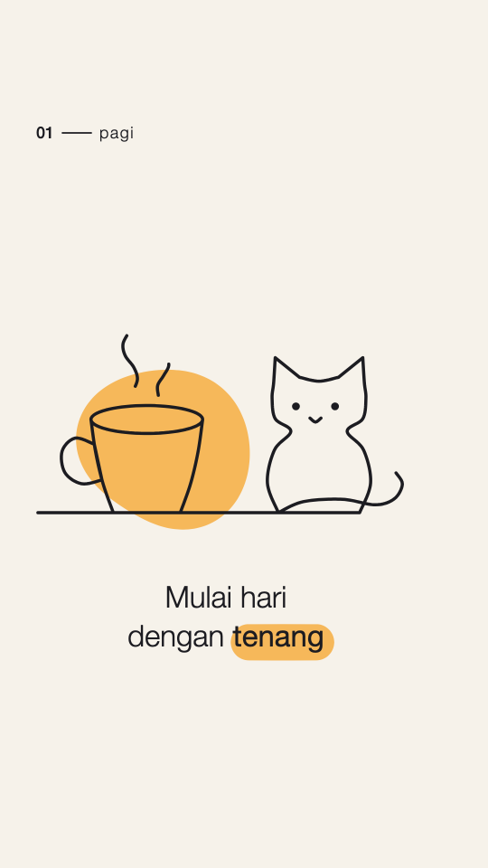

# Line art

Minimalist monoline illustration: **one line weight** with round caps and joins, a calm off-white (or softly tinted) ground, a near-black line, and **exactly one accent colour**, used only as a flat blob sitting slightly out of register behind the line drawing. Most of the frame is empty. One subject at a time. The signature motion is the **continuous-line draw**: a single unbroken stroke traces the subject on, then the accent blob pops in behind it. Type is a thin clean system sans. Motion on 1s.

Pick it for minimalist brands, tutorials, wellness, and premium products: anything that should feel quiet, confident and expensive.

**The one rule: one line, one weight, one accent.** If a frame needs a second colour, a second line weight, shading, or a texture, it is a different style.

Not to be confused with: `sketchbook` (graphite, hand lettering, a textured page, boil), `crosshatch` (sketchy boiling ink, hatch shading), `chalkboard` (grainy broken strokes, scribble fills), `isometric` (hairline product drawings with white faces and depth). Line art has no hatching, no pencil or chalk texture, no wobble, no depth cues, and far more whitespace than any of them.

## Palette and meaning (`LA` in kit.js)

| role | hex | use |
|---|---|---|
| ground / paper | `ground #f6f2ea` | warm off-white; the sheet and the morph paper |
| tinted ground | `tint #e9efe8` | a soft sage for a second era; still reads as "empty" |
| line and type | `ink #1c1c21` | every stroke, every letter |
| secondary type | `soft #8c8c93` | available for small secondary type only; never a line |
| **the accent** | `accent #f6b85a` (honey) | flat blobs only: behind the subject, behind the stressed caption phrase, the sun. Never a stroke, never text. |

One accent per piece. Change it for a brand with an options part listed before the style in `piece.json` `"build"` (e.g. `src/options.js` with `const LA_ACCENT = '#9fc5b8';`). `LA_GROUND`, `LA_TINT` and `LA_WEIGHT` work the same way. Keep the accent light enough that the ink line reads on top of it.

## Line, fill, texture

- **Line:** `LA.w` = 7 px at 1080 wide, constant on screen (divided by the camera zoom), round caps and joins, always `ink`. No tapering, no pressure, no doubled strokes. The tag's short rule is the one exception (half weight, it is type furniture).
- **Curves:** rigid and smooth: `laSpline` (Catmull-Rom through a few control points, with marked sharp corners). Nothing boils or wobbles between frames; idle motion is a slow smooth deformation (a tail flick, a leaf tilt).
- **Continuous line:** a subject is ONE path: the table, the object, the table again, the hero. Where a closed shape forces the pen over an edge twice, that stretch is a marked retrace (`laSkip`): it is drawn over the existing line and costs no drawing time, so the stroke stays unbroken.
- **Fill:** flat accent only, no outline of its own, slipped `LA.off` = (-20, -16) px from the line (the line sits up-left of its blob). Shapes are otherwise unfilled: the ground shows through the drawing.
- **Texture:** none. No grain, no vignette, no shadow. `post()` is empty.
- **Type:** `LA_SANS` = `"Helvetica Neue", "Avenir Next", "Segoe UI", "Inter", "Roboto", "Noto Sans", "Liberation Sans", Arial, sans-serif`. Captions 66 px weight 300, centred, sentence case, at most 2 lines; the one stressed phrase is weight 400 on a flat accent pill, out of register. Tags 36 px: a number, a short rule, a letter-spaced lower-case word.

## Motion habits

- On 1s (`ones: true`): the draw-on has to be smooth.
- **The draw:** `laDraw(P, t0, dur)` reveals the path along itself at a nearly constant pen speed (soft at both ends), about 1500 to 2000 px/s, with a small round pen dot at the head while it moves. A shot never opens on an empty sheet: start the line before the shot (`t0` negative, or `start`) so the first frame already holds part of the drawing.
- **Then the blob:** `laBlob(P, { t0 })` pops in behind the finished subject on a beat with a small spring overshoot. Line first, colour second, never the other way round.
- **Idle life**, all slow: steam wisps travelling upward (`laSteam`), the cat's tail flick and blink, leaves tilting, sun rays ticking on then turning (`laRays`), a far bird (`laBird`).
- **Camera:** a push of 3% at most inside an era; after a morph the new era opens 5% close and settles on a slow spring. No shake, no bumps.
- **Morph:** the old era closes inside a monoline iris shaped like the blob; as it closes the inside melts into the flat accent and the rim slips out of register, so it hands over to the blob without a pop; the blob (flat accent + an offset ink outline) morphs; the new era opens the same way in reverse. Captions and tags fade out during the first 0.3 s of the shrink and stay hidden until the new era has opened.
- **Sound:** sparse and calm (the demo is 80 BPM): soft plucks, a triangle pad, a quiet band of noise while the pen draws, a round pop for the blob.

## Frame checklist (on top of grammar/FRAME.md)

1. **One line weight** everywhere, round caps and joins, near-black. Nothing thinner or thicker in the drawing.
2. **One accent, flat, out of register.** Count the accent shapes: one blob behind the subject, at most one pill behind a caption phrase. No accent strokes or accent text.
3. **At least 60% of the frame is empty ground.** If the frame feels full, remove a subject, do not shrink everything.
4. **One subject at a time,** standing on one ground line, with the hero beside it. No scenery, no boxes, no frames around things.
5. **The line is continuous:** you can follow the subject from one end of the stroke to the other without lifting the pen. Small separate marks are allowed only for faces (eyes, mouth) and for life (steam, rays, birds).
6. **Something is being drawn or is quietly moving:** a pen dot mid-stroke, steam, a tail flick, turning rays. A finished drawing never sits completely still.
7. **Captions:** thin sans, at most 2 short lines, inside x 60 to 940 and above y 1500, one stressed phrase on its pill.
8. **No texture, shading, hatching, gradients, shadows or wobble.** If the eye wants more, add whitespace.

## Kit API (`kit.js`, on top of `kit/core.js`)

Palette and type
- `LA` (`ground`, `tint`, `ink`, `soft`, `accent`, `w`, `off`), `LA_SANS`.
- Options read at load: `LA_ACCENT`, `LA_GROUND`, `LA_TINT`, `LA_WEIGHT`.

Geometry
- `laZoom()`: the current camera zoom. `laPath(P, closed)`: begin a polyline path.
- `laCentroid(P)`, `laOffset(P, dx, dy)`, `laScale(P, centre, k)`.
- `laCirclePts(x, y, r, n, a0, a1)`, `laEllipsePts(x, y, rx, ry, n, a0, a1)`: full shapes, or arcs when `a0`/`a1` are given (any direction).
- `laBlobPts(x, y, r, key, { lump, sy, n })`: a calm organic round, seeded by `key`.
- `laSpline(pts, { step })`: a smooth rigid curve through `[x, y, corner?]` control points; a truthy third value is a sharp corner. Returns a dense polyline.
- `laJoin(...paths)`: join paths into one continuous line. `laReverse(P)`: the same line from its other end.
- `laSkip(P)`: mark a stretch as a retrace (zero drawing time). `laLen(P)`: drawn length. `laCut(P, a, b)`: the part between two fractions of the drawn length.

Line, draw, blob
- `laLine(P, { frac, from, c, w, closed, al })`: stroke at the one weight; returns the pen position.
- `laDraw(P, t0, dur, { start, tip, c, w })`: the continuous-line draw; `start` = the fraction already drawn at `t0`; returns the drawn fraction.
- `laFracAt(t, t0, dur, { start })` and `laTimeOf(frac, t0, dur, { start })`: where the pen is at a time, and when it reaches a fraction (for cueing sound or a reaction).
- `laEase(u)`: the pen's easing. `laDot(x, y, r, c)`.
- `laFill(P, c)`: a flat fill. `laBlob(P, { t0, c, k, d })`: the accent blob with its pop; draw it before the line.
- `laGround(c)`: fill the frame.

Type and captions (captions and tags go through `DEFER`)
- `laFont(size, weight)`, `laTextW(str, size, weight, track)`, `laText(str, x, y, size, c, { align, weight, al, track, base })`.
- `laCaption('line one\nline *stressed*', { y, size, at, x, c, hi })`: `at` = seconds after the era starts; `hi: false` drops the pill.
- `laTag('01', 'label', { at, x, y })`.
- `laLeaving()`: the caption fade around a bridge.

Hero: Garis, a sitting cat in one continuous line
- `laCatPts(bx, by, r, { sway })`: the cat's line; `(bx, by)` = the middle of its base, `r` = half its height. The line enters at the left foot and ends at the tail tip, so it can be joined after a ground line.
- `laCatFace(bx, by, r, { on, look, lookY, mood: 'calm' | 'happy', blink, key })`: eyes and mouth; sets `SPARK_AT`.
- `laHero(x, y, r, { frac, blob, blobAt, sway, look, lookY, mood, blink, key, on })`: the whole hero around its centre.
- `laHeroPts(x, y, r)`: the closed body outline, for bridges.

Subjects and life
- `laCupPts(x, y, s, { handle: 'left' | 'right' | 'none' })`: a cup as a stretch of a continuous line (enters at the base's left corner, leaves at the right).
- `laPlantPts(x, y, s, { sway, leaves: [[height, side, length]] })`: a potted plant as the end of a continuous line (enters at the pot's base, right corner).
- `laSteam(x, y, h, t0, { period, amp, key, c })`, `laRays(x, y, r, t0, { n, r0, r1, stagger, spin, rot, c })`, `laBird(x, y, s, { rate, ph, al })`.

`STYLE`: `paper` ground, `backdrop` flat fill, `window` (clip + monoline rim, melting into the accent near the bridge shape), `blob` (flat accent + offset ink outline), `hero` (Garis with a blob), `heroColor` accent, `heroPts`, `post` empty, `ones: true`.

## Do / don't

- **Do** build each subject as one path with `laJoin`, and let the ground line run into it and out of it.
- **Do** start the draw before the shot so the first frame is not empty, and land the blob on a beat after the line finishes.
- **Do** leave the big empty areas empty. Put life in small slow marks, not in more objects.
- **Do** bridge the blob into another round accent shape (a sun, a plate, a moon, a ball): same proportions, same colour, a clean morph.
- **Don't** add a second accent, tint the line, or fill a shape with anything but the accent.
- **Don't** vary the line weight, add hatching, dots, grain, shadows or gradients, or wobble the line.
- **Don't** crowd the frame with more than one subject plus the hero, or box things in with frames and panels.
- **Don't** set captions in a heavy weight or in capitals; the thin sans is part of the look.
- **Don't** morph the blob into a long thin shape (it pinches).

## Not matched / known weaknesses

- Built from the genre's conventions, not measured against a specific reference.
- The "one continuous line" is honest for the subject and the ground, but faces (two eyes, a mouth) and life marks (steam, rays, birds) are separate small strokes; closed shapes need retraces, which show as a one-frame jump of the pen dot.
- Only three ready subjects ship (a cup, a potted plant, the cat). Anything else has to be drawn by hand as control points for `laSpline`, and getting a recognisable one-line drawing takes iteration.
- No real perspective or overlap handling: lines that cross simply cross (the cat's tail runs in front of its flank). Complex objects read worse than simple ones.
- The thin type depends on the system having a light weight (Helvetica Neue Light, Segoe UI Light); on a system without one it falls back to regular and looks slightly heavier.
- With one accent and no texture, a long piece can feel samey: it needs changes of subject, scale and ground tint to stay alive.
- The morph midpoint is a bare blob on the sheet: clean, but it only works when both ends are round accent shapes.

## Proven on

`demo/` (6 s, 9:16, 80 BPM, 24 fps): one line runs along a table, draws a coffee cup and then Garis the cat beside it; a honey blob pops in behind the cup on beat 2, steam rises, caption "Mulai hari dengan tenang". At 3.0 s the blob morphs into the morning sun on a sage ground; the same line leaves the cat, runs along the sill, closes a pot and grows a plant leaf by leaf while the sun's rays tick on and two birds cross, caption "lalu tumbuh pelan-pelan". Tile deterministic; 2 to 24 ms/frame; review: morph on the grid, text PASS, story arc PASS, dead beats PASS, -14.6 LUFS, true peak -3.8 dBFS.
