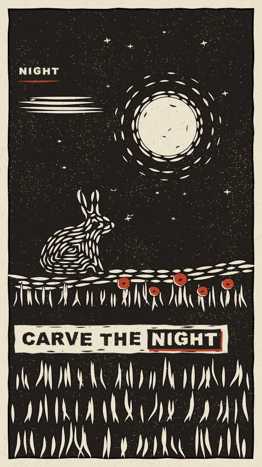

# Linocut

A linocut / woodcut relief print. The picture is carved **out of** a solid inked block: the ground is dense black ink, and every form is paper showing through where the knife removed material. Forms are built from tapered V-gouge cuts (lens-shaped: thick in the middle, pointed at both ends) laid in rows that follow the form's contour, plus areas cleared with wide cuts that leave stray uncut ridges ("chatter"). The ink is slightly uneven: salty speckle where the roller missed, a denser rim along cut edges. One flat second colour is printed from its own block, a few pixels off register. Lettering is carved too: chunky hand-cut caps.

Pick it for folk tales, nature, night and day, seasons, animals, hand-made and craft subjects, protest-poster boldness, anything that should feel cut by hand and heavy with ink. Not for UI, data, fine detail, soft or pastel moods, or subjects that need more than one colour.

**The one rule: everything is either cut or uncut. If a mark is not a tapered gouge, a cleared area with chatter, or solid block, it is not in the frame.**

## Palette and meaning (`LIN` in kit.js)

Ink, paper and exactly one second colour per piece. No greys, no tints, no transparency.

| role | hex | use |
|---|---|---|
| block | `ink #221e1a` | the ground of every frame: sky, earth, everything not yet cut; uncut ridges, islands, borders, the caption's letters |
| rim | `inkD #070606` | not a colour of its own: the denser line where ink squashes out along a cut edge and round the block |
| sheet | `paper #ece3cf` | every cut; the margin round the block; the morph's blank sheet; the caption plate |
| fibre | `fibre #d6cab0` | paper fibres only (drawn with `darken`, so it never touches the ink) |
| **second colour** | `red #b8432b` (default) or `ochre #c98f2c` | `LIN.color`. Printed under the black, seen only through cuts: the sun, flower heads, the strip under the caption's highlighted word. Set `LIN.color = LIN.ochre` in a piece's head to switch; never both in one piece. |

A frame is mostly block. The second colour is one big shape (a sun) or a handful of small ones (flowers), never a field.

## Cuts, ink and paper

- **The block** (`linBlock`): a scene is drawn inside `linBlock(() => { ... })`. Inside it `ctx` is the black block, an offscreen layer inked edge to edge (`LIN_B`: 34 px of paper margin shows round it, the edge slightly hand-cut). Every cut punches a hole (`destination-out`), so what lies under shows: paper, or the second colour. Nothing prints beyond the block's edge.
- **The gouge** (`linLens`): one lens, pointed at both ends, widest near the middle, optionally bent. Every mark in the style is this shape: light when cut (`linCut`), black when it is a ridge left standing (`linInk`). Never a constant-width line, never crossed into a grid.
- **Contour rows** (`linCarve`): any closed outline becomes rows of gouges that follow its edge inward, with short uncut gaps between cuts, so thin black ridges separate the rows. Width can vary across the form (`shade`) to model it: thin cuts read darker.
- **Cleared areas** (`linClear`, or `core: true` in `linCarve`): rows of wide overlapping gouges clipped to the outline; where neighbours do not meet, slivers of block stay standing and print. A cleared area without chatter looks like a flat vector shape: keep some.
- **Rim**: each cut is stroked in `inkD` before it is punched, leaving a ~2.5 px denser edge outside it; the block's own edge has a wider one.
- **Second colour** (`linColor`): drawn on the sheet under the block, shifted by `LIN.reg` (5, −4 px). On one side a sliver of paper shows between colour and black, on the other the colour runs under the black.
- **Surface** (`STYLE.post`): salt = paper-coloured specks in low-frequency patches, composited with `lighten` (only shows on ink and colour); one fixed layer plus one of three that alternate with the boil. Fibres and a few ink flecks composited with `darken` (only show on paper). All cached.
- **Type** (`linText`): `LIN_FONT` = `"Arial Black", "Arial Bold", Impact, Haettenschweiler, "Franklin Gothic Heavy", "DejaVu Sans", "Liberation Sans", "Helvetica Neue", Arial, sans-serif`, weight 900, caps only. Each glyph is turned, shifted and stretched a little (fixed by its key) and the knife takes two small bites out of its foot and head. Light on black (cut out of the block or a bar) or black on a cleared plate.

## Motion habits

- On 2s (`ones: false`). Nothing fades, nothing eases, nothing glows.
- **Carved in:** every element has `frac`; drive it with `linIn(t0, d)`. Gouges appear in sequence along the contour, the newest one part-way cut, a few chips flying off the tip. Rows run from the outline inward.
- **Then printed:** `linBlock(fn, { press: t })` drops the block 8 px for one step and salts the ink heavily; one step later the second colour lands (`in: linDrop(t + 1/12)`), first 2.6× off register, then settling to `LIN.reg`.
- **Idle life is print-like:** the block sits a pixel differently on every boil step, the boil layer of salt changes. Things that "move" are re-cut in a second position on the beat (`linStep(0.5) % 2`): grass leans the other way, a star is re-cut smaller, a ring of glow turns a notch, rays shift half a step, mist slides one notch. Small creatures hop a step every eighth.
- **The hero** is rigid: it is moved as a whole (a hop is the same carving at a new height on 2s); its back ear has a second cut position for a flick.
- **Bridges:** the block is cut away round the bridge shape until only an island with an uncut ring is left on the sheet, stray ridges thinning out; at the bridge time the island is pressed and the second colour drops in; the new block opens out of it.
- **Captions:** the black bar is stamped down, the plate is cleared left to right, words are stamped one per eighth (each lands a step low). Wiped off as a bridge starts.
- **Camera:** none in the demo. It is a print on a sheet.

## Frame checklist (in addition to `grammar/FRAME.md`)

1. **More than half the block is still black.** If the frame reads as dark drawing on light paper, it has turned into pen and ink: put the block back.
2. **Every light mark is a tapered gouge or a cleared area.** No constant-width strokes, no outlines drawn as lines, no hatching grids.
3. **Rows follow the form.** Gouge rows run along the contour of what they describe (round a disc, along a ridge, round a body), with black ridges between them.
4. **Chatter is present** in every cleared area, and an uncut border or ring stands where a cleared area meets the block's edge or an important shape.
5. **Three tones only:** ink, paper, the one second colour. No grey, no tint, no gradient, no soft edge or glow.
6. **The second colour sits off register:** a paper sliver on one side of it is visible at full size.
7. **Salt in the ink and a paper margin round the block** are visible; the block's edge is not a ruler-straight rectangle.
8. **The hero reads as a silhouette** with the rows squinted away, and sits on an ink island when it stands on carved ground or a cleared sky.
9. **Something is mid-cut** (a row part-way round, chips at the tip) or has just been pressed, and two or three things are re-cut on the beat.
10. **Caption: one line of caps on a cleared plate** at y ≈ 1330–1455 with one word left as paper letters in a black bar over a strip of the second colour. Nothing important behind it.
11. **Bridge objects are simple carved shapes of similar proportions** (disc → disc), clear of everything else at the bridge time.

## Kit API (`kit.js`, on top of `kit/core.js`)

- Palette and constants: `LIN { ink, inkD, paper, fibre, red, ochre, color, reg, gap }`, `LIN_FONT`, `LIN_B { x0, y0, x1, y1 }` (the block on the sheet).
- Timing: `linIn(t0, d)` (0..1: pass as `frac`), `linPulse(t)` (the press), `linDrop(t)` (the second colour: 0 / 0.5 / 1), `linStep(every, phase)` (a counter for two-state idle life).
- The block: `linBlock(fn, { press, bare, still })`, `linCut({ rim, rule })` (cut the current path), `linInk(c)` (ink the current path), `linColor(P, { in, c, grow })` (print outline P in the second colour under the black).
- **Generic helpers that turn any outline into the medium:**
  - `linCarve(P, { key, gap, w, rows, core, chatter, len, skip, shade(x, y), frac, chips, ink, hold, box, cache, rim })` — contour-following gouge rows for any closed outline (distance field + marching squares, cached by key and outline). `rows` limits the depth; `core: true` clears what is left inside, with ridges; `ink` first puts an ink island under it. Move a carved thing with `ctx.translate` round a fixed local outline; use `cache: false` for outlines that change every frame.
  - `linClear(P, { key, gap, a, w, len, hole, frac, chips, rim })` — clear any outline with wide cuts that leave chatter; `hole` = outline(s) left standing inside.
- Single marks: `linLens(x1, y1, x2, y2, w, bend, q)` (adds a gouge to the current path; returns the tip), `linGouge(x1, y1, x2, y2, w, { frac, bend, rim })`, `linRidge(x1, y1, x2, y2, w, { bend, c })`, `linChips(tip, key)`.
- Geometry: `linPoly(P, add)`, `linCen(P)`, `linGrow(P, px)`, `linDiscPts(x, y, r, n)`, `linRectPts(x, y, w, h)`, `linRough(P, amt, key, step)` (a fixed hand-cut edge), `linRound(P, it)` (rounds a hand-typed polygon), `linSig(P)`.
- Ready-made cuts (all take `frac`, `key`): `linDisc(x, y, r, o)` (two rows and a cleared middle: moon, sun), `linRays(x, y, r0, r1, { n, rot, w, short })`, `linArcRow(x, y, r, { n, w, len, rot })` (a carved glow), `linStar(x, y, s, { alt })`, `linGrass(x0, x1, y, { n, h, w, sway })`, `linCloud(x, y, w, { n, gap, w, ink })`, `linBird(x, y, s, { flap, ink })`, `linPoppy(x, y, s, { lean, h, in })`, `linTree(x, base, h, { rx, ry, gap })`.
- Hero: `linHare(x, y, r, { frac, ear, flip, ink, hold, key })` — a sitting hare carved in contour rows, one uncut dot for an eye; sets `SPARK_AT`. `linHarePts(x, y, r, ear, flip)`, `linHareUnit(ear)`.
- Type: `linFont(size)`, `linTextW(str, size, track)`, `linText(str, x, y, size, { c: 'cut' | colour, bg, align, key, n, track })`.
- Captions (through `DEFER`): `linCaption('CARVE THE *NIGHT*', { x, y, w, size, at })` (y = the baseline, 1420; shrinks to fit `w`, 820), `linTag('NIGHT', { x, y, size, at })`; `linBridgeK()` is their visibility through a bridge.
- Surface caches: `linSalt(i)`, `linFibre()`, `linStray()`.
- `STYLE`: `paper`, `backdrop` (the bare sheet with stray ridges; the blended colour is ignored on purpose), `window` (a clip with an uncut ring that grows as the window closes), `blob` (an ink island carved like `linDisc`, pressed at the bridge time, then printed in the second colour), `hero`, `heroColor`, `heroPts`, `post` (salt and fibre), `ones: false`.

## Do / don't

- **Do** start from black and decide what to remove. Leave big areas uncut.
- **Do** let rows describe the form: concentric round a disc, parallel to a ridge, wrapping a body.
- **Do** keep an uncut border, ring or island wherever a light shape would otherwise meet a cleared area.
- **Do** carve first, press second, colour third, and give each a sound (scrapes, a thud, a damp click).
- **Do** give carved things a stable `key` and a fixed outline; move them with a transform.
- **Don't** draw with lines. No pen strokes, outlines, cross-hatching, stippling or halftone dots.
- **Don't** use grey, opacity, gradients, blur, shadows or glows; no second second-colour.
- **Don't** tween shapes smoothly or let things drift: re-cut them in a new place on the beat.
- **Don't** clear an area completely clean, or run type over carved rows without a bar or plate.
- **Don't** set long captions: about 16 characters at 78 px; a longer line shrinks to fit 820 px.
- **Don't** put anything over a bridge object at the bridge time, or bridge between very different proportions.

## How it differs from the closest shipped styles

- **crosshatch** adds dark pen lines to light paper and shades with hatching. Linocut is the inverse: light cuts in a black field, tapered gouges only, and it never hatches or crosses rows.
- **riso** builds tone from halftone dots and overprints three inks. Linocut has no halftone, no overprint mixing, and one extra colour that is always flat.
- **ink-wash** is soft grey brushwork on mostly bare paper. Linocut has no greys and no soft edges, and its frames are mostly ink.
- **sand** is also dark silhouettes on a light ground, but it is poured and wiped, backlit and monochrome; linocut is hard-edged, knife-cut, with visible gouge rows and a printed second colour.

## Not matched / known weaknesses

- Built from the genre's conventions (relief prints with a single colour block), not measured from a specific print.
- `linCarve` rows are iso-lines of the distance to the outline, so narrow parts (ears, legs) get one row and wide parts spiral inward; it does not know anatomy. Thin features under about 1.2 × `gap` wide are not cut at all.
- A first call to `linCarve` on a large outline costs 20–150 ms (the distance field); later frames reuse the cache (typically 15–60 ms a frame in the demo). Outlines that change every frame (`cache: false`) pay it each time: keep them small, as the morph does.
- The rim is drawn per call, so a later cut's rim can draw a thin dark line across an earlier neighbouring cut; order calls so that overlapping cuts share one path, or pass `rim: 0`.
- The salt and fibre layers are fixed to the frame, not to the block, and are full-frame caches sized to the piece's main format.
- The font is a system heavy sans (Arial Black on macOS / Windows; DejaVu or Liberation bold on Linux, which is lighter). The hand-cut feel comes from the per-glyph jitter and bites, not from the typeface.
- `backdrop` ignores the colour the renderer blends, so `ERA_BG` has no visible effect.
- `linArcRow`, `linCloud` and `linTree` are used in the demo only at one size each; `LIN.ochre`, `linText` in `'cut'` mode inside a scene, `flip` on the hare and the hero-to-hero bridge (`STYLE.hero`) are not exercised by the demo. No camera moves were tested.
- Captions are single-line only; the demo does not loop seamlessly.

## Proven on

Its demo only. `demo/` (6s, 9:16, 120 BPM, 24fps): on a solid black block a moon is carved (two rows and a cleared middle, a broken glow round it), stars are nicked one by one, a ridge is cut in three rows, tufts of grass and a sitting hare are carved row by row; the block is pressed and five poppies print brick red, off register; the hare's ear flicks. At 3.0 s the block is cut down to the moon, which is pressed and printed as the red sun; the sky is cleared round it with long wide cuts that leave chatter, rays are cut, three hills are carved in rows that follow their ridges, two trees and the hare appear, a second press prints more poppies, and the hare hops twice. `tile.mjs`: deterministic; `review.mjs`: all checks pass.
