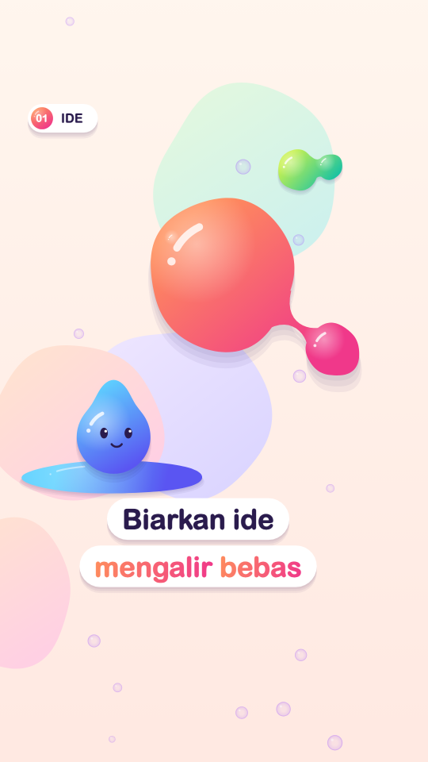

# Liquid

Liquid shape-morph motion graphics: smooth, borderless organic blobs filled with bold two-stop gradients (coral → magenta, blue → violet, lime → teal), each with a soft sheen, a crisp white glint and a small soft shadow, on a clean light ground or a deep indigo one. Blobs wobble slowly, pull droplets out of themselves on a thinning neck, snap apart and flow back together. Wave bands roll across the bottom of the frame or sweep the whole frame as a transition; drops fall and splash in a crown; small bubbles rise. Type is a rounded bold sans on white pills. Motion on 1s, always eased, with squash, stretch and an overshoot that settles.

Pick it for modern brands, drinks and beauty products, app intros and transitions — anything that should feel fresh, soft and flowing. Not for technical diagrams or dense data.

**The one rule: everything is a curve.** No outlines, no corners, no straight edges; a shape is a gradient-filled closed curve with a glint. Liquid never teleports: it stretches, necks, splits or merges.

## Palette and meaning (`LQ` in kit.js)

Gradient pairs live in `LQ.g`, each `[light stop, deep stop]`; the gradient runs from top-left to bottom-right.

| role | pair / hex | use |
|---|---|---|
| light ground / paper | `paper #fff6ee` → `paperB #ffe9e2` | the clean cream ground; morph paper |
| deep ground | `deep #1a1040` → `deepB #2c1768` | the night-indigo ground |
| **hero** | `sky #5fd2ff → #5a55f2` | Tetes the drop and its own water (the puddle). Reserved for the hero. |
| **main subject** | `coral #ff8f5c → #f0388a` | the thing the story follows; the caption highlight |
| result / love | `heart #ff7092 → #d02fb6` | hearts, the payoff shape |
| waves, wipes | `berry #4f86ff → #9a4dff` | blue → violet: transition bands, mid waves |
| back waves | `violet #8a6cff → #4a2bb8`, `dusk2 #5a3cc8 → #33208a` | farther wave layers on the deep ground |
| fresh accent | `lime #c8f250 → #17c2a4` | the front wave, a small goo pair, splashes |
| small accent | `sun #ffd84a → #ff8a3c` | beads and sparks only |
| drifters (light) | `peach`, `lilac`, `mint` | big pale background blobs |
| drifters (deep) | `dusk #34207c → #27155e` | big dim background blobs |
| text | `ink #2a1b4d`, `inkL #7d6d9e`, `white` | caption text on white pills; eyes |

A frame uses one ground + the hero's sky + one or two vivid pairs + pale/dim drifters. Morph between neighbouring hues (coral → heart, berry → violet, lime → sky); a coral → lime morph passes through a dull olive.

## Fill, light and shadow

- **No strokes on shapes.** The only strokes are the white glint arc, a wave's crest line, a splash ripple and the hero's smile.
- **Surface** (`lqPaint`): a linear gradient across the shape's box at ~55° (`angle: 0.95`), then clipped to the shape: a soft white sheen (radial, α 0.44) in the upper-left and a crisp glint (a short round-capped arc at 0.7 of the radius plus a dot below it, α 0.8).
- **Shadow:** three copies of the shape, offset down 0.5× / 0.95× / 1.4× of `clamp(size × 0.075, 6, 26)` px and grown 1.2% each, filled `rgba(44,16,84,0.055)`. No `shadowBlur`, no filters — cheap and deterministic. The same lilac shadow works on both grounds.
- **Outlines** are point lists drawn as one smooth closed curve through the midpoints (`lqPath`), so even a 40-point blob has no corner. Blob radius = `r × (1 + amp × (0.5 sin(2θ) + 0.3 sin(3θ) + 0.2 sin(5θ)))` with phases from the key, drifting with time: `amp` 0.05 calm, 0.075 normal, 0.12 lively.
- **Merging** is faked, not computed: `lqGoo` fills several blobs plus a **neck** between each close pair as one path (one gradient, one shadow). The neck (`lqNeck`) is two curves tangent to both circles; it thins as the blobs separate and breaks at `reach` (2.2 small-radii past touching).
- **Type:** `LQ_SANS` = `"Arial Rounded MT Bold", "Varela Round", "Nunito", "Quicksand", "Segoe UI", "Helvetica Neue", Arial, "DejaVu Sans", sans-serif`, weight 800. Captions 70px on white pills (one pill per line), one phrase gradient-filled; tags 32px.

## Motion habits

- On 1s (`ones: true`). Everything eases in and out (`EZ.io`) or springs (`lqPop`: overshoot, then settle).
- **Squash and stretch on every impact** (`lqLand`): wide and low, then tall, then settled, over ~0.5s. A falling drop is stretched 12% with a long tip; the base stays put while it squashes.
- **Split and merge:** a droplet leaves over 0.5–0.6s on a neck, hangs, snaps; it flows back over 0.4s and the parent jiggles when it arrives.
- **Idle life:** blobs wobble at ~1 rad/s, drifters slide ±60px, bubbles rise in 3–6s loops with a sway, waves roll (three layers at speeds 0.6 / 0.9 / 1.2), the hero floats and blinks every 2.9s.
- **Entrances:** a wave band sweeps off (`lqWipe`), or the sea rises on a soft spring. Captions: the pill springs open, words rise in 0.07s apart.
- **Camera:** a slow ≤ 4% push inside an era; after a morph the new era opens 10% close and settles on a slow spring. Never shake.
- **Morph:** on the clean paper, the shape keeps its two real gradients blended (`lqBridgePair`) and does one jelly squash through the change; the window rim is a band of the shape's gradient that swells as the window leaves the object.

## Frame checklist (on top of grammar/FRAME.md)

1. **No outline and no corner anywhere** — every edge is a curve, every fill a two-stop gradient.
2. **Every vivid blob has a glint and a soft shadow**; background drifters have neither (they stay flat and pale).
3. **Something is merging, splitting, dripping or splashing** in every held second — a neck is visible somewhere.
4. **Clean ground:** ≥ 45% of the safe area is plain ground or pale drifters; at most three vivid pairs plus the hero's sky.
5. **Sky blue belongs to the hero** (and its puddle). Don't put the hero in front of a blue or violet wave of the same value; give it a lime or deep background.
6. **Captions sit on white pills** in the safe area (x 60–940, y 250–1500), ≤ 2 lines, one gradient-filled phrase.
7. **Depth by layering:** drifters → bubbles → subject → waves → splash → captions; nearer waves are lighter and faster.
8. **Nothing lands without a squash**, nothing starts without an ease.

## Kit API (`kit.js`, on top of `kit/core.js`)

- Palette: `LQ` (grounds, text, `LQ.g.<pair>`), `LQ_SANS`.
- Colour: `lqRGB(c)`, `lqMix(a, b, u)`, `lqA(c, alpha)`, `lqPair(c)` (a pair stays; one colour becomes [lighter, deeper]).
- Geometry: `lqBlobPts(x, y, r, { key, amp, speed, n, sx, sy, rot, t })`, `lqDropPts(x, y, r, { tip, lean, sx, sy, sig, n })`, `lqHeartPts(x, y, r, n)`, `lqCirclePts(x, y, r, n)`, `lqPillPts(x, y, w, h)`, `lqSmooth(P, iterations)`, `lqBB(P)` → `[x0, y0, x1, y1]`, `lqCentroid(P)`, `lqArea(P)`, `lqPath(P, add)` (smooth closed curve), `lqPoly(P, add)` (straight segments).
- Surface: `lqPaint(build, bb, c, { al, angle, shadow, gloss, spots })`, `lqFill(P, c, { …lqPaint, raw })`, `lqGloss(cx, cy, rx, ry, g)`, `lqPlate(x, y, w, h, c, al)` (a flat pill with the soft shadow).
- Merging: `lqNeck([x, y, r], [x, y, r], v, reach)` → polygon or null; `lqGoo(items, c, { v, reach, …lqPaint })` with items `{ x, y, r, key, amp, speed, sx, sy }` or `{ P, x, y, r, spot, neck, gloss }` (a custom outline whose neck circle is x, y, r).
- World: `lqGround(top, bottom)`, `lqDrift(key, n, pairs, { r, al, box, speed })`, `lqBubbles(key, n, { box: [x0, yBottom, x1, yTop], r, c, al, speed })`.
- Waves: `lqWave(y, c, { key, amp, len, speed, t, depth, bottom, al, gloss, shadow, x0, x1 })`, `lqWaveY(x, y, o)` (the surface height, to float things), `lqWaveEdge(y, o, x0, x1, step)`, `lqEdgeLine(E, dy)`, `lqWipe(u, c, { dir, key, amp, len, c2 })` (a full-frame band: 0 out, 0.5 covering, 1 gone).
- Impacts and timing: `lqSplash(x, y, tSinceImpact, c, { key, n, power, r, spread })`, `lqLand(t0, amt, freq, damp)` (a damped squash value), `lqPop(t0, k, d)` (0 → 1 with overshoot).
- Hero: `lqHero(x, y, r, { key, squash, lean, tip, look, lookY, mood: 'smile' | 'wow' | 'calm', bob, c, shadow, eyes })` — Tetes, a sky-blue drop with two eyes; (x, y) the centre of the round body, r its radius; sets `SPARK_AT`. `lqHeroPts`, `lqHeroShape`.
- Type: `lqFont(size, weight)`, `lqTextW(str, size, weight)`, `lqText(str, x, y, size, c, { align, base, weight, al, grad })`.
- Captions (through `DEFER`): `lqCaption('line one\nline *highlight*', { y, size, at, hi, c, plate, x })`, `lqTag('01', 'LABEL', { c, x, y, at })`; both fade out at the start of a bridge and fade in once the next era is open (`lqBridgeAl()`).
- Bridges: `lqBridgePair(tc, pairA, pairB)` — call once beside `BRIDGES` so the morphing shape and the window rim use the real gradients.
- `STYLE`: `paper` cream, `backdrop` (the era colour; plain paper during a bridge), `window` (clip + a gradient rim that swells), `blob` (the liquid surface with blended gradients and a jelly squash), `hero` (Tetes), `heroColor`, `heroPts`, `post` (nothing: the look is clean), `ones: true`.

## Do / don't

- **Do** let liquid act the idea out: split for "share", merge for "together", drip for "give", fill for "grow".
- **Do** put the glint on everything vivid and keep background drifters flat (`gloss: 0, shadow: false`).
- **Do** squash on every landing and send a splash from where it lands (`spread` clears the thing that landed).
- **Do** keep goo partners within ~2.5× of each other's size; a neck between a huge blob and a dot is too thin to read.
- **Don't** add outlines, hard rectangles, sharp stars or straight lines; round everything (`lqSmooth`).
- **Don't** use blur, `shadowBlur`, or a per-pixel metaball field (slow, and it differs between GPUs).
- **Don't** fill the frame with vivid blobs; the clean ground is what makes them look wet.
- **Don't** morph between far hues (coral → lime) or a round blob into a long thin band.

## Not matched / known weaknesses

- Built from the genre's conventions, not measured from a specific reference.
- The merge is faked with neck shapes between circle pairs: three blobs meeting at once show overlapping necks rather than one true union, and a neck anchors to a circle, so on a strongly wobbling or custom outline (the heart) its root can sit a few px off the surface.
- The glint has a fixed position (upper-left arc + dot) sized from the shape's box; on very flat or concave shapes it is clipped or sits oddly — pass `spots` or `gloss: 0` there.
- Shadows are three hard-edged offset copies, soft only at normal viewing size; a still at 200% shows the steps.
- Bridges always happen on the cream paper, also between two deep eras (a light flash); the window rim is a plain gradient band, not a wobbling liquid edge.
- `lqWipe` only sweeps vertically, and nothing here is refractive or transparent: it is flat vector liquid, not glass.
- The demo does not loop seamlessly (the last frame is the sea, the first is the wipe).

## Proven on

`demo/` (6s, 9:16, 120 BPM, 24fps): on the cream ground a blue-violet wave band sweeps away, Tetes the drop falls into its puddle, squashes and splashes, while a coral blob of ideas pulls two droplets out on necks and takes them back (a lime pair keeps merging and splitting in the corner, bubbles rise) — caption "Biarkan ide *mengalir bebas*". At 3.0s the coral blob morphs into a rounded pink heart on the deep ground: three wave layers rise, bubbles climb, the heart drips twice into the sea with small splashes and Tetes pops out of the lime wave to ride it — caption "jadi karya yang *disukai*". Tile deterministic; ~11–64 ms/frame; review: morph on grid, text PASS, story arc PASS, -15.2 LUFS, true peak -1.0 dBFS.
