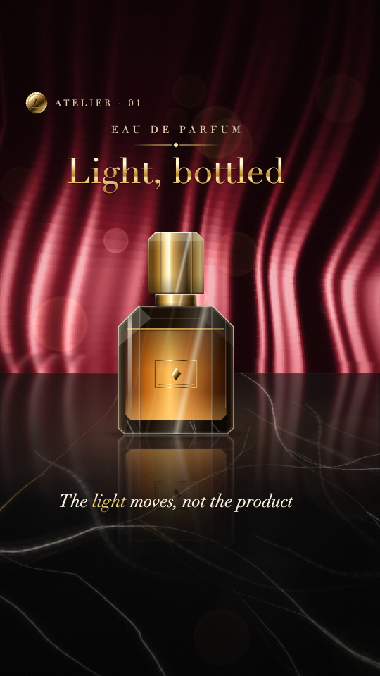

# Luxe

A luxury still-life film: the visual language of a perfume, jewellery, watch, cosmetics or chocolate advertisement. The materials are the subject and every one of them is drawn in code. A polished marble slab (black, deep emerald or ivory) with a few branching white and gold veins and a soft mirror image; satin that hangs or lies in long folds with smooth light and dark bands and a sheen that travels; polished and brushed gold as a banded metallic gradient on any outline and on the lettering; thick cut glass with liquid, facet lines and refraction slivers; a brilliant-cut stone whose facets flash one after another; warm out-of-focus bokeh discs drifting in the dark; a thin haze. **One** invented, unbranded product sits in the middle of it: a faceted perfume bottle with a gold cap and amber liquid, a solitaire ring, a lipstick, a small gift box with a gold bow. The type is a high-contrast serif in gold foil under widely tracked small caps and a thin gold rule, with a small foil monogram seal, and most of the frame stays dark and empty.

Pick it for premium physical products, gifting, launches of something you can hold, a brand's "hero object" moment, slow sensual moods. Not for explainers, diagrams, UI, characters, anything cheerful or fast, or more than one product at a time (that is **bento** or **keynote** territory).

**The one rule: the product never moves. The light does: a specular sweep crosses gold and glass, the satin's sheen travels, a stone glints, bokeh drifts, the camera pushes in very slowly.**

## Palette (`LUX` in kit.js)

| name | hex | use |
|---|---|---|
| `ground` | `#070605` | the dark of the studio; `STYLE.paper` |
| `wall` `ember` | `#2b1a10` `#5a3416` | the one warm pool of light on the wall behind the product (`lxWall`) |
| `ivory` | `#f4ecd9` | caption words |
| `cream` `taupe` | `#d8c9ab` `#93846c` | tracked caps (kicker, tag) |
| `gold.deep` `lo` `mid` `base` `hi` `white` | `#2b1a06` `#6a4413` `#b3822e` `#d6ad58` `#f8e4a4` `#fffbe6` | every gold surface and all foil lettering, always as a gradient of several of them |

Marble (`LUX.marble`): `black` base `#0b0a0b`, veins `#ece6da` and gold `#d6ad58`; `emerald` base `#041a13`, clouding `#0d4c38`, veins `#dcefe3`, gold `#e0bd68`; `ivory` base `#e6dccb`, veins `#8a7d68`, gold `#b88d3a`.

Satin (`LUX.silk`, lo / base / hi): `champagne` `#4b3520` `#bf9b69` `#f8e6c3`; `ivory` `#6d6250` `#d9ccb4` `#fffaee`; `burgundy` `#22060b` `#7c1626` `#e77a86`; `emerald` `#04201a` `#0e6b50` `#62cfa4`; `noir` `#060607` `#2a2930` `#b5b2c0`.

Liquids (`LUX.liquid`): `amber` `#421603` `#bd610f` `#ffc45c`; `rose`; `clear`. Stones (`LUX.gem`): `diamond` `#cfe6f5`, `emerald`, `ruby`, `sapphire`, `amber`.

- Any other base colour works for a satin, a liquid or a stone (`color: '#3b2a6e'`): the kit derives the dark and the lit tone.
- A frame holds the dark ground, gold, **one** stone colour for the slab, **one** satin colour and the product's own colour (the liquid, the stone, the lipstick). The demo: black marble + burgundy satin + amber; then emerald marble + emerald satin + a clear stone.
- **Colours for the renderer:** `ERA_BG` is a dark hex near the era's ground (`#0b0807`, `#06140f`); a bridge shape's `c` is a liquid's or a stone's **base** hex. Mid-morph the blend arrives as `rgb()` and `lxGlass` tints the glass with it.

## Light and texture

- **Marble** (`lxMarbleTex`, cached per preset and key): a base tone, 90 large soft cloud patches and 150 small mottles, nine broad ghost veins deep in the stone, a short hairline network, then four main white veins and two gold ones that enter from an edge, share one grain direction, meander slowly, branch at shallow angles, fade in and out along their run and bleed softly into the stone (four passes: 18×, 7×, 2.6× and 1× the core width at 2.5%, 7%, 30% and 100%). A fine crystal grain is added per pixel. `lxTable` maps the stone in perspective row by row (far rows see 2.4× more stone), darkens it toward the camera (8% → 60% black), adds a warm pool of reflected light and a bright hairline on its back edge. `lxMarble` shows it flat from above with a light falloff and one soft bar of light that crosses slowly.
- **The mirror** (`lxReflect`): whatever stands on the slab is drawn again flipped about the floor line, masked by a gradient (full strength at the line, a third at half depth, gone at about 60% of the object's height) and blurred 1.5–3 px. The satin behind the slab is mirrored the same way about the slab's back edge.
- **Satin** (`lxSilk`): a cloth that runs along a spine curve. Folds run along its length; each fold's tone belongs to its column, so the light and dark bands stay unbroken from end to end: a broad soft tone (cube of the facing term) plus a narrow bright ridge (10th power), darker toward the two edges. A bar of light travels along the cloth, the light angle swings ±0.3 rad so the ridges slide sideways, and `fall` dims it along its length. The cloth is drawn at 1/2 size and scaled up (1/3 for a drape behind the product, so it sits a little out of focus). Cloth lying on the slab gets a soft shadow down-right.
- **Gold** (`lxGold`): never one colour. `polished` is eleven stops (lo, mid, hi, white, base, lo, deep, mid, hi, base, lo) across the shape; `round` is a turned cylinder (deep, mid, hi, white, base, lo, deep); `brushed` is a softer ramp under fine brush lines. On top: an overhead wash (20% white at the top, 36% black at the bottom), an optional slanted specular band (`spec`), an optional bevel (a lit top edge, a dark lower edge). A ring uses five uneven lobes of the same tones round a conic gradient. `shift` slides the bands as the light moves.
- **Glass** (`lxGlass`): a dark tinted body that is lighter where the wall is thickest (the two edges); the liquid is the same outline drawn smaller and cut off at its level, lit from the centre, with light gathering at the bottom and a meniscus line; vertical cut lines with a lighter left facet and a darker right one; nine short refraction slivers in the thick base; three long faint reflections lying across the face; one long highlight down the left; a bright rim line inside the outline.
- **The stone** (`lxGem`): a round brilliant from above: an octagonal table, 8 star facets, 8 kites, 16 upper-girdle facets, 16 pavilion wedges seen through the table and 8 arrows round the culet. Each facet's brightness follows its direction against a turning light with its own phase, so they flash in turn; about a third of the bright ones take a little fire (amber, cyan, rose, green). A soft lamp highlight sits on the upper left, a bright girdle line round the edge.
- **Glints** (`lxGlint`): a four-point star (two long spikes, two shorter, four short diagonals) over a small halo, added with `lighter`. Brief: about half a second, once per event.
- **Bokeh and haze**: 8–14 discs of 22–86 px (a few of 70–150 px in front of the lens), each nearly flat with a slightly brighter rim, 5–17% alpha, added with `lighter`, drifting up a few px a second; five very large flat veils at 2.5–5.5% sliding sideways.
- **Type** (`LUX_SERIF`: Didot, Bodoni 72, Bodoni MT, Playfair Display, Libre Bodoni, Noto Serif Display, DejaVu Serif, Georgia, Times New Roman): headline 100 px in gold foil (a vertical gradient hi, white, base, mid, hi, base, mid over a dark pressed edge); kicker 28 px caps tracked 0.38 em in `cream`; a 250 px gold rule with a lozenge; caption 50–52 px italic in `ivory` with the key word in gold; the tag is a 60 px foil seal (scalloped disc, two rings, a pressed italic letter) and 25 px caps tracked 0.3 em.
- **Finish of the frame**: a vignette (corners about 60% darker) and a fixed fine warm grain (2%, added) so the dark gradients do not band in the video.

## Motion habits

- On 1s (`ones: true`), slow and sensual. One curve: ease in-out (`lxIn(t0, d)`). Nothing bounces, pops, overshoots or shakes.
- **The light is the motion.** The house light comes up over about a second (`light` 0.35 → 1); a specular sweep crosses the gold and the glass once per shot (`spec` 0 → 1 over 1.2–1.3 s); the gold's bands slide a little all the time (`shift: 0.1 * Math.sin(TT * 0.9)`); the satin's sheen travels on its own; the stone's facets flash in turn; a glint flares for half a second on the cap or the stone. The product itself never moves, turns or scales.
- **Gold-foil lettering is uncovered by a wipe of light**: left to right over 1.0 s with a bright band at the wipe's edge, and one more band crosses the letters about 1.4 s later. The kicker fades in first, the rule grows from its centre, caption words arrive 0.1 s apart. All screen-space type fades out 0.2 s before a bridge and back in after it.
- **Camera**: one very slow push per era (`push`, z 1 → 1.05–1.06 over the whole era). No cuts inside an era, no whip moves.
- **Background life (always three or more)**: bokeh drifting, the satin's sheen, the stone's facets, a returning small glint, the haze, the slab's crossing bar of light.
- **Bridges**: the scene is seen through the product's outline, edged in gold, and closes onto it; on the dark ground with only bokeh drifting the cut-glass body changes shape and tint while a band of light crosses it and a glint flares; the new scene opens out of the new outline.
- **Sound**: a low warm pad and a slow harp figure, air that brightens with the sweep, a small bell on each glint, a sub and a warm major chord when the second object appears.

## Frame checklist (in addition to `grammar/FRAME.md`)

1. **Squint test: a still life.** One lit object, two or three materials round it, and more than half the frame dark. If it reads as a product shot on a tech stage (no materials) or as a poster of gold lines (no photographic surfaces), it is keynote or art-deco, not luxe.
2. **Exactly one product**, drawn from real parts (glass wall, liquid, collar, cap; band, claws, stone), standing on the slab with a contact shadow and a mirror image, or lying on it with a soft drop shadow in a shot from above.
3. **Marble reads as marble at phone size**: a few veins that run one way, branch and fade, some of them gold; never a net of even lines. It is polished: something is mirrored in it or a bar of light lies on it.
4. **Satin reads as satin**: long unbroken light and dark bands along the cloth with a bright narrow ridge. If it looks striped or tiled, lower `folds` and `depth` or raise `soft`.
5. **Gold is a gradient with a near-white band and a deep brown one in the same shape.** No flat yellow anywhere, including the lettering.
6. **The stone has both white and near-black facets** and a bright girdle line; the glass has a bright edge, a liquid level and a highlight.
7. **The light is doing something** in every shot: coming up, sweeping, travelling along the cloth, flashing in the stone. A fully lit, static frame is a still.
8. **Three kinds of background life** are present (bokeh, sheen, glints, haze).
9. **Type is small against the space**: tag top left, kicker / rule / foil headline in the upper third, one italic caption at y ≈ 1440; nothing else. The headline sits over a dark part of the frame (use `fall` on a drape or `lxDim` over a slab). Everything inside x 60–940, y 250–1500.
10. **No real brand names, logos, bottle shapes or monograms.** The seal's letter is the piece's own; the bottle's plaque carries a lozenge, not lettering.
11. **Not too dark on a phone**: the product's brightest surface and the headline are close to white-gold; the wall behind the product has its warm pool.
12. **Bridge objects** are the product outlines (`lxProductPts`), clear of type, bokeh in front and glints at the bridge time, coloured with a liquid's or a stone's base hex.

## Kit API (`kit.js`, on top of `kit/core.js`)

- Palette and constants: `LUX { ground, wall, ember, ivory, cream, taupe, gold {...}, marble {...}, silk {...}, liquid {...}, gem {...}, grain }`, `LUX_SERIF`.
- Colour and timing: `lxMix(a, b, u)`, `lxA(colour, alpha)`, `lxW(alpha)` (warm white), `lxK(alpha)`, `lxRGB`, `lxHex`, `lxRamp(stops, u)`, `lxTone(table, name | hex | { lo, base, hi })`, `lxZ()` (camera zoom), `lxIn(t0, d)`, `lxBridgeK()` (1 outside bridges, 0 inside), `lxPoly(P)` (a sharp-cornered path), `lxSpine(points, n)`.
- **The room:** `lxWall({ cx, cy, r, light, color })`, `lxVignette(al)`, `lxDim(y0, y1, al)` (a soft dark band for type), `lxBokeh({ n, key, a, area, rmin, rmax, colors, speed })`, `lxHaze({ a, key, y0, y1, color, n })`, `lxGlint(x, y, s, { a | at + dur | every + off + dur, rot, color })`, `lxShadow(x, y, rx, { a, sq })`, `lxReflect(floorY, draw, { a, depth, blur })` (`draw` must not draw text), `lxGrain(al)`.
- **Marble:** `lxTable({ horizon, preset, key, light, cx, cy })` (the slab as a table top; its back edge is `horizon`), `lxMarble({ preset, key, light, cx, cy, sweep })` (the slab from above, filling the frame), `lxMarbleTex(preset, key, w, h)` (the stone as a canvas). Presets `black`, `emerald`, `ivory`; another `key` is another slab.
- **Satin:** `lxSilk(spine, { w, color, folds, depth, key, light, sheen, travel, fall, shadow, soft, a, nu, nv })`. `spine` = control points the cloth runs along; `w` a number, an array along the spine or a function; `fall` an array of brightness values along it; `shadow` for cloth lying on the slab; `soft` 1 (crisp) to 4 (out of focus).
- **Gold:** `lxGold(P | pathFn, { kind: 'polished' | 'brushed' | 'round', dir: 'h' | 'v' | angle, shift, spec, specA, bevel, sharp, a, bb })`, `lxGoldGrad(x0, y0, x1, y1, kind, shift)`, `lxGoldConic(x, y, a0)`, `lxSpecBand(bb, u, al, bw)` (into the current clip), `lxGoldText(str, x, y, size, { weight, italic, track, align, a, reveal, spec, flat })`.
- **Glass and stones:** `lxGlass(P, { tint, liquid: { level, color, inset, base }, facets, spec, specA, rim, sharp, key })`, `lxGem(x, y, r, { color, light, rot, glint, key, anchor })`, `lxGemPts(x, y, r)`.
- **Products** (x = centre, y = where it stands, s = its height; all take `spec`, `shift`, `glint`, `reflect`, `shadow` (`false` | `'drop'`), `blur`, `key`): `lxProduct('perfume' | 'ring' | 'lipstick' | 'gift', x, y, s, o)`, or directly `lxPerfume` (`liquid`, `level`, `tint`), `lxRing` (`color` = the stone, `anchor`), `lxLipstick` (`color` = the bullet), `lxGift` (`color` = the lacquer). Each returns `{ bb, ... }` with useful points (`cap`, `shoulder`, `gem: [x, y, r]`, `tip`, `knot`). `lxProductPts(kind, x, y, s)` gives the outline for a bridge (`'ring'` gives the stone).
- **Type:** `lxType(str, x, y, size, { weight, italic, color, track, align, a, at, dur, rise })`, `lxRule(x, y, w, { a, at, dur, gem })`, `lxSeal(x, y, r, { mono, a, spec, shift })`. Through `DEFER`, at screen size: `lxTitle(kicker, headline | [lines], { x, y, size, at, ksize, rule, italic })`, `lxCaption('The *light* moves', { x, y, size, at })`, `lxTag('Atelier · 01', { x, y, r, size, mono, at })`. `at` on these three is seconds into the era.
- `STYLE`: `paper` (the dark), `backdrop` (colour + drifting bokeh + vignette), `window` (the scene through the outline, edged in gold), `blob` (cut glass in the blended tint with a crossing band of light and a glint), `hero` / `heroColor` / `heroPts` (the brilliant-cut stone), `post` (grain), `ones: true`.

## Do / don't

- **Do** build the frame back to front: `lxWall`, the drape, `lxTable`, the drape's mirror image, bokeh, the product, a glint, haze, front bokeh, `lxVignette`, then type.
- **Do** put the product's base 150–200 px below the slab's back edge, and pass a `fall` that dims the drape behind the headline.
- **Do** time one specular sweep and one or two glints per shot and let them land on beats.
- **Do** keep the satin's colour in the same family as the slab or the product (tone on tone); gold is the accent.
- **Do** invent the product and its name. No real brands, logos or trademarked bottle shapes.
- **Don't** move, rotate or bounce the product; don't cut inside an era.
- **Don't** fill gold with one hex, outline things in gold lines as a style (that is art-deco), or add a spotlight cone and spec numerals (that is keynote).
- **Don't** put two products, a pattern, a grid or UI in the frame; don't use more than one satin and one stone colour per shot.
- **Don't** draw text inside a product or inside `lxReflect` (it would be mirrored), and don't let a glint or front bokeh sit on the bridge object at the bridge time.
- **Don't** light everything: if the corners are not dark the look turns into a catalogue page.

## How it differs from the closest shipped styles

- **keynote** is a tech launch: a near-black stage, a spotlight cone, a silhouette that gets lit, thin sans numerals with leaders, one finish colour. Luxe has no stage, no beam and no specs: it is warm, the materials round the product (stone, cloth, metal, glass) are the picture, and the type is serif foil.
- **art-deco** is a flat poster of mirrored gold linework in a frame. Luxe has no linework or ornament: its gold is a lit surface, and everything is shaded as a photographed material.
- **glass** is frosted UI panels over a coloured gradient; **liquid** is borderless gradient blobs. Luxe's glass is a thick cut bottle with liquid in it, standing on stone.

## Not matched / known weaknesses

- Built from the genre's conventions (perfume and jewellery films), not measured against one reference film; products, names and the monogram are invented.
- The lighting is a 2D fake. Gold bands follow the shape's bounding box, not its form; a strongly 3D object needs its parts drawn as separate outlines (as the ring and the bow do).
- Satin folds only run along the cloth: no cross wrinkles, no folds that overlap each other, no knots. Up close a drape shows a faint row texture from the mesh; `soft` hides most of it.
- Marble veins are a seeded random walk: now and then a slab puts a strong vein behind the caption or the product. Change `key` for another slab. `lxTable`'s perspective is row scaling, so far veins compress and near ones enlarge.
- The mirror image is a flip with a blur (`ctx.filter`) and a gradient mask: no ripple, no real refraction. It costs a full-frame composite per call.
- The stone is always a round brilliant seen from above; there is no side view and no other cut. `lxGoldConic` needs `createConicGradient` (current Chromium, Safari and Firefox); without it the ring falls back to a linear gradient.
- Didot / Bodoni exist on macOS; Windows and Linux fall back to Georgia, DejaVu Serif or Times, which are lower in contrast and wider. Tracking uses `ctx.letterSpacing`; where it is missing caps are set untracked.
- The grain is static. Layout numbers were tuned for 9:16 at 1080 × 1920; `lxCaption` and `lxTag` pick other positions for wide formats, but 1:1 and 16:9 were not rendered.
- Not exercised by the demo (each rendered once as a still while building the kit, not in a piece): `lipstick`, `gift`, the `ivory` marble, `champagne` / `ivory` / `noir` satin, coloured stones, the `rose` liquid, a product standing with `'ring'` mirrored in the slab, `lxSeal` at large size. Never rendered: a hero-to-hero bridge (`SP` shapes), multi-line headlines, export `--blur`. The demo does not loop seamlessly.

## Proven on

Its demo only. `demo/` (6 s, 9:16, 120 BPM, 24 fps): a faceted perfume bottle with a gold cap and amber liquid stands on polished black marble before a burgundy satin drape that is mirrored in the stone; the light comes up, bokeh drifts, "Light, bottled" is uncovered in gold foil by a wipe of light, a specular sweep crosses the cap and the glass, the cap glints, all during one slow push. At 3.0 s the frame closes onto the bottle, the cut-glass body turns clear and round as a band of light crosses it, and a second scene opens out of it seen from above: a solitaire ring lying across an emerald satin ribbon on emerald marble, its stone (the hero) flashing facet by facet, two four-point glints, a sweep round the polished band. `tile.mjs`: deterministic; `review.mjs`: all checks pass.
