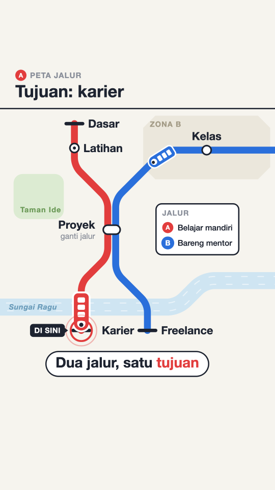

# Metro map

A transit (subway) diagram come alive: thick flat-colour lines that run only at 0°, 45° and 90° with generous round bends, white station discs with a dark ring, capsule interchanges, bar termini, line bullets, a legend box, a pale river band, park and zone tints, clean bold sans labels. Lines grow along their route at a steady speed, stations pop as the head passes, labels slide out from behind them, and a small train capsule with a headlight eye rides the line: it is the "now" of the story. An original, generic look: it copies no real city's map, line names, roundel or signage, and every name on it is passed in by the piece.

**The one rule: octilinear, flat, and the train is "now".** Every line segment is horizontal, vertical or at 45°; every fill is flat; the place the story has reached is wherever the train is.

Good for: narrated explainers about time and sequence in 9:16 — chronologies, roadmaps, stages of a journey, onboarding steps, "where we are now", histories with branches that split and rejoin.

Built from a written brief, not from measured reference frames: the palette, widths and timings are the brief's, tuned by eye on the demo.

## Palette and meaning (`MM` in kit.js)

| colour | hex | means |
|---|---|---|
| ground | `#f6f4ee` | the sheet; also the morph's paper and the title strip |
| ink | `#1d2330` | station rings, terminus bars, names, plates |
| muted | `#8a8f9a` | sub-labels, kickers, a station not reached yet (`future`) |
| red, blue, green, yellow, purple, orange | `#e23d3d` `#2a6fdb` `#1f9d63` `#f2b414` `#8a55c7` `#f07f2e` | the lines. One colour = one track of the story. The hero's line gets the strongest colour (red in the demo) |
| plan | `#d9d5c9` | a planned line: the route before it is built |
| water | `#cfe5f2` (dashes `#e9f3f9`, label `#6c9dbb`) | the river band: an obstacle or a boundary to cross |
| park | `#dcebd2` (label `#6c9a58`) | a rounded tint: a place to rest, a side topic |
| zone | `#ebe7dc` (label `#a39b86`) | a tint with 45° cut corners: a phase, a level, a group of stops |

A line colour means the same thing in the legend, the bullet, the keyword in the caption and the train. Yellow carries dark type (bullets switch by themselves) and is never a caption keyword.

## Type

- One clean system sans (`MM_SANS`: Helvetica Neue / Segoe UI / Inter / Roboto / Arial / Liberation / DejaVu). Bold 700 for station names, regular 400 for sub-labels, 800 for the headline and bullet letters.
- Station names 42 px, sub-labels 30 px, small labels (zones, parks, water, tags) 28 px tracked caps or italic for water; headline 66 px, caption 56 px. These are world units: under a camera at 1.15 they are 15% larger on screen. Keep names ≥ 38 px and small labels ≥ 28 px on screen.
- Labels are horizontal (`side: 'right' | 'left' | 'top' | 'bottom' | 'ne' | 'se' | 'nw' | 'sw'`) or at 45° (`tilt: true` with a diagonal side). A label never sits on a line: on a diagonal stretch use the free quadrant (`ne` / `sw` for a line running down-right).
- Line bullets: a filled circle in the line colour with one letter or number.

## Motion habits

- On 1s (`ones: true`), smooth and steady like a train. Nothing bounces except the small pop of a station.
- A line draws at constant speed with eased ends (`mmGlide`, 15% in and out); default speed 520 world px/s, or give `d`.
- A station pops (0.25 s, a small overshoot) exactly when the line's head passes it (`mmArrive`, `mmStationsOn`); its label slides out from behind it over 0.25 s.
- The train waits at a stop, eases out and eases into the next (`mmRide`), with a short squash on arrival. The line is laid a little ahead of it: the train never runs past the line's head.
- The camera glides with the train, looking about 90 px ahead (`mmFollow`), or pushes very slowly on a whole-map view.
- Idle life, always something: the "here" marker pulses twice a second, the river's dashes drift, a second train passes on another line, the legend's bullets tick in turn, the train blinks.
- Morph bridge: the station under the train swells into a big station disc; disc → capsule (or rounded square) → the next era opens through the same white band and dark ring.

## Frame checklist (on top of grammar/FRAME.md)

1. Every line segment is at 0°, 45° or 90° (`mmRoute` warns in the console when one is not); bends have a radius ≥ 2.5 line widths.
2. Lines sharing a corridor sit side by side with a hairline of ground between them; they never overlap along their length (crossings are fine).
3. Every station label is clear of every line and of every other label; nothing is cut by the title strip or the caption plate while it is held.
4. The train is in the frame and is the only train with the hero's colour and an eye that matters; a background train is shorter and on another line.
5. Stations the story has not reached are either not drawn yet or muted (`future`); the planned route is in `plan` grey.
6. One caption per era on its white plate, one keyword in a line colour; the title strip holds a kicker and a headline, nothing else.
7. The map area has at least one tint and the river or a second line, so the ground is not a blank sheet; no gradients, shadows or texture anywhere.
8. 9:16: routes run top to bottom, snaking with 45° jogs; what matters is inside x 60–940, y 250–1500.

## Kit API (`kit.js`, on top of `kit/core.js`)

Needs from the piece head: `W`, `H`, `FPS`, `CX`. Every reveal takes an absolute start time `t0`; all geometry is passed in as coordinates.

- Setup: `mmView(top, bottom)` first in every scene (the map window in screen px: map text scrolled under the title strip or into the caption band is not drawn); `mmGround()`.
- Tints: `mmWater(pts | route, w, { label, at, speed })`, `mmZone(x, y, w, h, { label, at, cut })`, `mmPark(x, y, w, h, { label, at })`.
- Routes: `mmRoute(points, { r, snap })` (waypoints → dense rounded path, validates and snaps angles), `mmPath([x0, y0], 'S 300', 'SE 200', …, { r })` (relative moves; a diagonal's number is the distance per axis), `mmOffset(path, d)` (a parallel copy for a shared corridor), `mmAt(path, frac)` → `[x, y, angle]`, `mmFracAt(path, [x, y])`, `mmLen`, `mmSub`.
- Lines: `mmLine(path, color, { t0, d | speed, from, to, ease, w, casing, frac })` → the head `[x, y, angle]`; `mmLineFrac(path, o, t)`, `mmArrive(path, frac, o)` (when the head gets there), `mmGlide` / `mmGlideInv`.
- Stations: `mmStation(x, y, { t0, name, sub, side, tilt, minor, terminus, ang, color, active, visited, future, size, dx, dy })`, `mmStationsOn(path, fracs, names, { line, … })` (pops each when the head arrives; returns their points and times), `mmInterchange(a, b, { t0, seed, name, … })`.
- Furniture: `mmBullet(x, y, r, color, char)`, `mmLegend(x, y, items, { title, t0 })`, `mmSign(x, y, text, color, { bullet, light, t0 })`, `mmYearTag(x, y, text, { side, t0 })`, `mmMilestone(x, y, n, color, { t0, label })`, `mmHere(x, y, { t0, color, label, side, spread })`.
- Hero: `mmTrain(path, frac, { color, squash, len, bg })`, `mmHero(x, y, r, { ang, … })` (both set `SPARK_AT` unless `bg`), `mmRide(stops, { travel })` → `{ frac, squash, at, moving }`.
- Camera: `mmFollow(path, frac, zoom, { to, ahead, lead, xk, yk })` → a camera for `pieceCam`.
- Captions (through `DEFER`, hidden during bridges): `mmTitle(kicker, headline, { bullet: [colour, char], at, band })`, `mmCaption('text with a *keyword*', { at, c, y, size })`.
- Bridge shapes: `mmDiscPts(x, y, r)`, `mmCapsulePts(x, y, w, h, r)`.

## With a voice-over

- One station per narrated beat. The line of narration that names a stage owns that station.
- Time the line's arrival to the word that names the station: give the station `t0: VW(line, word)`, or build the line's timing so `mmArrive` lands there (`mmStationsOn` with the same `line` options). A year tag or milestone pops on the word that says the year.
- Hold the train at the station while the line is spoken and travel during the pause between lines: `mmRide([[VW(l1, w1), f1], [VW(l2, w2), f2], …])` arrives on each word and leaves `travel` seconds before the next.
- Leave the bottom caption band free for subtitles: skip `mmCaption` (or keep it to one or two words) and set `mmView(top, 1340)` so map labels stay out of the band.
- 16:9: routes run left to right, with 45° jogs up and down; labels go `top` / `bottom` or tilted `ne`; follow with `mmFollow(path, frac, zoom, { yk: 0.5 })` (damp the vertical travel instead of the sideways one). The kit uses `W` / `H` / `CX` only, so the same helpers lay out a wide map.

## Do / don't

- Do lay out on a coarse grid (multiples of 20) and build routes with `mmPath`, so every bend is exact.
- Do draw the planned route in grey first: the viewer sees where the story is going, the colour shows how far it has got.
- Do give each era a different scale: a close ride (camera 1.1–1.25, following) and a whole-map view.
- Do keep 2–3 lines per frame; a legend once there are two.
- Don't use free angles, curves that are not bends, gradients, shadows, outlines on lines or texture.
- Don't put a label across a line, or rotate one to anything but 45°.
- Don't copy a real network: no real line names, colours-with-names, roundels or signage.
- Don't let the train run ahead of its line's head, or leave a frame without the train.
- Don't put more than about six stations in one 9:16 frame at zoom 1: names fall under 38 px or collide.

## Not matched / known weaknesses

- No reference frames were measured: proportions (ring 30% of the disc, bend radius 3 widths, corridor gap 4 px) are judgement, not measurement.
- Label placement is manual. The kit does not detect a label lying on a line or on another label; `tools/review.mjs` only catches text on text.
- `mmRoute` shortens a bend below 2.5 widths when a segment is too short for it, without warning.
- `mmOffset` gives a parallel copy by shifting points along the normal; on a tight bend with a large offset the inner copy can pinch. Offsets of one line width are fine at the default radius.
- A corridor is built by hand (two routes 30 px apart, or `mmOffset`); there is no network solver, and bends of parallel lines are only concentric when made with `mmOffset`.
- The train covers the station it stops on (at a path's ends it stops with its nose on the end instead, so the terminus bar shows on both sides of it).
- The train is a symmetric top-view capsule; it has no side view and no doors opening.
- Map text is in world units, so a zoomed-out camera shrinks the names; check the 38 px minimum yourself.
- The title strip is an opaque band: the map is hidden above y 428 on 9:16, and a station held just under it can look cropped.
- The disc → capsule morph lasts 0.4 s; there is a one-frame change where the era's window (ending under a white veil) becomes the bare bridge disc.
- Fonts differ per system (Helvetica Neue / Segoe UI / DejaVu): label widths change by a few percent, so leave slack beside labels.

## Proven on

`demo/` (6 s, 9:16, 120 BPM, 24 fps, every cue on the 8th grid; "Rute belajar desain", an invented roadmap): era 1 is a close ride at camera 1.15 — the red line grows from Dasar over the grey planned route, its head passing Latihan at 0.75 s and Proyek at 1.5 s (the stations pop, labels and BULAN tags slide out), the train leaving at 0.5 and 1.5 and stopping on the beats at 1.0 and 2.0, with a river, a park, a zone, a platform sign and a yellow cross line whose train passes behind; at 2.25 the station under the train swells into a big disc, which morphs at 3.0 s into an interchange capsule that opens onto era 2, the whole map — a blue line comes in from the right and reaches the interchange at 4.0 (the capsule opens), both lines run on to their termini by 4.75, the train leaves at 4.25 and arrives at Karier at 5.0, where the "DI SINI" marker lands and pulses; a legend whose bullets tick, a blue train, drifting water.

Results (run on the final build): `tools/tile.mjs` on frames 12 36 60 70 74 80 100 130 → `deterministic: true`. `tools/review.mjs`: cuts on grid PASS (0 hard cuts); morphs PASS (1 bridge at 3 s on the 8th grid); flat frames none; story arc PASS (2/2 rules); text PASS (0 cut-off/overlap, 0 in the safe zone); dead beats PASS (0 stretches over 3 s); sound −15.6 LUFS integrated, true peak −0.9 dBFS (0.1 dB over the −1 target), 0.1 s of silence before the loudest window at 3.0 s (the tool's note wants 0.5–4 s when a story has a turn). No voice-over piece and no 16:9 piece has been made with it yet.
