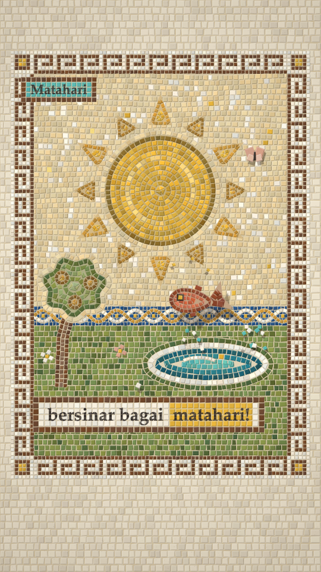

# Mosaic

An ancient floor or wall mosaic that is laid while you watch. Every picture is built from small hand-cut tesserae — slightly irregular quadrilaterals of stone and glass, 13–22 px at 1080 wide — with pale sandy grout between them. The tiles follow the form: one darker row traces a figure's outline, further rows fill inward along the contour (opus vermiculatum), and the ground behind it is laid in straight rows or in the scallop "fan" pattern (opus tessellatum). Each tile is a little off its area's colour, has a faint bevel (lit top-left, dark bottom-right), and a few are gold glass that glint when a slow band of light crosses the wall. The picture sits inside a meander border on a plain marble floor.

Pick it for history, geography, the sea, gardens, heritage and craft, "how something is built up piece by piece", calm educational pieces. It is pictorial: any outline can be tiled. Not for fast action, thin lines, long text or UI. It differs from `islamic-geometric` (star strapwork and zellige constructed by geometry, no pictures) and from `pixel` (a square low-res grid): here the tiles are irregular and run along the shapes.

**The one rule: everything is tiles, and tiles are laid, never faded.** A thing appears because its tesserae click into place one by one in row order; it leaves because they are lifted again. Nothing is a flat fill, a stroke or a gradient, and nothing cross-fades. What moves is a rigid group of tiles sliding over the floor.

## Palette and meaning (`MOS` in kit.js)

Earthy mineral colours: what stone, fired clay and glass can be.

| role | hex | use |
|---|---|---|
| morph paper | `paper #ece2cc` | the plain marble floor a morph happens on, and the floor outside the frame |
| grout / mortar | `grout #d8c8a6` | between all tiles; the bare bed before tiles are laid |
| under-drawing | `sinopia #a8543a` | the dashed sketch on the mortar of what is about to be laid |
| **hero** | `terra #c85f3c` | Sisik the fish. Terracotta is reserved for the hero. |
| light | `gold #e3b23c` | gold glass: the sun, eyes, studs, highlight panels, the tiles that glint |
| stone warm | `ochre #c9953c`, `sand #e2cc9c`, `marble #f3ecdc`, `rose #d9a48c` | fruit, rays, skies, shells, caption bands, petals |
| water | `teal #2c7c85`, `tealD #1d5a67`, `turq #5cb8b0` | seas and ponds; `turq` is the outer arc of every fan and a highlight panel |
| growth | `olive #7f8f4a`, `oliveD #566a39` | leaves, gardens, seaweed |
| structure | `lapis #27507f`, `umber #70492f` | borders and bands; trunks, rims, band edges |
| ink | `char #3b342f` | letters, an eye's socket (never pure black) |

A frame uses one ground colour family + the border colour + the hero's terracotta + two or three stone colours + gold. Rims are the fill colour deepened ~40% (`mosTone(c, -0.4)`), not black. Morph between neighbours a mason could swap tile by tile (marble → gold, sand → ochre, teal → olive).

## Tiles, grout and type

- **A tessera** (`mosMk`): four corners jittered ±1 px, lightness ±10% and a small warm/cool shift from the area's colour (seeded by the area's key), a 1.4 px lit line on the edges facing up-left and a dark one on those facing down-right. Grout gap ~2.2 px. Sizes: 17 px figures and grounds, 13 px borders, 11–15 px small figures and lines, 20 px caption bands, 24 px the plain floor.
- **Contour rows** (`mosFill`): a signed distance field of the outline on a ~3 px grid, iso-lines at ½, 1½, 2½ … rows traced by marching squares, tiles set along each loop with slightly varying lengths; the row height is the shape's inradius divided into whole rows, so the last row closes on the middle. The outline row takes `rim`, inner rows take `rows`; `halo` lays one row of the ground's colour around the outside so the figure is bedded into the ground. Under the tiles lies a mortar patch tinted 30% toward the fill, so any seam where rows meet reads as grout.
- **Lines** (`mosLine`): one to three rows along an open path — waves, stems, trunks, ribs.
- **Grounds** (`mosField`): `rows` (straight courses, alternate courses laid in opposite directions, optional gentle undulation and a second colour flecked in) or `fan` (overlapping scallops six rings deep, the outer arc in a lighter colour, each fan bringing its own mortar).
- **Bands**: `mosBorder` (meander, checker, dentil or wave on a tile grid, gold studs in the corners), `mosGuilloche` (two plaited wave rows with a gold stud in every eye).
- **Gold glass**: `gold: p` makes that share of an area's tiles gold. Once the area is laid they glint when the sweep band (`MOS_SWEEP`: start second, px/s, period) passes over them: two steps brighter and a small four-point star, stepping on 2s.
- **Type:** `MOS_SERIF` = `"Palatino Linotype", Palatino, "Book Antiqua", "Iowan Old Style", "Hoefler Text", Georgia, "Times New Roman", "DejaVu Serif", serif`, weight 700. The glyphs are cut into tesserae: sliced by grout lines every 0.2 em and toned cell by cell, so they read as inlaid stone up close and as plain sturdy letters at phone size. Captions 60 px in charcoal on a band of marble tiles inside an umber tile border (fully opaque); the highlighted word sits on an inlaid panel of light tiles (gold, turquoise, rose) — never a dark panel, pale letters drown in pale grout. Tags 46 px on a small gold or turquoise band.
- **Finish** (`STYLE.post`): static stone dust and a soft darkening toward the corners. No flicker: a wall does not boil.

## Motion habits

- **On 1s for the laying** (`ones: true`). Tiles land in list order at `rate` tiles per second from second `at`. A landing tile is in the air for two frames: lifted 10 px, 20% larger, its shadow thrown down-right, then settled. Rates that read as building: 300–600/s for a figure, 1000+/s for a big figure, ~8000/s for a full-frame ground (it sweeps down in ¾ s).
- **Order tells the story:** mortar and sinopia first, the ground, then the border and lines, then figures from the outline inward, then details (ribs, fruit, studs). Stagger starts by 0.1–0.25 s so there is always something being laid.
- **Movers are rigid groups on 2s** (`mosGroup` + `mosStamp`, time from `mosT2()`): the hero, a pearl, minnows. They slide, tilt and hop as one piece with a small shadow that moves away when they lift; they never re-tile. Loose chips (`mosChip`) do the small stuff: bubbles, drops, splashes, a butterfly's wings.
- **Idle life is stepped:** waves slide in 8 steps, seaweed leans left/right, a pond's ripple ring has 4 sizes, fountain drops walk along their arc, the hero's tail flips between two angles and its gold eye blinks.
- **Leaving:** tiles are lifted column by column (`out`, `outDur`). Captions and tags are lifted as a bridge starts and are not laid again until it is over.
- **Camera: none.** The wall stays still so tiles stay crisp; scale comes from what is laid. (The kit works under a camera transform, but settled tiles are bitmaps and soften when zoomed.)
- **Morph:** on the plain marble floor the bridge object is re-laid every frame as a medallion (rim + ring rows) in the blended colour; the windows before and after are edged by a dark row and a marble row of tiles laid around the hole.

## Frame checklist (on top of grammar/FRAME.md)

1. **Tiles are visible at phone size:** grout lines read in every area, and rows visibly run *along* each figure's outline. A shape that looks like a flat fill needs bigger tiles or a stronger rim.
2. **Every figure has a rim row** in a deeper tone and (on a tiled ground) a halo row in the ground's colour.
3. **Ground and figure differ in laying:** fans or straight rows behind, contour rows in front.
4. **There is a border** (meander or another band) around the picture and plain floor outside it.
5. **Something is being laid or moved right now:** a few tiles in the air with their shadows, or a rigid group mid-step — plus two or three stepped idle details.
6. **Terracotta belongs to the hero;** gold is light (sun, eye, glints, the highlighted word).
7. **The caption is one line on the marble band** inside x 60–940, y 250–1500, nothing overlapping it, with one word on a light inlaid panel; ≤ ~26 characters.
8. **Bridge objects are round-ish medallions** of similar proportions, clear of everything else at the bridge time.
9. **Tile sizes stay in family:** no area below ~11 px tiles (it turns to noise) and none above ~24 px.

## Kit API (`kit.js`, on top of `kit/core.js`)

- Palette, font, sweep: `MOS`, `MOS_SERIF`, `MOS_SWEEP { t0, v, per }`.
- Colour: `mosRGB(c)`, `mosCSS([r, g, b])`, `mosMix(a, b, u)`, `mosTone(c, k)` (k < 0 deeper, k > 0 lighter), `mosLum(c)`; all accept hex or `rgb()`.
- Helpers: `mosT2()` (time on 2s), `mosZoom()`, `mosCanvas(w, h)`, `mosPath(g, P, closed)`, `mosOffset(P, d, closed)`, `mosHashPts(P)`, `mosEntry(key, build)` (the cache).
- Laying options (every tiled helper takes them): `at` + `rate` (start second, tiles/s), `out` + `outDur` (lift it again), or `reveal` 0..1 + `land` (tiles in the air), `glint: false`. Each returns how much is laid (0..1). `mosLay(entry, o)` is the engine.
- **`mosFill(P, colour, { key, s, gap, rim, rimRows, rows: [colours] | (k, n) => colour, halo, haloRows, gold, vary, bed, nocache, …laying })`** — tile any closed outline with contour-following rows. Static outlines only.
- `mosLine(P, colour | [colours], { key, rows, s, gap, bed, …laying })` — rows along an open path.
- `mosChip(x, y, size, colour, { w, h, rot, key, at, lift, gold, vary })` — one loose tessera.
- `mosField(x, y, w, h, colour, { pattern: 'rows' | 'fan', key, s, c2, mix, c3, rings, wavy, gold, vary, bed, …laying })`.
- `mosBorder(x, y, w, h, { kind: 'meander' | 'checker' | 'dentil' | 'wave', s, c, c2, key, …laying })`, `mosBorderW(o)` (band thickness), `MOS_PAT` (the patterns), `mosGuilloche(x, y, w, { s, c, c1, c2, key, …laying })`.
- Floor and bed: `mosFloor(c)`, `mosFloorCv()`, `mosBed(x, y, w, h)`, `mosSketch(P, { closed, c, w, al })`.
- Rigid groups: `mosGroup(key, w, h, ox, oy, draw)` (draw once, world point (ox, oy) at the centre), `mosStamp(group, x, y, { rot, flip, lift, shadow })`, `mosPut(group, x, y, rot, flip, shadow)`.
- Hero: `mosHero(x, y, r, { key, flip, tilt, lift, mood: 'smile' | 'wow' | 'happy', tail, c, eye })` — Sisik; (x, y) the body centre, r half its length; sets `SPARK_AT`. `mosHeroPts(x, y, r)`, `mosFishBody(r)`, `mosFishTail(r)`. With `c` and `eye: false` it is any other fish.
- Props: `mosMedallion(x, y, r, c, o)` (pearl, sun, fruit), `mosMedRows(c)`, `mosDiscPts(x, y, r)`, `mosRays(x, y, r, { n, len, w, at, step, rate, key })`, `mosWave(x0, x1, y, { amp, len, c, dir, key })`, `mosWavePts(x0, x1, y, amp, len)`, `mosShell(x, y, r, { key, halo, at, rate })`, `mosShellPts(x, y, r)`, `mosSeaweed(x, y, h, { n, key })`, `mosBubbles(x, y, { n, rise, speed, from, key })`, `mosStar(x, y, r, o)`, `mosTree(x, base, { x, y, r }, { key, halo })`, `mosCrownPts(cx, cy, r, key)`, `mosPond(x, y, rx, ry, { key, halo, ripple, rx0 })`, `mosJet(x, y, h, { w })`, `mosSplash(x, y, tSinceImpact, { n, c, key })`, `mosFlutter(x, y, s, { c, key })`.
- Type: `mosFont(size)`, `mosTextW(str, size)`, `mosText(str, x, baseline, size, colour, { align })`.
- Captions (through `DEFER`): `mosCaption('words *highlight* words', { y, x, size, at, field, edge, hi, col })`, `mosTag('Label', { x, y, size, at, c, edge, col })`; `mosBridgeTimes(at)` gives when they may be laid and when they are lifted.
- `STYLE`: `paper` marble, `backdrop` (the plain tiled floor in any colour), `window` (clip + two rows of tiles around the hole), `blob` (the outline re-laid as a medallion), `hero`, `heroColor`, `heroPts`, `post` (dust + corner shade), `ones: true`.

## Do / don't

- **Do** give every area a stable `key`: the cut of its tiles is seeded by it and must not reshuffle.
- **Do** build a picture in the mason's order and let the laying carry the timing: start times and rates are the animation.
- **Do** bed figures into the ground with `halo` and outline them with `rim`.
- **Do** make anything that moves a `mosGroup` (painted once) or a handful of `mosChip`s.
- **Do** keep bridge objects medallions; `mosMedallion` and the morph blob share their ring rule, so the hand-over is seamless.
- **Don't** call `mosFill` with an outline that changes every frame: each new outline is a new distance field and a new cache entry (the morph blob does it on purpose, for ~10 frames, with `nocache`).
- **Don't** fade, blur, glow or draw strokes; no `shadowBlur`, no filters, no per-pixel loops per frame.
- **Don't** put pale text on a dark tile band, or set more than one short line.
- **Don't** zoom the camera in on settled tiles, and don't shrink tiles below ~11 px to get detail: make the thing bigger instead.
- **Don't** tile very thin shapes with `mosFill` (under ~1.5 tiles wide): use `mosLine` or chips.

## Not matched / known weaknesses

- Built from the conventions of Roman and Byzantine mosaics, not measured from one reference.
- Where a shape's width is not a whole number of rows, rows from two sides meet in a seam: tiles overlap or a sliver of mortar shows. Real mosaics have such seams; here they are not trimmed.
- Fan tiles at a fan's lower edge are overlapped by the next fan rather than cut to fit.
- Letters are system glyphs sliced into tesserae, not letters built from rows of tiles; the face varies by platform. `tools/textcheck.mjs` cannot see them (they are drawn through small offscreen canvases), so captions must be checked by eye.
- The first frame of each era costs 100–150 ms once (tile lists and canvases are built); after that frames are 5–35 ms. Jumping backwards in time repaints an area's settled layer from its first tile.
- The morph itself is plain: one medallion on an empty floor for ~0.4 s, its tiles reshuffling a little each frame as the outline changes.
- Shrink/grow backdrops blend the floor's colour continuously (the renderer's doing): the one place something is not laid.
- The hero's moods are limited by a one-tile eye: mood shows in tilt, tail and thrown gold chips.
- The demo does not loop seamlessly (the last frame is the garden, the first the bare mortar).

## Proven on

Its demo only. `demo/` (6s, 9:16, 120 BPM, 24fps): inside a lapis meander frame a teal sea in the fan pattern is laid over the mortar and its sinopia sketch; two waves, seaweed, a starfish and a scallop shell with a pearl are laid in; pale minnows cross, bubbles rise; Sisik swims in, nudges the pearl and it rises out of the shell — tag "Laut", caption "Sebutir *mutiara* di laut". At 3.0s the marble pearl is re-laid as a golden sun medallion over a sand sky, a plaited band and an olive garden in an umber frame: twelve rays are laid one after another, three fruit ripen on the tree, flowers are set, a butterfly flutters, a fountain plays, the gold glints, and Sisik leaps out of the pond twice with a splash — tag "Matahari", caption "bersinar bagai *matahari!*".
