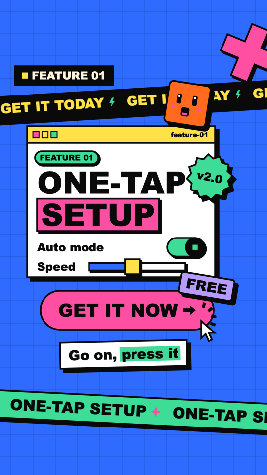

# Neo-brutal

Neo-brutalist web and product design in motion: the loud, sticker-like look of indie and creator-economy product launches. Everything in the frame is an **object**: a flat, fully saturated block with a thick pure-black border and a hard black shadow knocked down and to the right. Cards, pill buttons that sink into their own shadow, seal badges and stickers a few degrees off, marquee strips of repeated words crossing the frame at an angle, a window chrome with three square dots, fat toggles and sliders, blunt pictograms, and very heavy grotesk type, some of it on highlighter blocks. It is deliberately "undesigned": things overlap, tilt and butt against the frame edge. Nothing is shaded, blurred, textured or transparent.

Pick it for product launches, feature announcements, changelogs ("v2.0 is live"), pricing and call-to-action beats, app and tool explainers, creator promos, anything that should feel loud, cheap-and-cheerful and confident. Not for calm, premium or corporate moods (use `glass` or `line-art`), not for stories that need scenery, depth or characters with bodies, not for anything that should feel hand-made.

**The one rule: every element is a block with the same black border and the same hard shadow. If something has no border, a soft edge, a gradient or a blurred shadow, it is not in this style.**

## Palette and meaning (`NB` in kit.js)

| name | hex | use |
|---|---|---|
| `ink` | `#0a0a0a` | every border, every shadow, almost all type, black strips and the kicker slab |
| `cream` | `#fff4e0` | the default ground and the morph's blank sheet (`STYLE.paper`) |
| `white` | `#ffffff` | card and window bodies, the caption slab, the cursor, type on blue or black |
| `pink` | `#ff4fa3` | the call to action, the main highlighter block |
| `yellow` | `#ffe14a` | a loud ground, window bars, the caption's highlight, type on black strips |
| `blue` | `#2f6bff` | a loud ground, strips, slider fill (type on it is white) |
| `mint` | `#3ddc97` | "on" and "new": toggles, seals, tags |
| `lilac` | `#b79cff` | secondary stickers and pictograms |
| `hero` | `#ff6a1f` | **orange, reserved for the mascot.** Never spent on a button or a sticker |

- A ground is **one** flat colour (cream, or one loud bright) with a coarse black pattern at low density: square dots on a 60 px staggered grid at 20 % (`dots`), or 3 px graph-paper lines every 90 px at 13 % (`grid`). The pattern may march linearly.
- A frame uses black, the ground and 3–4 brights. Neighbours must clash: never put a block on a ground of its own colour (a ground change mid-piece has to be checked against every block on it).
- Type is black on cream, white, yellow, pink, mint and lilac; white on blue and black (`nbOn(c)` picks). Yellow type is for black strips only.
- Colours given to the renderer (`ERA_BG`, bridge shapes' `c`, `heroColor`) are these 6-digit hexes.

## Border and shadow geometry

Measured at 1080 wide; both are **screen** pixels and stay constant under any camera (`nbZoom()` divides them out), and under a sticker's slap-on scale.

| what | value |
|---|---|
| border | `NB.bw` = 7 px, pure black, mitred joins, square caps; the same on a 60 px tag and a 760 px card |
| hard shadow | `NB.sh` = 14 px down and 14 px right: the same outline, solid black, zero blur, no spread. It always falls down-right on screen, whatever the block's own rotation |
| small parts | tags, icons, highlighter blocks, toggles: shadow 0.5–0.7 x (7–10 px), border unchanged |
| the hero, morph window, morph blob | border 1.4 x, shadow up to 22 px (they are the biggest things in frame) |
| corners | square by default; cards may take 0–14 px, stickers 10 px, pills `h / 2`. Never a soft "friendly" radius on a big card |
| press | a pressed block translates by `press x NB.sh` along the shadow; the shadow stays put, so at `press = 1` it is fully covered |
| rotation | stickers ±6–12 degrees, type and highlighter blocks ±1–2 degrees, marquee strips ±3–5 degrees, containers that hold UI 0 |
| type | `"Arial Black", "Helvetica Neue", "Segoe UI Black", "Segoe UI", Impact, "Liberation Sans", "DejaVu Sans", Arial, sans-serif` at weight 900; headlines 120–220 px, button labels 60–80 px, captions 56 px, UI labels 40–46 px; cap height 0.716 em (`NB_CAP`) centres a line in a block |
| piece options | `const NB_BW = 8, NB_SH = 16;` before the kit (e.g. `src/options.js` in piece.json `"build"`) changes both everywhere |

## Motion habits

On 1s (`ones: true`). Snappy and physical; nothing fades, nothing eases gently. **Cue times are the moment of impact**: a thing lands, sticks or bottoms out ON the cue, so the sound for it goes on the same time.

- **Slam** (`nbSlam(t, from)`): a block comes from off-frame in 0.17 s (4 frames), accelerating, stops dead at `t`, carries ~16 px past and snaps back within 3 frames. Headlines, cards, strips, buttons and captions arrive this way, from the nearest frame edge.
- **Slap** (`nbSlap(t)`, or `o.at` on stickers, seals, tags, buttons and the hero): the sticker is big (1.9 x) and twisted two frames before, is at size on `t`, then its rotation wobbles out in about 0.3 s.
- **Press** (`nbPress(times)`): half down the frame before the beat, fully down on it, held 3 frames, released in 2. A press is answered: 3–5 short ticks (`nbTicks`), the mascot's mouth, a sticker, or a hard cut of the ground colour.
- **Marquees scroll linearly** and never ease, stop or reverse. Two strips in one frame run in opposite directions at slightly different speeds and angles.
- **Notches, not glides:** seals turn one notch per beat (`nbStep`), status dots blink on the 8th, the mascot's mood switches in one frame. Toggles snap with a stiff spring (`springEase(TT - t, 320, 20)`); sliders fill linearly.
- **Ground colour changes are hard cuts** on a beat, timed to an impact (a landing, a press).
- **Bridge:** the old frame is seen through a bordered block with a hard shadow shrinking onto the object; the block changes shape and colour, tips 4 degrees and its shadow deepens; the new frame opens out of the counterpart. Captions and the kicker hide for the bridge.
- **Idle life:** the pattern marching, strips scrolling, a seal ticking round, the kicker's dot blinking, the mascot bobbing and blinking.

## Frame checklist (in addition to `grammar/FRAME.md`)

1. **Border and shadow on everything.** Each object has the 7 px black border and the 14 px hard shadow, falling the same way. Nothing floats without them except type set directly on the ground and the ground's pattern.
2. **Flat and saturated.** No gradients, blur, glow, transparency, grain or texture. The ground is one colour.
3. **One call to action per frame** and it is the largest coloured block after the headline; the mascot's orange appears nowhere else.
4. **Objects, not only words.** At least three kinds of object in frame (e.g. a card, a button, a sticker, a strip). A frame of type alone belongs to `kinetic-type`.
5. **Two or more things are off-axis and two things overlap.** One element is cut by the frame edge. But UI that must be read (a card's rows, a button label) stays level.
6. **Hierarchy survives the noise:** one headline (the biggest type), then the button or card, then stickers. Stickers never cover a label, a control or the button's text; check every sticker's landing spot.
7. **Text is legible:** heavy type at 40 px or more for UI labels, 56 px for captions, black on a bright or white block; no type directly on a blue or black ground without its own block.
8. **Marquee strips cross the whole frame** (they are 1.7 frame widths long) and their text is decoration: nothing the viewer must read lives only on a strip.
9. **Something lands on the beat** in every half second: a slam, a slap, a press, a ground cut.
10. **Phone-safe:** the headline, card, button and caption sit inside x 60–940, y 250–1500; only strips, big seals and pictograms may live outside it.

## Kit API (`kit.js`, on top of `kit/core.js`)

Containers take a **top-left corner**; objects take their **centre**. Needs `CX` (caption centre x) from the piece head.

| helper | what it draws / returns |
|---|---|
| `NB`, `NB_FONT`, `NB_CAP` | palette, border and shadow sizes; the type stack; its cap height in em |
| `nbBox(x, y, w, h, c, o)` | **the primitive:** a block with border and hard shadow. `o`: `r`, `rot`, `press` 0..1, `s`, `sh`, `lw`, `shc`, `line`, `draw(w, h)` (content in the block's own frame, clipped unless `clip: false`) |
| `nbShape(P, c, o)` | any outline as a block (the morph blob, pictograms). `o`: `sh`, `lw`, `press`, `join` |
| `nbStrokes(L, wd, c, o)` | open polylines as blocks: a colour core, a black rim, the shadow (asterisk arms, a tick) |
| `nbText(str, x, y, size, color, o)` | heavy type, `y` = baseline; returns the width. `o`: `align`, `rot`, `maxW`, `hl` (a bordered highlighter block), `hlSh`, `hlPad`, `stroke` (black outline + hard shadow on the letters) |
| `nbTextW(str, size)`, `nbFont(size)`, `nbOn(c)` | measure; set the font; black or white for a ground colour |
| `nbButton(x, y, w, h, label, c, o)` | a pill (or `pill: false`, `r`) with a label; `o`: `press`, `icon`, `size`, `tc`, `rot`, `at` |
| `nbSticker(x, y, label, c, o)` | a label block sized to its text, tilted; `o`: `at`, `rot`, `size`, `icon`, `tc`, `r`; returns its width |
| `nbBurst(x, y, r, label, c, o)` | a seal badge with `n` shallow points that turns a notch per `turn` seconds; `o`: `at`, `rot`, `n`, `depth`, `sub`, `size` |
| `nbTag(x, y, label, c, o)` | a small pill or slab label; `o`: `dot` (a square status dot), `size`, `r`, `at` |
| `nbToggle(x, y, w, on, c, o)` | a fat track (w x w/2) and a round black knob; `on` 0..1 |
| `nbSlider(x, y, w, frac, c, o)` | a fat track filled to `frac` with a square thumb (`y` = centre line) |
| `nbWindow(x, y, w, h, o)` | a browser-ish window: title bar, three square dots, a rule, a body; `o`: `title`, `c`, `barC`, `bar`, `dots`, `rot`, `press`, `draw(w, bodyH)` |
| `nbMarquee(y, h, str, c, o)` | a strip of repeated words across the frame; `o`: `rot`, `speed` (px/s, sign = direction), `tc`, `sep`, `sepC`, `dx` / `dy` (a slam offset) |
| `nbIcon(kind, x, y, r, c, o)` | `arrow`, `bolt`, `cursor` (x, y = its tip), `star`, `plus`, `asterisk`, `check`, `smiley`; `o`: `rot`, `flat` (no border: inside a button), `sh`, `press` |
| `nbTicks(x, y, r, t, o)` | 3–5 short fat ticks for 0.2 s after a hit at `t` (a click registers); `o`: `n`, `a0`, `a1` |
| `nbPattern(kind, o)`, `nbGround(c, o)` | the ground's pattern (`dots`, `grid`, `plus`, `none`; `dx` / `dy` march it); a flat ground with its pattern |
| `nbHero(x, y, r, o)`, `nbHeroPts(x, y, r)` | the mascot: an orange smiley block (`r` = half its side); `o`: `mood` (`happy`, `wow`, `wink`), `look`, `rot`, `bob`, `press`, `at`; its outline for bridges |
| `nbSlam(t, from, o)` | `[dx, dy]` for a block landing at `t` from `'l' 'r' 't' 'b'`; `o`: `d`, `dist`, `over` |
| `nbSlap(t)`, `nbPress(times)`, `nbStep(per)` | `{ s, rot }` for a slap landing at `t`; the press envelope 0..1; an integer that ticks every `per` seconds |
| `nbCaption('Say hi to *v2.0*', o)` | DEFER: a white slab at the bottom of the safe area; the part between `* *` sits on a highlight; `o`: `at`, `y`, `hl`, `size` |
| `nbKicker('LAUNCH DAY', o)` | DEFER: the black top-left tag; `o`: `at`, `dot` (a blinking square), `x`, `y` |
| `nbInBridge()`, `nbZoom()` | inside a morph bridge?; the current zoom (constant borders) |
| `STYLE` | `backdrop` = a flat ground with dots; `window` = a bordered block with a hard shadow; `blob` = a block that tips mid-morph; `hero` / `heroPts` / `heroColor` = the mascot (`SP(x, y, r)` bridges); `post` = nothing; `ones: true` |

## Do / don't

**Do**
- Build every frame from blocks: if you need a new object, draw it with `nbBox` / `nbShape` so it gets the border and shadow for free.
- Land things on beats and give each landing a sound on the same cue.
- Let strips, seals and pictograms run off the frame; keep what must be read inside the safe area and level.
- Hold the mascot still (`bob: 0`) for the last 0.4 s before a bridge that starts from it, and keep stickers off the bridge object.
- Change the ground by hard cut, on an impact.

**Don't**
- No gradients, blur, soft or coloured-glow shadows, transparency, grain, paper texture, 3D.
- No thin lines: nothing lighter than the 7 px border, except the ground pattern.
- No halftone dots, speech bubbles, speed lines or sound-effect words (that is `comic`); no posters of pure geometry on a modular grid, no overprint (that is `bauhaus`); no frames made only of words (that is `kinetic-type`).
- No real brand names, logos or recognisable product UIs.
- Don't ease marquees, fade anything in, or let a sticker cover a control or a label.
- Don't spend the mascot's orange on anything else.

## How it differs from the closest shipped styles

- **comic** shares thick black outlines and a hard shadow on lettering, but its world is a printed page (panels, Ben-Day dots, bubbles, bursts holding sound words). Here the objects are interface parts and stickers, fills are perfectly flat, and the shadow is on every block, not only on type.
- **bauhaus** is flat geometry too, but unbordered, composed on a grid, with overprinting inks and restraint. Neo-brutal is bordered, shadowed, tilted and crowded.
- **kinetic-type** is type as the only actor. Here type is one object among cards, buttons and stickers.
- **flat-vector** is soft, borderless and friendly; this is hard-edged and loud.

## Not matched / known weaknesses

- Made from a written brief, not measured against reference frames: the border, shadow and palette numbers are chosen, not sampled.
- The hard shadow is an offset copy (like a CSS `box-shadow`), not an extruded slab: at the two off corners there is a notch rather than a diagonal face.
- `nbToggle`'s knob and the `smiley` pictogram are drawn without their own hard shadow.
- Marquee text is rasterised once into a strip canvas and tiled, so it does not stay crisp under a camera zoom much above 1.5 x, and `tools/textcheck.mjs` does not see it (a strip is cut by the frame on purpose).
- `nbText` draws nothing while its text is wholly off-frame (mid-slam); a slam sampled part-way across the frame edge can still be reported by textcheck as cut off.
- The morph resamples outlines by angle, so the window and blob show slightly rounded corners during a bridge even between two square blocks.
- Type depends on the machine's heavy grotesk (Arial Black on macOS and Windows; Linux falls back to bold Liberation / DejaVu Sans, which is lighter and wider). Layouts use `maxW` where a line must fit.
- Only 9:16 was built; the helpers take absolute pixels (use `LX` / `LY` / `UNIT` in a piece for other formats). No camera move was tested in the demo.
- The demo's true peak is -0.9 dBFS (the kit's limiter), a hair over review.mjs's -1 guide.

## Proven on

Its demo only (`demo/`: 6 s, 1080x1920, 24 fps, 120 BPM; two eras on cream and blue with hard ground cuts, one block-to-card morph at 3.0 s, the mascot, two captions, a synthesized percussive score). `tools/tile.mjs` prints `deterministic: true`; `tools/review.mjs` passes cuts, morphs, story arc, text and dead beats.
