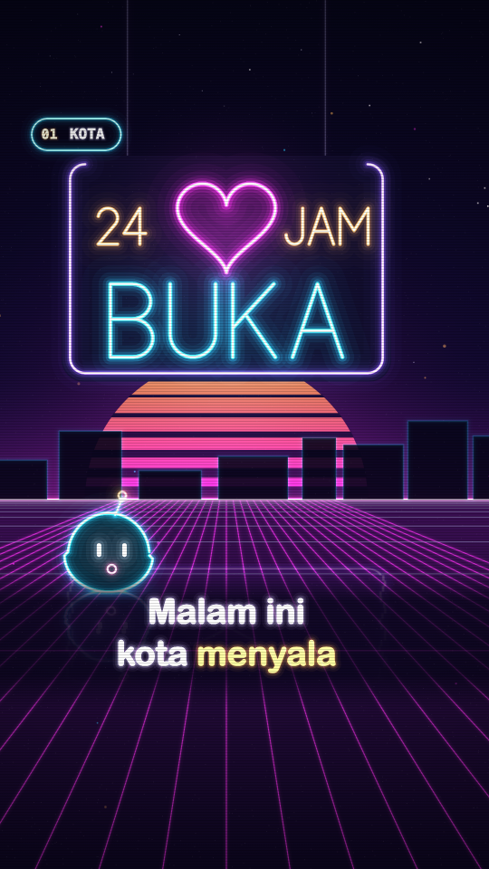

# Neon

Neon signs at night over a synthwave floor: a deep blue-black sky with stars, a striped gradient sun sitting on a glowing horizon, a magenta (or cyan) perspective grid scrolling toward the camera, a dim skyline with blinking windows — and everything that matters drawn as **glowing glass tubes**: a wide soft coloured halo, a saturated tube, a white-hot core. Sign lettering is a **single-stroke tube alphabet** (one bent tube per stroke, not an outlined font). Signs hang on wires from dark backboards and **power on with a stutter**, letter by letter. A wet floor mirrors them in fading, rippling rows. Scanlines, a vignette and a little grain sit on top. Motion on 1s.

**The one rule: light is made only of tubes.** Every drawn subject is a stroked line (halo + colour + white core, added with `lighter`), never a flat bright fill. Fills exist only as dim coloured glass (≤ 0.2 alpha) or dark backboards behind tubes.

## Palette and meaning (`NEO` in kit.js)

| role | hex | use |
|---|---|---|
| ground / paper | `ground #07061a` | the night; morph paper |
| sky band | `groundT #130a33` | the sky's lighter middle; the second era's ERA_BG |
| floor at the horizon | `horizon #3a0f52` | the floor gradient's top |
| **magenta** | `mag #ff2bd6` (`magD`) | the grid, hearts, the main sign shape |
| **cyan** | `cyan #22e6ff` (`cyanD`) | the hero (Volt), lettering, the second grid |
| violet | `violet #8a5cff` (`violetD`) | sign frames, records, the skyline |
| **amber accent** | `amber #ffb238` (`amberD`) | the highlighted caption word, HUD numbers, the antenna lamp, lit windows. One focus per frame. |
| pink | `pink #ff5c8a` | the horizon line, the hero's mouth, the sun's middle |
| core | `white #fff4fb` | tube cores, eyes |
| text | `ink #e9e4ff`, `inkD #8d86b8` | caption words; unlit tubes and wires |

A frame uses ground + two of magenta / cyan / violet + amber for the one accent. Magenta → violet morphs stay vivid (avoid magenta → cyan: the straight RGB mix goes lavender-grey).

## Line and glow

- `neoTube(P, c, { w, on, closed, core, halo, soft })`: `P` is one polyline or a list of polylines (stroked as one path, so crossings and joints do not add up twice). A cored tube gets five halo strokes at 14×, 9×, 5.8×, 3.7×, 2.3× the width (alpha 0.018 → 0.17, a long soft falloff) + the saturated line + a pale sleeve at 0.68× + a white core at 0.36×. Tubes with `core: false` (grid, grooves, skyline) and everything inside a reflection use the cheap three-stroke halo (7.5×, 4.4×, 2.5×). Widths are **screen-constant** under the camera (divided by zoom). Sign tubes 6–10px, details 3–5px, the grid 2.2px without core.
- Round caps and joins always. No blur filters, no `shadowBlur` — the halo is layered strokes, so it is deterministic and cheap.
- An **unlit** tube (`on < 0.2`) is dull grey glass (`inkD`), not invisible: signs read as objects before they switch on.
- Glow pools (`neoGlow`): radial gradient, additive, under lit signs and under the hero on the floor.
- Type: `NEO_SANS` = `"Arial Rounded MT Bold", "Varela Round", "Nunito", "Segoe UI", "Helvetica Neue", Arial, "DejaVu Sans", sans-serif`, weight 800. T1 sign words are **single-stroke tube capitals** from `NEO_GLYPHS` (A–Z, 0–9, `. , : · - + ! ? / '` and space; lower case is drawn as capitals; any other character falls back to a light weight of the sans) through `neoSignWord` / `neoText(..., { tube: true })`, 150–220px on signs (cap height = 0.72 × size, tube 8–9px). T2 captions 76px glowing filled sans over a dark band, the one highlighted phrase in the same bold sans and case, in the accent colour with its glow (`hot: 0.22` keeps it saturated). Tube capitals are for sign words only; keep them ≥ 100px with a tube ≥ 8px so they read at phone size. Tags and HUD labels in `NEO_MONO` 30–34px.

## Motion habits

- On 1s (`ones: true`). `export.mjs --blur` is possible but not needed: flicker reads better crisp.
- **Power-on stutter** (`neoPower(t0, key, dur)`, pattern in `neoFlicker(u, key)`): off → over 0.3–0.5s the tube catches like a real one: a short flash, dark, a second flash, dark, then it holds and warms from 60% to full (gap lengths seeded per key, so letters differ) → on with a faint 7 Hz hum and a rare two-frame dip. It depends only on `TT` and the key. Stagger letters a 16th note (0.125s at 120 BPM), caption words 0.09s. Captions and tags do not dip once lit. Put power-on cues on the 8th-note grid so the buzz-zaps land with the music.
- The grid floor scrolls toward the camera continuously (`speed` 0.9 calm, 2.0 on a beat section). Stars twinkle, windows blink at 1.5 Hz, dust drifts up.
- Characters: the hero bobs (idle), blinks every ~3.1s, hops with a squash on landing; in a music beat it bobs on every beat.
- Values pulse on the beat (`neoEQ` bars, `every: BEAT`).
- Camera: a slow ≤ 4% push inside an era; after a morph the new era opens 10% close and settles on a slow spring. Never shake.
- Morph: the window rim is a tube of the bridge colour that stutters on as the new era grows; the blob is dim glass + a tube + a faint echo ring.

## Frame checklist (on top of grammar/FRAME.md)

1. **Everything bright is a tube** with a halo and a white core; no flat bright fills. Lettering is one tube per stroke: no double-line outlined letters.
2. **Dark wins:** ≥ 60% of the frame is near-black ground; glow is precious.
3. **A horizon and a floor** anchor the frame (grid or reflection); the hero stands on the floor with a light pool and a reflection.
4. **One amber accent** (the caption highlight or one HUD number); the rest magenta / cyan / violet.
5. **Something has just powered on or is pulsing** in every held frame (stutter, hum, grid scroll, EQ).
6. **Captions sit on their dark band** in the safe area (x 60–940, y 250–1500), ≤ 2 lines, one highlighted phrase.
7. **No mirrored text** under captions: reflect shapes, not words.
8. Scanlines + vignette + grain in post on every frame.

## Kit API (`kit.js`, on top of `kit/core.js`)

- Palette: `NEO`, `NEO_SANS`, `NEO_MONO`.
- Geometry: `neoPath(P, closed)`, `neoCirclePts(x, y, r, n, a0, a1)` (arc if a0/a1 given), `neoHeartPts(x, y, r)`, `neoRRectPts(x, y, w, h, r)`, `neoCentroid(P)`, `neoZoom()`.
- Light: `neoTube(P, c, o)`, `neoGlow(x, y, r, c, a)`, `neoFill(P, c, a)`, `neoPower(t0, key, dur)`, `neoFlicker(u, key)` (the switch-on pattern for u 0..1).
- World: `neoGround({ hy, sun: { x, r, on }, speed, gridC, vx, stars, key, haze })` (`haze` = the additive glow over the horizon, default 0.3), `neoSkyline(hy, key, { min, tall, fill })`, `neoReflect(floorY, draw, a, { stretch, len, ripple })` (draws `draw()` mirrored into a scratch canvas, then adds it below the floor line in 12px rows that fade over `len` and wobble by `ripple`; call it **before** drawing the object itself; `draw` must not draw text), `neoSignBoard(x, y, w, h, c, on)`.
- Type: `neoFont`, `neoTextW`, `neoText(str, x, y, size, c, { on, tube, w, track, align, base, weight, fam, hot })` (`tube: true` = tube capitals), `neoTubeW(str, size, track)` (a tube word's width), `neoSignWord(str, cx, y, size, c, t0, { key, stagger, dur, w, track, unlit })` (letters hang as dull glass before they catch; `unlit: false` hides them), `NEO_GLYPHS`, `neoArc`, `neoTubeLay`, `neoTubeDraw`. Tube words are reported to the text check through an invisible `fillText` of the same box (`neoTextMark`).
- Hero: `neoHero(x, y, r, { key, on, look, mood: 'smile' | 'wow', squash, bob, c })` — Volt, a cyan gumdrop tube robot with an amber antenna lamp; (x, y) its centre; sets `SPARK_AT`. `neoHeroPts` (bridge outline).
- Life: `neoDust(key, n)`, `neoNote(x, y, s, c, on)`, `neoEQ(x0, x1, yBase, n, hMax, t0, { every })`.
- Captions (through `DEFER`): `neoCaption('line one\nline *highlight*', { y, size, at, hi, c })`, `neoTag('01', 'LABEL', { c })`; both fade during the first 0.3s of a bridge's shrink (`neoLeaving()`).
- `neoPost()` (scanlines, vignette, grain).
- `STYLE`: `paper` ground, `backdrop` flat fill, `window` (clip + a tube rim in the bridge colour, catching over the first 30% of the grow phase), `blob` (glow pool + dim glass + echo ring + tube), `hero` (Volt), `heroColor` cyan, `heroPts`, `post` neoPost, `ones: true`.

## Do / don't

- **Do** show signs unlit first (dull glass), then stutter them on — the switch-on is the style's best moment; give it a buzz-zap in the score.
- **Do** hang signs (wires, backboard) and stand things on the wet floor so the glow has a world.
- **Do** keep the grid faint near the horizon and brighter toward the camera.
- **Don't** fill shapes with bright colour, or use blur/shadowBlur (slow and non-deterministic across GPUs).
- **Don't** put every colour in one frame; pick two tube colours + amber.
- **Don't** reflect text (the text check flags mirrored strings, and it muddies captions).
- **Don't** use the shared city generator inside a conditional (a blinking window that draws a random number shifts every building after it); give blinking things their own `RNG` key.
- **Don't** morph magenta into cyan (grey midpoint) or a round sign into a long thin bar.

## Not matched / known weaknesses

- Built from the genre's conventions, not measured from a specific reference.
- No chromatic aberration (a second offset pass would double the cost); scanlines carry the "screen" feel.
- The tube alphabet is capitals, digits and a few marks only, upright and geometric: no lower case, no accented letters, no connected script. Characters outside it fall back to a light weight of the system sans, which varies by platform.
- A sign hung high reflects far down the floor, mostly under the caption band; only the hero, the equalizer and the lower rim of big shapes reflect visibly.
- During the shrink of a morph the iris cuts through the sign's letters for a few frames.
- Era drawing is ~50–80 ms/frame (many additive strokes plus the reflection pass), about 20% more than before the soft halo; a long piece takes proportionally longer to export.

## Proven on

`demo/` (6s, 9:16, 120 BPM, 24fps): over a magenta grid and a striped sun behind a dim skyline, a sign hung on wires hangs unlit as dull glass, then catches — a pink heart, "BUKA" letter by letter in tube capitals, then "24 JAM" in amber beside the heart — over a striped sun and a low skyline, while Volt powers up and hops; at 3.0s the heart morphs into a spinning vinyl record on a cyan grid, a tonearm swings in, an equalizer pumps on every beat, notes float up and Volt bobs to the beat. Every cue sits on the 8th-note grid. Tile deterministic; review: cuts/morph on grid, text PASS, story arc PASS, -15.0 LUFS, true peak -1.0 dBFS.
