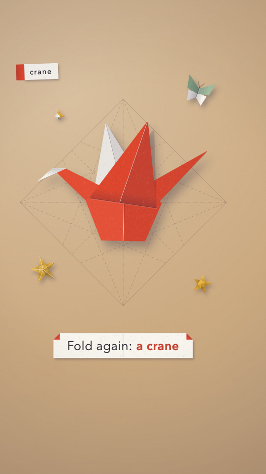

# Origami

Folded paper models photographed on a plain tabletop. Every subject is a **small number of large flat paper facets** (6–20, never hundreds) that meet along straight creases. What makes it paper and not a 3D render: each facet is one flat tone of its paper colour, lighter or darker only by which way it leans from one soft light; creases show as a thin dark valley line or a thin light mountain ridge; the paper has **two sides**, a coloured face and a white reverse, and the reverse shows wherever a flap is folded over; facets carry faint fibres and a very soft gradient beside a fold; the model casts **one** soft contact shadow. The table is a calm matte colour with a lot of empty space and may carry a faint crease-pattern diagram and fold arrows, as in folding instructions.

Pick it for making and building, step-by-step explanations, "from one simple thing, many things", patience, craft, gifts, wishes, Japan, paper, geometry and symmetry, transformation stories. Not for crowds, landscapes, faces and acting, soft or liquid things, or anything that needs detail smaller than a facet.

Different from its neighbours: **low-poly** is a dense triangle mesh for landscapes with atmospheric perspective, and its facets flip in; here the facets are few, large and deliberately shaped, the paper is two-sided, the creases are drawn, the subject sits alone on a table, and the motion is folding. **cut-paper** is torn flat shapes with drop shadows and crayon; here nothing is torn and nothing is a flat cutout, every shape is a folded volume. **diorama** is backlit stacked sheets in a box; here a single model is lit from the front.

**The one rule: everything in the frame is a sheet of paper that was folded — it has straight edges, two sides, creases and one shadow, and it only ever moves by folding or as a rigid whole.**

## Palette and meaning (`ORI` in kit.js)

| name | hex | use |
|---|---|---|
| `table` | `#e5e2db` | neutral pale-grey table: the ground a morph happens on (`STYLE.paper`) |
| `blue` | `#cbdde5` | a pale blue table: water, morning, calm |
| `kraft` | `#c8a57a` | a warm kraft table: wood, afternoon, warmth |
| `white` | `#f8f5ee` | the **reverse** side of every sheet; also tags, caption strips, pleats |
| `verm` | `#e2472d` | vermilion: **reserved for the hero** (the crane) and its era's caption word |
| `indigo` | `#2f4b8c` | the calm second paper: boats, weight |
| `mustard` | `#e3ab2f` | small bright things: stars, a far boat |
| `sage` | `#8db08c` | quiet living things: butterflies, leaves |
| `ink` | `#35323b` | lettering, diagram lines, arrows |

Two or three paper colours per scene plus the white reverse. A facet's tone is its paper colour pushed toward warm white (`#fffaee`) in the light or toward a violet shadow (`#28223e`) away from it (`oriTone`); never a different hue.

## Line, texture and type

- **Edges:** straight only. No curves anywhere in a model (the fold arrows on the table are the one curved mark).
- **Facet:** one flat tone, a hairline in its own tone (no seams), faint fibres from one seeded tile, an optional soft gradient reaching ~44 px in from a crease.
- **Creases:** 2 px. Valley = dark line with a faint light line on its far side; mountain = light ridge with a faint shade behind it; a folded edge = a quiet light line.
- **Shadow:** one soft contact shadow per model, falling down-right; small and tight under a flat sheet (`lift` ≈ 0.1), longer and softer under a standing model (`lift` ≈ 0.8–1). A flap also drops a flat shadow on the paper under it while it turns, and a sliver once it lies flat.
- **Table:** one matte colour, brighter toward the top-left, fine grain and a soft vignette over the whole photograph (`STYLE.post`).
- **Diagram:** thin ink lines at 25–30 % opacity: solid sheet outline, dashed valley lines, dash-dot mountain lines, open-headed curved arrows, small step numbers.
- **Type:** a clean light sans (Avenir Next / Segoe UI / Helvetica Neue / Noto Sans), small and quiet, tracked a little; on a white folded tag or strip, or directly on the table at ~34 px for step numbers.

## Motion habits

- **On 1s** (`ones: true`). No camera: the table is photographed from a fixed stand.
- **The fold is the move.** A flap is mirrored across its crease with its width scaled through zero at halfway, switching from face to reverse colour as it passes edge-on, its tone changing as it turns (`oriFold`). One fold takes 0.3–0.45 s, lands on the beat, bounces back a few degrees **once** and settles (`oriGo`).
- **Models are made in front of you** by 3–5 folds from a flat square (`step` on `oriBoat` / `oriCrane`); each fold is announced by an arrow and a number drawn on ~0.3 s before it.
- **Transitions unfold and refold:** the bridge goes from the finished model's outline to the flat sheet the next model is folded from; mid-morph the sheet is lifted and flexed about a centre crease.
- **Idle life:** a model rocks 2–3° on its base, wings flex 15 % of a fold, a boat drifts, pleats breathe, a star turns a little, the diagram's dashes creep.
- **Nothing squashes, stretches, bends or fades in.** Things arrive by sliding in flat, or by unfolding. Captions unfold from their middle; tags slide in and fold their end over.

## Frame checklist (in addition to `grammar/FRAME.md`)

1. **Count the facets:** each model is 6–20 flat polygons with straight edges. If it needs more, simplify the model.
2. **Two sides show:** somewhere in the frame a folded-over flap shows the white reverse (or a mid-fold flap is changing colour).
3. **Every facet a different tone of the same paper,** consistent with a light from the top-left; no gradients across a whole facet, no outlines in ink.
4. **Creases are drawn:** at least one valley and one mountain line visible on the main model.
5. **One soft shadow per model,** down-right, and it matches how far the model stands off the table.
6. **At least half the frame is bare table.** One main model near the middle, two or three small folded things far from it.
7. **The table is calm:** one colour, the diagram (if any) faint enough to disappear at a glance.
8. **Something is folding, or has just landed from a fold,** and two or three idle details are alive.
9. **Tag** top-left (white strip, coloured folded end); **caption** one line on a white strip with dog-eared corners at y ≈ 1350–1450, one `*word*` in the era's paper colour. Nothing else below y 1300.
10. **Bridge shapes** are a finished model's outline and a flat sheet of about the same width and height, clear of everything else at the bridge time.

## Kit API (`kit.js`, on top of `kit/core.js`)

- Palette, font, light: `ORI`, `ORI_FONT`, `ORI_L` (light direction), `ORI_SH` (shadow direction), `ORI_W` (tan 22.5°).
- Colour and light: `oriTone(c, s)` (a facet's tone, s −1..1), `oriLambert(n)` (flat on the table = 0), `oriRGB`.
- Geometry: `oriPath`, `oriCentroid`, `oriArea`, `oriLerp`, `oriDist(p, a, b)`, `oriMirror(p, a, b)`, `oriClip(P, a, b, side)`, `oriT(x, y, scale, rot, px, py)` (a model's placement), `oriAxis(P)`.
- Timing: `oriGo(t0, d)` (a fold's 0..1 progress with one small bounce), `oriSteps([t…], d)` (a model's step counter), `oriBounce(u)`.
- The three marks: `oriFacet(P, c, s, { fold, soft, plain })`, `oriCrease(a, b, 'v' | 'm' | 'e', { w, al, frac })`, `oriShadow(polys, { lift, al, d, blur })`.
- **Shading a list of facets:** `oriShade(facets, { amp, light })` sets each facet's tone from `n` (a normal), `P3` (3D corners) or `tilt`; `oriFacets(facets, { c, creases, lift })` shades, casts the one shadow and draws them.
- **The fold:** `oriFold(P, [a, b], u, { side, whole, c, rev, s, ds, amp, stay, behind, shadow, crease })` folds the flap of polygon `P` across any crease line by progress 0..1 with two-sided colour. `oriFoldPts` (geometry only), `oriFoldDraw`, `oriFoldMap(g, T)` for folds inside a placed model.
- **Any outline into the medium:** `oriCut(P, { c, creases, amp, cross, lift })` turns any polygon into a piece of folded paper (default: a mountain crease along its long axis and a valley across it; or pass up to four crease lines); `oriPleatFill(P, { n, a, c })` fills it as a fan of parallel pleats.
- The table: `oriTable(c)`, `oriPattern(x, y, half, { lines: 'bird' | 'boat' | [...], rot, al, in, march })`, `oriArrow(a, b, { bend, frac, al })`, presets in `ORI_CP`.
- Small folded things: `oriStar(x, y, r, { in, rot, c })`, `oriButterfly(x, y, r, { flap, rot, c, rev })`, `oriPleat(x, y, n, { len, h, ang, c })` (a rigid accordion strip).
- Models: `oriBoat(x, y, a, { step 0..3, c, rev, rot, lift })`, `oriBoatPts`; the hero `oriCrane(x, y, r, { step 0..4, rot, flap, flap2, lift })`, `oriCranePts`, `oriSheetPts` (the diamond it is folded from).
- Lettering: `oriText(str, x, y, size, c, { align, weight, track, al })`, `oriTextW`, `oriFont`.
- Through `DEFER`: `oriTag(str, { c, x, y, size, at })`, `oriCaption(str, { c, x, y, size, at, w })` (`*word*` = the accent); `oriBridgeK()` lifts both off during a bridge.
- `STYLE`: `backdrop` = the bare table; `window` = the era as a picture on a sheet cut to the bridge shape, with its shadow and a light edge; `blob` = one sheet in the blended colour, lifted and flexed about a centre crease (`oriCut`); `hero` / `heroPts` = the crane; `post` = grain and vignette; `ones: true`.

## Do / don't

- **Do** build a new model as: a list of facet polygons in unit coordinates, a hinge crease for every flap, `oriFoldPts` + `oriFoldMap` for each, one `oriShadow` over all of them, then draw back to front (see `oriCrane`).
- **Do** let flaps start hidden behind the body or lying flat on it, so a fold never pops.
- **Do** give flaps the opposite colour on the other side (`c` / `rev`) wherever the story allows; pass `rev: c` for parts that must stay the model's colour.
- **Do** leave the table empty. Put small things near the corners of the safe area.
- **Don't** use curves, outlines, gradients across a facet, more than three paper colours, or torn / rough edges.
- **Don't** scale a model up from nothing, squash it, or cross-fade it. Slide it in flat, or fold it.
- **Don't** tile a surface with small triangles (that is low-poly) or stack flat cutouts with drop shadows (that is cut-paper).
- **Don't** put anything over a bridge shape at the bridge time, or morph between shapes of very different proportions.

## Not matched / known weaknesses

- Built from the genre's conventions (studio photographs of origami and folding diagrams), not measured from a specific reference.
- The fold sequences are stylised: three to five moves that read clearly, not real folding instructions. The crane's last move (wings, neck and tail swinging out of the kite together) and the boat's sail have no exact counterpart in real paper; layer order is plausible, not strict.
- Folding is a 2D mirror with foreshortening, not a 3D projection: a flap's free edge moves in a straight line toward the crease, not along an arc.
- Mid-morph the sheet is the blend of the two outlines and of the two paper colours (indigo into vermilion passes through a mauve), with slightly wavy edges from the angular resampling.
- `oriCut` clips to at most four crease lines and does not know which side of a crease is "up"; it shades by which way each region leans from the light.
- Shadows use the canvas shadow blur at device scale; under a camera zoom the blur is scaled by the zoom but was not tested (the demo has no camera).
- The font is a system sans: Avenir Next on macOS, Segoe UI on Windows, Noto / Liberation / DejaVu Sans on Linux; weights differ slightly.
- `oriPleatFill`, `oriFacets` / `oriShade`, `oriCut` with default creases, and `STYLE.hero` / `heroPts` were checked in a test still, not used in the demo. Captions are single-line only; the demo does not loop seamlessly.

## Proven on

Its demo only. `demo/` (6s, 9:16, 120 BPM, 24fps): on a pale blue table a white square slides in onto its crease pattern and is folded, one fold per beat, into a boat: the top half comes down (indigo), bow and stern fold up (white), the sail stands (white). It rocks and drifts while two pleated paper waves spring open and a small mustard boat crosses the top. At 3.0 s the boat's outline flattens into the vermilion square the crane is folded from, on warm kraft over a bird-base crease pattern: in half (white), into a kite (vermilion), opened (far wing white, tail and neck out from behind the body, near wing up), head down (white beak). The crane rocks on its base and flexes its wings on the last two beats; three mustard stars fold their points out and a sage butterfly flaps. Score: soft plucks on a pentatonic figure, a low pad, a paper swish and a crease tick on every fold, a chime when the head folds down.
