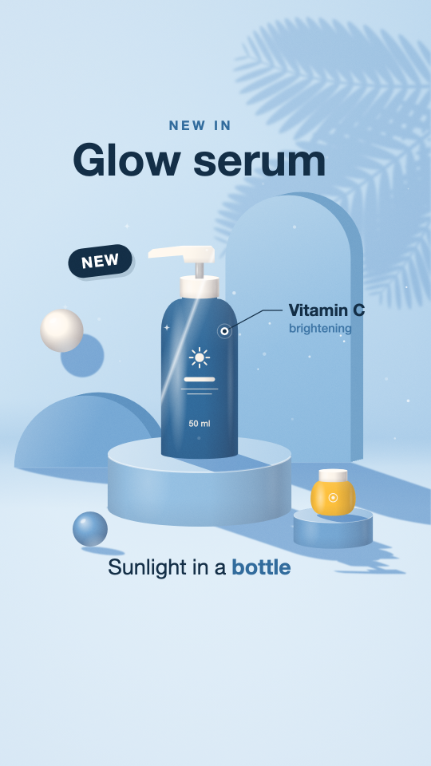

# Packshot



A bright studio packshot for physical-product ads: the look of e-commerce and DTC product pages, and the opposite of keynote's dark stage. The ground is a seamless pastel cyclorama: a wall that turns into the floor through a soft cove with no line, in **one colour family per scene** (peach, sage, lilac, butter or sky). On it stand geometric props in the same family: cylinder podiums, stacked podiums, blocks, steps, arches, half-discs, spheres. **One** invented product, drawn in code, stands on the podium: a pump bottle, a dropper bottle, a jar, a squeeze tube, a carton or a can, each with a body in the family's deep tone, a soft vertical highlight, a cream cap and a simple label (an invented mark, a bar where a name would be, two thin lines, a size). One hard "sunlight" key comes from the upper left, so every object throws a crisp shadow down and to the right across the floor, and a palm-leaf or window-blind shadow (a gobo) drifts slowly on the wall. Type is one clean sans in the family's dark ink: a tracked-caps kicker over a bold headline, pill badges ("NEW", "50 ml"), a thin-line callout with a dot on the product, a dark price / CTA pill, one caption line.

Pick it for skincare, cosmetics, food and drink, supplements, packaging, any physical product that needs to look desirable and clean; for price and offer beats, "new in" announcements, a product range. Not for software or screens (ui-mockup, bento), dark premium hardware reveals (keynote), stories with characters, or diagrams.

**The one rule: one product, one sun, one colour family. Everything on the set is a tint of the same hue; the sun decides where every highlight and every shadow goes.**

## Palette (`PK` in kit.js)

Shared:

| name | hex | use |
|---|---|---|
| `paper` | `#f7efe6` | the empty studio; `STYLE.paper` (what a morph happens on) |
| `white` | `#ffffff` | highlights, sparkles, motes, the white pill, the callout dot |
| `cream` | `#fff8ee` | caps, lids, paper labels, print on dark bodies, the floating ball |
| `dark` | `#2a2233` | what a colour is mixed toward (74%) for its own shaded side; never drawn pure |
| `hero` | `#ffc23d` | the hero's reserved colour (a little sunny-yellow jar); `STYLE.heroColor` |

Scenes (`PK.scene.<name>`, picked with `pkStage('<name>')`):

| scene | wall | wall2 | floor | prop | prop2 | deep | ink | shade |
|---|---|---|---|---|---|---|---|---|
| `peach` | `#f9d6c2` | `#f2bea6` | `#fce4d6` | `#f3ac8e` | `#ea9274` | `#c65f3f` | `#55281b` | `#e09a7c` |
| `sage` | `#d2dfc9` | `#bccdb1` | `#e0ead8` | `#a6bd98` | `#8aa47c` | `#4f6d46` | `#22341e` | `#93b083` |
| `lilac` | `#dfd4f0` | `#cbbce5` | `#eae2f6` | `#bca7df` | `#a38bcf` | `#6a50a4` | `#2c204e` | `#a28dd2` |
| `butter` | `#f9e8b2` | `#f3da8e` | `#fcf1cb` | `#f1cf70` | `#e4ba4e` | `#a87a12` | `#483507` | `#e2bd5c` |
| `sky` | `#cbe2f3` | `#b1d1eb` | `#deedf8` | `#96c1e3` | `#77a9d5` | `#326c9d` | `#142f47` | `#86b1d9` |

- `wall` is the lit wall, `wall2` the wall away from the sun and in the cove, `floor` the sunlit floor; `prop` / `prop2` are the two mid tones for props; `deep` is the product's default body and the accent type; `ink` is all other type and the solid pills; `shade` is the colour cast shadows and the gobo are **multiplied** in (at 80% and about 30%).
- A scene object of your own (the same eight keys) can be passed to `pkStage` instead of a name.
- A product may leave the family once per frame (an amber dropper on lilac, a green can), or be cream with a `deep` cap. Props never leave it.
- **Colours for the renderer:** `ERA_BG` is the scene's `wall`; a bridge shape's `c` is the product's body colour (6-digit hex); `heroColor` is `PK.hero`. Mid-morph the blend arrives as `rgb()`; `STYLE.blob` pushes its saturation up 1.5× so a blue-to-terracotta blend does not go grey.
- The hero's yellow is reserved for the hero. On a `butter` scene give it another colour (`STYLE.heroColor = '#ff6f59'`).

## Light and texture

- **The cyclorama** (`pkStage`): a diagonal wall gradient, brightest at the upper left (wall mixed 42% toward white) falling to `wall2` at the lower right; a cove about 170 px tall round the horizon (default y 1090) where the wall darkens a little and turns into `floor`; the floor brightens toward the camera. No horizon line anywhere. Corners fall off 20% in `prop2`.
- **The sun** is one direction for everything, `PK.sun = [0.74, 0.25]`: a point 1 px above the floor throws its shadow 0.74 px right and 0.25 px toward the camera. Shadows are hard: a 1.6 px blur, no penumbra.
- **Cast shadows** (`pkLit`): every prop and product inside `pkLit(() => { ... })` is drawn twice. First all their shadows go on one scratch layer as flat `shade`, and the layer is multiplied on at 80%: overlapping shadows never darken twice. Then the bodies are drawn on top. A product on a podium also throws a short shadow on the podium's top (`on`), and its long shadow lands on the real floor (`floor`).
- **A turned volume** (`pkVol`: podiums, bottles, jars, caps, the can): flat body colour, the label, then the turn of the form over both: a shade of the body's own colour mixed 74% toward `dark` at 22% on the left edge, nothing from 30–56%, 25% at 80%, 42% at 93% and back to 27% at the right edge (bounce from the bright floor); a soft vertical highlight streak at 22% of the width (an ellipse of white fading at every edge, 42–62% at its core) and a faint second streak at 90%; a little top light and underside shade. A top face (`pkTop`) is the colour mixed about half-way to white with a thin lit front edge.
- **Flat props** (`pkSlab`: arches, discs): a lit front face (30% toward white at the upper left, to the colour, to `prop2`) and a visible thickness going back to the right and up, 34% toward `deep`. **Blocks and steps** show a face and a strip of their top.
- **Spheres**: a radial gradient lit from the upper left (62% toward white, the colour, 36% toward `dark`), a soft bounce of floor colour in the underside, one small specular ellipse.
- **The gobo** (`pkGobo`): a palm (three fronds with tapering leaflets) or a window with blinds (13 slats thrown slanted, with the wall round the window in shadow), multiplied on the wall at 26–36% with a 3 px blur, fading out through the cove. It sways and drifts a few px a second.
- **Dust** (`pkMotes`): about 26 white motes of 2–4 px rising slowly and twinkling, a fifth of them four-point sparkles.
- **Labels** have no words: a mark (`sun`, `drop`, `leaf`, `ring`, `wave`, `half`), a rounded bar, two hairlines and optionally a size ("50 ml"). Printed in cream on a dark body, in ink on a light one, or on a cream paper panel (the dropper).
- **Type** (`PK_SANS`: Helvetica Neue, Segoe UI, Inter, Roboto, Noto Sans, Arial): headline weight 700 at about 112 px in `ink`; kicker weight 700, caps, tracked 0.22 em, about 32 px in `deep`; caption 54 px weight 400 in `ink` with the key words weight 700 in `deep`; callout title weight 700 at 38–40 px with a weight 500 sub line at 72% of it in `deep`; badge weight 700 at 36 px tracked 0.08 em; price weight 700 at 46 px beside a weight 500 CTA.
- **Pills** are fully round, with a hard little shadow offset down-right (16–18% ink, no blur), like everything else on the set.
- **Callout lines** are 2.5 px, divided by the camera zoom so they stay 2.5 px during a push; the dot is a white disc with an ink centre and a ring that pings every 1.6 s.
- **Finish of the frame**: a fixed fine grain (`PK.grain`, 3.5%, `overlay`) that keeps the pastel gradients from banding in the video. Held still on purpose.

## Motion habits

- On 1s (`ones: true`), soft and springy. One spring, `PK.spring` (k 210, d 21: a hair of overshoot), through `pkSpring(t0)`; `pkIn(t0, d)` for plain ease in-out.
- **The set builds itself, back to front, staggered about 0.15 s apart:** podiums rise out of the floor (height × `pkSpring`), arches, discs and steps slide in from the nearest edge, balls roll in.
- **The product drops in last** (`pkDrop(t0, h)`): it falls for 0.34 s, lands, and makes one small hop (4% of the drop, gone in about 0.4 s). It stays rigid: no squash, no stretch. While it is in the air its shadow runs ahead of it on the floor and its shadow on the podium top fades in as it lands.
- **Then the ad copy, one piece at a time:** badge pops (scale from 0 with a little rotation), the callout's line draws on from the dot and its label fades in, the price pill rises and scales up, its arrow nudges once a second.
- **A glint sweeps the product** once it has settled (`glint` 0 → 1 over about 0.8 s), left to right, slanted.
- **Camera**: one slow push per era toward the product (z 1 → 1.045–1.05). No cuts inside an era.
- **Idle life**: the gobo drifts and sways, a floating ball bobs (about 13 px, 0.27 Hz) with its shadow on the wall, motes rise and twinkle, the callout dot pings, the hero's lid hops once every two seconds.
- **Type** fades in while settling a few px upward, word by word; all screen-space type fades out 0.2 s before a bridge and back in after it.
- **Bridges**: the set is seen through the product's outline as a die-cut card with a white edge and a hard shadow, closing onto the product; on the empty studio the product itself changes shape and colour in the sun, with its cast shadow, while a glint crosses it; the new set opens out of the new product's outline. Podiums and the new product are already standing when the window opens; the other props arrive after.
- **Sound**: a light marimba pattern over a soft pad and a round bass; a swish for a sliding prop, a soft thud when a product lands, a pop for each pill, a shimmer for the glint, a two-note chime for the price.

## Frame checklist (in addition to `grammar/FRAME.md`)

1. **Squint test: a bright pastel room with one darker object in the middle.** The whole frame is one hue family; the product is the deepest, most saturated thing in it. If the frame looks white, grey or multicoloured, it is not this look.
2. **Exactly one product**, standing on a podium, with all its parts: body, soft vertical highlight, cap, label (mark + bar + lines, no words), a cast shadow on the floor and a short one on the podium top.
3. **Every shadow runs the same way**: down and to the right, hard-edged, in the family's `shade`. Nothing is lit from the right, nothing glows, nothing has a soft drop shadow underneath.
4. **A gobo shadow is on the wall** (palm or blinds), faint, not crossing the headline's letters at full strength, fading before the floor.
5. **No horizon line**: the wall turns into the floor through a gradient. Props stand on the floor zone, their bases below the cove.
6. **Props are few and geometric** (3–6): they frame the product, never cover it, and none is taller than the product plus its podium except an arch or disc behind it.
7. **One reserved outsider at most**: the yellow hero jar (or one off-family product). Everything else is the family.
8. **The copy is an ad's copy**: kicker + headline at the top, at most one badge, one callout whose dot sits on the part it names, one price / CTA pill, one caption line at y ≈ 1440. Nothing overlaps the product except the callout's dot.
9. **Everything inside x 60–940, y 250–1500**, measured after the camera push (a callout label on the right ends by world x ≈ 920).
10. **Something is moving**: the gobo, the ball, the motes, a glint, a ping. A fully built set with no drift is a still.
11. **Bridge objects are two products**, standing still on their podiums at the bridge time, clear of badges and callouts, coloured with their body hex.

## Kit API (`kit.js`, on top of `kit/core.js`)

Needs from the piece head: `CX` (caption centre x).

- Palette and constants: `PK { paper, white, cream, dark, hero, tilt, sun, shadow, hair, grain, spring, scene { peach, sage, lilac, butter, sky } }`, `PK_SANS`, `PK_S` (the current scene, set by `pkStage`).
- Colour and timing: `pkMix(a, b, u)`, `pkA(colour, alpha)`, `pkW(alpha)`, `pkRGB`, `pkHex`, `pkLum`, `pkZ()` (camera zoom), `pkSceneOf(name | object)`, `pkIn(t0, d)`, `pkSpring(t0, p)` (0 → 1), `pkDrop(t0, h)` → `{ dy, a, down }`, `pkBridgeK()` (1 outside bridges, 0 inside).
- Paths: `pkPoly(P)` (straight edges; core's `trace` rounds corners), `pkPaths([P, ...], dx, dy)`, `pkRR(x, y, w, h, r)`, `pkProf(profile, sb, st)` (a turned outline from `[half-width, y]` pairs), `pkQ(a, b, 'v' | 'h', n)` (a shoulder or a heel between two profile points).
- **The studio:** `pkStage(name | scene, { horizon, curve, vig })` (call it first, outside `pkLit`), `pkGobo('palm' | 'blinds', { x, y, a, w, h, n, len, horizon, key })`, `pkFrond(x, y, len, ang, bend, sway)`, `pkMotes({ n, box, a, key })`, `pkSparkle(x, y, r, alpha, colour)`.
- **The sun:** `pkLit(draw, { a, blur })` (shadows first as one layer, then bodies; `draw` runs twice, so keep type out of it or rely on the type helpers skipping the shadow pass), `pkShadow(P | [P, holes...], floorY)`, `pkCast(P, floorY)`, `pkContact(hull, baseY, on, k)`.
- **Volumes:** `pkVol(P, colour, { k, gloss, flat, ribs, under, over, top })`, `pkTop(x, y, rx, ry, colour, { hi })`, `pkStreak(x, y, rx, ry, alpha)`.
- **Props** (y = where the prop meets the floor): `pkPodium(x, y, w, h, { color, tilt, floor, on, k, gloss })` → its top `{ x, y, rx, ry, floor, P }` (pass it as `on`; stack podiums by using the lower one's `.y` as the upper one's `y`), `pkBlock(x, y, w, h, { color, d, floor })` → same shape of result, `pkSteps(x, y, w, h, n, { dir, color })`, `pkArch(x, y, w, h, { color, open, t })`, `pkDisc(x, y, r, { half, color, t })`, `pkSlab([outline, holes...], colour, floorY, { t })`, `pkArchPts(x, y, w, h)`, `pkSphere(x, y, r, { color, floor, wall })`.
- **The product:** `pkProduct(kind, x, y, s, { color, cap, ink, bulb, label { mark, text, panel, ink }, on, floor, dy, a, glint })` with kind `'bottle'` (pump bottle, about 215 × 500 at s = 1), `'dropper'` (about 156 × 416), `'jar'` (about 306 × 236), `'tube'` (about 194 × 432, standing on its cap), `'box'` (about 238 × 350, a three-quarter carton) or `'can'` (about 160 × 329); x, y = where its base stands → `{ x, y, top, x0, x1, w, h, hull, at(u, v) }`. `pkProductPts(kind, x, y, s)` is its hull (bridge shapes). `pkParts(kind, o)` → `{ parts, hull }` in local units, `pkLabel(cx, y0, y1, w, { ink, mark, text, panel })`, `pkMark(kind, x, y, r, colour)`.
- **The hero:** `pkHero(x, y, r, { color, lid, floor, on, dy, a, key, still })` (a little round jar, x, y = its centre, r = half its height; sets `SPARK_AT`), `pkHeroPts(x, y, r)`.
- **Ad copy in world coords (under the camera; `at` is absolute seconds):** `pkBadge(str, x, y, { at, size, rot, solid, fill, color })`, `pkCallout(x0, y0, x1, y1, str, { at, dur, run, size, sub, color, subColor })`, `pkPrice(price, cta, x, y, { at, size, fill, color })`.
- **Type:** `pkType(str, x, y, size, { weight, color, track, align, a, at, dur, rise })`, `pkWords(str, cx, y, size, { weight, weightHi, color, colorHi, a, at, step, rise })` (`*word*` = accent). Through `DEFER`, at screen size, `at` in seconds into the era: `pkHeadline(kicker, headline | [lines], { x, y, size, ksize, at })`, `pkCaption(str, { x, y, size, at })`, `pkTag(str, { x, y, size, at })`.
- `pkGrain(alpha)`.
- `STYLE`: `paper` (the empty studio), `backdrop` (colour + a wash of sunlight), `window` (the set through the outline: white die-cut edge, hard shadow), `blob` (the lit volume in the blended colour with its cast shadow and a glint crossing), `hero` / `heroColor` / `heroPts` (the little jar), `post` (grain), `ones: true`.

A scene, in order:

```js
pkStage('peach');
pkGobo('blinds', { x: 640, y: 600, a: 0.3 });
pkLit(() => {
  pkArch(270, 1150, 320, 520, { open: 0.6 });                        // back first
  const pod = pkPodium(520, 1260, 440, 130 * pkSpring(0.1));
  const d = pkDrop(0.5);
  pkProduct('jar', 520, pod.y, 1.2, { on: pod, floor: 1260, dy: d.dy, a: d.a, glint: seg(TT, 2, 2.8) });
});
pkMotes();
pkBadge('NEW', 260, 680, { at: 1.3, solid: true });
pkHeadline('New in', 'Cloud cream'); pkCaption('Soft skin, *all day*');
```

## Do / don't

- **Do** call `pkStage` first, then `pkGobo`, then one `pkLit` holding every prop and the product (back to front), then motes and copy.
- **Do** stand the product on a podium and pass the podium as `on` and the real floor as `floor`, so both shadows land right.
- **Do** keep props in the scene's `prop` / `prop2` and give the product the `deep` tone (or cream with a `deep` cap) so it is the darkest thing on the set.
- **Do** let the set build before the product drops, and the copy arrive after it has landed; delay the headline until the product has passed it.
- **Do** invent the product. Labels are a mark, a bar and lines: no real brand names, logos or trademarked bottle shapes. Headlines name the kind of thing ("Glow serum"), not a brand.
- **Do** point the callout at a real part (the pump, the lid, the label) and end its label inside the safe area.
- **Don't** mix colour families in one scene, or add a gradient sky, a pattern, a texture or a second light.
- **Don't** soften the shadows into blurry drop shadows or point them another way; don't add glows, outlines or rim lights.
- **Don't** squash or stretch the product, tilt it, or spin it: it is a rigid object that drops, hops once and stands.
- **Don't** put text inside `pkLit` unless it is one of the kit's type helpers (they skip the shadow pass); never use `destination-out` on the frame (it punches through to the previous frame).
- **Don't** stack more than one badge, one callout and one price pill in a frame, and don't let any of them cover the label.
- **Don't** let a tall prop or the gobo sit behind the headline at full strength.

## How it differs from the closest shipped styles

- **keynote** is the same job in the opposite light: one product on a near-black stage, lit by a moving beam, one finish colour, thin numerals, no bounce. Packshot is daylight, pastel, hard shadows, bold type, springs.
- **clay** is hand-made plasticine with fingerprints on 2s; packshot is clean manufactured surfaces on 1s.
- **flat-vector** has flat fills and long shadows for icons and UI; packshot shades every object as a volume and casts real projected shadows on a floor.
- **bento / ui-mockup / glass** show software; packshot shows a physical object in a room.

## Not matched / known weaknesses

- Built from the genre's conventions (pastel studio packshots with geometric props), not measured against one reference; the products and their copy are invented.
- The lighting is a 2D fake. A cast shadow is the object's front silhouette sheared onto the floor, so a wide podium's shadow is a little too thin and a sphere's shadow is an ellipse; shadows do not climb the wall or fall across other props' faces (they are multiplied under all bodies), and the gobo is not thrown onto props or the product.
- Blocks, steps and slabs are seen front-on (a face plus a top strip or a thickness); only the carton has a true three-quarter view. Podiums and products use different amounts of "seen from above" (20% and about 13%).
- The glint and the highlight always come from the left; a product cannot be turned or tilted.
- `pkLit` runs its callback twice and uses a full-frame scratch layer; the gobo uses another. `ctx.filter` blur is used for the two layers (Chromium, current Firefox and Safari).
- Tracking uses `ctx.letterSpacing`; where it is missing, caps are set untracked. Glyph widths differ a little between platforms, so re-check callout labels against the right safe edge.
- The grain is static.
- Layout numbers were tuned for 9:16 at 1080 × 1920; 1:1 and 16:9 were not rendered.
- Not exercised by the demo: the `dropper`, `tube`, `box` and `can` products, the `sage`, `lilac` and `butter` scenes, `pkBlock` on its own, a full `pkDisc`, `pkTag` (all rendered once as a still on a lilac set while building the kit, not in a piece), the hero-to-hero bridge (`STYLE.hero` through `SP`), and a custom scene object.

## Proven on

Its demo only. `demo/` (6 s, 9:16, 120 BPM, 24 fps): on a sky-blue set a podium rises, an arch and a half-disc slide in, a deep-blue pump bottle drops onto the podium and settles, the yellow hero jar drops onto a small podium beside it, a "NEW" pill pops, a callout ("Vitamin C") draws from the bottle and a glint sweeps it, while a palm shadow drifts on the wall and a cream ball bobs. At 3.0 s the set closes onto the bottle, which becomes a terracotta cream jar on stacked podiums on a peach set: an arched doorway and steps slide in, the hero drops in, a "50 ml" pill, a callout ("Shea + oat"), the "$24 · Shop now" pill, window-blind shadows drifting on the wall. `tools/tile.mjs` prints `deterministic: true`.
