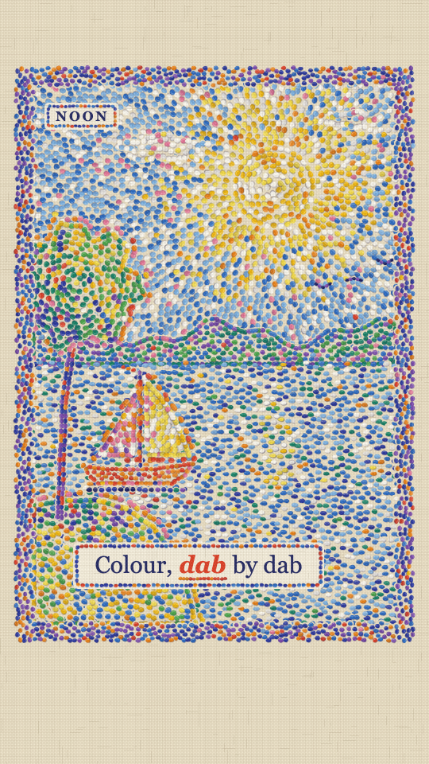

# Pointillism

A Neo-Impressionist pointillist painting that is dabbed in while you watch. The whole picture, ground included, is made of small round dabs of pure, unmixed paint laid side by side on a pale primed canvas, with a little canvas showing between them. There are no outlines, no flat fills and no gradients: a green bank is yellow and blue dabs with a few orange ones, a shadow is ultramarine and violet with the lit colour's complement sprinkled in, and a form is read only by the change of hue and direction of the dabs at its edge, helped by a thin broken halo of complementary dabs. The canvas weave shows through everything and the picture sits inside a painted dotted border, as in the period.

Pick it for light, weather, seasons, landscape, water, leisure, "many small things add up to one picture", how the eye or a screen mixes colour, calm art-history pieces. It is pictorial: any outline can be filled with dabs. Not for thin diagrams, UI, dense text or fast action.

**The one rule: everything is a dab, and dabs appear, swap hue or move as a group. Nothing fades and nothing blends.** A thing arrives because a brush works across it, a few dabs each step. Light changes because dabs swap to another tube colour. A thing moves as a rigid group of dabs. The only flat surfaces are bare canvas: the ground outside the border and the caption plaque.

## Palette and meaning (`PT` in kit.js)

High-key tube colours, used pure. Mixing happens in the weights of a palette, never in the paint.

| role | hex | use |
|---|---|---|
| canvas | `canvas #ece2c9` | the primed ground: between the dabs, outside the border, the morph's blank sheet |
| plaque | `plaque #f7f1e0` | the caption and tag strips (bare primed canvas, a shade lighter) |
| ink | `ink #232a66` | caption type only (a deep ultramarine, never black) |
| sunlight | `lemon #f8e04a`, `yellow #f5bd12` | the sun, lit grass and leaves, glitter, lamps, the lit sail |
| warmth | `orange #ee8418`, `verm #e0412a` | lit edges, halos against blue, the hero's hull and pennant, sunset |
| flesh of light | `rose #e9799c` | haze, clouds, the sprinkle that warms a cool field, sunset |
| shadow | `violet #7b4bb3`, `ultra #2a3aa6`, `deep #1b2168` | shadows, night sky, trunks, the dark under a hull (`deep` is the darkest thing allowed) |
| air and water | `cobalt #2c6fca`, `sky #7db5e8` | sky, water, the blue half of an optical green |
| growth | `viridian #15856a`, `emerald #4aa94c` | leaves, far banks, the cool sprinkle in water |
| light itself | `white #fffdf4` | the brightest dabs: glitter, clouds, sails, stars |

A region's palette is 3–5 colours with weights: two or three neighbours that make its local colour, one light, and a small weight (0.5–1.2) of the complement (`[[PT.cobalt, 4], [PT.sky, 3], [PT.ultra, 2], [PT.white, 1.4], [PT.orange, 0.5]]`). `PT_COMP` gives each tube colour's complement (yellow ↔ violet, orange ↔ blue, vermilion ↔ viridian, rose ↔ emerald) and `PT_NEAR` its neighbour on the wheel, which is what a dab shimmers to. Day is blues, yellows and greens under a border of ultramarine, violet and orange; dusk is ultramarine and violet over orange and rose under an orange border: the border takes the complement of the picture.

## Dabs, canvas and type

- **A dab** (`ptSprite`): a slightly irregular oval with a heavier head, about 17 × 13 px at the default spacing of 13.5 (keep spacing 10–18), with a thin shadow under it, a darker lee side and a ridge of light: thick paint. Six shapes per colour, three tones per colour (a little thicker, plain, a little thinner). Dabs in one region are the same size.
- **Placement** is Poisson-disc from seeded RNG (`ptPoisson`): even spacing, no rows, no grid, no two layouts alike. A filled outline first gets a row of dabs just inside its edge, then the interior grows away from that row, so edges stay readable without a drawn line.
- **Direction** (`dir`): dabs lie along the form. Horizontal and flatter on water (`asp: 0.8`), pointing away from the sun in the sky (`ptRadial`), in rings on a disc or a crown (`ptRing`), along a mast or trunk (`ptLine`).
- **Optical mixing**: `pal` plus `pal2` and `mix(x, y)` (the chance a dab comes from the second palette) gives the lit and shadow side, a glow round a light, a horizon haze, without any blend.
- **The halo** (`halo`): a broken row of dabs just outside the outline, in the complement of the form's first colour or in a palette you give (warm dabs on a lit edge against a cool neighbour). Keep it broken (`haloDens` 0.4–0.6): a full row reads as an outline.
- **Bare canvas under forms**: a form laid over a ground carries a small patch of canvas under each of its dabs, so the ground's dabs do not show between them. Grounds on the bare canvas pass `under: false`.
- **Canvas** (`STYLE.post`): a static 4 px weave with slubs over the whole frame.
- **Border** (`ptBorder`): a 44 px band of smaller dabs round the picture; bare canvas outside it.
- **Type:** `PT_FONT` = `Georgia, "Iowan Old Style", "Palatino Linotype", "Book Antiqua", "DejaVu Serif", "Liberation Serif", "Times New Roman", serif`. Captions are **never** built from dabs: they are plain serif in `ink` on the plaque, a strip of bare canvas with a dotted edge, one word in bold italic colour with a row of tiny dabs under it. `ptWord` builds **one** large title word from dabs: capitals, 280 px or taller, a strong warm colour on a cool ground or the reverse. Lower case, white, or anything under about 250 px does not read.

## Motion habits

- **On 2s** (`ones: false`).
- **Dabbed in** (`at`, `dur`, `sweep`): a region's dabs appear in an order that sweeps across it, a clutch per step: left to right over water, outward from the sun over the sky, from the keel up over the boat, round the border. Order the picture as a painter would: the light source, the sky, the water, the land, the figures. Stagger starts by 0.1–0.3 s so a brush is always working somewhere.
- **Light moves by swapping hues** (`lights`): a warm band crossing the water (`ptBand`), a column of glitter under the sun, moon or a lamp (`ptGlitter`), a ring stepping outward from the sun once a beat (`ptPulse`), a reflection or a pool of lamplight (`ptPool`). Each dab has a seeded threshold, so a light of strength 0.6 turns about 60% of the dabs it covers.
- **Idle life is shimmer** (`shimmer`): each boil step a seeded 2–8% of a region's dabs turn to their neighbouring hue; on water those dabs also slip 5 px sideways (`slide`). Stars and lamps alternate between two or three colours on the step.
- **Forms move as groups of dabs** (`dx`, `dy`, `rot`, or a `ctx.translate` round the call): the boat sails and rocks, clouds drift, without re-laying. Small loose things are single dabs (`ptDot`): birds, stars, fireflies, a pennant.
- **Leaving:** captions and tags are taken away for the length of a bridge.
- **Camera: none.** It is a painting on a wall. (The kit works under a camera, but finished regions are bitmaps and soften when zoomed.)
- **Morph:** the window's cut edge is hidden under two rows of dabs (the bridge colour inside, its complement outside) while the era's loose dabs are taken off the bare canvas a few at a time; then the same set of dabs regroups from one outline into the other, turning a little round the centre, with a broken ring of complement dabs.

## Frame checklist (on top of grammar/FRAME.md)

1. **Dabs read at phone size** as separate touches of paint with canvas between them, in every region including the ground. An area that looks like a flat fill needs larger spacing; one that looks like confetti on paper needs denser or bigger dabs.
2. **No line anywhere:** no stroke, no full ring of one colour round a form. If an edge reads as an outline, lower `haloDens` or drop the halo.
3. **Each region mixes at least three tube colours**, one of them the complement in a small weight. Squint: sky reads blue, bank reads green, yet no dab is "sky blue-green".
4. **Each form differs from its ground in hue and in dab direction**, and the main forms carry a broken complementary halo.
5. **Dabs follow the form:** flat on water, radiating from the light, ringed on round things.
6. **Never a grid.** If rows or columns of dots appear it has become riso or comic.
7. **The border is there** and bare woven canvas shows outside it.
8. **Something is being dabbed in or lit right now**, plus two or three shimmering details.
9. **The caption is plain serif on the plaque**, one line, inside x 60–940, y 250–1500, with nothing important behind it. At most one dab-built title word in a piece.
10. **Bridge objects are round-ish discs of dabs** of similar size, clear of everything else at the bridge time.

## Kit API (`kit.js`, on top of `kit/core.js`)

- Palette and tables: `PT`, `PT_FONT`, `PT_COMP`, `PT_NEAR`, `PT_BORDER`, `PT_SUN`, `PT_MOON`, `PT_LEAF`, `PT_LEAFSH`.
- Colour: `ptRGB(c)`, `ptHex([r, g, b])`, `ptMix(a, b, u)`, `ptTone(c, k)`, `ptComp(c)` (table, else the hue turned half round), `ptNear(c)`, `ptPal(pal)` (a weighted palette with `.pick(u)`).
- Geometry: `ptRectPts`, `ptDiscPts`, `ptBlobPts(cx, cy, rx, ry, key, lumps, amt)` (crowns, clouds), `ptOffset`, `ptInward`, `ptInPoly`, `ptCentroid`, `ptHashPts`, `ptPath`, `ptCanvas`, `ptPoisson(bb, r, R, init)`, `ptRadial(cx, cy)`, `ptRing(cx, cy)`.
- **`ptFill(P, pal, o)`** — the generic helper: fill any closed outline with dabs from a weighted palette. `o`: `key`, `s`, `size`, `asp`, `dir`, `jit`, `pal2` + `mix`, `halo` (`true` = complement, a colour, or a palette) + `haloDens`, `edge`, `under`, `dens`, `hole`, `sweep` + `scatter`, and the play options below. Returns how much is laid (0..1).
- Play options (every dab helper takes them): `at`, `dur`, `dx`, `dy`, `rot` (+ `cx`, `cy`), `shimmer`, `slide`, `lights: [{ k: (x, y) => 0..1, pal }]`.
- `ptLine(P, pal, { closed, rows, s, gap, … })` — dabs along a path. `ptDot(x, y, colour, { s, a, v, tone, asp, under })` — one loose dab. `ptWord(str, x, baseline, size, pal, o)` — one dab-built title word.
- Lights: `ptPulse(cx, cy, r0, r1, { steps, w, k, every })`, `ptBand(xc, { w, k, lean, wob, y0 })`, `ptGlitter(xc, y0, y1, { w0, spread, k })`, `ptPool(cx, cy, rx, ry, k)`.
- Picture parts: `ptBorder(x, y, w, h, { band, pal, s, key, … })`, `ptDisc(x, y, r, { pal, halo, … })` (sun, moon), `ptTree(x, base, { x, y, r }, { lit, shade, sun, halo, trunk, … })`, `ptBird(x, y, s, { flap })`, `ptStar(x, y, i)`, `ptLamp(x, y, h, lit)`.
- Hero: `ptHero(x, y, r, { rock, key, at, dur, dusk, lantern, halo })` — Skiff, a small sailboat: lemon-and-white mainsail, rose-and-violet jib, vermilion hull, a mast of one column of dabs, a pennant of three. `ptHeroPts(x, y, r)`, `ptHeroParts(r)`.
- Engine: `ptField(key, bb, inside, pal, o, init)` (build a region's dabs once), `ptEntry(key, build)` (the cache), `ptLayer(entry)` (its canvas), `ptPaint`, `ptPlay(entry, o)`, `ptSprite(css, v)`, `ptStamp`, `ptWeave()`.
- Type and captions (through `DEFER`): `ptText(str, x, y, size, colour, { weight, italic, track, align })`, `ptTextW`, `ptPlaque(x, y, w, h, o)`, `ptCaption('words *highlight* words', { x, y, size, w, hi, at })`, `ptTag('Label', { x, y, size, at })`.
- `STYLE`: `paper` the canvas, `backdrop` (bare canvas with the era's loose dabs, taken away as the window closes), `window` (clip + two rows of dabs on the cut), `blob` (the same dabs regrouped inside the blended outline), `hero`, `heroColor`, `heroPts`, `post` (the weave), `ones: false`.

Cost: a region is laid out and painted once (20–150 ms for a full-width ground), then costs one `drawImage` plus its shimmering or lit dabs. The demo's frames render in 10–30 ms once warm; the first frame of an era takes 0.1–0.3 s.

## Do / don't

- **Do** give every region a stable `key`: its layout is seeded by key, outline and palette, and must not reshuffle.
- **Do** keep outlines static and move them with `dx`, `dy`, `rot` or a transform. An outline that changes every frame is a new layout and a new cached canvas every frame.
- **Do** lay grounds with `edge: false, under: false` and end them under the border.
- **Do** change light with `lights`, and season or time of day with a different palette under a new `key`.
- **Do** make thin things from `ptLine` (one or two rows) and tiny things from `ptDot`.
- **Don't** fade, blur, glow, stroke or use gradients; no `globalAlpha` ramps, no `shadowBlur`, no filters.
- **Don't** put near-white forms on bare canvas without a coloured ground round them: white dabs on primed canvas vanish.
- **Don't** shrink dab spacing under 8 px (it turns to noise) or set body text in dabs.
- **Don't** use black or grey. The darkest dab is `deep`.

## How it differs from the closest shipped styles

- `mosaic`: hard-edged stone tiles packed tight in rows with grout, earthy colours, laid on 1s. Here: soft round touches of paint with canvas between them, no rows, pure spectral colour mixed by the eye.
- `riso`, `comic`: mechanical dot screens on a grid, flat inks, outlines. Here: every dab hand-placed, irregular, with relief, and never on a grid; no outlines at all.
- `sand`, stipple looks: monochrome grains. Here: all colour, and colour is the subject.
- `watercolor`: washes that blend and bleed. Here: nothing ever blends; two colours sit side by side.

## Proven on

Its demo only (`demo/`, 6 s): a riverside afternoon dabbed in from the sun outward with a sailboat that sails across, bridged sun disc to moon disc into the same river at dusk. `ptWord` and the hero-to-hero bridge were checked in stills, not in the demo.
