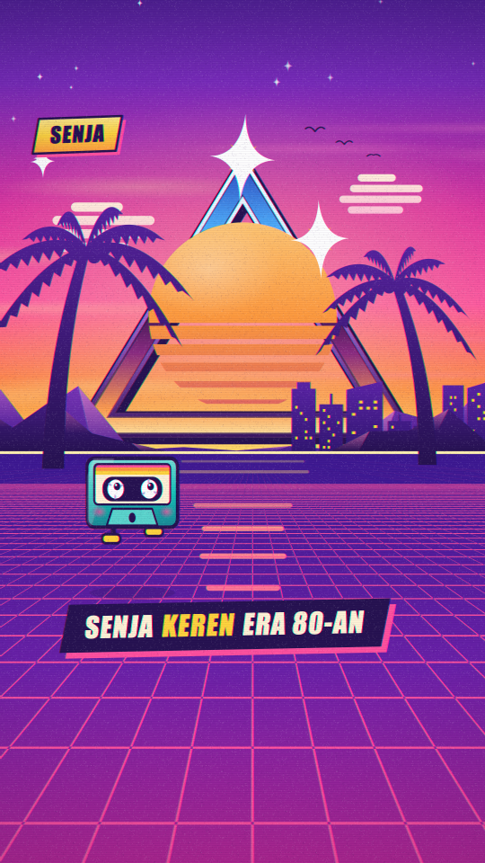

# Retro 80s

A 1980s airbrushed poster, VHS cover or arcade flyer in daylight-to-sunset colour. The medium is the **smooth airbrush gradient**: a sunset sky banded from deep purple through hot pink to orange and yellow, a big sun cut by horizontal slats that slide down, flat silhouette layers (mountains with one lit facet per peak, palms, a skyline) each with its own gradient, a ground plane drawn as a perspective grid of **solid coloured lines** on a gradient floor, **chrome** shapes and lettering (sky-blue top, white horizon line, dark band, warm underside, a hard bevel) with four-point sparkles, and **Memphis confetti** (squiggles, zigzags, triangles, dot grids, half-circles, rings) with hard offset shadows. A light VHS finish sits on top: a 2 px chroma offset, faint scanlines, soft grain. Motion on 1s, gliding and bouncy.

Pick it for music, games, pop culture, nostalgia, "level up" and party beats, energetic children's content, countdowns and title cards. Not for calm or solemn subjects, data-heavy explainers, or anything that needs fine detail or long text.

It is not `neon`: nothing glows. There are no tubes, no halos, no additive light and no night-black ground — the light is painted (gradients, a white chrome horizon, sparkles), and the darkest colour is indigo.

**The one rule: every surface is a gradient, every edge is hard.** A fill ramps from a light tone to a deep one (never one flat colour, never a blur or glow); depth comes from layered silhouettes and hard offset shadows in indigo, not from soft shadows.

## Palette and meaning (`R80` in kit.js)

| role | hex | use |
|---|---|---|
| morph paper | `paper #f7ead0` | the cream poster board a morph happens on |
| light grounds | `cream #fff3d6`, `peach #ffd2b0` | party walls, caption text, labels, horizon lines |
| **ink** | `indigo #24104f` | silhouettes, outlines, every hard shadow, the caption bar (never black) |
| sky top / floors | `deep #3b1791`, `purple #6b2fb5` | the top of the sky, far ranges, the grid floor |
| sky middle | `mag #c0268f`, `pink #ff4f9e` | the sky's hot band, grid lines, underlines, the record |
| sun | `orange #ff9a3c`, `yellow #ffd43b` | the sun and the horizon; **yellow is the highlighted caption word** and the tag |
| **hero** | `teal #12c4b8` | Kaset, the cassette hero. Reserved for the hero. |
| chrome | `sky #4fb4ff`, `blue #2438b8`, `brown #2a0f45` | chrome's sky half, its top, its dark band (`R80_CHROME` is the full ramp) |

`R80_SUNSET` is the sky ramp (`#2a1470 → #7a2bbd → #e0359f → #ff4f9e → #ff8a3c → #ffd95a`). `r80Hot(c)` is the ramp of a warm object (pale yellow → c → magenta); the sun, the record and the morph blob all use it, so they blend into each other. A frame is either a **sunset frame** (purple-to-yellow sky, purple floor, pink lines) or a **poster frame** (cream-to-peach wall, pink floor, yellow lines), plus the hero's teal and chrome. Morph between warm neighbours (orange → pink, yellow → orange); avoid warm → teal (grey middle).

## Gradient, line, texture and type

- **Gradients** are vertical linear ramps of 2–6 stops (`r80V`, `r80Lin`), sized to the shape (`r80Shape` with a stops array) or to the layer (a whole range, a whole palm). Soft shading is an airbrush puff (`r80Puff`: a radial spray at ≤ 0.45 alpha) used as a highlight on the sun, cheeks on the hero, streaks in the sky — never as a light source.
- **Edges are hard.** No outlines on silhouettes; a 5–7 px indigo outline on the hero, chrome and plates. Shadows are a flat indigo copy offset down-right (7–16 px), never blurred.
- **Slats:** the lower 55% of the sun is cut by six gaps that slide downward and widen toward the bottom (`r80SlatGaps`, `r80BandFill`); what is behind shows through.
- **Grid floor:** vertical lines are thin triangles from the vanishing point, horizontal lines are rectangles at `hy + h0 / z`, both solid and thicker toward the viewer; the far distance is airbrushed into the floor's top colour. A 6 px light line marks the horizon.
- **Chrome** (`r80Chrome`, `r80ChromeText`): the `R80_CHROME` ramp top to bottom, an indigo outline and hard shadow, and a bevel band inside the edge (white above, dark purple below, with a dark seam). A white shine band sweeps across once (`shine: 0..1`); a sparkle pops where it leaves. Chrome lettering is painted once per word into a sprite.
- **Sparkles** (`r80Sparkle`): a thin white four-point star over a small yellow diagonal one; on light grounds add `shadow: true`.
- **VHS finish** (`r80Post`): the red channel slips 2 px right, a 4 px scanline pattern, grain from four seeded 256 px tiles (one per frame, offset by a seeded amount), a light indigo vignette. All cached.
- **Type:** `R80_DISPLAY` = `Impact, Haettenschweiler, "Arial Narrow Bold", "Franklin Gothic Heavy", "Arial Black", Futura, "Helvetica Neue", Arial, sans-serif`, always capitals, slanted by a skew transform (0.14–0.16; no italic font needed). T1 = chrome caps 150–200 px, or gradient caps with a dark offset shadow (`r80GradText`). Accent = one casual word in `R80_SCRIPT` = `"Brush Script MT", "Segoe Script", "Lucida Handwriting", "Snell Roundhand", "Comic Sans MS", cursive`, 70–90 px, written on from the left with a swash. Captions 62 px cream caps on a solid indigo slanted bar with a pink bar offset behind it, one word in yellow. Tags 48 px indigo caps on a yellow slanted plate.

## Motion habits

- On 1s (`ones: true`): everything glides. The grid scrolls toward the viewer the whole time (`speed` 1.1 calm, 1.4 on a party beat); the sun's slats never stop sliding.
- **Parallax:** each silhouette layer drifts at its own rate (far range 6 px/s, skyline 12, near range 18); clouds drift the other way; palms sway on a slow sine.
- **Entrances are springs:** the sun rises from behind the horizon on a heavy spring, chrome and Memphis shapes scale in with a playful overshoot, the caption bar slides in from the left and its words pop one by one, the tag pops with a sparkle. Nothing fades.
- **On the beat:** sparkles pop (`r80Twinkles`), confetti pulses 10% and keeps spinning, the hero bops (a 6–7% squash) and sways; put chrome's shine sweep and pops on the 8th-note grid.
- **The hero** tumbles in (one full turn over two hops), lands with a damped squash, jumps with a stretch, blinks every ~2.9 s; its reels turn all the time.
- **Camera:** a slow ≤ 5% push inside an era; after a morph the new era opens 10% close on the object and settles. Never shake.
- **Morph:** on cream poster board, the disc's slats close while record grooves fade in and a hard shadow slides out from under it; two sparkles pop at the midpoint. The window is ringed in chrome that thins onto the object. Caption and tag slide away as the bridge starts and return after it.

## Frame checklist (on top of grammar/FRAME.md)

1. **No flat fills on big shapes:** sky, floor, sun, ranges, palms, hero, chrome and plates all ramp. A flat-coloured big shape is a bug (small Memphis shapes are the one exception: flat + hard shadow).
2. **Nothing glows:** no halos, no additive light, no blur. If it looks like `neon`, a shadow went soft or the ground went black.
3. **A horizon and a grid floor** anchor the frame, with the grid visibly in perspective and thicker toward the viewer.
4. **One chrome thing per frame** (a shape or one word), with its white horizon line readable at phone size and a sparkle near it.
5. **Teal belongs to the hero**; yellow belongs to the highlighted word, the tag and small accents. No teal confetti.
6. **Silhouettes stay silhouettes:** indigo-to-purple, no interior detail except lit windows and one lit facet per peak.
7. **Memphis shapes stay off the subject:** scattered in the free space (`avoid` boxes), ≤ 10 per frame, each with its hard shadow.
8. **The caption is one line on its indigo bar** inside the safe area (x 60–940, y 250–1500), opaque and drawn last; the hero's feet stay above it (in the demo: feet at y 1292, bar from 1338).
9. **Something is gliding or popping in every held frame:** the grid, the slats, the reels, a sparkle.
10. **Bridge objects are discs or plates of similar proportions,** clear of everything else at the bridge time.

## Kit API (`kit.js`, on top of `kit/core.js`)

- Palette and ramps: `R80`, `R80_SUNSET`, `R80_CHROME`, `R80_DISPLAY`, `R80_SCRIPT`.
- Colour (hex or `rgb()` in): `r80RGB(c)`, `r80Mix(a, b, u)`, `r80Tone(c, k)` (k < 0 deeper, k > 0 lighter), `r80A(c, alpha)`, `r80Hot(c)` (a warm three-stop ramp).
- Gradients and caches: `r80Lin(x0, y0, x1, y1, stops)`, `r80V(y0, y1, stops)` (stops = colours evenly spaced, or `[[offset, colour], ...]`), `r80Cache(key, w, h, draw)` (a static picture painted once; `ctx` points at it inside `draw`), `r80Pat(key, w, h, draw)` (a cached repeat pattern), `r80DotPat(c, gap, r)`.
- Primitives: `r80Path(P, closed)`, `r80Centroid(P)`, `r80Shape(P, fill, { shadow, off, line, lw, smooth })` (fill = colour or stops), `r80Puff(x, y, rx, ry, c, alpha)`, `r80Beat(every, sharp, t0)` (1 on the beat → 0).
- Sparkles: `r80Sparkle(x, y, s, { c, c2, rot, al, shadow })`, `r80Twinkle(x, y, s, t0, { dur, ... })`, `r80Twinkles(key, { box, every, n, s, avoid, shadow })`.
- Sunset set: `r80Sky(hy, { stops, sun: { x, y }, stars, key })` (cached), `r80Sun(x, y, r, { c, stops, clipY })`, `r80SunPts(x, y, r)`, `r80SlatGaps(yTop, yBot, n, ph, hMax, open)`, `r80BandFill(P, gaps, fill, dx, dy)`, `r80SunGaps(bb, u)`, `r80Range(key, y, { amp, step, x, stops, gap: [cx, halfWidth, floorK], sunX, lit, bottom })`, `r80City(key, y, { amp, x0, x1, x, stops, win })`, `r80Palm(x, base, h, { key, lean, sway, stops, fronds })`, `r80Floor(hy, { speed, vx, stops, c, gap, dz, w, near, hc, sun: { x, c }, t })`.
- Poster set: `r80Wall({ stops, key, dot, hy })` (cached), `r80Band(y, h, 'check' | 'tri' | 'stripe', { speed, a, b })`.
- Chrome: `r80Chrome(P, { hole, bevel, out, shadow, shine, smooth, stops })`, `r80ShineBand(bb, u, width)` (under a clip), `r80ChromeText(str, x, y, size, { align, shine, skew, fam, stops })` (baseline at y; returns the width; reported to the text check through an invisible `fillText`), `r80ChromeSprite(str, size, o)`.
- Other type: `r80GradText(str, x, y, size, { stops, align, skew, fam, out })`, `r80Script(str, x, y, size, c, { rot, reveal, shc })`.
- Memphis: `r80Mem(kind, x, y, s, c, rot, { shadow, off, shc })` with kind `'squig' | 'zig' | 'tri' | 'triO' | 'dots' | 'half' | 'ring' | 'plus'`, `r80Confetti(key, n, { box, avoid, colors, kinds, size, t0, stagger, at(i), spin, every, pulse })` (a seeded scatter, cached per key).
- Props: `r80Cloud(x, y, w, { key, stops })`, `r80Bird(x, y, s, flap, c)`, `r80Note(x, y, s, c, rot)`, `r80Record(x, y, r, { c, label, spin, shadow })`.
- Hero: `r80Hero(x, y, r, { key, c, mood: 'smile' | 'happy' | 'wow', look: [x, y], tilt, sx, sy, lift, step, spin, blink, legs, shadow })` — Kaset; (x, y) the body centre at rest, r half its width, feet on y + 0.95r; sets `SPARK_AT`. `r80HeroPts(x, y, r)` (the bridge outline).
- Captions (through `DEFER`): `r80Caption('words *highlight* words', { y, x, size, at, hi, c, bar, under, caps })`, `r80Tag('Label', { x, y, size, at, c, col, under, caps })`; `r80BridgeK()` is their presence through a bridge; `r80Slant(w, h, sk)` the plate outline.
- `r80Post({ chroma })`: the VHS finish.
- `STYLE`: `paper` cream, `backdrop` (an airbrushed ramp of the colour + the dotted grid), `window` (clip + a chrome rim), `blob` (the slatted disc turning into a grooved one), `hero`, `heroColor` teal, `heroPts`, `post`, `ones: true`.

## Do / don't

- **Do** build depth from 3–5 silhouette layers with different parallax rates, lightest at the back.
- **Do** dip the ranges where the sun sits (`gap`) and keep the sun fully above the horizon when it is a bridge object.
- **Do** give chrome a moment: spring it in, sweep the shine once, pop a sparkle where the shine leaves.
- **Do** give every key a stable name: ranges, skylines, palms and confetti are seeded by it.
- **Don't** use `shadowBlur`, filters, `lighter` blending for light, or black; it turns into `neon`.
- **Don't** put Memphis confetti on a sunset frame's sky (it fights the silhouettes); keep it for poster frames and plates.
- **Don't** set long text: one caption line of ≤ ~24 characters; chrome words ≤ ~8 letters at 190 px.
- **Don't** let anything stand in the caption bar's band; the bar is opaque and drawn last, but a hero cut off by it looks wrong.
- **Don't** call `r80ChromeText` with a size that changes every frame (each size is a new cached sprite); scale it with the canvas transform instead.

## Not matched / known weaknesses

- Built from the genre's conventions, not measured from a specific reference poster.
- Chrome's bevel is lit from above only (a vertical ramp), not per edge direction; on very thin strokes the bevel fills the letter.
- Display type depends on the system: Impact on macOS / Windows, a heavy sans elsewhere; the script word falls back from Brush Script MT to other casual faces and looks different per platform. Slant is a skew, not a true italic.
- The chroma offset is a whole-frame red shift, not edge-selective; the grain is four repeating tiles.
- Silhouette palms are one design at different sizes; the skyline is rectangles only.
- Captions are single-line only. The demo does not loop seamlessly (it ends on the party, starts on the empty sunset).
- `r80Twinkles` picks positions per beat from a seed; with small boxes and `avoid` rects a beat can come up empty.

## Proven on

Its demo only. `demo/` (6s, 9:16, 120 BPM, 24fps): over a scrolling pink grid a slatted sun rises on a spring between palms, mountains and a small skyline; a chrome triangle springs up behind it and a shine sweeps across it; Kaset, the teal cassette, tumbles in, lands with a squash, bops to the beat and jumps as a sparkle pops on the sun's rim; clouds drift, gulls flap, stars twinkle on the beat — tag "Senja", caption "Senja *keren* era 80-an". At 3.0s the sun's slats close and it becomes a spinning pink record on a cream Memphis wall over a pink dance floor: confetti springs in on the 16ths, chrome "ASYIK!" drops in and shines, "banget" is written in brush script, notes float up, Kaset dances and hops — tag "Pesta", caption "Saatnya *pesta* musik!". Tile deterministic; ~20–75 ms/frame on an idle machine (the first frame of each set is the slow one); review: morph on grid, flat frames none, text PASS, story arc PASS, dead beats PASS, -14.5 LUFS, true peak -1.0 dBFS.
