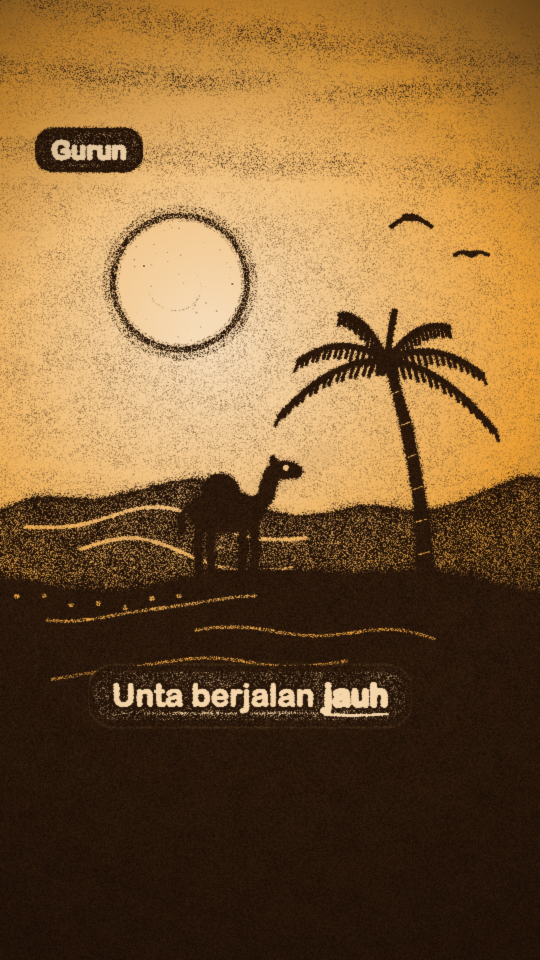

# Sand

Sand animation performed on a backlit glass table, seen from a locked-off camera above it. The ground is a light box: hot and creamy in the middle, honey further out, deep brown in the corners. The picture is made of sand and nothing else. Where the sand is thick it blocks the light (near-black umber silhouettes), where it is thin it is a grainy translucent tan, and where the glass has been wiped clean it glows. So there are exactly two ways to draw: **pour** sand on (a heap rises under a falling stream, a line is dribbled from the hand, a thin veil is sprinkled) or **wipe** it away with a finger (a bright stroke with a darker ridge of pushed sand along both sides). Everything is visibly granular: edges break up into scattered grains, thin layers are stipple, big areas carry finger-swipe streaks, and a few loose grains are always drifting. Motion on 1s.

Pick it for desert and night stories, Ramadan and Islamic educational pieces, bedtime stories, calm history or nature pieces, anything that should feel handmade, warm and a little magical. Not for data, UI, bright multi-colour subjects, or anything that needs small precise text.

**The one rule: it is only ever sand and light.** A shape is either sand put down or sand taken away, and it always shows its grain. Nothing slides rigidly, fades or has a clean vector edge: a picture changes because sand is poured, wiped, swept off or re-drawn. The only "colour" is the temperature of the lamp.

## Palette and meaning (`SND` in kit.js)

Strictly monochrome. A frame is one backlight tint plus sand.

| role | hex | use |
|---|---|---|
| morph paper | `paper #cfa873` | the lit table under an even film of sand: the ground a morph happens on |
| **backlight, day** | `amber #f2a437` | the warm lamp: desert, day, "before". The glow lifts toward white at its hot spot and falls to `dark` in the corners |
| **backlight, night** | `moon #a6bbdc` | the cool lamp: moonlight, night, "after". Same sand, colder glass |
| clean glass | `cream #ffedc2`, `moonlit #eef4ff` | glass wiped down to the light under each tint: suns, moons, stars, lamps, letters (the bridge colours) |
| thin sand | `tan #b98a50` | a sparse scatter of grains: haze, veils, the skirt of stray grains round every shape |
| thick sand | `black #1b0f07` with `umber #4f3018` specks | sand that blocks the light: dunes, silhouettes, the hero |
| corners | `dark #150b05` | what the light falls to at the edge of the table |

Meaning is carried by **thickness**, not hue: thick = near and solid (the hero, the near dune), medium (`d` 0.4–0.65) = far (a distant dune, a mosque on the horizon), thin veil = air (a hazy sky 0.2–0.3, a night sky 0.45–0.6), clean = a source of light. The brightest clean patch in a frame is the thing the story is about (the sun, the moon, a lamp, the hero's eye). A third tint is any hex passed to `sndGlow` (keep it pale and warm or cool, never saturated).

## Grain, edges and type

- **Development.** Between `sndGlow()` and `sndDone()` the global `ctx` is a half-resolution canvas whose **alpha is the sand's thickness**. `sndDone()` turns it into the picture in one pass: each pixel's thickness is compared with a cached 512 px seeded noise tile fixed to the table, so a soft edge becomes scattered grains, a thin layer becomes stipple and a thick layer a textured dark. One developed grain is 2 px at 1080 wide. Because the noise stays on the table, a moving shape re-forms out of different grains every frame, the way re-drawn sand does.
- **Edges.** Every poured shape gets a skirt (three wide faint strokes) that develops into stray grains 10–30 px out. Outlines carry a fixed seeded unevenness (`sndRough`); they do **not** boil.
- **Wipes.** A wipe first adds a wider faint stroke (the ridge), then removes the stroke itself (`destination-out`): a clean core, a soft shoulder, a darker ridge on both sides. `depth` 0.3 is a faint wind ripple, 1 is down to the glass.
- **Streaks.** A veil (`sndLayer`) is an even film crossed by long finger swipes (most lift a little sand, some leave more); a dune gets two or three wiped ripples below its ridge; a wiped disc keeps the faint arcs of the circling finger.
- **Real grains.** Only the moving ones are particles: 70 beside a pour stream and 26 in its splash, 130 ahead of a sweep, 16 kicked up behind the hero, 12–26 trickling or drifting. All positions are closed-form in time.
- **The table.** `sndLight` is one radial gradient; 1,500 stray grains and a few faint smears never leave the glass (cached). `STYLE.post` adds a soft vignette and the lamp's breathing (±2%, period 3 s).
- **Type.** `SND_FONT` = `"Arial Rounded MT Bold", "Varela Round", "Nunito", "Baloo 2", "Segoe UI", "Trebuchet MS", "DejaVu Sans", Arial, sans-serif`, weight 700. Text is **finger-written**: the letters are wiped out of a smoothed band of sand, left to right, with a ridge beside every stroke. Under the band the glass is clean and opaque, so nothing of the picture shows through. The highlighted word is wiped wider and fully clean and gets a wiped underline; the other words keep a hair of sand in them. Captions 62 px, tags 50 px. Text never floats free in the picture.

## Motion habits

- On 1s (`ones: true`): grain flow and falling sand need every frame. Shapes themselves hold still once made.
- **Pour:** a thin wavering stream falls from above the frame (its head drops in ~0.12 s, clumps run down it, its tail falls away at the end) and a heap rises under it and spreads until it fills the shape (`sndPile` `p`, 0.5–0.7 s for a dune). Small things are dribbled (`sndDribble`, a palm frond in 0.2 s) or rise as a thin heap (a trunk, a tent).
- **Wipe:** a bright path grows behind the finger (`sndWipe` progress, 0.2–0.6 s); a disc is rubbed out with a circling finger (`sndDisc`, 0.6 s); a dot is poked with a little overshoot (`sndPoke` / `sndStars`, 0.2 s), one per 8th note.
- **Sweep:** to change the whole picture without a morph, `sndSweep` clears it sideways in ~0.6 s: a ridge of pushed sand rides the front, grains fly ahead, drag streaks trail behind, and a thin streaky film is left to draw the next picture on.
- **The hero never slides.** Unta steps (`step` = a walk phase tied to distance, about one cycle per 74 px at scale 1.5), bobs, kicks up grains, leaves poked footprints, folds its legs to sit, rests its head to sleep and breathes.
- **Idle life:** grains trickling down a slope, grains drifting across the light, fronds swaying, a pennant fluttering, stars twinkling ±14%, the hero blinking every 2.6 s, the lamp breathing.
- **Captions:** the band is smoothed on from the left with a small heap riding its edge (0.3 s), then the words are written left to right (~0.03 s a letter). At a bridge the band and the tag are swept off to the right and smoothed back on afterwards.
- **Camera:** none. Sand animation is shot from a fixed camera; the kit supports a camera transform (grains stay on the table) but the look does not want one.
- **Morph:** the table is covered by an even film of sand and the bridge object is the one patch of clean glass left in it. The window is that patch, edged by a ridge with grains rolling along it; in the middle the patch is rubbed from one outline into the other while the lamp changes colour underneath.

## Frame checklist (on top of grammar/FRAME.md)

1. **Three thicknesses at least:** clean glass, a thin veil or a far shape, and thick sand. A frame of only black on plain glow is a silhouette cut-out, not sand.
2. **Grain is visible at phone size:** scattered edges on every shape, stipple in the veil, at least one finger streak or ripple inside every large area.
3. **One brightest clean patch,** and it is the subject or lights the subject (sun, moon, lamp). Never several equally bright patches competing.
4. **The hot spot of the lamp sits behind the subject** (`sndGlow` `x`, `y`), not in dead sky.
5. **Something is being poured, wiped or walked right now,** plus two or three idle details (a trickle, drifting grains, a sway, a twinkle).
6. **The hero is thick sand against something thinner:** it stands on a ridge with a far dune or the sky behind it, never inside the near dune. Its clean eye is visible.
7. **Text sits on its band,** one short line, inside x 60–940, y 250–1500, with exactly one highlighted word; the band lies on the near ground, clear of the hero's feet.
8. **Bridge objects are wiped discs (or other compact clean patches) of similar proportions,** with nothing overlapping them at the bridge time.
9. **No hand, no tool, no face of a person.** The finger is implied by what it leaves.

## Kit API (`kit.js`, on top of `kit/core.js`)

- Palette and constants: `SND`, `SND_FONT`, `SND_RES` (0.5).
- Colour (hex or `rgb()` in): `sndRGB(c)`, `sndMix(a, b, u)`, `sndLift(c, k)` (toward clean glass), `sndShade(c, k)` (toward the corners), `sndA(c, alpha)`.
- **A scene:** `sndGlow(tint, { x, y, r, dust })` lights the table and opens the sand; … ; `sndDone()` develops it. **Always close with `sndDone()`**, then call `sndTag` / `sndCaption`. Between the two calls `ctx` is the sand canvas: anything painted (any colour) adds sand by its alpha; `globalCompositeOperation = 'destination-out'` wipes.
- Table: `sndLight(c, { x, y, r })` (the bare glow, current coords), `sndDust()`, `sndVignette()` (cached canvases).
- Passes: `sndPass(fn, bb)` (a small sand pass of its own on the current ctx; `bb` = its box in screen px), `sndOpen()`, `sndClose(bb, into)`, `sndSpecks([[x, y, size, alpha], …], c)` (real grains on top of the developed sand).
- Pouring: `sndPile(pts, { d, p, mode: 'pour' | 'sprinkle', from, slope, base, soft, rough, key, raw })` (a dark shape with a grainy edge and a reveal), `sndPileTop(pts, p, { from, slope, base })` (where the growing heap's top is, for the stream), `sndDribble(path, width, progress, { d, soft })`, `sndLayer({ d, d1, y0, y1, streaks, dir, key, p })` (a thin veil to wipe into), `sndPour(x, y0, y1, progress, { w, n, key })` (the falling stream), `sndFillSoft(pts, d, soft)`, `sndSkirt(soft, d, w)`, `sndRough(pts, amt, key, closed, step)`.
- Wiping: `sndWipe(path, width, progress, { depth, ridge, edge })`, `sndPoke(x, y, r, { depth, ridge })`, `sndDisc(x, y, r, { p, depth, ridge, turns })`, `sndClear(pts, { depth, ridge, soft, rough, key, raw })`, `sndRing(pts, w, { d })` (a ridge along an outline), `sndSweep(progress, dir, { leave, clean, key })`.
- Loose grains: `sndGrains({ n, key, al, box: [x0, y0, x1, y1], vx, vy })` (drifting) or `sndGrains({ path, speed, spread, n, key })` (trickling along a line).
- Props: `sndDune(y, { amp, len, key, d, p, from, slope, bottom, ripples, ripple, rw, rdepth })` with `sndDuneY(x, y, o)` (the ridge height at x) and `sndDunePts(y, o)`; `sndPalm(x, base, s, { p, lean, sway, key })`; `sndTent(x, base, s, { p, lit, key })`; `sndMosque(x, base, s, { d, p, lit, key })` (`lit` 0..3: door and windows rubbed clean one by one); `sndCrescent(x, y, r, { p, turn, veil, ridge })`; `sndStars([[x, y, r, t], …], { twinkle, ridge })`; `sndBird(x, y, s, flap, { face, wipe })`.
- Hero: `sndCamel(x, y, s, { step, sit, look, sleep, blink, breath, trail, face, soft, key })` — Unta; (x, y) = the ground under its middle, faces right; sets `SPARK_AT`. `sndCamelPts(x, y, r)`.
- Type: `sndFont(size)`, `sndTextW(str, size)`.
- Captions (through `DEFER`, screen coords, opaque): `sndCaption('words *highlight* words', { y, x, size, at, d })`, `sndTag('Label', { x, y, size, at, d })`; `sndBridgeK()` → `[k, leaving]`, how much of a band is left at a bridge.
- `STYLE`: `paper` (the film-covered table), `backdrop` (the glow in any colour under the cached film), `window` (clip + a ridge of sand and rolling grains), `blob` (the patch of clean glass being rubbed into its new shape), `hero`, `heroColor`, `heroPts`, `post` (vignette + the lamp breathing), `ones: true`.

## Do / don't

- **Do** build depth from thickness: near = 1, far = 0.4–0.65, sky = a veil.
- **Do** pour the big shapes and wipe the small bright ones; let the story's light (sun, moon, lamp, eye) be the cleanest glass in the frame.
- **Do** give every key a stable name: outlines, ripples, veils and heaps are seeded by it.
- **Do** put a veil under anything you want to wipe a light into (a sun in clean glass is invisible), and stop a sky veil at the horizon so far dunes stay lighter than near ones.
- **Do** draw the wipes of a thing *after* the sand they cut into: order is the medium (a later pile covers an earlier wipe).
- **Don't** forget `sndDone()`: the era stays bare glow, silently.
- **Don't** tween a finished shape's position. Sweep it and pour it again, or make it a hero that steps.
- **Don't** use `shadowBlur`, `ctx.filter`, or thousands of particles; soft edges come from the skirt and the development.
- **Don't** add a second hue, outlines, gradients inside shapes, or flat clean-edged fills.
- **Don't** set text outside a band, set long text (≤ ~24 characters per caption), or go below ~44 px: letters are 2 px grains.
- **Don't** put anything over a bridge object at the bridge time, or morph a disc into a long thin shape.

## Not matched / known weaknesses

- Built from the genre's conventions (live sand-art performances on a light box), not measured from a specific reference film.
- It is a 2D thickness map, not a simulation: sand does not flow, heaps do not avalanche, and a wipe's ridge is a fixed stroke rather than displaced volume. A wipe drawn where there is no sand still gets a ridge.
- Grain is 2 px (the sand canvas is half resolution). Under a camera zoom the grains scale with the table, which is correct but softens them.
- Overlapping medium-thickness shapes add up (a darker band where two far shapes meet).
- Letters come from a system font wiped out of the sand, not from real finger strokes; the face varies by platform (Arial Rounded on macOS; Segoe UI / DejaVu elsewhere are less round). Because the letters are drawn on the half-resolution sand canvas, `tools/textcheck.mjs` (which watches full-size canvases only) does not see them: check captions by eye.
- Captions are single-line only, and always sit on an opaque band.
- The pour-mode heap rises from the bottom of the shape's bounding box; for a shape that should fill from somewhere else pass `base`.
- No hands are ever shown, so a sweep or a wipe has no visible cause; sound has to carry it.
- The demo does not loop seamlessly (it ends at night and starts on the old swept picture).

## Proven on

Its demo only. `demo/` (6s, 9:16, 120 BPM, 24fps): under an amber lamp the last picture (a film of sand with three wavy finger lines) is swept away left to right; two streams of sand pour from the top and pile into a near and a far dune; a palm is dribbled on and sways; a round sun is rubbed clean in the haze; two birds cross; Unta the camel walks the ridge leaving footprints, stops and looks up at the sun; ripples are wiped into the dunes, grains trickle and drift — tag "Gurun", caption "Unta berjalan *jauh*". At 3.0s the table is covered with a film of sand, the sun is rubbed into a full moon and the lamp cools to moonlight: a night veil, stars poked out one by one on the 8ths, a mosque on the far dune whose crescent, door and windows are rubbed clean one by one, a tent whose door is rubbed open to show the lamp, a shooting star flicked across; Unta arrives, folds its legs and falls asleep — tag "Malam", caption "lalu *istirahat* di tenda".
