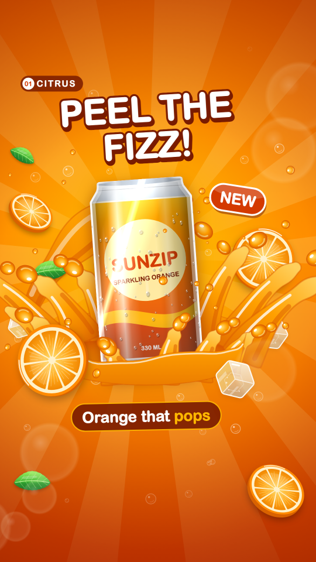

# Splash

A high-speed "freeze-frame" drink or food commercial. The ground is one saturated flavour colour (citrus orange, lime green, berry magenta, ice blue or cola brown-red) that glows: a pale hot spot sits right behind the product, a slow fan of soft rays turns round it, and the corners fall off into the flavour's dark. **One** invented product stands in the middle, drawn in code: a can, a glass bottle, a gable-top carton, a spouted pouch or a tall glass, with flat pack art under a glossy light (a dark turn at both sides, one hard highlight, a white rim light on both edges), a made-up label, and cold condensation: many small droplets with a highlight dot and a tiny shadow, a few of them creeping down and leaving a wet trail. The product stands *in* a crown of liquid: a squashed ring with a low wall and tapered tongues that curl outward and end in detached beads, half of it behind the product and half in front. Round it hang citrus wheels with segments, mint leaves, clear ice cubes, spray beads and rising bubbles; a few large, soft, out-of-focus drops drift in front of everything. Type is heavy rounded sans, tilted, white on a block shadow, with a flavour-coloured pill badge.

Pick it for physical-product ads: drinks, juice, snacks, sauces, fresh food, skincare with a "fresh" or "cold" promise, a new flavour, a "0 sugar" claim, anything that should feel loud, cold and tasty. Not for apps or dashboards (that is ui-mockup / bento), premium hardware (keynote), calm or serious moods, or abstract shape stories (liquid).

**The one rule: one flavour colour per scene, one product in the middle, and everything else is thrown out of the same eruption and then hangs.**

## Palette (`SPL` in kit.js)

Each flavour (`SPL.fl`, picked per call with `flavor` or for the whole piece with `SPL_FLAVOR`) is one hue family:

| flavour | deep (shade, badges) | base (the ground) | hi (the glow) | hot (hot spot) | liq / liqHi / liqLo (liquid) | ink (type shadow, vignette) |
|---|---|---|---|---|---|---|
| `citrus` (default) | `#d43a00` | `#ff7a00` | `#ffb700` | `#fff0a8` | `#ffa000` / `#ffe07a` / `#d95a00` | `#7a1c00` |
| `lime` | `#0c7a2a` | `#35b82e` | `#b8e82a` | `#f4ffb0` | `#7fcc14` / `#dcfb7a` / `#268a10` | `#0a4a1c` |
| `berry` | `#8a0a52` | `#e6197e` | `#ff6aa8` | `#ffe1ee` | `#f0306e` / `#ffa6c6` / `#a80a4c` | `#56063a` |
| `ice` | `#0b3fa6` | `#1790ea` | `#6fd4ff` | `#ecfaff` | `#58c4f6` / `#d6f4ff` / `#1470c8` | `#082a6e` |
| `cola` | `#2c0805` | `#8a1f10` | `#d8502a` | `#ffd2a0` | `#6a2410` / `#e08a4a` / `#2e0c06` | `#1c0503` |

- Neutrals: white (type, rims, highlights, droplets), `cream` `#fff8ea` (paper labels, carton faces), `silver` (can shoulders, caps). `paper` `#ffc61a` is the flash a morph happens on.
- Fruit (`SP_FRUIT`): orange `#ff8a00` rind / `#ffa81a` flesh, lime `#43a01e` / `#a6d638`, lemon `#ffd21a` / `#ffe85a`, grapefruit `#ffa24a` / `#ff6a5a`; mint `#8fe85a` to `#17702a`; strawberry `#ff5a48` to `#9c051c`. Fruit keeps its own colour on any ground.
- Any other base colour works as a flavour (`flavor: '#7a2dd0'`): `spFlavor` derives the rest. Mid-morph the renderer's `rgb()` blend goes through the same path.
- **Colours for the renderer:** `ERA_BG` and a bridge shape's `c` are a flavour's **base** hex; `heroColor` is the orange rind.

## Light and texture

- **The ground** (`spGround`): a vertical gradient (base mixed 40% toward deep at the top, base at 42%, deep at the bottom), a radial hot spot centred behind the product (hot, hi at 20%, hi 36% at half radius, gone at the edge; radius about half the frame's long side), 14 soft ray wedges in the hot colour at 20% that turn 0.05 rad/s, and a vignette in the flavour's ink (55% at the corners). Never flat, never a second hue.
- **The product** (`spProduct`): a soft dark halo behind it (it is backlit), then, clipped to its outline: flat pack art; a shade (black 56% at both edges falling to nothing by a quarter of the width; one hard white highlight at 26% across, a soft return at 73%; a top wash and a bottom falloff); **rim lights on both edges** (white, inside the outline, 100% at the edge and gone by 22% of the width); condensation; an optional glint (a slanted white band, added).
- **Condensation** (`spCondense`): about 90 droplets of 2–6 px, crowded toward the edges of the turn and squeezed there; each is a tiny shadow down-right, a 20% white body, a lower crescent of light and a white highlight dot up-left. Five or six runners creep down 18–34% of the height, sticking and slipping, each over a fading wet trail. A light frost fades in toward the bottom.
- **Liquid** (`spLiquid`, `spSplash`, `spSwoosh`, `spBead`): thick parts dark (liqLo), thin tips backlit (toward liqHi); every tongue has a darker edge, one white highlight along its lit side and a shaded stroke along the other; it tapers to a small bulb and a round tip, never to a point; beyond the tip sit one to three detached beads, each with a highlight dot and a lower crescent. The crown is a ring squashed to 26% with a low wall that climbs into each tongue's root.
- **Fruit, mint, ice:** wheels have a rind, a pith ring, 9–11 rounded segments with radial vesicle strokes and a gloss arc, and show their thickness when tilted; mint is a serrated two-tone almond with a pale midrib; ice is a clear rounded cube with three faces (the left one takes the drink's colour), refraction streaks, a ghost of its far corner and bright edges. Each floats on a soft drop shadow.
- **Depth:** bubbles (rings with a highlight dot, 5–17 px) rise behind everything; 6–8 out-of-focus drops (46–118 px, 10–20% alpha, a brighter rim) drift up at the frame's sides in front of everything.
- **Type** (`SP_SANS`: Arial Rounded MT Bold, Nunito, Varela Round, Segoe UI Black, Arial Black, Helvetica Neue): headline weight 900 at 110–130 px, tilted -0.06 rad, white with an 11% outline and an 8% block shadow in the flavour's ink; badge 44–50 px white on a deep pill with a white rim, a hard shadow and a shine; caption 52 px white on an ink pill, key word in the flavour's hi; tag 30 px tracked caps on an ink pill with a numbered white disc.

## Motion habits

- On 1s (`ones: true`), energetic. **Everything erupts fast and then hangs**: `spFreeze(t)` reaches about 90% in a quarter of a second and then drifts on at 3–4% a second. The crown, the thrown fruit and ice (`spFly`) and the swoosh all ride it, started on the beat.
- **The product pops up through the crown** with a small overshoot (`springEase(t, 210, 14)`: up from below, scale 0.6 to 1). A product that is already standing takes the hit instead: a 5% bump that rings out.
- **Thrown things** turn fast on the way out (about half a turn) and then tumble slowly (0.12–0.3 rad/s); wheels rock their tilt a little. Spray beads are stretched along their path at first and round up as they slow. Detached beads keep drawing apart from their tongues.
- **Type slaps on**: headline lines pop one after another (0.17 s apart, a spring with a small rotation), the badge 0.75–1 s later with a bigger wobble, the caption last. All screen-space type steps aside 0.15 s before a bridge.
- **Background life** (always running): bubbles rise, the foreground drops drift, condensation runs, wheels and ice keep turning, the rays turn, the hero's beads orbit, a glint sweeps the product about once per scene (0.7 s).
- **Camera**: one slow push toward the product per scene (z 1 to 1.05). No cuts inside a scene.
- **Bridges**: the scene is seen through the product's outline, edged with a wet rim of its liquid; on a yellow flash the pack itself changes shape and colour, glossy and wet, a glint crossing it and beads thrown off it; the next flavour opens out of the new outline and its crown erupts a quarter of a second later.
- **Sound**: a sub and a band-passed noise burst on each eruption, fizz that settles, bubble pops, a bright major riff that steps up a tone for the second flavour, a pop and a chime for each badge, small bells for ice.

## Frame checklist (in addition to `grammar/FRAME.md`)

1. **Squint test: a bright glowing colour with a product in its hot spot.** One hue family fills the frame; the brightest area is directly behind the product. A flat, grey or two-coloured ground fails.
2. **Exactly one product**, upright or tilted a few degrees, 600–780 px tall on 9:16, with all of: pack art, both rim lights, the hard highlight, condensation, the halo behind it.
3. **The product stands in the crown**: `spSplash` is called twice (`part: 'back'` before the product, `part: 'front'` after it) with the same key, ring and time.
4. **Liquid reads as liquid**: tongues are wide at the root, curl outward, end in a bulb and detached beads; no straight spikes, no flames, no flat ribbons. Beads have a highlight.
5. **The label is invented and readable**: a short made-up name, a small descriptor; no real brand, logo or trademarked pack shape.
6. **Three depth layers**: bubbles and thrown things behind, the product and crown, then a few things and out-of-focus drops in front.
7. **Fruit matches the flavour** (orange on citrus, lime and mint on lime) and at least one wheel is large; ice is present when the promise is "cold".
8. **Nothing covers the label or the type**: thrown things stay clear of the headline (y under about 580), the badge and the product's name.
9. **Type hierarchy at phone size**: tag (small, top left), a two-line tilted headline above the product, one badge beside its shoulder, one caption pill at y about 1440. Everything that matters inside x 60–940, y 250–1500; decoration may spill below.
10. **Something is still moving** in a held frame: a runner on the product, a bubble, a slow tumble.
11. **Bridge objects are two packs of similar height** (can to bottle, carton to pouch), coloured with their flavours' base hex, standing still at the bridge time.

## Kit API (`kit.js`, on top of `kit/core.js`)

- Palette and constants: `SPL { paper, cream, silver, fl { citrus, lime, berry, ice, cola } }`, `SP_SANS`, `SP_FRUIT { orange, lime, lemon, grapefruit }`, `SP_KINDS { can, bottle, carton, pouch, glass }` (profiles and pack art).
- Colour and timing: `spFlavor(name | hex | rgb() | flavour)` → `{ deep, base, hi, hot, liq, liqHi, liqLo, ink }`, `spFruitOf(flavour)`, `spMix(a, b, u)`, `spA(colour, alpha)`, `spW(alpha)`, `spK(alpha)`, `spRGB`, `spHex`, `spFreeze(t, k, drift)` (the erupt-then-hang curve), `spFly(t, from, to, { k, drift, sag })` → `[x, y, g]`, `spBridgeK()` (1 outside bridges, 0 inside).
- **The ground and the air:** `spGround(flavour, { cx, cy, r, rays, a, vig })`, `spBubbles(key, n, { x0, x1, y0, y1, rmin, rmax, sp, a })`, `spBokeh(key, n, flavour, { rmin, rmax, a, mid })` (the out-of-focus foreground drops: draw last).
- **The product:** `spProduct(kind, x, y, s, { flavor, rot, scale, a, label { name, sub, note, fruit }, glint, glintA, cond, drops, run, rim, shadow, key })`: kind `'can' | 'bottle' | 'carton' | 'pouch' | 'glass'`, centred on (x, y), `s` px tall. `spProductPts(kind, x, y, s, rot)` is its closed outline in world coords (for bridges). `spGloss(P, colour, { glint, cond, rim })` lights any closed outline as a wet glossy body (the morph shape).
  - Building blocks, in local coords (centred, half-width `w`, height `s`): `spProf(profile, w, s)`, `spLit(P, w, s, flavour, o, mode, art)`, `spShade(mode, w, s)` (`'cyl' | 'glass' | 'flat' | 'pillow'`), `spRim(P, w, s, a)`, `spCondense(w, s, key, { n, run, y0, y1, frost })`, `spGlint(w, s, u, alpha)`, `spLabelText(str, x, y, maxW, size, colour, { rot, weight, under })`, `spInnerBubbles`, `spCrimp`, `spHLine`. A new pack is one more entry in `SP_KINDS`: `{ hw, mode, prof, art(fl, w, s, o), under?, over? }`.
- **Liquid:** `spSplash(x, y, t, flavour, { R, h, n, sq, part, key, spray, k, drift, pool })` (the crown; `t` = seconds since it erupted), `spSwoosh(cx, cy, r, a0, a1, width, flavour, { u, sq, key, a, hi })` (an arc of liquid with beads off its leading end), `spLiquid(C, wf, flavour, { a, hi })` (any tapered ribbon along a centreline), `spRibbonPts(C, wf)`, `spBead(x, y, r, flavour, { rot, st, a })`.
- **Fruit, mint, ice:** `spSlice(kind, x, y, r, rot, { tilt, a, flat })`, `spBerry(x, y, r, rot, { a, flat })`, `spLeaf(x, y, r, rot, { bend, a, flat })`, `spIce(x, y, r, rot, { tint, a, flat })`. `flat: true` drops the shadow (printed on a pack, or inside a glass).
- **The hero:** `spHero(x, y, r, { key, rot, tilt, kind })`: an orange wheel that turns, two beads of juice in orbit; sets `SPARK_AT`.
- **Type:** `spType(str, x, y, size, { flavor, color, shadow, rot, align, depth, weight, a, at })` (one line; with `at` in absolute seconds it pops in), `spBadge(str, x, y, { flavor, size, rot, c, at, a })` (world coords, under the camera). Through `DEFER`, at screen size: `spHeadline(line | [lines], { flavor, x, y, size, rot, at, gap })`, `spCaption('Orange that *pops*', { flavor, x, y, size, at })`, `spTag('01', 'Citrus', { flavor, x, y, size, at })`. `at` on these three is seconds into the era.
- Piece option (a plain constant anywhere in the piece): `const SPL_FLAVOR = 'berry';` sets the default flavour.
- `STYLE`: `paper` (the yellow flash), `backdrop` (the glowing ground in the passing colour), `window` (the scene through the outline with a wet liquid rim), `blob` (the glossy wet pack in the blended colour, a glint crossing, beads thrown off), `hero` / `heroColor` / `heroPts` (the orange wheel), `ones: true`. No `post`.

## Do / don't

- **Do** start every scene with an eruption on a beat and let it hang; put the product's pop within a frame or two of it.
- **Do** draw the crown in two calls round the product, and keep its base near the product's lower sixth so the label stays clear.
- **Do** invent the product, its name and its claims. No real brand names, logos or recognisable trademarked pack shapes; fruit on a pack is a printed `spSlice` with `flat: true`.
- **Do** pass the same flavour to the ground, the liquid, the ice tint, the badge and the type of one scene.
- **Do** keep a large wheel or cube overlapping the crown's front edge: it hides the ring's ends and adds depth.
- **Do** stand the product still at a bridge (the morph's outline is its resting outline).
- **Don't** mix two flavour colours in one scene, add a pattern or a second gradient to the ground, or dim the hot spot.
- **Don't** let the splash become abstract blobs (that is liquid) or outlined shapes (that is comic): no ink outlines, no flat fills.
- **Don't** use thin or light type, a serif, or untilted centred captions floating without a pill.
- **Don't** fill the frame edge to edge with thrown things: six to ten, with clear air round the headline.
- **Don't** animate the thrown things on a constant speed: fast out, then nearly still.
- **Don't** put more than one badge or more than one caption in a scene.

## How it differs from the closest shipped styles

- **liquid** is abstract: borderless gradient blobs that merge and split, with a drop hero. Splash is product-centric and photographic in intent: a labelled pack, real fruit, ice, condensation, a lit ground; its liquid is a crown thrown by an object, not the subject.
- **keynote** also lights one invented product, but on a black stage in one finish colour with thin white type and no motion in the object. Splash is the opposite mood: saturated ground, heavy type, things flying.
- **comic** shares the loud type and bursts but is flat inked outlines and Ben-Day dots; splash has no outlines.
- **aurora** has a glowing gradient ground too, but several hues, grain and no objects.

## Not matched / known weaknesses

- Built from the genre's conventions (freeze-frame beverage spots), not measured against one reference film. Products, names and claims are invented.
- It is a 2D fake of a 3D photograph: packs are front views with a painted turn; they cannot rotate, and the label does not wrap (only the bottle's label edges are curved). The crown is a fixed set of tongues on an ellipse, not a simulation; tongues do not collide or merge.
- Drop shadows and the product's halo use the canvas `shadowBlur`, which is in device pixels: they do not scale with the camera zoom (unnoticeable at the demo's 1.05 push, visible in a big zoom).
- The glass and the bottle are opaque paintings of transparency: the background does not show through them.
- A custom flavour derived from an arbitrary colour (and the mid-morph blend between two distant hues) can turn muddy; the five presets are tuned by hand.
- Heavy rounded type depends on the system font: Arial Rounded MT Bold on macOS; Windows falls to Segoe UI Black or Arial Black and Linux to DejaVu Sans Bold, which are not rounded. Glyph widths differ between platforms.
- Layout numbers were tuned for 9:16 at 1080 × 1920; 1:1 and 16:9 were not rendered.
- Not exercised by the demo: the `carton`, `pouch` and `glass` packs, the `berry`, `ice` and `cola` flavours, `spBerry`, lemon and grapefruit wheels (all rendered as stills while building the kit, not in a piece), a hero-to-hero bridge (`STYLE.hero`), `spType` on its own, export `--blur`. The demo does not loop seamlessly.

## Proven on

Its demo only. `demo/` (6 s, 9:16, 120 BPM, 24 fps): on a glowing orange ground a crown of juice erupts on the first beat and an invented can ("SUNZIP") pops up through it with a small overshoot; orange wheels, ice and mint are thrown out and hang, the hero wheel lands lower left, the headline "PEEL THE FIZZ!" slaps on, then a NEW badge, a glint crosses the cold can while droplets run down it, all during one slow push. At 3.0 s the scene closes onto the can and on a yellow flash it becomes a glass bottle ("MINTIKA") on a lime ground: a second crown erupts round it, lime wheels, mint and ice hang, the orange hero comes back small in the corner, "STAY FROSTY" and a 0 SUGAR badge land. `tools/tile.mjs` reports `deterministic: true`.
