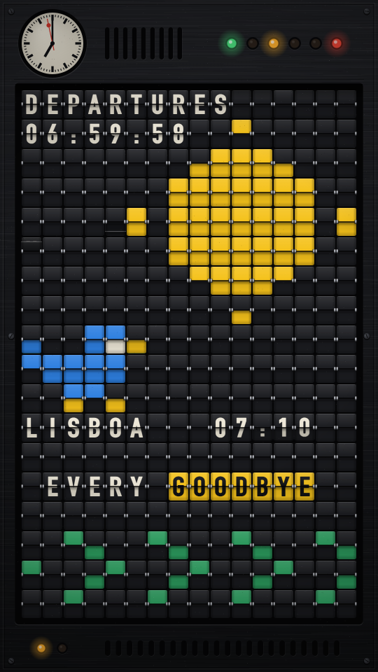

# Split-flap

A mechanical departure board, the kind that hung in railway stations and airports. The whole frame is the machine: a brushed dark housing with a station clock, a speaker grille and a row of indicator lamps, and inside it a fixed grid of cells. Each cell is a pair of hinged flaps, a top half and a bottom half, with a split line between them and a hinge pin at each side. A cell shows one of two things: a **character** (off-white condensed capitals and digits, physically cut in two by the split) or **solid colour**, and because each half-flap can carry its own colour, a block of colour cells becomes a coarse mosaic picture: a sun, a heart, an arrow, a bird. Nothing is ever drawn freely on the board.

The motion is the point. A cell changes only by flipping: the top flap falls forward, foreshortened and darkening, its back lands as the new bottom half with a small bounce, and a few flaps of the drum pass before the target. Changes run across the board as waves (left to right, top to bottom, outward from a point), so words and pictures assemble out of chatter, and every flap that lands can be given its own click in the score.

Pick it for travel, time, schedules, countdowns, announcements, status changes, before/after and "X becomes Y" stories, launch dates, scoreboards, anything where information *turning over* is the idea. Not for soft or organic subjects, faces, fine detail, long sentences, or anything that needs more than about 14 characters on a line or a picture finer than 16 × 36 blocks.

**The one rule: everything on the board is a flap in a cell, and a cell only ever changes by flipping.** No fades, slides, scales or free drawing; if it can't be a character flap or a colour half-flap, it is not on the board.

## Palette and meaning (`FLP`, `FLAP_COL` in kit.js)

A small signal palette on black. Colours are flat, matte card; a flap cannot show a tint or a blend.

| role | hex | letter | use |
|---|---|---|---|
| blank flap | `black #1b1c20` | `k` | every cell at rest; the board is mostly this |
| gap | `recess #050506` | | the dark between flaps and the recess they sit in |
| characters | `white #ece6d6` | `w` | all text; in pictures: an eye, a pulse running through a shape |
| signal | `yellow #f5c21b` | `y` | the highlighted caption word (black letters on yellow flaps), warm pictures (a sun), small accents |
| alarm / heart | `red #d8362c` | `r` | one picture or status per frame, never text |
| **hero** | `blue #2e7fe0` | `b` | reserved for the hero (`STYLE.heroColor`) |
| wayfinding | `green #2fa765` | `g` | arrows, chevrons, "on time" marks; keep it at the edge of the frame |
| letter on colour | `ink #101114` | `k` as `fg` | black lettering on a colour flap |
| housing | `housing #16171a`, `housingD #0b0b0d` | | the brushed frame; `housingD` is `STYLE.paper` and `ERA_BG` |
| furniture | `pin #9a9da4`, `dial #e8e3d4`, lamps `#4be07f` / `#ffb02e` / `#ff4a3a` | | hinge pins, the clock face, power / chase / busy lamps: on the housing only |

A frame is at least two-thirds blank flaps. Use two or three colours at once, each meaning one thing.

## How the board is built

- **The grid** (`FLAP_G`): 16 × 18 cells of 60 × 84 px starting at (60, 256) on a 1080 × 1920 frame, 4 px of gap round each flap, 12 flaps a second. `flapSetup({ cols, rows, x0, y0, cw, ch, gap, rate, clock })` changes it before the first board is built. Content belongs in columns 0–13 and rows 0–13 (x 60–900, y 256–1432).
- **A face** is four letters: character, top colour, bottom colour, letter colour (`'Akkw'` = a white A on black; `' ykw'` = yellow over black; `' kkw'` = blank). `flapFace` draws it once into a small cached canvas: a card with rounded outer corners and the glyph, sized from the font's measured cap height (68 % of the flap) and squeezed to 64 % of its width, so a fallback font fills the flap the same way.
- **Type**: `FLAP_FONT` = `"DIN Condensed", "Bahnschrift Condensed", "Avenir Next Condensed", "Arial Narrow", "Liberation Sans Narrow", "DejaVu Sans Condensed", "Helvetica Neue", Arial, sans-serif`, weight 700 with a hairline stroke for weight; caps, digits and `: . - / ! ? & + '` only. One character per cell, so text is always letter-spaced on the grid.
- **The cell** (`flapCell`): the face, then a shared overlay: light on the top flap, the shadow the top flap throws on the bottom one, darker sides, a 3 px split, and two metal hinge pins in front of everything.
- **A flip**, phase p from 0 to 1: the next face's top half is already behind; p < 0.5 the old top half is squashed toward the hinge by cos(pπ), widened a hair, darkened, with a bright free edge; p > 0.5 its back (the next face's bottom half) grows down from the hinge and throws a shadow on the old bottom half. After the last flap two small bounces (34° then 11° of lift, about three frames) let the old flap show under the new one.
- **The drum**: characters sit in the order of `FLAP_REEL`, colours in the order of `FLAP_CREEL` (`k w y r b g`). A cell asked for a target with `flips: n` passes the n − 1 faces before it on the drum, so a yellow sun arrives through black and white, an `R` through `O P Q`.
- **Pictures** count half rows (`hrow`): a string map has one row per half cell, so the picture grid is 16 × 36 blocks of 60 × 42 px. `flapMapPts` turns a map into its outline for a bridge; `b.shape` fills any outline with flaps.
- **The program** (`flapBoard`): a board is declared once as text, pictures, sprites, clocks and strays over absolute time, with a wave order and a per-cell delay, and compiled into a list of flips per cell. `flapDraw` draws any frame from it, so nothing is carried between frames and the tile check stays deterministic. A sprite sits over the board: the cells it leaves flip back to whatever is under it.
- **The housing** (`flapHousing`, cached): brushed metal hairs, a recess with every cell blank, screws, a station clock, a grille, lamp sockets, vents. `flapLive` adds the clock's hands (the second hand jumps and rings) and the lamps: green power, an amber chase on the 8ths, a red lamp that is on while flaps are moving.
- **Finish** (`STYLE.post`): darker corners and a little dust. No glow, no scanlines, no glass.

## Motion habits

- On 1s (`ones: true`). Mechanical: nothing eases in, nothing fades, nothing slides between cells.
- **Everything arrives as a wave.** Text left to right at about 0.03 s a cell with 4–5 flaps each; pictures radially from their middle at 0.045–0.05 s a cell with 3 flaps; clearing is faster (1–2 flaps).
- **Changes are small and local.** A time turns into a gate, a clock drops one flap on the second, a status word swaps. Only the cells that differ flip: `b.text` over an old line leaves the unchanged letters alone.
- **Pictures move by re-flipping.** The hero hops as a sprite: one position up and across, then down, two frames each; rays step out and back on the 8ths; a band of chevrons marches a column a beat; a heartbeat is a ring of white that runs out from the middle (`b.flick`).
- **Idle life:** the clock row and the housing clock tick on the second, lamps chase, a few blank cells flip through a letter or two and settle back (`b.stray`), a status mark re-flips.
- **Bridges:** the old board closes onto the bridge picture as a wave of cells falling to blank; the picture's flaps turn over to the new colour from the middle outward while its outline creeps to the new shape by whole half-flaps; the new board opens out of it as a wave of flaps landing. The caption row flips away as the bridge starts.
- **Sound follows the flaps.** `flapActivity(board)` lists every landing, frame by frame; the score gives each a dry click, so the clatter has exactly the picture's waves.
- **Camera:** none. It is a board on a wall.

## Frame checklist (in addition to `grammar/FRAME.md`)

1. **The grid shows everywhere:** split lines and hinge pins are visible on blank cells at phone size, and at least two-thirds of the cells are blank.
2. **Every mark on the board is one cell's flap:** a character or a colour half. Nothing crosses a gap, nothing sits between cells, no outlines, no gradients across cells.
3. **Something is mid-flip:** a wave in progress, a hop, a clock digit, a stray. A flipping cell shows two different halves and a foreshortened flap, never a blend.
4. **Words are capitals on the grid,** one per cell, at most 14 to a line, in columns 0–13 and rows 0–13; one short line per row, at most four rows of text in a frame.
5. **One picture owns the frame:** at least 6 × 8 blocks, with a full blank cell between it and any text or other picture.
6. **Colour is flat and means one thing each:** blue only on the hero, yellow for the highlight, one red thing. No colour is spent on decoration inside the safe zone.
7. **The hero reads as a silhouette** at 6 × 6 blocks, with one white eye, and stands on a row of text or blank cells, not over a picture.
8. **The caption is one row of the board** (row 13, y 1348–1432), 16 characters at most, one word on yellow flaps with black letters; the row is otherwise empty and the row above it is blank.
9. **The housing frames it:** clock, lamps and grille above the board, vents below; nothing that matters is on the housing.
10. **Bridge objects are two colour pictures on the same patch of cells** with similar proportions (7 × 10 blocks to 7 × 10 blocks), with nothing else touching them at the bridge time.

## Kit API (`kit.js`, on top of `kit/core.js`)

Needs `FPS`, `W`, `H`, `CX` from the piece head; reads `BRIDGES` if the piece has it.

- Palette and constants: `FLP`, `FLAP_COL { k, w, y, r, b, g }`, `FLAP_FONT`, `FLAP_REEL`, `FLAP_CREEL`, `FLAP_BLANK`, `FLAP_G { cols, rows, x0, y0, cw, ch, gap, rate, clock }`, `flapSetup(o)`, `flapXY(col, row)` (a cell's corner in px), `flapCenter(str, cx)` (the column that centres a string).
- **The board program:** `flapBoard(key, (b) => { ... })`, compiled once and cached by key. Times are absolute seconds; every call takes the wave options `{ wave: 'lr' | 'rl' | 'tb' | 'bt' | 'diag' | 'radial' | 'rand' | 'none', gap, from: [col, row], jit, span, flips }`.
  - `b.text(t, col, row, 'WORDS *HI*', { fg, bg, hiFg, hiBg })` — a row of characters; `*..*` puts a word on yellow flaps.
  - `b.pic(t, col, hrow, MAP, { pal, erase })` — a colour picture from a string map (letters `k w y r b g`, `.` = leave alone); `pal` recolours it, `erase` flips its cells back to black.
  - `b.shape(t, P, 'y', o)` — any outline in px, filled with colour flaps (centre test per half cell).
  - `b.flick(t, col, hrow, MAP, 'w', o)` — the map's cells flip to a colour and back: a pulse, a twinkle.
  - `b.sprite(MAP, [[t, col, hrow], ...], { flips, inFlips, hero })` — a picture that sits over the board and hops; `[t, null]` hides it. The last one declared is the hero and sets `SPARK_AT`.
  - `b.clock(t0, t1, col, row, o)` — `HH:MM:SS` from `FLAP_G.clock`, one flap per changed digit on each second.
  - `b.stray(t0, t1, { n, box: [c0, r0, c1, r1], key })` — blank cells that flip through a character or two and settle back.
  - `b.clear(t, c0, r0, c1, r1, o)`, `b.set(t, col, row, { ch, bg, bg2, fg }, o)`.
- Drawing: `flapScene(board)` (housing, the board at `TT`, lamps and clock), `flapDraw(board)` (the cells only; returns how many are moving; reports words to the text check), `flapHousing()`, `flapLive(busy)`, `flapStamp(MAP, col, hrow)` (a picture at rest, no program).
- One cell: `flapFace(key)`, `flapCell(x, y, A, B, p, { lift, raw })`, `flapBounce(t)`, `flapSeq(from, to, n)`, `flapWave(o, col, row, box)`.
- Outlines and cells: `flapMapPts(MAP, col, hrow)` (a map's outline in px: the bridge shape), `flapInside(P, x, y)`, `flapRho(P, cx, cy, x, y)`, `flapCen(P)`, `flapNearest(colour)` (the nearest flap colour letter).
- Sound: `flapActivity(board)` → `[[t, flaps landing, pan], ...]` per frame, for the score.
- Hero: `FLAP_BIRD` (a 6 × 6 block bluebird map), `flapHero(x, y, r)` (at rest, snapped to the grid).
- Captions (through `DEFER`): `flapCaption('EVERY *GOODBYE*', { row, col, at, out, flips })` (centred on `CX` by default; flips away as the next bridge starts), `flapTag('GATE 4', { row, col, at })`.
- `STYLE`: `paper` (`housingD`), `backdrop` (the housing with every flap blank; the blended colour is ignored), `window` (the era shown cell by cell inside the outline, its edge a wave of flips), `blob` (a region of colour flaps that flips to follow the outline, the colour turning over from the middle out), `hero`, `heroColor` blue, `heroPts`, `post`, `ones: true`.

## Do / don't

- **Do** lay the board out on paper first: which rows are text, which block of cells is the picture, which row is the caption. Leave whole rows blank between them.
- **Do** draw pictures as string maps at half-row resolution and check them at phone size; 7 × 10 blocks is enough for a disc or a heart.
- **Do** give every change a wave and a reason: a line arrives left to right, a picture from its middle, a status in place.
- **Do** put cues on the 8th-note grid and build the clatter from `flapActivity`, so sound and picture share one source.
- **Do** keep the bridge pictures on the same cells in both eras and build the bridge shapes with `flapMapPts`.
- **Don't** fade, slide, scale, rotate or blur anything on the board, and don't draw on it with `ctx`.
- **Don't** blend colours or use a tint: a flap is one of six colours, or it is mid-flip.
- **Don't** fill the board. A wall of colour reads as pixel art; a wall of text reads as a terminal.
- **Don't** set lower case, long lines or two captions; don't put words in columns 14–15 or below row 13.
- **Don't** move the camera, and don't put anything over a bridge picture at the bridge time.
- **Don't** use more than three or four flaps per cell on long lines: the wave should finish inside a beat or two.

## How it differs from the closest shipped styles

- **terminal** is also a character grid, but it is light on a tube: phosphor glow, scanlines, typed text, one hue. Split-flap is a lit physical object with no glow: cells have gaps, hinges and shadows, text is letter-spaced capitals, several flat colours, and things change by flipping, not typing.
- **pixel** draws at low resolution and upscales: square pixels edge to edge, dithering, sprites that slide. Split-flap blocks are separate cards 60 × 42 px with a gap round each, far fewer of them, and nothing slides: a picture moves by re-flipping.
- **kinetic-type** makes huge words move freely across a paper grid with eases and masks. Split-flap type is one size, locked to cells, and its only move is the flap.
- **mosaic** also builds pictures from pieces, but irregular stone tiles laid along contours; here the pieces are a rigid machine grid.

## Not matched / known weaknesses

- Built from the genre's conventions, not measured from a specific board or reference.
- The flap is a 2D fake: a vertical squash toward the hinge with shading and a slightly wider flap, not a perspective trapezoid. At 12 flaps a second and 24 fps each flap is seen twice (45° falling, 135° landing).
- The drum is cut short: a cell passes only the last `flips − 1` faces before its target, not the whole reel as a real board would.
- Letter shapes come from the system condensed sans (DIN Condensed on macOS, Bahnschrift or Arial Narrow on Windows, Liberation Sans Narrow or DejaVu Sans Condensed on Linux), so weight and width differ a little by platform; the cells, colours and motion do not.
- One text size only, and no character on a two-colour flap. A big headline would have to be block letters built from colour flaps.
- Pictures are coarse (blocks of 60 × 42 px, wider than tall); faces and thin diagonals do not survive. The hero is 6 × 6 blocks and cannot change expression.
- The morph hooks ignore the camera and the blended colour: `backdrop` always draws the blank board, `blob` reads both shapes from `BRIDGES` (in world coordinates), and `window` cuts whole cells out of the era's layer, so a piece with camera moves would show cells off the grid. The hero-to-hero bridge (`STYLE.hero`, `heroPts`) and `flapTag`, `b.shape`, `b.clear` waves other than left to right, and grids other than 16 × 18 are not exercised by the demo.
- A caption needs about 0.3 s of the bridge to flip away; with a bridge shorter than `d: 0.4` it would still be turning when the morph starts.
- Captions are single-row only; the demo does not loop seamlessly.

## Proven on

Its demo only. `demo/` (6 s, 9:16, 120 BPM, 24 fps): a board at 06:59:57. `DEPARTURES` clatters in left to right, the clock row ticks, a sun of yellow flaps assembles from its middle outward through black and white, a bluebird of colour flaps appears and hops twice along the listing row, `LISBOA 07:10` turns over to `GATE 4`, the sun's rays step out and back on the 8ths, green chevrons march along the bottom, a few blank cells stray, and the caption row reads EVERY GOODBYE. At 3.0 s (07:00:00) the board closes onto the sun in a wave of flips, its flaps turn red from the middle while the outline becomes a heart, and the new board opens: `ARRIVALS`, `LISBOA LANDED`, the heart beats four times as a ring of white flaps, sparks answer on the off-beats, the chevrons turn round, the bird hops under the heart, FLIPS TO HELLO. The score's clatter is generated from the boards' own flap landings. `tile.mjs`: deterministic, 3–15 ms a frame after the first; `review.mjs`: all checks pass (morph on grid, story arc, text, dead beats), −14.7 LUFS, true peak −3.2 dBFS.
