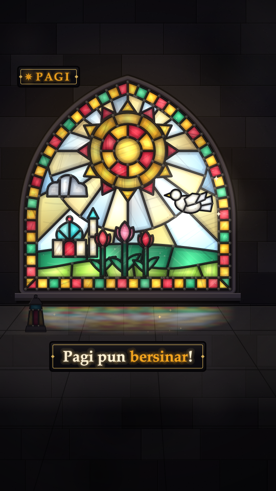

# Stained glass



A leaded window lit from behind in a dark stone room. Every picture is cut into **panes** of coloured glass held by thick dark lead came, with a solder dot wherever leads meet. Each pane is one jewel colour with its own slight tint, a glow that is brighter in the middle and darker toward the lead, and the streaks, seeds and uneven thickness of hand-made glass. The window sits in a moulded opening in near-black dressed stone, usually arched (pointed, round or horseshoe) with a border of small square panes; its colours spill softly on the floor below. Even the background is glass: a sky of diamond quarries, or pale rays fanning from the sun. Type is a bold roman serif glowing warm white and amber on a dark plaque with a thin gold rule. Motion on 1s, calm.

Pick it for night-and-day stories, Ramadan and other Islamic or seasonal pieces, "light" and "knowledge" metaphors, calm reveals, title cards. Not for fast action, dense data or anything that needs small moving parts: a picture here is built from pieces no smaller than a thumbnail.

**The one rule: the glass is fixed; only light moves.** Nothing slides, scales, fades in or pops. A thing appears because its panes go from dark glass to glowing, one after another along the lead. A character "moves" by being a small leaded figure that changes place in whole steps, or by panes lighting in sequence.

## Palette and meaning (`SGL` in kit.js)

Jewel colours on near-black. A window uses one family for its field and one or two accents.

| role | hex | use |
|---|---|---|
| morph paper / the room | `stone #131117` (`stoneL #2b2731`, `stoneD #070609`) | the wall and floor; the blank wall a morph happens on |
| lead | `lead #0b0a0d`, `leadHi #6a645b`, `solder #353230` | came, its thin lit edge, the dots at junctions |
| **hero** | `milk #f4eedd` | the dove's milky white glass. Reserved for the hero. |
| night field | `night #172c84`, `cobalt #2450c8`, `indigo #33289a`, `violet #7440bd` | night skies, "before", calm |
| day field | `sky #93c8ee`, `straw #f6cf6a`, `cloud #d3e4f2` | morning skies and rays, clouds; `straw` is also the moon and stars |
| the sun, warmth, the highlighted word | `amber #f2a41f` | suns, flames, lamps, door lights, the caption's highlighted word |
| accent | `ruby #c81e33`, `rose #e9708c` | petals, flames, border accents |
| growth | `emerald #1f9460`, `lime #86bf3c` | hills, leaves, stems |
| water, domes | `turquoise #1fb0b8` | domes, border accents |
| type and rules | `white #fff3d6`, `glow #ffd98a`, `gold #d8b25c` | caption text, the glow round letters, the plaque's rule |
| light and shade | `light #fff3d2`, `shade #06050c` | `sglTone` lifts toward `light`, deepens toward `shade`; unlit glass is its lit self under an 86% veil of near-black |

Morph between a cool round and a warm round (cobalt moon to amber sun): mid-morph the roundel flares white-hot, which hides the grey middle of the blend.

## Glass, lead, stone and type

- **A pane** (`sglGlassPane`, painted once): base colour ±14% tint; a radial glow from the centroid (brighter in its own hue, `sglLift`) to −46% at the edge; three soft thick-and-thin patches; 4–16 streaks all running one seeded way, light and dark, 1–6 px; 1–5 seeds (small bubbles with a dark rim); three stacked dark strokes along the outline so the glass darkens into the lead.
- **Lead:** 9 px came (7 px on small figures), near-black, with a 1.4 px lit edge offset up-left; round joins. Solder dots (radius 0.62 of the came) wherever the corners of two or more panes meet. Panes are painted in order: a later pane covers what is under it and cuts away the lead it hides, so pictures are simply laid over a background lattice.
- **Lit and unlit:** `sglDraw` fills every pane from the cached lit glass and veils it by how unlit it is. A lit value above 1 is a white flare (`sglSeq` overshoots for a moment as a pane catches). Lit panes get a 15% halation that creeps over the lead between them.
- **Shimmer:** a slow wave travels across the window and dims lit panes by up to 22%; it never stops, so a held frame is alive.
- **Sweep:** a 150 px band of light crossing from the top-left to the bottom-right, lighting (and flaring) whole panes as it passes.
- **Spill:** the window's blurred image, upside down and squashed, added to the floor under it (`sglSpill`), with fixed twinkling dust (`sglMotes`).
- **Stone** (`sglWall`): ashlar courses 122 px high, blotches and speckle, a floor of big flags, a moulded opening (outer roll, chamfer, deep rebate) and a sill. Painted once per key. `STYLE.post` adds a vignette.
- **Type:** `SGL_SERIF` = `"Palatino Linotype", Palatino, "Book Antiqua", "Iowan Old Style", "Hoefler Text", Georgia, "Times New Roman", "DejaVu Serif", "Liberation Serif", serif`, weight 700. Letters light one after another; an unlit letter is still there at 22%. Glow is two wide low-alpha strokes (no `shadowBlur`). Captions 60 px on an opaque plaque (lead edge, 2 px gold rule, a diamond at each end); tags 44 px small capitals, tracked 0.14 em, with an eight-point star.

## Motion habits

- On 1s (`ones: true`). Nothing boils: the glass is rigid.
- **Light order tells the story:** border first (round the arch, 0.026 s a pane), then the subject (crescent, then its medallion), then the field outward from the subject (`sglOrder` by distance, 0.017 s a pane), then details on the beat.
- **A pane takes ~0.2 s to light** and flares for another ~0.3 s. Groups: `sglSeq` (one after another), `sglChase` (a running pulse: a comet), `sglTwinkle` (stars, lamps), a beat pulse on rosette rings.
- **One sweep per era**, on a beat, 0.6 s. It can wake something (the dove lights as the band reaches it).
- **The hero** steps: a new place and the other wing pose every 8th note, never an in-between. When it arrives it keeps flapping on the 8ths and glints.
- **Captions:** the plaque comes up over 0.25 s, then its letters light left to right (0.03 s apart). Plaques go dark as a bridge starts.
- **Camera:** at most a 4–10% push about a low point (so the window grows without pushing the floor into the caption). Never pan across glass.
- **Morph:** the old window is seen through a ring of came closing on its roundel; on the bare wall a leaded roundel (eight panes round a boss) changes colour through a white flare, throwing its colour on the floor; the new window opens out of it with only the roundel lit, and light spreads from there.

## Frame checklist (on top of grammar/FRAME.md)

1. **Everything inside the window is a pane with lead round it.** No outline-less fills, no gradients across lead, nothing drawn on top of the glass except the hero (itself leaded) and glints.
2. **Panes are big enough to show glass:** at least ~40 px across once the 9 px came has taken its share. A sliver that is all lead is a bug (small stars are one pane, not kites).
3. **The room is dark and the window is the light:** at least a third of the frame is near-black stone; lit glass is the brightest thing in it.
4. **Some panes are still dark, or just catching.** A fully lit, static window is a poster; show the light arriving or let the shimmer and a twinkle carry a hold.
5. **Milky white belongs to the hero.** Clouds and pale rays use `cloud`, `sky`, `straw`.
6. **Jewel colours stay jewel:** ruby reads red, not pink; night reads cobalt, not lavender. Don't hold a whole field in a flare.
7. **Light spills below the window** in proportion to how lit it is, and stops above the caption.
8. **One caption plaque,** one line, inside x 60–940, y 250–1500, one word in amber; the plaque is opaque and drawn last. Nothing stands in its band.
9. **Bridge objects are roundels** of similar size (a medallion, a rosette), with nothing else overlapping them at the bridge.

## Kit API (`kit.js`, on top of `kit/core.js`)

- Palette and font: `SGL`, `SGL_SERIF`, `SGL_DIM`.
- Colour (hex or `rgb()` in): `sglRGB(c)`, `sglMix(a, b, u)`, `sglTone(c, k)`, `sglLift(c, k)`, `sglA(c, alpha)`; `sglHalo(x, y, r, c, al, ry)` (an additive glow), `sglZoom()`, `sglCanvas(w, h)`.
- Geometry: `sglPath(g, P)`, `sglArea(P)`, `sglCen(P)`, `sglClean(P, tol)`, `sglInside(P, x, y)`, `sglClipHalf(P, ax, ay, nx, ny)`, `sglClipConvex(P, Q)`, `sglCirclePts(x, y, r, n)`, `sglSectorPts(x, y, r0, r1, a0, a1, n)`.
- Windows: `sglArchPts(cx, top, w, h, { kind: 'pointed' | 'round' | 'horseshoe' | 'rect', rise, neck, n })`, `sglBorder(P, bw, { step, corner })` → `{ polys, inner }`, `sglFrame(cx, top, w, h, { kind, rise, border })` → `{ out, inner, border }`.
- **Glazing any outline** (each returns polygons): `sglCut(P, { n, key, slant, angle, min })` (seeded straight cuts), `sglFan(P, cx, cy, n, { a0, min })` (wedges from a centre: rays), `sglQuarries(P, s, { ratio, x, y, min })` (diamond lattice), `sglGrid(P, cw, ch, { x, y, brick, min })`.
- Panes: `sglPanes(polys, c | [c…] | (i, P) => c, id, extra)` → `[{ P, c, id, i, n, ce, a }]`; `sglOrder(panes, [x, y], byAngle)` renumbers `i` by distance (or angle).
- Light over time (for a lit function): `sglSeq(p, t0, per, dur)`, `sglTwinkle(p, amt, speed)`, `sglChase(p, t0, speed, gap, tail)`.
- A window: `sglGlaze(key, () => panes, { lead })` (cached: lit glass, lead, bloom) → `G`; `sglDraw(G, lit | (pane, i) => lit, { x, y, s, flip, shimmer, sweep, band, dim, bloom })` → how lit it is (0..1); `sglSpill(G, k, { x, y, w, h, al })`; `sglGlassPane(g, pane, key)`, `sglSoft(canvas, div)`.
- The room: `sglWall(key, { open: [outline…], sill: [x0, x1, y], floor })`, `sglStone()`, `sglAmbient(x, y, r, c, k)`, `sglMotes(x0, y0, x1, y1, n, key, k, c)`, `sglVignette()`.
- Ready-made pieces (return panes): `sglRosette(x, y, r, { n, rings, c, rot, id })` (pane `.ring`), `sglFlames(x, y, r0, r1, n, { c, rot, id, fat })`, `sglStar(x, y, r, { n, inner, rot, c, c2, id, split })`, `sglCrescent(x, y, r, { n, rot, c, id, d, r2 })`, `sglMosque(x, base, { s, c, dome, door, id, side })` (the door pane has `.door`), `sglCloud(x, y, w, { n, key, c, id })`, `sglFlower(x, base, { s, c, leaf, id })` (petals have `.bloom`).
- Things in the room: `sglLantern(x, base, s, { lit, c, c2, hang })`.
- Hero: `sglHero(x, y, r, { wing: 0 | 1, lit, flip, mood: 'sleep' | 'smile' | 'wow' })` — a leaded dove of eight panes; (x, y) its middle, r half its size; sets `SPARK_AT`. `sglHeroGlaze(wing)`, `sglHeroPts(x, y, r)`.
- Type: `sglFont(size, weight)`, `sglTextW(str, size, track)`, `sglText(str, x, y, size, c, { align, reveal, glow, al, track, weight })`, `sglPlaque(x, y, w, h, al, rule)`.
- Captions (through `DEFER`): `sglCaption('words *highlight* words', { y, x, size, at, hi, col })`, `sglTag('Label', { x, y, size, at, c })`; `sglBridgeK()` is their brightness through a bridge.
- `STYLE`: `paper` stone, `backdrop` (the bare wall, tinted), `window` (clip + a glowing ring of came), `blob` (the flaring leaded roundel), `hero`, `heroColor`, `heroPts`, `post` (vignette), `ones: true`.

A window in five lines:

```js
const fr = sglFrame(500, 320, 800, 810, { kind: 'pointed', rise: 540 });
const G = sglGlaze('mine', () => [...sglPanes(fr.border, [SGL.ruby, SGL.amber], 'border'),
  ...sglOrder(sglPanes(sglQuarries(fr.inner, 130), SGL.cobalt, 'sky'), [500, 600]), ...sglRosette(500, 600, 150, { id: 'sun' })]);
sglWall('room', { open: [fr.out], floor: 1196 });
const k = sglDraw(G, (p) => (p.id === 'sky' ? sglSeq(p, 1.0, 0.02) : sglSeq(p, 0.2, 0.03)), { sweep: null });
sglSpill(G, k, { y: 1200 });
```

## Do / don't

- **Do** build pictures from few, large panes and lay them over a lattice or a fan; let the painting order do the cutting.
- **Do** give every glazing a stable key and build its panes in a function: it is painted once and reused every frame.
- **Do** drive everything from one lit function per window, switching on `pane.id`; return 0.5–0.8 for glass that should stay deep (a night sky).
- **Do** move the hero in whole steps on the grid and swap its wing each step.
- **Don't** animate a pane's shape or position, tween the hero between places, or scale things in.
- **Don't** change a glazing's panes per frame (a new key every frame repaints the cache); change light, not glass.
- **Don't** cut panes smaller than ~40 px or stars into kites below r 64: the came swallows them.
- **Don't** use `shadowBlur`, `ctx.filter` or per-pixel loops; the glow is cached bloom and additive gradients.
- **Don't** put props in the caption's band or let the camera push the floor into it.

## Not matched / known weaknesses

- Built from the craft's conventions, not measured from a specific window or film.
- Unlit glass is the lit glass under one flat veil: it has no surface reflections of the room.
- The spill is the whole window's blurred image scaled by how lit it is; it does not show which panes are lit.
- Halation is taken from the fully lit window, so a dark pane painted over a lit one would glow faintly.
- Painting order hides lead and solder under later panes, but where a later pane's edge crosses an older lead line there is no solder dot.
- `sglClipHalf` on a concave outline can leave a hairline bridge along the cut; it sits under the lead.
- Came width is one value per glazing; a small figure needs its own glazing with thinner came (the dove and the lantern do this).
- The first frame of each window costs ~130–190 ms (the glazing, and once the stone, are painted); after that ~25–65 ms/frame with ~190 panes.
- Letters come from a system serif (Palatino on macOS and Windows; DejaVu or Liberation Serif on Linux are plainer).
- Captions are single-line only. The demo does not loop seamlessly (it ends in the morning and starts at night).
- `kind: 'horseshoe'` and `'round'`, `sglGrid`, kite stars and a hanging lantern were checked in a one-off test frame, not used in the demo.

## Proven on

Its demo only. `demo/` (6s, 9:16, 120 BPM, 24fps): a dark pointed window in a stone room, a lantern burning on the floor. Night: the border lights pane by pane round the arch, the crescent and its cobalt medallion glow, the sky of diamond quarries fills in from the moon outward, four stars and three small ones light on the beat, a comet of five panes runs, a lamp flickers in the mosque's door, and a band of light crosses the window and wakes the glass dove asleep on the hill — tag "Malam", caption "Malam, bulan *menyala*". At 3.0s the moon medallion flares white and becomes the sun rosette: flames, twenty rays of pale glass lighting round like a clock, green hills, a cloud, the mosque, three tulips that light stem first then petals, the sun breathing on the beat, and the dove flying up toward it in three steps and flapping — tag "Pagi", caption "Pagi pun *bersinar*!". Tile deterministic; ~25–65 ms/frame (first frame of each window ~130–190 ms); review: morph on grid, no flat frames, text PASS, story arc PASS, dead beats PASS, -14.2 LUFS, true peak -3.0 dBFS.
