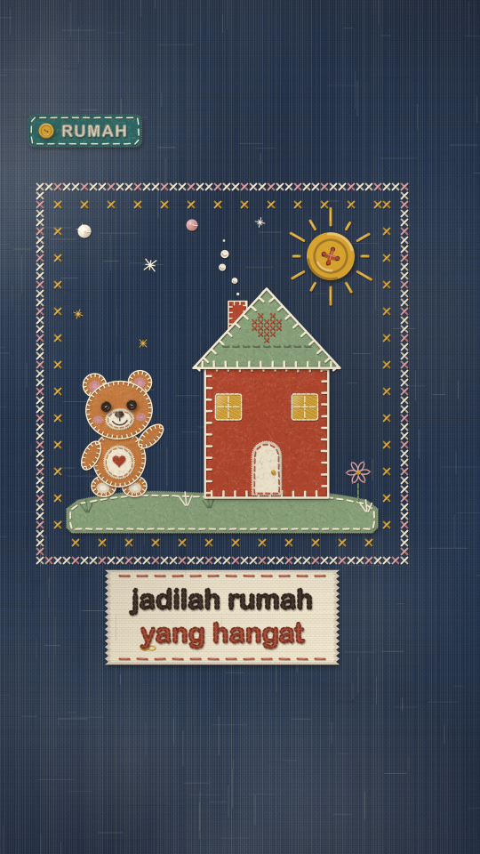

# Stitch

Hand embroidery and felt appliqué on woven cloth. The ground is **natural linen** (optionally stretched in a wooden embroidery hoop) or **deep denim**; shapes are **felt patches** (flat, fuzzy-edged, a soft shadow) sewn down with a visible **blanket stitch** or **running stitch**; lines are **thread**, drawn stitch by stitch: running stitch, backstitch, chain stitch, cross-stitch, satin stitch for solid embroidered fills, French knots for dots. **Buttons** and **sequins** are the accents. Letters are embroidered, and the caption is a **sewn-on fabric label**. The hero is **Beru**, a felt plush bear with button eyes.

Pick it for craft and handmade products, UMKM, children and family, home, gifts, Hari Ibu, anything that should feel warm, patient and made by hand. It is not `batik` (wax lines on dyed cloth, fully patterned, flat) and not `cut-paper` (torn paper, crayon): here everything has thread on it and sits *on top of* the cloth with a small shadow.

**The one rule: nothing is drawn, everything is sewn.** A shape is a felt patch with stitches round its edge; a line is a row of separate stitches; a solid embroidered area is satin thread. No plain vector strokes, no gradients on figures, no outlines that are not thread.

## Palette and meaning (`STC` in kit.js)

| role | hex | use |
|---|---|---|
| linen ground | `linen #e2d3b5` (`linenD #c7b48f` for reserves) | era ground 1: natural undyed cloth, usually in the hoop |
| denim ground | `denim #22344f` (`denimD #16233a`) | era ground 2: the dark cloth |
| sage cloth / paper | `sageCloth #93a685` | the top cloth a morph happens on (`STYLE.paper`) |
| **cream thread** | `cream #f4ead2` | the default thread: blanket stitching on every patch, hems, cross-stitch; also the caption label and small felt details (muzzle, door) |
| **brick red (the thread of the story)** | `brick #b5482f` | the thing the story follows: in the demo the heart, the house it becomes, the heart on the bear's tummy; also the caption's highlighted phrase |
| **caramel (the hero)** | `bear #c47a3e` | Beru's felt. Reserved for the hero. |
| mustard | `mustard #d9a531` | the accent: one button, a sun, lit windows, flower centres, the chain underline of the highlighted phrase |
| sage | `sage #8aa37b`, `sageD #5f7a55` | leaves, hills, roofs; `sageD` for stems and tile lines |
| dusty pink | `pink #d99a9c` | flowers, cheeks, inner ears, a second cross-stitch colour |
| teal | `teal #3d8c8a`, `tealD #2a6462` | cool counterweight: some leaves and buttons; `tealD` is the tag's felt |
| ink | `ink #3a2a22` | caption lettering, the nose, button eyes |
| wood, brass, steel | `wood #d2a56c`, `woodD #a67842`, `brass #c9a24a`, `steel #cfd4d8` | the hoop, its clasp, the needle. Tools only. |

A frame is one ground + cream thread + brick red for the subject + two or three of the muted craft colours. Shadows are one warm dark (`rgba(24,14,8,…)`), highlights one warm white: `stcShade(c, k)` makes every lighter and deeper tone from the base colour, so threads never need extra palette entries.

## Line, fill, texture

- **Cloth** (`stcCloth`): the colour, then one cached neutral weave laid over it: warp and weft threads every 5px, the little holes of a plain weave, slubs, a soft mottle. Visible at phone size but quiet. It lives in world coords (it moves with the camera) and works on any colour, including the `rgb()` blends mid-morph.
- **Thread** (`stcThread`): every stitch is three strokes: a shadow down-right, the thread with round ends, a short highlight up-left. That is what makes it sit on the cloth. Widths 3–7px at 1080 wide; under 2.5px the highlight disappears and it reads as a pen line.
- **Stitches** (`stcStitch`): evenly spaced along any path, with a tiny seeded jitter per stitch (keyed by path, never per frame). Running = dashes with gaps; back = touching segments; chain = overlapping loops (the thick line); blanket = an edge thread with teeth pointing into the patch; cross = X's; knot = French knots.
- **Felt** (`stcFelt`): flat colour, a fibre texture, a fuzzy dotted edge, a soft drop shadow, a slightly darker rolled edge, then its edge stitching. Blanket stitch for main patches (pitch 26–45px on big shapes, 9–14px on the hero), running stitch for inner patches and labels.
- **Satin** (`stcSatin`): dense parallel threads (3.6px pitch, two alternating tones) clipped to an outline, with a band of sheen across them; use for small solid areas (leaves, windows, a nose), never for big ones (big areas are felt).
- **Cross-stitch** (`stcCross`, `stcCrossBorder`): X's on a grid, the under leg a shade darker. Cells 11–20px.
- **Hoop** (`stcHoop`): beech ring with grain, a brass screw clasp, a shadow on the taut cloth inside and darker slack cloth outside. One era at most.

## Motion habits

- On **2s** (`ones: false`). Nothing boils: stitches, fibres and the weave are fixed. The only ambient movement is the cloth "breathing" in `post()` (a fold of light and shade drifting a little) and small idles (buttons turning a few degrees, sequins glinting, a button sun's rays breathing).
- **Stitch by stitch.** Reveals are stitches appearing in order along the path. `stcStep(t0, n, rate)` gives the sewn fraction for one stitch per 1/12s (one per 2s step); `ev()` works for long lines (a chain-stitch wreath). `stcStitch` and `stcFelt` return the needle position while they are unfinished: give it to `stcNeedle`, dipping on alternate steps (`dip: B % 2 ? 0.7 : 0.1`).
- **Drop, then sew.** A felt patch lands (`drop` 0→1 over ~0.25s: slightly large, a big shadow, settling), and only then is its edge stitched (`sewn`). Buttons and knots pop (`popS`).
- **Rhythm with the score.** Put cues on the 1/12s grid. At 60 BPM in triplets a 2s step is a triplet 32nd, so a tick per stitch is in time (the demo); at 90 BPM a step is a straight 32nd.
- **The morph** is a felt patch changing shape; its blanket stitching has a fixed count (`n`), so the stitches ride the edge instead of crawling. **The window** is a hole cut in the top cloth with a blanket-stitched hem (teeth pointing out), the era below shaded by the cut edge.
- Camera: gentle pushes only (z ≤ 1.08); the weave scales with it.

## Frame checklist (on top of grammar/FRAME.md)

1. Is the weave visible on the ground, and is there at least one felt patch with stitches you can count at phone size?
2. Does every shape have thread on it (edge stitching, or satin threads)? A bare flat shape is a bug.
3. Is every line made of separate stitches (not a continuous stroke)?
4. Does brick red mark only the subject of the story, and caramel only the hero?
5. Do patches overlap in a sensible sewing order (what was sewn last is on top; arms in front of the body)?
6. Is the caption on its label, fully inside x 60–940 and above y 1500, with the highlighted phrase in brick red on cream?
7. Is something being sewn or idling (needle, a growing row of stitches, a glint, smoke knots, the bear's ear)?
8. One hoop at most, and nothing important under its ring.

## Kit API (`kit.js`, on top of `kit/core.js`)

| helper | what it draws |
|---|---|
| `stcCloth(c)` | the woven ground in any colour (hex or `rgb()`) |
| `stcStitch(P, { type, c, w, len, gap, n, closed, frac, key, prong, out })` | stitches along a path: `'running' \| 'back' \| 'chain' \| 'blanket' \| 'cross' \| 'knot'`; returns `{ x, y, ang }` (the needle) while `frac < 1` |
| `stcThread(S, c, w)` | a batch of raw stitches: `[x0, y0, x1, y1]`, loops `[cx, cy, rx, ry, ang]`, polylines |
| `stcStep(t0, n, rate = 12)` | sewn fraction when one stitch lands every `1/rate` s from `t0` |
| `stcSatin(P, c, { ang, gap, frac, sheen, edge, ew })` | satin-fill an outline at an angle; `edge` adds a backstitched outline |
| `stcCross(rows, x, y, cell, { pal, frac })` | cross-stitch a small bitmap (strings; `pal` maps characters to colours) |
| `stcCrossBorder(x, y, w, h, cell, { cols, dot, frac })`, `stcXs(cells, cell, frac)` | a cross-stitch frame; raw X's |
| `stcFelt(P, c, { stitch, thread, sw, pitch, n, sewn, drop, lift, tex, key })` | a felt patch from any closed outline (`tex: 'weave'` = a woven label); returns the needle position |
| `stcButton(x, y, r, c, { holes, thread, rot, pop })`, `stcSequin(x, y, r, c, { pop, ph })`, `stcKnot(x, y, r, c, k)` | accents |
| `stcNeedle(x, y, { ang, len, c, from, dip })` | the needle with its trailing thread |
| `stcHoop(cx, cy, r, { w })` | the wooden hoop (cached) |
| `stcHeartPts`, `stcHousePts`, `stcLeafPts`, `stcRibbonPts`, `stcOffset(P, d)` | outlines; an outline moved inward |
| `stcLeaf`, `stcFlower` (lazy daisy), `stcStar`, `stcTuft`, `stcHouse` | embroidered props |
| `stcWord(str, x, y, size, c, { frac, align, ls })`, `stcWordW` | embroidered lettering (satin threads clipped to bold rounded glyphs, a stitched outline), letter-by-letter reveal; its width |
| `stcBear(x, y, s, { wave, drop, face, key })` | Beru; sets `SPARK_AT` |
| `stcCaption('line\n*phrase*', { at, y, size, hi })`, `stcTag('LABEL', { at, bg })` | the sewn-on label and the felt tag, through `DEFER` |
| `stcShade(c, k)`, `stcCache(key, w, h, draw)` | a lighter / deeper tone; a static cached layer |

Needs from the piece head: `CX` (caption centre x). After a bridge of half-length `d`, give the tag `{ at: d }` and the caption `{ at: d + 0.4 }`.

## Do / don't

- **Do** let a patch land before it is sewn, and let the needle lead the stitches.
- **Do** keep stitches chunky: fewer, bigger stitches read better on a phone than many fine ones.
- **Do** bring the story's colour back as a small patch (the heart on the bear's tummy, the cross-stitch heart in the gable).
- **Do** fix `n` on anything whose outline changes (morph blobs, hems), so stitches follow the edge.
- **Don't** re-seed stitch positions per frame or wobble outlines on the boil: thread on cloth does not move.
- **Don't** draw text with plain `fillText`; use `stcWord` (minimum ~34px; captions 60px+).
- **Don't** satin-fill large areas or put cream thread on linen without felt under it (too little contrast: use sage, teal, pink, mustard or brick thread on linen).
- **Don't** stack more than three felt layers, or put a patch over the bridge shape.
- **Don't** use both grounds in one era, or the hoop on both.

## Not matched / known weaknesses

- The weave is a plain weave on both grounds; the denim has no diagonal twill.
- Lettering is system glyphs textured as thread, not stitches that follow each letter's strokes; the fallback fonts (Segoe UI, DejaVu Sans) are less rounded than Arial Rounded MT Bold on macOS.
- `stcWord` renders into a cached canvas, so `tools/textcheck.mjs` (which traces `fillText` on the main canvas) does not see captions and tags: check them by eye in stills.
- Felt shadows use canvas `shadowBlur` (a dozen per hero): fine for one hero and a few props (20–45 ms/frame in the demo), heavy for crowds.
- The blanket stitch on very sharp corners (a heart's point) leaves one tooth sticking out past the tip.

## Proven on

Its demo only (`demo/`, 6s: a heart sewn onto linen in a hoop morphs into a felt house on denim with a button sun and Beru the bear).
