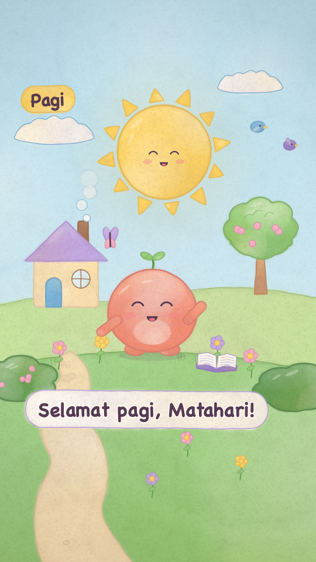

# Storybook

A children's picture book painted in watercolour on warm cream paper. Shapes are soft and round, colours are bright but gentle, and every shape has a soft coloured-pencil outline a shade darker than its own fill (never black). Characters are cute, with big round eyes, highlights and blush. Captions are rounded hand lettering on small painted labels. Made for young kids' educational shorts, so it stays warm, calm, legible and uncluttered.

**The one rule:** every shape is a wash, never a flat fill. `sbWash` gives it a soft uneven edge, pigment pooled at the rim, blooms and paper tooth. Its outline is its own colour, deepened toward a warm plum.

## Palette (`SB` in kit.js)

| role | value | use |
|---|---|---|
| paper | `#fbf3e1` (highlight `#fffaf0`) | the page, cloud and page whites, the blank sheet a morph happens on |
| plum | `#563a52` (light `#8a6a86`) | the only "ink": eyes, mouths, lettering. Outlines are each fill's own colour deepened toward plum |
| sky | `#a9d8ef` → `#e4f3f2` (deep `#79b6da`) | day sky, doors, little birds |
| night | `#6f74c0` → `#c4b2de` | a soft indigo night that never goes black. Night hills `#6c74b6`, grass `#73a98d` |
| leaf | `#8fcb6e` (light `#b9e08d`, deep `#5f9e4f`) | grass, crowns, sprouts, stems |
| sun | `#ffd45e` (deep `#f2b23c`), moon `#fdeeb4` | the sun, stars, lit windows, the glow of a book |
| lilac | `#c4a8e3` (deep `#9b80c6`) | roofs, butterflies, the wet-in-wet cool bleed |
| pink | `#f6abc1` | flowers, fruit, berries, blush |
| wood / wall | `#d19a6c` / `#a5704a`, `#fde3b0` | trunks, chimneys, cottage walls |
| **hero: coral** | `#f58e74` | the sprout-kid, and only the hero |

## Line and texture

- **The wash (`sbWash`).** First a soft feathered fringe where the wet paint crept a few px past its edge. Then a paler opaque underlay, so stacked shapes don't show through, and two translucent passes whose edges are seeded differently (they never move), which gives a soft uneven rim where one pass runs past the other. Inside the paint:
  - blooms: light back-runs with a faint darker crinkled rim, and darker pools
  - a warm and a cool neighbour colour bled in wet-in-wet
  - pigment settled toward one side (a seeded, mostly downward direction), and a lighter top
  - dry-brush skips (`skip: true`, used on round things: the hero, sun, moon, crowns, bushes): two slivers of paper showing near the top-left rim
  - granulation: a seeded tile of soft round pigment grains (never square pixel noise), multiplied
  - pigment pooled darker along the rim in three soft strokes

  All of this is keyed on the shape's `key`, so it stays put. Only the pencil line boils. Shapes under 48px take a short path (one edge, no bleed, one pooled stroke). A wash that is wholly outside the canvas is skipped, and the fills inside a huge one stop at the canvas edge.
- **The coloured-pencil line (`sbLine`).** It is the fill deepened about 40% toward plum. It sits a hair off the paint (`off` [1.2, -1]) and has a thinner second pass that doesn't quite agree. Its wobble reseeds every boil step `B`, so the line boils gently on 2s. The width scales with the shape: 2.4–5px at 1080 wide.
- **Paper.** `sbPaper` / `sbSky` lay cream paper with big soft cold-press mottles, specks and fibres from one cached, seeded canvas. `post()` adds light tooth and a warm vignette over the whole frame, nudged a few px with the boil.
- **Glow, not shadow.** Light sources get a soft radial glow (`sbGlow`): the moon, a lit window, fireflies, a book. Characters get a soft plum ground shadow that stays on the ground and shrinks when the hero hops (`lift`). There are no hard drop shadows.
- **Sky** is one wet-in-wet wash: a vertical gradient with large soft blooms, and paper texture showing through. It never changes, so `sbSky` paints each sky once into a cached canvas (keyed by its colours and `key`, at most 4 kept).

## Lettering

- Local system fonts only. In the head: `HAND = '"Chalkboard SE", "Comic Sans MS", "Comic Neue", "Segoe Print", "Arial Rounded MT Bold", "Nunito", cursive'` (macOS, Windows, Linux), always bold (700).
- `sbText` places each glyph separately, with a cream halo stroke and a tiny jitter that boils. With `reveal` 0..1 the letters pop in one after another: each grows from 60%, lifts and fades in.
- **Tag** (`sbTag`): a sunny-yellow painted pill top-left at y ≈ 340 that pops in. It names the page ("Malam", "Pagi").
- **Caption** (`sbCaption`): one or two short lines (≤ ~24 characters, 66px) on a cream painted label centred on `CX`, at y ≈ 1400. The label pops first and the letters follow. Both fade out in the first 0.3s of a morph's shrink, so the old caption never sits on the closing window.

## Motion habits

- **On 2s** (`ones: false`). The pencil lines, letter jitter, star twinkle, firefly pulse, wing flaps and butterfly wings all step on `B`.
- **Gentle and calm.** Idle motion is slow sines: the hero's bob and breath, sprout sway, tree and flower sway, drifting clouds, rising chimney smoke. Nothing snaps except a reaction: a hop on the beat (`lift` for the height, stretch through `sx` / `sy` on the way up and a short squash on landing; squash is anchored at the feet), sparkles, a tag pop.
- The hero acts with moods (`smile`, `happy`, `wow`, `sleepy`), eyes that look at the subject (`look`), blinks, and arms (`arms`: 0 hangs, ~1.3 waves out-up, negative tucks in to hold a book).
- The camera leans in slightly toward the bridge object and settles back after the morph. Moves are small (zoom ≤ 1.15).
- Morph: the old world shrinks into a soft, deckled opening (cream rim, pencil line in the bridge colour). On bare paper the shape is a wash that blends colour. Then the new world opens out of it.

## Frame checklist (storybook)

1. **Every fill is a wash.** Look closely: soft uneven rim, a darker pooled edge, a bloom or two, tooth showing through. A flat vector fill means a shape skipped `sbWash`.
2. **No black.** The outlines are each fill's own deeper tone, and the eyes and text are plum. If anything reads as black (a line, text, a sky), fix it.
3. **Coral is the hero.** Nothing else in the frame is coral. Flowers are pink, roofs lilac, doors blue.
4. **Big, round, readable subjects.** The hero is at least 25% of the frame width (r ≈ 150 at 1080). One subject leads and props support it. Leave sky. At most about 12 named things.
5. **Cute face check.** The eyes are big, round and plum with two highlights. There is blush, and the mouth is small. Faces on the sun and moon are optional but consistent.
6. **Calm palette per page.** One sky family, one ground family, and small touches of yellow, pink and lilac. Night is soft indigo, not dark.
7. **The caption reads at phone size.** It is short (one line ≤ ~24 characters, or two), plum on a cream label with a halo, fully inside x 60–940, y 250–1500. Check the tag and the caption against the right-hand UI strip.
8. **Background life is small and slow.** Twinkling stars, fireflies, drifting clouds, birds, a butterfly, smoke, swaying flowers: at least three per page, none of them louder than the hero.
9. **On 2s, boil without swimming.** Washes stay fixed in place and only the pencil lines tremble. Nothing slides on 1s except the camera.

## Kit API (`styles/storybook/kit.js`)

- **Medium:** `sbWash(P, colour, { key, edge, under, bloom, line, w, lineA, light, alpha, pool, bleed, bleedA, grain, feather, settle, skip, off })` returns the wash edge. Also `sbLine(P, { col, w, key, a, closed, part, off, amt, second })`, `sbGlow(x, y, r, colour, a)`, `sbPaper({ fill })`, `sbSky(top, bottom, { key, to })` (cached), `sbVisible()` (the canvas rectangle in the current drawing coordinates).
- **Colour:** `sbTone(c, k, a)` (k < 0 deepens toward plum, k > 0 lifts toward cream), `sbMix(a, b, u)`, `sbAlpha(c, a)`, `sbRGB(c)`. All of them accept hex or `rgb()`.
- **Shapes:** `sbCircle(x, y, r)`, `sbCloudPts(x, y, w, h, key, bumps)`, `sbBlobPts(x, y, rx, ry, key, bumps, depth)`, `sbStarPts(x, y, r)`, `sbHillPts(pts)`, `sbHeroPts(x, y, r)`, `sbCapsule(x1, y1, x2, y2, w)`, `sbSmooth(P, k)`, `sbJit(P, closed, amt, key, step, boil)`.
- **Hero:** `sbHero(x, y, r, { mood, look, arms: [l, r], sx, sy, lift, s, key, col, blink })` sets `SPARK_AT`. `y` is the body centre when standing; `lift` raises the hero above the ground while its shadow stays. `sbFace(x, y, s, { mood, look, key, blink })` works for any character, including the sun and moon.
- **Props:**
  - sky: `sbSun(x, y, r, { rays01, spin, mood, face })`, `sbMoon(x, y, r, { mood, crescent, glow })`, `sbStar(x, y, r, { key })`, `sbCloud(x, y, w, h, { key, c, line })`
  - ground: `sbHill(topPts, colour, { key, tufts })`, `sbTree(x, y, s, { key, c, fruit })`, `sbBush(x, y, w, h, colour, { key, berries })`, `sbFlower(x, y, s, colour, key)`, `sbPath(centrePts, w0, w1, colour, { key, pebbles, line })`
  - objects: `sbHouse(x, y, s, { key, lit, smoke, wall, roof, door, chimney })`, `sbBook(x, y, s, { key, c, glow, rot })`
  - life and effects: `sbBird(x, y, s, flap, key, colour)`, `sbButterfly(x, y, s, key, colour)`, `sbFirefly(x, y, key)`, `sbSparkle(x, y, r, colour, a)`, `sbZ(x, y, size)`
- **Lettering:** `sbText(str, x, y, size, colour, { align, reveal, key, stroke, halo, a, rot })` returns the width. Also `sbTextW(str, size)` and `sbLabel(x, y, w, h, { c, line, key })`.
- **Captions (DEFER):** `sbTag('Pagi', { c, at, size })` and `sbCaption('Selamat pagi!' | ['line one', 'line two'], { at, size, y, x, col })`.
- **STYLE:**
  - `backdrop`: the page washed toward a colour, with tooth
  - `window`: the world through a soft deckled cream rim with a pencil line in the bridge colour
  - `blob`: a wash
  - `hero`: the sprout-kid
  - `heroColor`: coral; `heroPts`: its egg outline
  - `post`: tooth and a warm vignette, nudged with the boil
- **Needs from the head:** `HAND`, `CX`.

## Do / don't

- **Do** pass a unique `key` to every wash and line. It seeds the edge, the blooms and the boil.
- **Do** keep layers simple: sky, far hill, buildings and trees, near hill, hero, foreground bushes. Draw big soft shapes first and small details last.
- **Do** keep the bridge object in clear sky. Anything that overlaps it (a tree crown, a bird, a cloud) shows inside the morph window.
- **Do** bridge shapes of similar proportions, such as moon → sun (circle → circle) or book → window (rounded rect → rounded rect).
- **Don't** use black, hard drop shadows, gradients as shading on objects (blooms and pooling do that job), thin hairlines or sharp angular shapes.
- **Don't** use coral for anything but the hero, or crowd the page. Picture books breathe.
- **Don't** reuse core names (`ink`, `paint`, `hatch`, `wobble` …). Everything here is `sb…`. And don't load web fonts, images or URLs.

**Not matched / weak spots:** the watercolour is simulated with layered translucent fills and gradients rather than a fluid sim. Up close the blooms are softer and more uniform than real back-runs, and the feathered fringe is two soft strokes, not a true bleed. The dry-brush skips can read as a glossy highlight on very saturated shapes; leave `skip` off for flat things (walls, roofs, paths, labels). Hills and other big washes are repainted every frame (only the sky is cached), which is most of the frame time. `STYLE.window` uses one `shadowBlur` per morph frame for the rim's soft shadow. The hero's arms are simple capsules, so a pose more complex than holding, waving or resting needs new drawing. Lettering depends on the system: Chalkboard SE on macOS and Comic Sans on Windows look different.

**Proven on:** this demo (6s, 24fps / 120 BPM, 9:16). On a night hill the sprout-kid reads under a sleepy moon, with fireflies and twinkling stars. The moon morphs into the sun, and morning on the same hill brings birds, a butterfly, chimney smoke and flowers while the kid waves and hops. The score puts its loudest moment on the morph at 3.0s (a chord stab and a soft sub as the sun appears). It renders at about 100 ms/frame.
