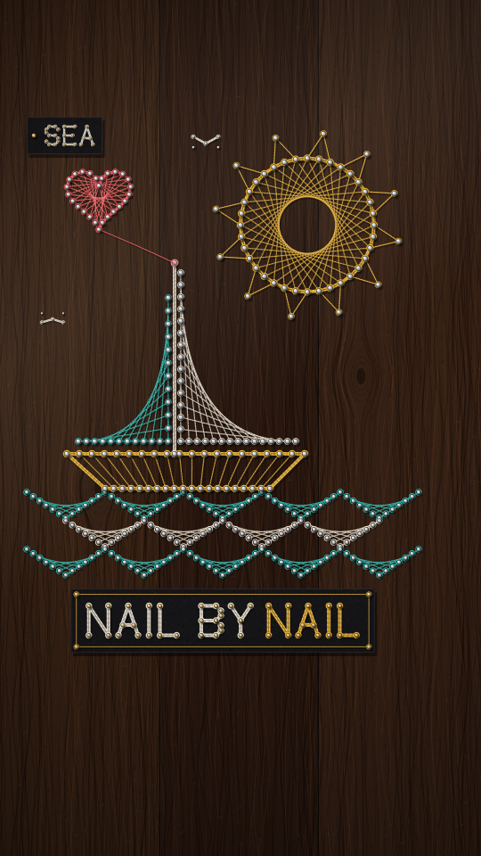

# String art

Pin-and-thread art on a board. The ground is a **dark stained wood panel** (walnut, or a blue-black "ebony" stain) with visible grain, knots and plank seams. Small **round-headed nails** are hammered in along the outlines of shapes: each has a domed head, a specular dot and a tiny cast shadow. **Coloured thread** is pulled dead straight from nail to nail. Pictures come only from straight strands: outlines wrapped nail to nail, and fills made by systematic chord patterns (nail *i* to nail *i+k* round a ring, or two rows of nails laced together), which give the classic curved envelopes: the round hole in a rosette, cardioids, parabolic corners, moiré where layers cross. Thread has real thickness, a twisted-ply highlight and a cast shadow, is slightly translucent so brightness builds where strands cross, wraps visibly round every nail, and lies in layers. Lettering is nails and thread too.

Pick it for craft and maker subjects, geometry and maths-as-beauty, "connecting the dots" stories (networks, relationships, routes, steps that add up), patience and process, logos and simple icons rebuilt by hand, gift and decor brands. Not for faces or characters that must act, photographs, UI, dense data, long text, or anything that needs a solid coloured area or a soft gradient: the medium can only say what straight threads between fixed points can say.

**The one rule: no curve is ever drawn and no area is ever filled. Every mark is a straight strand between two nails; a curve is the envelope of many of them.** (The only round things are the nail heads and the loop of thread round each.)

## Palette and meaning (`STR` in kit.js)

Three or four saturated threads per piece on a dark board. Thread colours are never mixed or tinted; "lighter" happens only where strands cross.

| role | hex | use |
|---|---|---|
| board | `walnut #2d1c12` (grain `#6e4629` / `#110905`) | the daytime, warm ground |
| board | `ebony #161b27` (grain `#3d4b62` / `#05070c`) | the night, cool ground; a second era |
| felt | `felt #151417` | caption strips and tags; the workbench a morph happens on (`STYLE.paper`) |
| thread | `white #f6ecd8` | warm white: sails, snow, stars, ropes, lettering |
| thread | `teal #22c4ba` | turquoise: water, the cool subject |
| thread | `mustard #f5b82e` | sun, the warm subject, the caption's key word (`STR.hi`) |
| thread | `coral #ff5a5f` | **the hero's thread, reserved for it** (the heart and its string) |
| thread | `magenta #e2408f` | a spare fourth colour; swap it for one of the others, do not add it |
| nails | `steel #cdd2d8`, `brass #e2b964` | steel for pictures, brass for lettering and tacks |

## Board, nails and thread

- **Board** (`strBoard`): three planks, about 170 grain streaks each that bend round one knot per plank, pores, two dark seams, a faint satin sheen. Cached per tone. `STYLE.post` adds a vignette and a little lint.
- **Nails** (`strNails`): head radius 6 px at 1080 wide (4.8–5.5 for dense rows, about 4.6 for 66 px letters). A pre-rendered sprite: cast shadow down-right, radial dome, dark rim, white specular dot up-left. Spacing 18–30 px along an outline; 26–40 nails on a ring.
- **Thread** (`strThread`): 3.1 px for wraps (×1.1), 2.5 px for fills. Three strokes per batch: a shadow offset (0.8w, 1.5w) at 30% black; the body in the thread colour darkened 16%, at 70–78% opacity for fills, stroked in 3–4 interleaved groups so crossings between groups add up; a dashed lighter ply (0.42w, dash 1.5w / 1.1w) pushed to the lit side. A collar of thread is drawn round each nail it touches.
- **Fills** are chord rules on a ring (`strFill`): step `k` (hole radius = R·cos(πk/n): k near n/2 closes the hole, small k leaves a wide ring), `times` (i → 2i a cardioid, 3i a nephroid), `fan` (every nail to one hub). **Laces** (`strLace`) join two rows; a row running into a corner laced to a row running out of it is the parabolic corner (sails, waves, leaves, snow caps).
- **Layers**: later colours lie over earlier ones; nail heads are always drawn last.
- A finished web with a `key` is cached as a static layer (bounding-box sized). The demo runs at 10–60 ms a frame.

## Motion habits

- **On 1s**, taut and precise. No squash, no easing bounce on thread: only nails bounce and only strands vibrate.
- **Nails first.** They are tapped in one by one along the outline (`t0`, `dur`): each lands large, settles in three frames and glints.
- **Then one thread end travels** (`frac`): strand by strand, slow while the pattern is set up and accelerating (`strWind`). The three newest strands are drawn plucked (a shallow triangle that flips each frame and dies away), and the end is a small bright dot.
- **Re-stringing is the look's verb.** A finished web changes by being strung differently on the same nails: a new step `k` (the envelope changes size), a cardioid instead of a rosette, a pentagram instead of a star outline, wings up / wings down. To change a web: unpick it fast (`frac` 1 → 0), then wind the new rule on.
- **Nails never move** once they are in. The only exception is the morph, where the ring is being re-made.
- **Idle life:** a sheen crosses the board every 2.5 s and each nail glints as it passes; a long strand is plucked on the beat; the hero heart beats by being re-strung (full heart ↔ open heart).
- **Leaving:** thread is unpicked, then nails are pulled in reverse order (`out`). Captions unwind as a bridge starts.
- **Bridges:** the era's board is sawn to the bridge shape and lies on black felt, a rim of nails strung round it; the blob is a ring of 36 nails that moves with the outline while its step runs from `STR.bridge[0]` to `[1]`.

## Frame checklist (in addition to `grammar/FRAME.md`)

1. Is every mark a straight strand between two nails? No stroked curves, no fills, no glow.
2. Do nails read as nails at phone size (head, specular dot, shadow), and is there a nail at both ends of every strand?
3. Does thread have body: at least 2 px, a visible twist, a shadow, a collar round the nails? (1 px hairlines read as a vector diagram or a star chart.)
4. Is at least one subject a recognisable object (boat, balloon, heart, peak), not only an abstract rosette?
5. Is there at least one curved envelope made of chords, and one place where two colours cross?
6. Three or four thread colours, coral only on the hero.
7. Is the board visible: grain, a seam or a knot somewhere in the frame, with 35% or more of it bare?
8. Is something being wound, plucked or re-strung in this frame, or is a nail glinting?
9. Caption on its felt strip, letters at least 60 px tall, inside x 60–940 and y 250–1500.

## Kit API (`kit.js`, on top of `kit/core.js`)

| call | what it does |
|---|---|
| `strBoard('walnut' \| 'ebony' \| 'felt')` | the ground; first call of every scene |
| `strCircle(x, y, r, n, rot)`, `strLine(a, b, n)` | nails on a ring (nail 0 at the top) / in a row |
| `strNailsOn(P, n, { closed, corners })` | n nails along any outline, equally spaced; `corners: true` keeps every vertex |
| `strNails(N, { t0, dur, out, r, metal, glint })` | draw the heads (after the thread); tapped in from `t0`, pulled from `out` |
| `strThread(P, { c, w, frac, key, a, g, twang, amp, nails, tip })` | one thread through points P (or segments); `frac` winds it; returns the travelling end |
| `strFill(N, { k \| rule: 'times', m \| rule: 'fan', hub, c, frac, key })` | a ring strung with a chord rule |
| `strChords(N, o)`, `strLacePath(A, B, shift)` | the same paths as point lists, to join into one thread |
| `strLace(A, B, { shift, c, frac, key })` | two rows laced in a zigzag (the parabolic corner) |
| `strWrap(N, { loops, closed, off, c, frac, key })` | the outline, nail to nail, two passes either side of the nails |
| `strHeart(x, y, r, { frac, beat, t0 })`, `strHeartPts` | the hero; `beat: true` re-strings it open |
| `strStar(x, y, r, { alt, frac, t0 })`, `strBird(x, y, s, { flap })` | a wrapped star (alt: pentagram), a five-nail bird |
| `strText(str, x, y, size, { c, align, frac, t0 })`, `strTextW` | nail-and-thread capitals, digits and `- + / ! ? . : , '` |
| `strCaption('NAIL BY *NAIL*', { at, x, y, w, size })`, `strTag('SEA')` | felt strip / tab through `DEFER`; one `*word*` in mustard |
| `strIn`, `strWind`, `strBeat`, `strHit` | timing: linear, accelerating wind, beat counter, beat pulse |
| `strGlint`, `strGrow`, `strMix`, `strPlaque` | sparkle, outline offset, colour mix, a sawn board on felt |

Per piece: `STR.tones = ['walnut', 'ebony']` (each era's board, for the blob) and `STR.bridge = [kA / 36, kB / 36]` so the blob matches the two bridge webs. Bridge objects should be rings of 36 nails wrapped in their own colour.

## Do / don't

- Do build every subject from rings, rows and corners of nails; decide the nails first, the rule second.
- Do wind big webs with `strWind` and give every finished web a `key`.
- Do draw thread first and `strNails` last, and draw the back colour before the front one.
- Do use re-stringing for every change of state.
- Don't stroke a curve, fill a polygon, add glow or blur, or use `lighter` blending: it turns into neon.
- Don't move or scale a strung shape; don't fade thread in (wind it) or out (unpick it).
- Don't use more than four thread colours, or coral anywhere but the hero.
- Don't set text under about 40 px cap height or in lower case (the font is capitals only).
- Don't put more than about 600 nails in a frame: they turn into beadwork and bury the thread.

## How it differs from the closest shipped styles

- `stitch`: thread goes *through cloth* as short separate stitches on felt patches, soft and warm. Here thread is stretched *in the air* between metal nails on wood, long, straight and taut; there are no patches at all.
- `constellation`: a few bright points joined by hairlines on a sky, with halos. Here the points are physical nails, the lines have body and shadow, and the picture is in the dense chord fills, not the points.
- `line-art`: one continuous curved line, one weight, a light empty ground. Here nothing curves, hundreds of strands overlap, and the ground is dark wood.
- `islamic-geometric`: also constructs geometry, but as flat strapwork and tiles; no material depth.

## Not matched / known weaknesses

- Built from the craft's conventions, not measured from one specific piece or video.
- Thread does not deflect round nails it passes, and strands do not weave over and under each other: layering is by draw order only.
- Density builds between the 3–4 stroke groups, not between every pair of strands, so a very dense web is a little flatter than the real thing.
- The loop round a nail is one collar per nail, however many times the thread visits it.
- Twang is driven by `frac` (how recently a strand was laid), so it stops the moment a web finishes and is cached; the plucked tether in the demo is hand-rolled in `scenes.js`.
- Cached web layers are world-size bitmaps: a camera push beyond about 1.5× softens them. No camera moves were tested.
- `strBoard` covers world 0,0–W,H only (a zoom-out would show the edge), and its grain is built for portrait; other formats get the same generator at their size but were not looked at.
- `backdrop` ignores the colour the renderer blends, so `ERA_BG` has no visible effect; the window rim is strung in the bridge colour only when it arrives as hex.
- The lettering is not seen by `tools/textcheck.mjs` (it is thread, not `fillText`): check captions by eye. Captions are single-line.
- `strText` digits and punctuation, `STR.magenta`, the felt ground as a scene board, `metal: 'brass'` on pictures and the hero-to-hero bridge (`STYLE.hero`) are not exercised by the demo. The demo does not loop seamlessly.

## Proven on

Its demo only. `demo/` (6s, 9:16, 120 BPM, 24fps): on a walnut board nails are tapped in along a sun, a sailing boat and three rows of waves; one thread winds the sun (36 nails, step 13) and its rays, two sails as parabolic corners, a laced hull and scalloped waves; a coral heart is strung and flown as a kite from the masthead, gulls flap by being re-strung, the heart beats. At 3.0 s the board is sawn down to the sun's ring, whose nails move into a balloon outline while the web is re-strung from step 13 to 17 and turns turquoise; on a midnight board three peaks are strung as fans with white snow laces, ropes and a basket are tied on, six stars are wrapped, a mustard web is wound over the balloon, its turquoise web is unpicked and re-strung as a cardioid, and the heart beats twice. `tile.mjs`: deterministic; `review.mjs`: no FAIL; export about 20 s.
