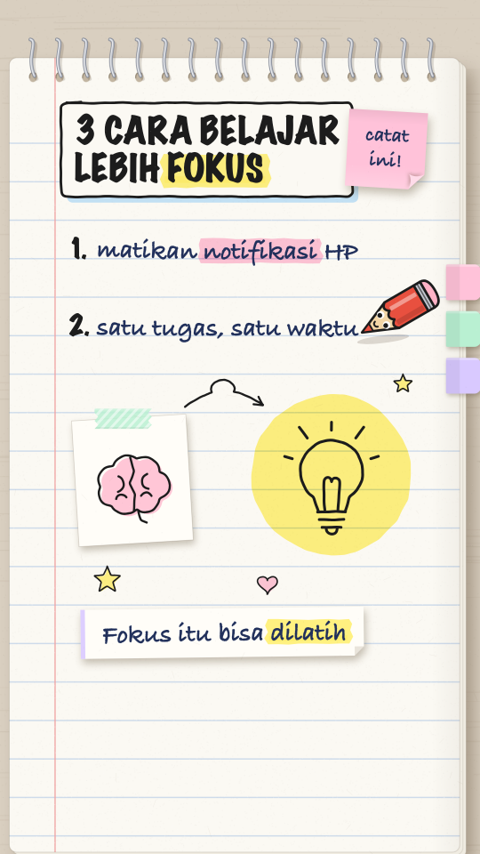

# Study notes

"Aesthetic study notes": a bullet-journal page that writes itself. A soft white ruled page with a pink margin line and a wire coil lies on a desk; headings are lettered in fat marker caps inside a drawn box or ribbon, body text is written in navy ballpoint at a steady hand speed, pastel highlighters sweep in behind the key words, sticky notes slap on, washi tape holds cards down, index tabs stick out of the page edge and small fineliner doodles (a lightbulb, a brain, a clock) draw themselves in the gaps. The hero is a short coral-red pencil with a tiny face that does the writing. Motion on 2s, everything cued by an absolute start time so it can follow a voice.

**The one rule: the page stays tidy.** Writing sits on the rules, one idea per line, one highlighted word per line, and coral-red is spent on the hero and at most one kind of mark per page.

Good for: narrated educational explainers, study and productivity tips, "3 ways to…" lists, summaries, definitions and formulas, revision checklists, anything a teacher would put on a neat page of notes.

Built from a written brief (the genre's conventions), **not measured from reference frames**. Closest relative: `sketchbook` (graphite drawings and one accent on a dot-grid sketchbook page). This one is the opposite temperament: colourful, neat, text first, drawings only as margin doodles.

## Palette and meaning (`SN` in kit.js)

| role | hex | use |
|---|---|---|
| paper | `paper #fbf9f3` | the page (`STYLE.paper`) |
| rules | `rule #c9d8ea` | the page's lines, pitch 84 (`snLineY(n)`) |
| margin | `margin #f0a3a3` | the vertical margin line |
| desk | `desk #d9cfc0` (`deskD`, `under`) | what the page lies on, the pages below |
| ballpoint | `navy #22315c` | all body writing, captions |
| fineliner | `ink #1c1c1c` | headings, boxes, arrows, doodle outlines |
| highlighters | `yellow #fff27a`, `pink #ffc2d9`, `mint #b9f0d2`, `lilac #d9c9ff`, `sky #bfe3ff` | a band under a key word, doodle fills, heading blocks, tabs, tape, stickies. Decorative: no fixed meaning, but one colour per idea on a page |
| **accent** | `coral #e8503f` (`coralD`, `coralL`) | the pencil hero, and the single most important kind of mark on the page (the ticks, or one circled word) |
| sticky / card | `sticky #ffe873`, `card #fffdf8` | note paper |

Highlighters are multiplied onto the paper, so two that overlap mix (yellow over sky goes green). Keep a highlighted word off a filled pastel box, or use the box's `shadow` mode (the default for headings), which keeps the inside of the box paper-white.

**Dot grid:** `const SN_DOTS = true;` before the kit (a `src/options.js` in the piece's `build` list) or `snPage({ dots: true })`.

## Type

- **Body hand** `SN_HAND` = `"Bradley Hand", "Segoe Print", "Chalkboard SE", "Comic Sans MS", "Comic Neue", cursive`, weight 700, with a thin pen-weight stroke. 54–58px for body lines, 44–46px for small notes, never under 44.
- **Lettering** `SN_LETTER` = `"Marker Felt", "Segoe Print", "Chalkboard SE", "Comic Sans MS", "Comic Neue", cursive`, weight 700: headings in caps at 64–78px, list numbers, mind-map centres, tab labels (≥ 30px), the title label.
- Each word is placed on its own with a seeded baseline jitter (±3.5% of the size) and rotation (±0.02 rad), plus a sub-pixel boil every 2 frames, so a line never looks typeset.
- Baselines sit on the rules (`snLineY(n)`); a heading's two lines sit on consecutive rules; leave a rule free between list items when the pencil hero writes them (it then never covers the line above).
- **The hand font differs per OS** (Bradley Hand on macOS, Segoe Print on Windows, usually Comic Neue or a generic cursive on Linux). Widths differ by up to about 25%, so on the target system check: that the longest line still ends before x = 940, that a `hi` word still gets its band (it is found by text, so it will), and that captions still fit (`snCaption` shrinks to 50px, then overflows).

## Motion habits

- On 2s (`ones: false`). The pen line and each word boil very slightly every 2 frames; highlighter bands, stickies and tape do not boil (they are not drawn by a pen).
- **Writing** appears left to right at a steady hand speed (`speed`, characters a second, default 16; or `t1` to finish at a given time). The pencil hero's tip follows the write-on point (`snPenAt` → `snHero`), bobbing through the x-height; it hops in an arc to the start of the next line and leans a little into the hop.
- **The highlighter sweeps a beat after its word** (default 0.25s after the line finishes, 0.3s long, ease out), under the letters.
- **Sticky notes, cards, the caption strip and the title label slap on:** a little big, opaque within two frames, rotation settling over three 2-frame steps (+0.13, −0.065, +0.03 rad). **Washi tape lands two steps after its card.**
- **Doodles draw on stroke by stroke** in their drawing order; the pastel fill arrives when the outline is about three quarters done, set slightly off the line.
- **Checkboxes tick on the beat** (0.17s per tick), the pencil leaning left so the words stay readable.
- Idle life: the pencil blinks and wiggles, a sticky's corner lifts, stars twinkle and throw little rays, the bulb's rays pulse, a clock's hands turn, the page shadow breathes.
- Camera: a slow push (≤ 3%) while a page fills, or a pan down a taller page (`snPage({ h })`) as notes accumulate. After a morph the new era opens ~6% close and settles.
- Transition: the morph happens on a bare ruled sheet; the old era is seen through a piece cut out of the page with a double fineliner outline; the blob is a flat highlighter-colour shape with a pen outline. Pick two shapes of similar proportions (a round highlighter glow → a squarish sticky note).
- Captions and the title leave in the first 0.3s of a bridge and come back when it ends.

## Frame checklist (on top of grammar/FRAME.md)

1. **It reads as a notebook page**: rules, margin line and coil (or holes) visible, a strip of desk at the edge.
2. **Writing sits on the rules** and starts at the writing margin (`pg.left`), ≤ 6 written lines on screen.
3. **One highlighted word (or short phrase) per line**, and neighbouring lines use different highlighters.
4. **Coral is the hero's**: besides the pencil, at most one kind of coral mark (the ticks, or one circled word).
5. **Three or four pastel colours on a page, not all five everywhere**; the desk and paper stay calm.
6. **Something stuck on** (a sticky, a taped card or a tab) and **one doodle** per page: without them it is just handwriting.
7. **Readable at phone size**: body ≥ 54px (never under 44), headings ≥ 64px, captions ≥ 50px, labels ≥ 30px; check `review/phone.jpg`.
8. **The pencil never hides the word being read**: free rule between lines it writes, rest it off the text.
9. **Something moves** in every held frame (a blink, a corner, a star, the clock).

## Kit API (`kit.js`, on top of `kit/core.js`)

Every reveal takes an absolute start time `t0` (left out = already there). Marks return `{ t0, t1, tip, start, end }` so the hero can follow them.

- Palette and fonts: `SN`, `SN_HAND`, `SN_LETTER`, `SN_PITCH` (84), `snFont(size, face, weight)`, `snTextW(str, size, face)`.
- Page: `snPage({ dots, coil: 'top' | 'left' | 'holes' | 'none', x, top, right, h, line0, pitch })` → `{ x, y, w, h, left, right, marginX, line0, pitch, lines }` (cached texture, keyed on the geometry); `snLineY(n)`; `snGeom(o)`.
- Pen: `snLine(P, { w, col, part, closed, double, amp, key })`, `snFill(P, col, { off, a, mult })`, `snSlap(t0, amt)` → `{ rot, sc, al }`.
- Writing: `snWrite(str, x, y, size, color, { t0, speed | t1, face: 'hand' | 'letter', align, hi: { word | phrase, color, t0, h } | [...], key, jit })` → `{ w, x0, x1, y, t0, t1, u, done, tip, start, end, a, b, words }` (the highlighter band is drawn under the text inside the same call); `snHighlight(x, y, w, h, color, t0, { d, a })` (y = the band's centre; call it before the text it marks).
- Headings and lists: `snHeading(str, x, y, size, { t0, style: 'box' | 'banner' | 'block' | 'double', fill, hi, boxT0, caps, lh, align, shadow })`; `snBullets(items, x, y, { t0, stagger, marker: 'dot' | 'star' | 'arrow' | 'check' | 'num', size, lh, speed, ticks: [t...], tickC })` (items: `'text'` or `{ s, t0, t1, hi, tick }`; each result has `.mark` and, when ticked, `.tick`).
- Marks: `snUnderline(a, b, { style: 'single' | 'double' | 'wavy', color, w, t0, d, gap })` (a, b = a write result's `.a`, `.b`), `snCircleWord(x0, x1, y, size, o)`, `snBox(x, y, w, h, { fill, shadow, double, r, t0, d })`, `snBracket(x, y0, y1, { side })`, `snArrow(a, b, t0, { bow, loop, head, d })`.
- Stuck-on things: `snSticky(x, y, w, h, color, { t0, rot, text, size, textT0, speed, hi, curl, lift })` → `{ cx, cy, rot, P, lines }` (lines in world coords), `snStickyPts(x, y, w, h, rot)` (its outline, for a bridge), `snWashi(x, y, w, rot, 'stripes' | 'dots' | 'plain', { color, h, t0 })`, `snTab(y, color, label, { t0, x, w, h })`, `snClip(x, y, s, { rot })`, `snCard(x, y, w, h, { t0, rot, tape, tapeC, draw(w, h) })`, `snPolaroid(x, y, w, h, { tint, caption, draw })`.
- Doodles: `snDoodle(name, x, y, s, { t0, d, color, fill, twinkle, time })` with `lightbulb`, `brain`, `clock`, `book`, `star`, `heart`, `cloud`, `magnifier`, `target`, `battery`; `snBlob(x, y, r, color, t0)` (a highlighter glow); `snMindmap({ x, y, s, rx, ry, color }, [{ s, a, len, color, bend }], { t0, stagger, size })`; `snFormula(str, x, y, { size, fill, t0 })`; `snDefinition(term, 'line\nline', x, y, w, { fill, t0 })`.
- Hero: `snPenAt(marks, { from, hop, height, rest, restAfter, tilt })` → `{ x, y, writing, air, idle, tilt }`; `snHero(x, y, r, { tilt, writing, air, idle, center, key })` (x, y = the pencil's tip; r = half its length); sets `SPARK_AT`.
- Captions (through `DEFER`): `snTitle(kicker, headline, { y, at, size, hi, tape, tapeC })`, `snCaption('text with a *keyword*', { y, size, at, hi, strip, edge })`; `snLeaving()`, `snEraIn()`.
- `STYLE`: `paper`, `backdrop` (the bare ruled sheet), `window` (a cut-out of the page with a shadow and a double fineliner outline), `blob` (a flat highlighter shape with a pen outline), `hero` (`snHero`, centred), `heroColor` coral, `heroPts`, `post` (a light grain), `ones: false`.

## With a voice-over

- Start each `snWrite` on the first word of its sentence and make it finish with the sentence: `snWrite(str, x, y, 56, SN.navy, { t0: VL(id).t0, t1: VL(id).t1 })`.
- Sweep the highlighter when the keyword is spoken: `hi: { word: 'fokus', t0: VW(line, 'fokus') }`.
- One bullet per narrated point; tick a checkbox on the word that settles it.
- At most 6 written lines per page, then pan down (`snPage({ h })` and a camera move) or turn the page (a morph or a cut to a fresh `snPage`).
- Leave the bottom caption band free for subtitles: drop `snCaption`, or raise it (`{ y }`) so it does not sit where the subtitles will be burnt in.
- The pencil follows whatever marks you hand `snPenAt`, so it stays in step with the voice without extra timing.

## Do / don't

- **Do** write short lines (3–5 words) and let the narration carry the rest.
- **Do** put the heading in a box or ribbon at the top and keep one free rule under it.
- **Do** cue the highlighter, the tick and the slap on beats (or spoken words); the writing itself can run between them.
- **Do** rest the pencil off the text when it has nothing to write, and let it blink.
- **Don't** highlight whole sentences, or stack two highlighters on one word.
- **Don't** use coral for decoration (no coral tabs, tape or doodle fills).
- **Don't** rotate body writing or set it off the rules; only stuck-on things are tilted.
- **Don't** fill the page: a notebook page with air on it reads as tidy, a full one as homework.
- **Don't** put a label on an index tab in 9:16 if it must be read: the tabs sit in the right-hand phone-UI zone.

## Not matched / known weaknesses

- Built from a written brief and the genre's conventions, not measured from references.
- The handwriting is a system font uncovered left to right by a clip, not real strokes: within a letter the reveal is a vertical wipe, and the look depends on the OS (see Type). No Linux or Windows render has been checked; only macOS (Bradley Hand / Marker Felt).
- The pencil covers what is directly above-right of its tip. Leave a free rule between lines it writes; on adjacent rules it hides part of the previous line while it writes.
- The hero's face is small (eyes about 17px across at r = 92): it reads as a pencil first and a character second at phone size.
- Highlighters multiply: a band over a pastel fill or another band changes colour.
- `snTab` labels fall in the right-hand safe zone on 9:16 (the demo's tabs carry no text).
- During a morph the desk disappears (the bridge happens on a full-frame ruled sheet), and that sheet's rules do not line up with the era's when the camera is zoomed.
- The doodle set is ten icons; anything else is drawn by the piece with `snLine` / `snFill`.
- 16:9 and the dot grid render (checked with a scratch piece, by eye) but have no demo and were not run through `review.mjs`. `snMindmap`, `snFormula`, `snDefinition`, `snPolaroid`, `snClip`, `snBracket`, `snCircleWord` and the `banner` / `block` / `double` headings were checked the same way, as stills only.

## Proven on

`demo/` (6s, 9:16, 120 BPM, 24fps, every cue on the 8th grid): a page headed "3 CARA BELAJAR LEBIH FOKUS" in a box (FOKUS highlighted at 0.5) with a pink sticky on its corner; the pencil hero writes "1. matikan notifikasi HP" (0.25–1.0, pink sweep at 1.25) and "2. satu tugas, satu waktu" (1.25–2.0, mint sweep at 2.25); a card with a brain doodle is taped in at 0.5, a lightbulb draws on from 1.0 and its yellow glow pops in at 2.0, with the caption "Fokus itu bisa *dilatih*". At 3.0s the glow (a round highlighter blob) morphs into a squarish sticky note that opens onto tip 3: the pencil writes "istirahat / 5 menit" on the note (3.5, 4.0) and underlines it with a wavy line (4.25), a clock doodle draws on, a fourth tab slides out (4.5), a checklist writes itself and is ticked on 4.75, 5.0 and 5.25, under the title label "CARA KE-3 / Beri otak jeda" and the caption "Otak juga butuh *jeda*".

Tile `deterministic: true`, 6–24 ms/frame (first frame 83 ms, the page texture being built). Review: cuts on grid PASS, morph on the 8th grid PASS, story arc PASS (2/2), text PASS (0 cut-off/overlap, 0 in the safe zone), dead beats PASS; −15.2 LUFS integrated, true peak −0.9 dBFS (0.1 dB over the −1 target).
