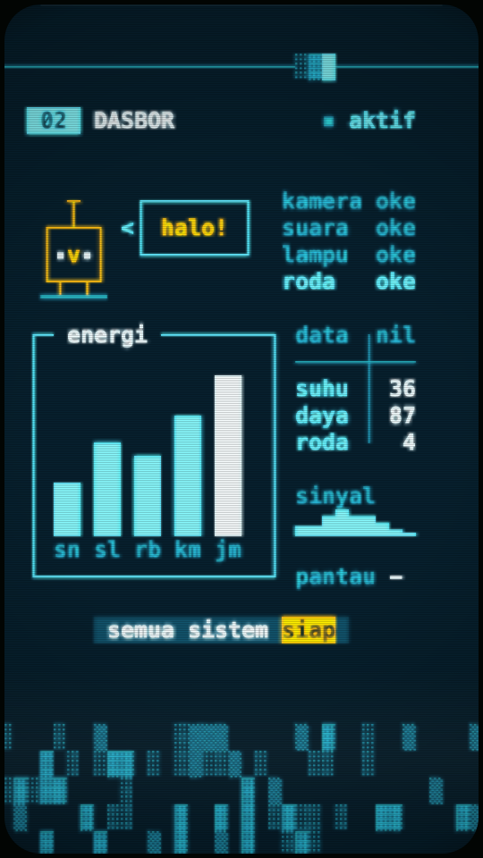

# Terminal

A text-mode world on an old CRT terminal. The whole picture lives on a **fixed character grid** — 36 columns × 32 rows of 30×60 px cells at 1080×1920 — and everything in it is a character in a cell: box-drawing frames (`┌─┐│└┘├┬┼`), block and shade characters (`█ ▓ ▒ ░ ▀ ▄ ▌ ▐ ▁…▇`), typed text with a block cursor, `[████░░░░]` bars, `|/-\` spinners, tables, bar charts, sparklines and a small ASCII robot. Shapes (a ball, the morph blob, the morph window) are **rasterised to the grid**: coverage is sampled per cell and a shade or half-block character is chosen. On top sits the tube: phosphor bloom, scanlines, a vignette, a rounded bezel, a slow bright band and a rare one-frame flicker. Motion on 1s, but stepped.

**The one rule: one character per cell, and nothing between cells.** No glyph is ever rotated, scaled or nudged by a fraction of a cell; things move by whole cells, text appears one character at a time, bars fill one cell at a time. If it can't be typed, it isn't in the picture.

## Palette and meaning (`TRM_THEMES`, `TRM` in kit.js)

One phosphor per era; a theme is five tones of it plus the accent.

| role | green (default) | cyan | amber | use |
|---|---|---|---|---|
| `bg` — the dark tube | `#06120a` | `#04121a` | `#140c02` | the screen; `ERA_BG`; green's is the morph paper |
| `ink` — the phosphor | `#33ff66` | `#4de8ff` | `#ffb000` | body text, frames, bars, filled shapes |
| `dim` — half brightness | `#178a3a` | `#1c7f96` | `#8f6200` | dots, labels, empty bar cells, older log lines, background life |
| `hi` — hot near-white | `#d9ffe2` | `#e3fbff` | `#fff0c4` | what was just typed, answers (`oke`), values, the cursor, the newest bar |
| `panel` — a lit strip | `#0d3118` | `#0a2f3d` | `#33230a` | the caption strip's background |
| **`accent`** | `#ffb000` amber | `#ffb000` amber | `#5cf2ff` cyan | **the hero and the one highlighted caption word** (what the hero says), nothing else |

`TRM.amber #ffb000` is the hero's colour (`STYLE.heroColor`); `TRM.black #020503` is the bezel. A frame uses one theme + the accent: never two phosphors on one screen (the morph is the only place two meet). Brightness, not hue, carries hierarchy: dim → ink → hi.

## Line, fill, texture

- **Glyphs:** `TRM_FONT` = `Menlo, Consolas, "DejaVu Sans Mono", "Liberation Mono", "Courier New", monospace`, bold 50 px, centred in its cell, drawn once per (character, colour) into a glyph atlas and stamped. Letters never touch the grid lines of their neighbours.
- **Box, block, shade and dot characters are not font glyphs.** `─│┌┐└┘├┤┬┴┼╴╵╶╷` are 4 px strokes from the cell centre to the cell edge (so frames always join); `█▀▄▌▐▔▁▂▃▄▅▆▇` are rectangles; `░▒▓` are a 5 px dot screen at 25 / 50 / 75 % that tiles from cell to cell; `•●` are square phosphor dots. They look the same on every platform.
- **Lines merge:** `trmLine` / `trmBox` / `trmRule` OR direction bits into the cell, so a crossing becomes `┼`, a branch `┬ ├ ┤ ┴` by itself.
- **Fills** (`trmFill`): 8 samples per cell. A full cell takes the tone's shade (`░▒▓█`), a clean half becomes `▀ ▄ ▌ ▐` (bright fills only), anything thinner is dropped. The default tone is a ball lit from the top left (`█` → `▓` → `▒`).
- **The screen buffer:** scenes write into a buffer (`trmScreen`), later writes replace earlier ones like a real terminal, and the buffer is flushed once. Inverse video (a coloured cell with dark text) is the only "fill" text gets.
- **The tube (`trmPost`):** bloom = the frame halved three times, brightened and laid back with `lighten` (the halo fills the dark around glyphs; lit cells keep their exact colour, so amber stays amber); 2 px scanlines every 4 px (15 to a text row), a vignette and a rounded bezel in one cached layer; a faint band rolling down; about one frame in fourteen dims by 5–11 %.

## Motion habits

- `ones: true`, but nothing glides: every motion is an integer clock (`trmStep(rate, t0)`).
- **Typing** at a steady 16 characters a second (commands) or 30 (captions); a solid block cursor while typing, blinking twice a second when idle.
- **Check lines:** the label lands, dots tick across, the answer lands in `hi` on an 8th note.
- **Bars and charts** fill one cell (or half cell) per step; counters count up in whole numbers; logs scroll up a whole row at a time, newest line brightest.
- **The hero** hops in whole cells on 2s (1, 2, 2, 1 cells), tucks its feet in the air while its shadow shrinks, blinks every ~2.4 s, waves with a `/` `-` arm.
- **Background life:** a block stepping along the top rule (`trmScan`), a memory map of shade cells each changing at its own slow pace (`trmMem`), spinners, a sparkline scrolling left a cell at a time.
- **Morph:** the old screen is seen through a hole made of whole cells, rimmed with `▓` in the bridge colour and `░` outside; the blob is the outline re-rasterised every frame, so its edge crawls in cell steps; a little static (dim shade cells) jumps on the blank tube. Captions and tags are hidden while a bridge runs.
- No camera (`pieceCam` returns null). Put cues on the 8th-note grid so key clicks and beeps land with the picture.

## Frame checklist (on top of grammar/FRAME.md)

1. **Every mark is a character in a cell.** Nothing rotated, scaled, half a cell off, or drawn as a free curve.
2. **Dark wins:** most of the tube is empty; one phosphor + amber for the hero / the highlighted word.
3. **Three brightnesses are in use:** dim for the furniture, ink for the content, hi for the newest thing.
4. **Something has just been typed or is still ticking** — a cursor, a spinner, a bar mid-fill, a scrolling log — in every held frame.
5. **Frames join:** corners and junctions close; a title sits *in* the top edge of its box.
6. **Text stays in columns 2–30, rows 4–24** (x 60–930, y 240–1500); rows 0–3 and 25–31 hold only decoration (rule, memory map), never words.
7. **The caption is one typed line on its lit strip**, the highlighted word in inverse amber (dark text on amber), ≤ 29 characters.
8. **Words are lower case** like terminal output; capitals only for the tag.
9. The tube shows: scanlines, glow, bezel corners at phone size.

## Kit API (`kit.js`, on top of `kit/core.js`)

Coordinates are **cells** (`col`, `row`) unless a function says pixels. Needs `W`, `H`, `CX` from the piece; optional `ERA_THEME = ['green', 'cyan']` (per-era theme names, used by the hooks).

- Constants: `TRM`, `TRM_THEMES`, `TRM_FONT`, `TRM_CW` 30, `TRM_CH` 60, `TRM_COLS`, `TRM_ROWS`, `TRM_SHADE`; the current theme is `trmT` (also passed to the `trmScreen` callback).
- Screen: `trmScreen(theme, (t) => { ... })` (a scene: ground, buffer, flush), `trmOverlay(theme, draw)` (cells straight to the screen, no ground), `trmSet(col, row, ch, fg, bg)`, `trmGet`, `trmPut(col, row, str, fg, { bg, inv })`, `trmClear(col, row, w, h, bg)`. Words are reported to the text check automatically.
- Clocks: `trmStep(rate, t0)`, `trmBlink(period)`, `trmTyped(str, t0, cps)`.
- Lines: `trmLine(c0, r0, c1, r1, fg)` (across, down, or an L), `trmRule(col, row, w, fg)`, `trmBox(col, row, w, h, fg, { title, titleC, bg })`, `trmEdge`.
- Shapes: `trmFill(P, fg, { shade: 'ball' | 0..1 | (x, y) => 0..1, where: (x, y) => bool })` — P is an outline in **pixels**; `trmMask(P)`, `trmInside(P, x, y)`.
- Text and widgets: `trmType(col, row, str, t0, fg, { cps, cursor })`, `trmCursor(col, row, fg, solid)`, `trmCheck(col, row, label, t0, t1, w, { ok })`, `trmBar(col, row, w, frac, fg)`, `trmSpin(col, row, fg, rate)`, `trmChart(col, rowBase, vals, { h, bw, gap, labels, colors, halves: (i) => n })`, `trmSpark(col, row, vals, fg, { lit })`, `trmTable(col, row, rows, { w })`, `trmBubble(col, row, str, fg, { n, c, tail })`.
- Hero: `trmHero(col, row, { key, sleep, mood: 'smile' | 'happy' | 'wow', hop, wave, ground, c })` — Bit, 5×4 cells, (col, row) its top-left, standing on row + 4; sets `SPARK_AT`. `trmHop(t0, top)` gives the hop in cells; `trmHeroPts(x, y, r)` its bridge outline (pixels).
- Life: `trmScan(row, key, { rate })`, `trmMem(row, rows, key, { rate })`.
- Captions (through `DEFER`): `trmCaption('semua sistem *siap*', { at, row, cps })` (`\n` for a second line), `trmTag('01', 'LABEL', { at, row, col })`.
- `trmPost()`.
- `STYLE`: `paper` green `bg`, `backdrop` (flat tube + static), `window` (cell-quantised hole with a `▓`/`░` rim), `blob` (`trmFill` ball), `hero` (Bit), `heroColor` amber, `heroPts`, `post`, `ones: true`.

## Do / don't

- **Do** lay a screen out on the grid first (columns and rows on paper), then type it; align columns like a real program would.
- **Do** let things arrive in order: command → output → result. The typing *is* the animation.
- **Do** use `hi` for the newest line and let older lines fall back to `ink` / `dim`.
- **Do** build figures from a few rows of characters (`trmPut` per row) and move them by whole cells.
- **Don't** draw with `ctx` directly inside a scene (arcs, strokes, gradients): rasterise an outline with `trmFill` instead.
- **Don't** mix two phosphors on one screen, or spend amber on anything but the hero and the highlighted word.
- **Don't** put words in rows 25–31 or past column 30 (phone UI), or rely on glyphs outside Latin-1 + the drawn set (`✓ ◄ …` vary by font; use `oke`, `<`, `...`).
- **Don't** morph a round shape into a long thin bar; a ball → a squarish panel is clean.
- **Don't** use `ctx.filter` blur or `shadowBlur` for glow: the bloom in `trmPost` is cheap and deterministic.

## Not matched / known weaknesses

- Built from the genre's conventions, not measured from a specific machine or reference.
- Letter shapes come from the system monospace font (Menlo on macOS, Consolas on Windows, DejaVu / Liberation on Linux), so their weight differs a little by platform; the grid, boxes, blocks and shades do not.
- One text size only (36 columns): no big headline type — a headline would have to be block-letter art built from `█` cells.
- No screen curvature, no colour fringing, no phosphor persistence trails.
- The hero is small (150×240 px); its face is three characters. Close-ups are not possible without a second, larger figure.
- Only `green` → `cyan` has been rendered; the `amber` theme is defined but unproven.

## Proven on

Its demo only. `demo/` (6 s, 9:16, 120 BPM, 24 fps): a green terminal starts up — `> mulai` is typed, three checks tick to `oke`, a progress bar fills cell by cell while a ball of shade characters fills row by row, and Bit sleeps (`z`), wakes with a `!` and hops; at 3.0 s the ball morphs into the chart panel of a cyan dashboard, where bars grow by half cells, a table counts up, a log scrolls by whole rows, a sparkline scrolls and Bit says "halo!". Tile deterministic, 20–40 ms/frame; review: morph on grid, text PASS, story arc PASS, dead beats PASS, −14.7 LUFS, true peak −3.2 dBFS.
