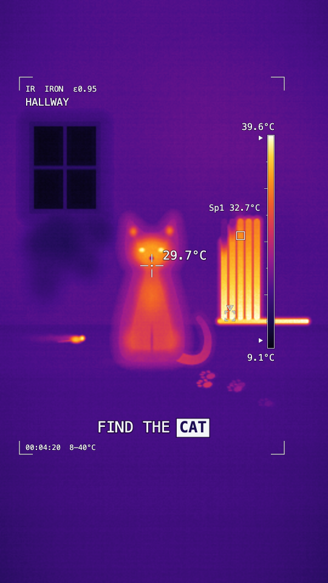

# Thermal

The world as a handheld infrared camera sees it. Nothing has a colour of its own: every object is a **temperature**, and the whole picture is one scalar heat field shown through a single false-colour ramp (iron: near-black, indigo, purple, magenta-red, orange, yellow, white-hot). Edges are soft because heat diffuses; hot things bloom into what is round them; extremities are cooler than cores (a cat's ear tips and nose are cold, its eyes are white-hot, its fur reads cooler than its face); cold or reflective things are dark holes; steam and breath are faint warm wisps; a hand or a paw leaves a print that fades as the surface cools. The sensor shows too: a low native resolution scaled up smoothly, fine fixed-pattern noise, faint row banding, a soft vignette. Over the image sits a thin white camera HUD whose numbers are **measured from the frame**: a scale bar with the frame's max and min, a centre crosshair with a spot reading, a marker on the hottest point, corner brackets, a mode line. Captions are HUD text.

Pick it for energy, heat and cold, insulation and leaks, engines and electronics, bodies and animals at night, cooking, climate, "what you cannot see" reveals, search-and-find stories, anything where the plot is something warming up, cooling down or being found. Not for stories that need real colours, faces with expressions, brand colours, fine detail or lots of text; not for bright cheerful moods.

**The one rule: draw temperatures, never colours. A scene is a greyscale heat field (`thmC(t)`, 0 = coldest, 1 = hottest); the only colours in the frame come from the ramp in `STYLE.post`, and the only white lines are the HUD.**

## Palette and meaning (`THM` in kit.js)

The ramp (`THM.stops`, baked into a 1024-entry table `THM_LUT`; `thmRamp(t)` gives the hex):

| temperature | hex | reads as | typical use |
|---|---|---|---|
| 0.00 | `#05030f` | near-black | ice, a night window, bare metal (reflects the cold sky) |
| 0.13 | `#1b0c52` | deep indigo | cold surfaces, draughts, the shadow side of a room |
| 0.27 | `#4a0f8a` | purple | room temperature: walls, floors, tables (`THM.amb` = 0.22 is the morph's blank sheet) |
| 0.42 | `#9a1b8f` | magenta-purple | lukewarm: fresh prints, steam, handles, ear tips, tails |
| 0.55 | `#d2315f` | magenta-red | fur, clothing, the edge of a warm body |
| 0.68 | `#f0602a` | orange-red | a body's core, a chest |
| 0.80 | `#fb9a1c` | orange | bare skin, a face, a hot wall |
| 0.90 | `#fdd23c` | yellow | hot liquid seen through a wall, a radiator |
| 0.97 | `#fff7b0` | pale yellow | eyes, a pour, a heating element |
| 1.00 | `#ffffff` | white-hot | the hottest point only; keep it small |

- **Degrees** are only a label: each era has a span (`THM_SPAN = [[0, 90], [8, 40]]`, degrees for temperature 0 and 1) and the HUD prints `span[0] + t * (span[1] - span[0])`. Across a bridge the span glides from one era's to the next (the camera re-spans).
- **Colours for the renderer are temperature greys.** `thmC(t)` returns `#vvvvvv`; use it for `ERA_BG`, bridge shapes' `c` and `heroColor`. Mid-morph the renderer hands back `rgb(v,v,v)`, a straight blend of two greys, so it is exactly the blended temperature. `thmTemp(c)` reads a grey directly and maps any other colour to the nearest ramp entry (so a ramp hex also works, less exactly).
- **HUD:** `hud #f3f5f7` lines and type with a dark under-stroke `rgba(8,5,22,0.6)`; the caption's highlighted word is `hudInk #1b0c52` on a white box. No other colour.
- A frame should use the ramp across its range: a cold ground (0.15–0.3), mid bodies (0.4–0.7), a few hot cores (0.8–0.95), one or two white points, and something near black.

## How the medium is built

- **The heat field.** Scenes draw in greyscale with the helpers below; grey value = temperature. Warm things are added with `lighten` (they never cool what is under them), cold things with `darken`, bodies with plain fills.
- **Bodies** (`thmBody`): any closed outline, filled at its core temperature, with the outline stroked inside the clip in seven widening passes of the cooler edge temperature (a core-to-edge gradient that follows the shape), and five wide `lighten` strokes outside it (the bloom). Hot cores, liquid levels and markings go inside with `thmClip`.
- **Blobs** (`thmBlob`): a radial falloff; the unit of everything soft (cores, eyes, cold noses, steam, pools, draughts).
- **Conduction** (`thmConduct`): a path stroked segment by segment, hot at its source end, cooler along its length, with a soft heat front at `frac` and the unheated part at `base`.
- **Prints** (`thmPrint`): outlines that fade, soften and shrink toward their middle as `age` goes 0..1.
- **The sensor** (`STYLE.post` → `thmSense`): the finished greyscale frame is halved twice to 270 × 480 (`THM.res` = 4), read once (`getImageData` on 129,600 pixels), **measured** (max, min, the hottest and coldest points, the centre spot, any `thmSpot`), then every pixel goes through the ramp table with the sensor's errors added in grey levels: per-pixel fixed pattern (±1.5), per-row and per-column banding (±1.2), temporal noise (±2), one slow rolling band, a vignette (corners up to 10 levels colder), and a 2-bit dither. The result is scaled back up with smoothing. The pass is cheap: whole demo frames render in about 50 ms each.
- **The shutter** (`THM_NUC = [t, ...]`): at each time the picture goes nearly flat for two frames (the sensor sees its own shutter), "NUC" shows in the corner for 0.4 s, and the fixed pattern is a new one afterwards.
- **The HUD** is drawn after the colour map, unmapped, at screen size: 2.5 px white lines with a dark under-stroke, `MONO` type at 24–50 px. The camera's own HUD (`thmAutoHud`) sits inside the phone-safe box x 60–940, y 250–1500: corner brackets, the scale bar at x 882–902 with the frame's max above and min below and carets where they fall in the span, the crosshair at (500, 875) with the spot reading, the hottest-point marker, the mode line top left, a time code and the span bottom left.

## Motion habits

- On 1s (`ones: true`), smooth. Nothing snaps, nothing bounces: use `thmIn(t0, d)` (ease in-out) and `thmWarm(t0, a, b, tau)` (exponential approach, like real warming and cooling).
- **Heat is the motion.** Things glow up the ramp from purple to yellow to white; liquid levels rise and the wall above them warms by conduction; heat creeps along rods, pipes and fins (`frac`); a warm patch spreads under a hot object; cold spreads as dark (`thmFrost`).
- **Things that move leave heat behind:** prints age and vanish oldest first, moving bodies drag a fading trail (`thmTrail`), steam and warm air rise in wisps that start at the source (`from`).
- **Idle life is thermal:** breathing changes a chest by a degree, a tail swishes, an ear folds, a blink puts out the two hottest points, ice cubes bob, the noise crawls, the rolling band drifts down.
- **The HUD follows the picture:** the spot reading jumps when something hot passes under the crosshair, the max / min and their carets move, the hot marker hops to whatever is hottest now. Do not animate these by hand.
- **Bridges:** the old room is seen through a feathered hole the shape of the bridge object and closes onto it; on the blank room-temperature frame the object is a heat body that changes shape while its **temperature** (not its hue) goes from one object's to the other's and the span re-spans; put a `THM_NUC` at the bridge time for the flat blink and a click; the new room opens out of the new object.
- **Captions** type on at 30 characters a second with a block cursor, and fade as a bridge starts.
- **Camera:** none in the demo (a camera held still). Slow pushes are fine; the HUD stays put.

## Frame checklist (in addition to `grammar/FRAME.md`)

1. **Squint test: it is a thermal image.** A cold purple-indigo ground, soft-edged warm bodies, a thin white HUD with a scale bar. If it could be a neon sign or a gradient poster, the edges are too hard or the HUD is missing.
2. **The subject is identifiable from its heat pattern alone:** a hot core, a cooler edge and at least two anatomical cues (cold nose and ear tips with white-hot eyes; a hot liquid level in a cooler mug with a cool handle).
3. **The ramp is used across its range:** something near black, a purple ground, magenta-to-orange bodies, yellow cores, and white on less than about 3% of the frame. Not a purple smear, not everything white-hot.
4. **Nothing has a hard edge or a flat fill:** every body has a bloom and an inner gradient; nothing is outlined.
5. **Something is changing temperature** in every shot (warming, cooling, conducting, pouring, fading), and something cold is in frame for contrast.
6. **A trace of the past is visible:** a print, a trail, a warm patch where something stood.
7. **The HUD is complete and quiet:** brackets, scale bar with max and min, crosshair with a reading that makes sense for what is under it, the hot marker on the hottest thing, the mode line. Thin, white, inside x 60–940, y 250–1500. HUD text never overlaps other HUD text.
8. **The crosshair is on, or about to be crossed by, something that matters** (the reading is part of the story).
9. **Sensor character shows at full size:** grain, faint row banding, darker corners, a smooth low-resolution softness; never crisp vector edges.
10. **Caption: one short line of HUD caps** at y ≈ 1424 with one word in the inverse box; nothing white-hot behind it.
11. **Bridge objects are warm bodies of similar proportions** (mug → sitting cat), clear of everything else at the bridge time, each given as a temperature grey.

## Kit API (`kit.js`, on top of `kit/core.js`)

- Palette and constants: `THM { stops, amb, hud, hudD, hudInk, res, span, emis, noise, fpn, band, vig }`, `THM_FONT`, `THM_LUT`.
- Temperature and colour: `thmC(t)` (the grey for a temperature: fills, `ERA_BG`, bridge colours), `thmA(t, alpha)`, `thmRamp(t)` (false-colour hex), `thmTemp(colour)` (back to 0..1), `thmDeg(t, span)`, `thmSpanAt()`, `thmFmt(deg)`.
- Timing: `thmIn(t0, d)`, `thmWarm(t0, a, b, tau)`, `thmBridgeK()` (1 outside bridges, 0 inside).
- **Generic helpers that turn any outline or path into the medium:**
  - `thmBody(P, { t, edge, soft, bloom, halo, a, cold, mode })` — a body with a hot core and a cooler edge from any closed outline, with its bloom (`cold: true` for a cold body).
  - `thmClip(P, fn)` — draw inside an outline (cores, levels, markings).
  - `thmBlob(x, y, r, t, { ry, rot, a, hard, cold, set })` — a soft heat blob; warms only by default, `cold` cools only, `set` replaces.
  - `thmConduct(P, { w, taper, t0, t1, base, frac, bloom })` — a conduction gradient along an open path (rods, pipes, fins, tails, handles); `thmSmooth(P)` rounds a path.
  - `thmPrint(P | [P, ...], { t, amb, age, a })` — a fading residual print; `thmHandPts(x, y, s, rot)`, `thmPawPts(x, y, s, rot)` give the outlines.
  - `thmSteam(x, y, { h, w, r, t, a, n, m, speed, from, dir, key })` — steam, breath, warm air.
  - `thmTrail(pos(t), { r, ry, t, amb, n, dt, a })` — the fading trail of a moving body.
  - `thmPour(x0, y0, x1, y1, { w, t, head, tail, bend })` — a poured stream.
  - `thmFrost(x, y, r, { t, grow, n, sy, a, key })` — cold spreading as dark.
  - `thmAmbient(t, { to, amt, key })` (the room, with slow unevenness), `thmPlane(y, t, { far, depth })` (a table or floor), `thmCen(P)`.
- Ready-made subjects: `thmMug(x, y, w, h, { level, heat, hot, cold, handle })` (returns `{ rim, level }`), `thmMugPts(x, y, w, h)`; the hero `thmCat(x, y, r, { fur, eye, tail, ear, look, blink, key })` (sets `SPARK_AT`), `thmCatPts(x, y, r, ear)`, `thmCatUnit(ear)`.
- HUD (screen space, used by post; call them from `thmHud` for custom overlays): `thmScaleBar(x, y, w, h, { max, min, tmax, tmin, size })`, `thmCross(x, y, reading, { gap, len, size })`, `thmMark(x, y, up, s)`, `thmBrackets(S, l)`, `thmHudText(str, x, y, size, { align, al, weight, n, c })`, `thmHudStroke(path, w, al)`, `thmHudW(str, size)`, `thmSafe()`.
- From a scene: `thmSpot(x, y, { label, dx, dy, align, size })` (an extra measuring box at a world point; its reading is measured in post), `thmHud(x, y, fn(sx, sy))` (any HUD drawing at a world point), `thmCaption('POUR THE *HEAT*', { x, y, size, at, cps })` and `thmTag('KITCHEN', { x, y, size, at })` (through `DEFER`).
- Piece options (plain constants in the piece): `THM_SPAN` (degrees per era), `THM_NUC` (shutter times), `THM_HUD = { bar, cross, hot, cold, brackets, mode, clock, unit }` (switch parts of the camera's own HUD; `cold: true` adds a coldest-point marker).
- The sensor: `thmSense()` (returns the measurement `{ max, min, hot, cold, spot, mean, at(x, y), spots, nuc }`), `thmAutoHud(M)`, `thmNucAt()`, `thmOffsets()`, `thmCv()`.
- `STYLE`: `paper` (room temperature as a grey), `backdrop` (a temperature, with unevenness), `window` (a feathered hole), `blob` (a heat body at the blended temperature that flares a little mid-morph), `hero` / `heroColor` / `heroPts` (the cat), `post` (sensor, then HUD), `ones: true`.

## Do / don't

- **Do** plan the temperature anatomy before drawing: what is the core, what is the cool extremity, what is the one white point.
- **Do** keep the ground cold (0.15–0.3) so warm things have somewhere to bloom into, and put one cold object in frame.
- **Do** let the crosshair and `thmSpot` readings tell the story (a number that climbs is the plot).
- **Do** give every warm thing a past: a print, a trail, a warm patch.
- **Do** pass temperatures to the renderer as greys (`thmC`), and give each era a span that puts its subject in the orange-yellow part of the ramp.
- **Do** score it like an instrument: a cool pulse, a tone that rises with the heat, ticks for readings, a two-part click for the shutter.
- **Don't** use colour anywhere in a scene, and don't draw outlines, hard-edged flats or line art in the heat field.
- **Don't** fill large areas above 0.9: white is a point, not a surface (and HUD text disappears on it).
- **Don't** put HUD text where the camera's own HUD is (the top-left mode line, the bar's labels at the right, the crosshair reading), or over each other; the hot marker carries no text for that reason.
- **Don't** hand-animate the readings, and don't pop things in: heat arrives gradually.
- **Don't** rely on detail under about 16 px: the sensor is 270 × 480; whiskers, text and thin lines in the heat field vanish.
- **Don't** put anything over a bridge object at the bridge time, or bridge between very different proportions.

## How it differs from the closest shipped styles

- **neon** is light made of tubes: stroked lines with a white core on black, in several hues. Thermal has no lines in the picture at all, one ramp instead of hues, and its brightness means temperature, not light.
- **liquid** is borderless glossy gradient blobs in chosen colours that merge and split. Thermal's blobs are anatomy on recognisable silhouettes, coloured only by the ramp, grainy and measured by a HUD.
- **pixel** also draws small and scales up in `post`, but nearest-neighbour with hard pixel edges; thermal scales up smoothly and remaps a scalar through a lookup table.
- **terminal** shares the instrument feel and mono type, but it is text on a character grid; here the type is only the overlay.

## Not matched / known weaknesses

- Built from the genre's conventions (handheld microbolometer cameras with an iron palette), not measured from one camera's footage; the HUD layout is generic, not a copy of any maker's.
- The span is fixed per era (it only glides across a bridge); a real camera on auto-range re-spans continuously. The scale bar therefore shows the span, with carets for the frame's max and min, rather than stretching to them.
- The hot marker is the centre of the hottest plateau near the frame's hottest pixel; with two equally hot things it can hop between them from frame to frame.
- The measurement covers the phone-safe box only, and HUD positions were tuned for 9:16 at 1080 × 1920; other formats use a 48 px inset box and were not tested.
- `thmBody`'s inner gradient is seven stroked passes, an approximation of diffusion: on very thin shapes (under about 2 × `soft`) the core temperature never shows; pass a smaller `soft`.
- The shutter is a two-frame flat blink, not a true freeze of the last image (nothing is kept between frames).
- The noise makes video files larger (the 6 s demo is about 8 MB at the exporter's default quality).
- Type is the system monospace (`MONO`: Consolas, Menlo, DejaVu Sans Mono), so glyph widths differ slightly between platforms; captions are one line, caps only.
- `thmHud`, `thmHudW`, the `cold` marker, `THM_HUD` switches, the hero-to-hero bridge (`STYLE.hero`), `thmTemp` on ramp (non-grey) colours and camera moves are not exercised by the demo. The demo does not loop seamlessly.

## Proven on

Its demo only. `demo/` (6s, 9:16, 120 BPM, 24fps): a cold kitchen counter with a glass of ice (a dark hole, cold pooling round it, a measuring spot on it) and a hand print cooling on the table; a kettle pours a white-hot stream into a purple mug, the level rises as yellow through the wall, the rim turns white, steam rises, heat creeps up a bare spoon, the table warms under the mug and the crosshair reading climbs from 24 to 76 °C. At 3.0 s the room closes onto the mug, the shutter clicks (a flat two-frame blink, "NUC") and the mug cools into a sitting cat as the span glides from 0–90 to 8–40 °C; a hallway opens out of it: a black window leaking a draught, paw prints fading oldest first, a radiator whose pipe and five fins heat one after another (its spot reading climbs and the hot marker hops from the cat's eye to the pipe), a mouse running along the skirting with a fading trail, the cat's ear and head turning to it, a blink. `tile.mjs`: deterministic; `review.mjs`: all checks pass.
